# 02 OOA 面向对象分析

> 统一领域模型说明：本部分所有图基于同一套领域对象（见 §4.2 类图）。后端为 C11 过程式代码、AI 服务为 TypeScript，**类图中的"类"是分析层对象模型**：C 结构体（如 `Session`、`AppConfig`）、kv_store 数据聚合（如 `users`/`qdata` 命名空间）与 TS interface/class（如 `Conversation`、`Jobs`）被抽象为 UML 类，方法名尽量保留真实函数名以便追溯。

---

## 4.1 用况图（Use Case Diagram）

### 4.1.1 用况图 1：用户认证与题库管理（已实现）

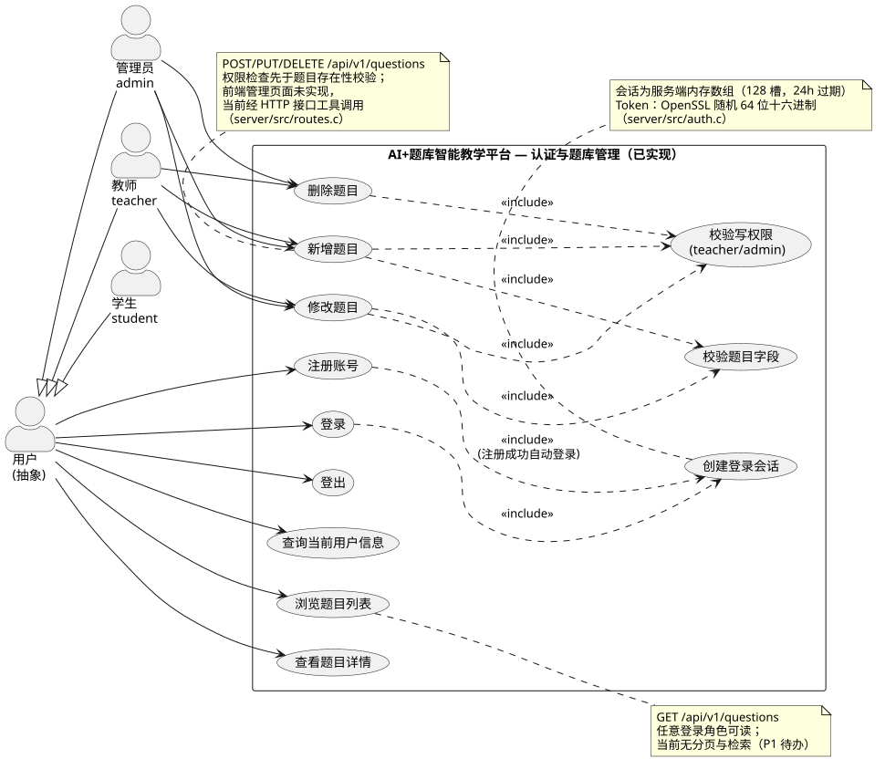

**图说明**：系统边界为 C 后端公共 API 与静态前端。三个具体角色泛化自抽象"用户"。`注册账号`、`登录` 均包含 `创建登录会话`（`session_create` 为共用控制逻辑）；题目写用况包含 `校验写权限`（teacher/admin，且先于题目存在性校验）与 `校验题目字段`（`extract_question_fields` 的统一校验规则）。读用况（列表/详情）对所有登录角色开放。

### 4.1.2 用况图 2：AI 解答与 API 配置（已实现，默认 teacher 模式）

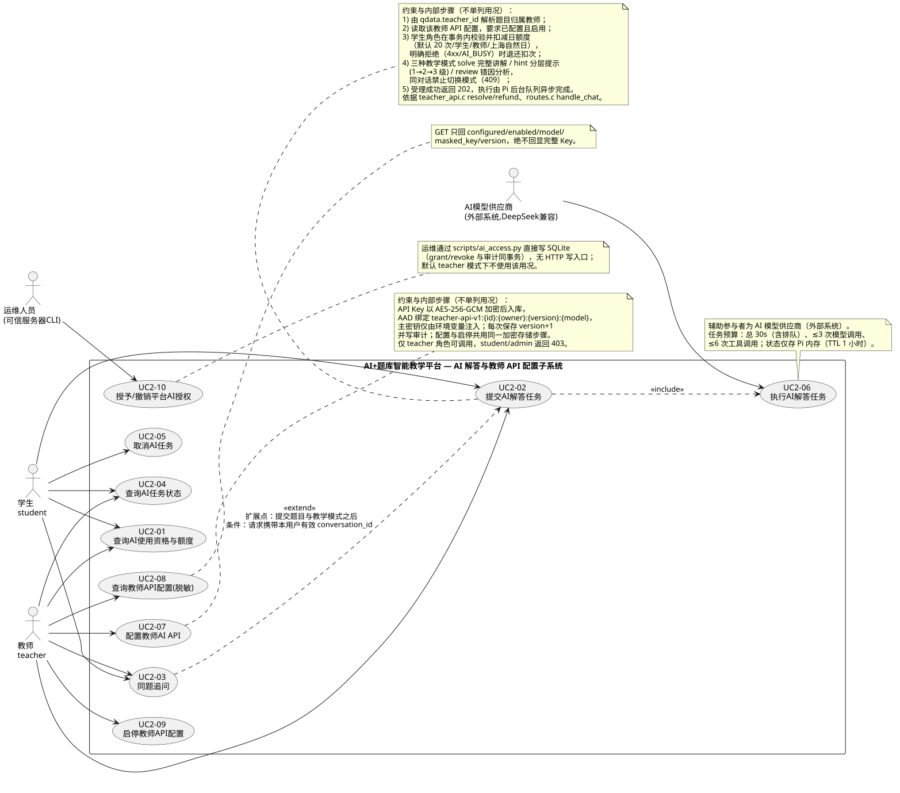

**图说明**：`提交AI解答任务` 包含 `解析题目归属教师`（读 `qdata.teacher_id`）、`校验并扣减学生日额度`（学生角色、teacher 模式、事务内原子扣次）与 `执行AI解答任务`（202 受理后由 Pi 后台队列异步执行，AI 模型供应商作为外部参与者参与执行用况）。`同题追问` 以 `<<extend>>` 扩展提交用况（扩展条件：请求携带有效 `conversation_id`）。教师配置/启停 API 包含 `加密存储API Key`。运维人员仅在 platform 兼容模式参与 `授予/撤销平台AI授权`（CLI 直写数据库，无 HTTP 写入口）。

### 4.1.3 用况图 3：目标功能（需求有描述、无代码支撑）

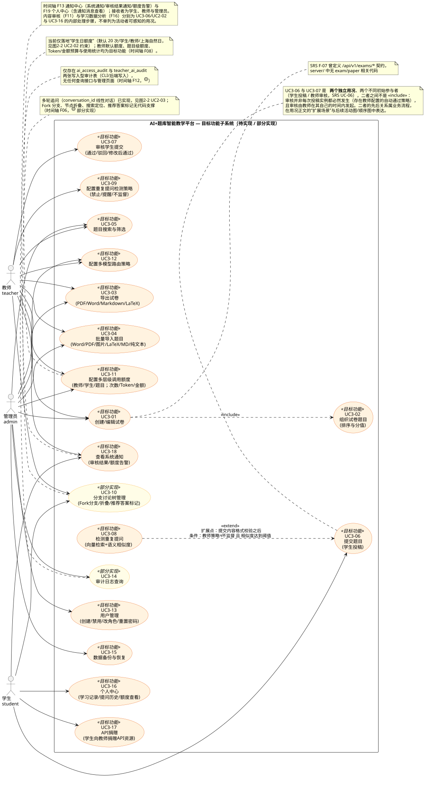

**图说明**：橙色为**目标功能**（试卷管理、导入导出、学生提交审核、用户管理、个人中心、重复检测、通知、API 捐赠、备份恢复），黄色为**部分实现**（分支讨论树仅多轮追问落地；审计仅有写入型表）。依据 `docs/AI题库项目整体预期功能说明书.md`、`docs/软件需求说明书.md` F-03~F-17 与 `docs/项目Backlog.md`（2026-11-09 核实）。

### 4.1.4 核心用况文字说明

| 用况 | 参与者 | 前置条件 | 基本事件流 | 备选事件流 | 后置条件 |
| --- | --- | --- | --- | --- | --- |
| UC-登录 | 全部用户 | 账号已存在（或 demo 三账号） | 1 提交用户名/密码；2 后端解析 JSON；3 查 `users` 密码哈希；4 SHA-256(salt‖pw) 比对；5 创建会话返回 token+user | 400 缺字段/JSON 非法；401 用户名或密码错误（不区分，防枚举）；500 会话创建失败 | 获得 24h 有效 Bearer token |
| UC-注册 | 全部用户（前端仅开放 student/teacher） | 无 | 1 提交 username/password/confirm/role；2 强度与一致性校验；3 写 `users`；4 自动创建会话 | 400 各类校验失败；409 用户名已存在 | 新用户入库并处于登录态 |
| UC-浏览题目列表 | 登录用户 | 有效会话 | 1 GET /questions；2 遍历 qdata 组装；3 按 id 升序返回 | 401 无会话；500 数据库不可读（不伪装空列表） | 无状态变更 |
| UC-新增题目 | 教师/管理员 | 有效会话且角色合法 | 1 POST 题目 JSON；2 角色检查；3 字段校验；4 分配 id=max+1；5 写 qdata（teacher_id=会话用户，status=active）；6 回读返回 201 | 403 学生越权；400 字段非法；500 存储失败 | 新题目 active 可见 |
| UC-修改题目 | 教师/管理员 | 题目存在 | 1 PUT 部分字段；2 旧题合并后整体校验；3 覆盖写 | 404 不存在/id 非法；400 合并后校验失败 | 字段更新，id 不变 |
| UC-删除题目 | 教师/管理员 | 题目存在 | 1 DELETE；2 kv_delete_key 物理删除 | 404 不存在 | 题目及全部字段删除 |
| UC-查询AI资格与额度 | 学生/教师 | 有效会话；teacher 模式需 question_id | 1 GET /ai/access?question_id=N；2 解析归属教师与配置；3 返回 allowed/status/quota | 400 缺 question_id；401；503 存储故障（不放行） | 无扣次 |
| UC-提交AI解答任务 | 学生/教师 | 会话有效；题目 active；教师配置启用；额度未用尽 | 1 POST /chat；2 会话/媒体类型/字段白名单校验；3 读题；4 事务扣次并解密教师 Key；5 内部 POST /internal/v1/jobs；6 返回 202 job_id | 401/415/400/404/403/429；Pi 明确拒绝时退还扣次 | 任务 queued；额度 used+1 |
| UC-查询AI任务状态 | 任务本人 | 持有 job_id | 1 GET /chat/{job_id}；2 C 校验 UUID 并转发；3 Pi 校验 owner 返回视图 | 404 跨用户/过期 | 无状态变更 |
| UC-取消AI任务 | 任务本人 | 任务 queued/running | 1 DELETE；2 queued 出队或 running 调 abort；3 返回 cancelled | 404 不存在；已完成任务保留原状态 | 本轮不进对话历史 |
| UC-同题追问 | 学生/教师 | 持有有效 conversation_id | 1 POST 携带 conversation_id；2 Pi 校验归属/模式/锁/长度；3 新任务复用历史执行 | 404/409(BUSY/MODE_MISMATCH/LIMIT/CREDENTIAL_CHANGED) | 对话历史追加一轮 |
| UC-配置教师AI API | 教师 | 有效教师会话 | 1 PUT {api_key, model?}；2 白名单解析；3 加密入库 version+1；4 写审计；5 返回脱敏元数据 | 401/403/415/400 | 配置启用，旧对话 credentialScope 失效 |
| UC-启停教师API | 教师 | 配置存在 | 1 PATCH {enabled}；2 解密重存 version+1；3 审计 | 404 未配置 | 停用后学生新提交 403 |
| UC-平台授权（CLI） | 运维人员 | 服务器数据库写权限；platform 模式 | 1 `ai_access.py grant/revoke/status`；2 授权与审计同事务写入 | 拒绝未知账号/重复 ID/非法到期时间 | 授权持久化，下次提交生效 |

---

## 4.2 类图（Class Diagram）

### 4.2.1 类图 1：用户与题库领域

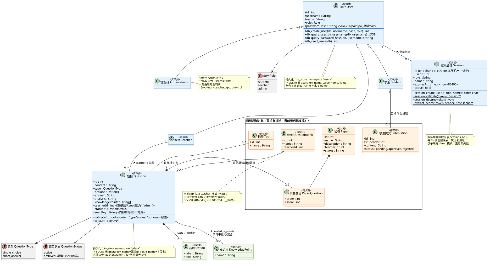

**职责与关键成员**（完整成员见图）：

| 类 | 类型 | 职责 | 代码依据 |
| --- | --- | --- | --- |
| 用户 User | 实体 | 账号与角色载体；密码仅存 SHA-256 哈希 | `db.c`（db_create_user 等）、kv `users` |
| 管理员/教师/学生 | 实体（泛化） | 分析层角色 specialization | 代码实现为 `role` 字段 + 路由角色判断 |
| 登录会话 Session | 实体（内存） | 会话生命周期与 token 校验 | `auth.c`（g_sessions[128]、session_cleanup） |
| 题目 Question | 实体 | 题干/选项/答案/解析/知识点/归属/状态 | `routes.c`（kv_to_question、extract_question_fields）、kv `qdata` |
| 选项 Option / 知识点 KnowledgePoint | 值对象 | JSON 内嵌结构与字符串数组元素 | `qdata.options/knowledge_points` |
| 题库/标签/试卷/试卷题目/学生提交 | 实体（待实现） | 目标功能占位，无代码 | SRS F-07/F-11、Backlog F03/F04 |

**关键关系与多重性**：教师 1—0..\* 题目（`teacher_id` 归属，seed 题为 admin）；题目 \*—0..\* 选项（组合，JSON 内嵌）；题目 o—0..\* 知识点（聚合，字符串数组）；用户 1—0..\* 会话。

**设计依据说明**：不将 `qdata` 表逐列映射为类，而是把"一个 key 的多个 value_name"聚合为 Question 的属性集合；`seed_key` 为内部幂等键不对外暴露（`kv_to_question` 显式跳过）。

### 4.2.2 类图 2：AI 解答、对话与额度领域

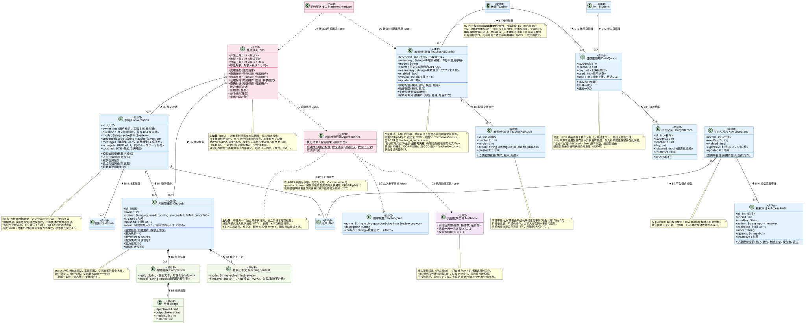

| 类 | 类型 | 职责 | 代码依据 |
| --- | --- | --- | --- |
| 对话 Conversation | 实体（Pi 内存） | 绑定用户+题目+模式；保存完整模型/工具消息；单任务锁 | `jobs.ts` Conversation |
| AI解答任务 ChatJob | 实体（Pi 内存） | 任务状态机载体与视图组装 | `jobs.ts` Job、`view()` |
| 任务队列 Jobs | 控制 | 有界队列调度、取消、TTL 清理、会话校验链 | `jobs.ts` |
| Agent执行器 AgentRun | 控制 | 每任务独立 Agent、预算控制、工具受限注入 | `agent.ts startAgent` |
| 教学技能 TeachingSkill | 实体 | 三模式 SKILL.md 内容注入系统提示 | `teaching.ts`、`skills/*/SKILL.md` |
| 受限数学工具 MathTool | 控制 | arithmetic / 一元一次方程求解 / 代入校验 | `math-tools.ts` |
| 教师API配置 TeacherApiConfig | 实体 | 加密 Key、版本、启停、脱敏元数据、归属解析 | `teacher_api.c` |
| 日额度使用 DailyQuota / 扣次记录 ChargeRecord | 实体 | 学生×教师×自然日计数与退还追踪 | `teacher_ai_usage/charges` |
| 平台AI授权 AiAccessGrant + 审计 | 实体 | platform 模式授权与审计 | `ai_access.c`、`scripts/ai_access.py` |

**关键关系与多重性**：对话 1—0..\* 任务（同时仅 1 个 active）；任务 \*—0..1 解答结果（组合）；教师 1—0..1 教师API配置（组合，PK 即 teacher_id）；配置 1—0..\* 教师API审计；授权 0..1—1 用户；额度 1—0..\* 扣次记录。

### 4.2.3 类图 3：边界-控制-实体（BCE）总览

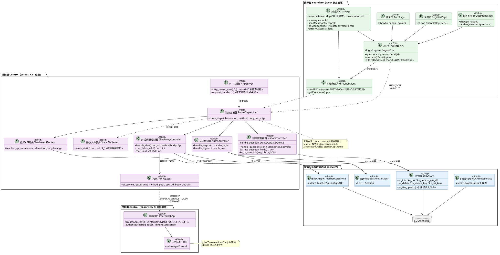

- **边界类**：前端四个页面模块与两个服务封装（`API`、`PiChatClient`）；`API.withFallback` 承担 file:// 离线演示与"接口未实现(404/405/501)"回退，并在界面标注非真实 AI。
- **控制类（C）**：`HttpServer`（请求体累积 ≤64KiB、完成回调统一释放）→ `RouteDispatcher`（url+method 顺序匹配；teacher 模式优先转交 `teacher_api_route`）→ 认证/题目/对话代理/教师API路由四个控制器；`AiClient` 负责内部 HTTP 转发与响应结构校验；`StaticFileServer` 负责静态托管与路径穿越防护。
- **控制类（Pi）**：`InternalJobApi`（timingSafeEqual 服务凭证）→ `Jobs`。
- **实体服务/数据访问**：SessionManager、TeacherApiService、AiAccessService、KvStore → SQLite。

**依赖方向**：边界→控制→实体服务→数据访问；C 控制→Pi 控制仅经内部 HTTP，不存在反向依赖，无循环。

---

## 4.3 顺序图（Sequence Diagram）

### 4.3.1 顺序图 1：用户登录与身份认证

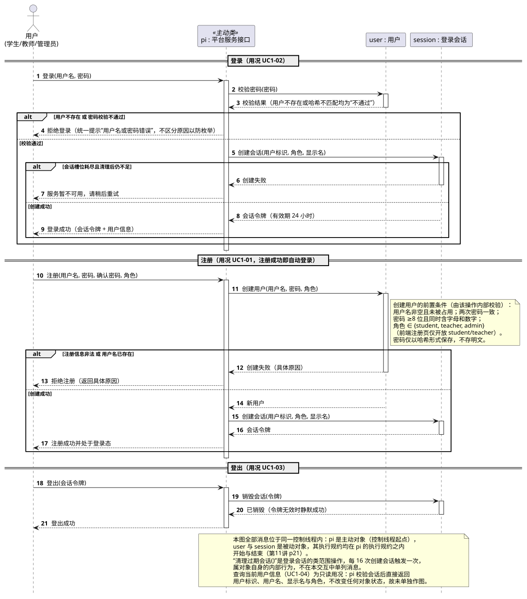

消息与代码对应：`API.login` → `route_dispatch` → `handle_login` → `db_query_password_hash`（kv_get users）→ `hash_password` 比对 → `db_query_user_by_username` → `session_create`（OpenSSL RAND、24h、每 16 次清理）。备选流覆盖 400/401/500 与注册分支（201 自动登录、409 重名）。

### 4.3.2 顺序图 2：教师创建和管理题目

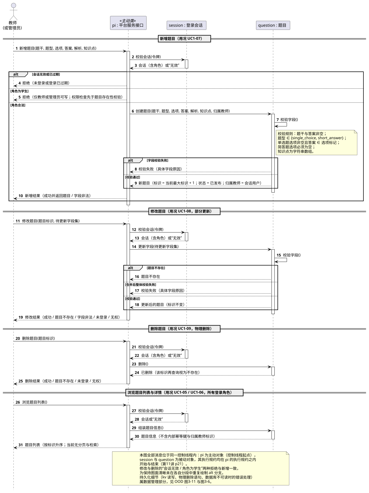

覆盖 POST/PUT/DELETE 三条链路：会话校验 → 角色校验（先于存在性）→ `extract_question_fields` 统一校验 → `next_question_id`/合并校验/`kv_delete_key`。说明：web 无管理页面，当前由接口工具调用同一组接口（与 `docs/questions.md` "联调交接"一致）。

### 4.3.3 顺序图 3：学生提交题目并获取 AI 解答

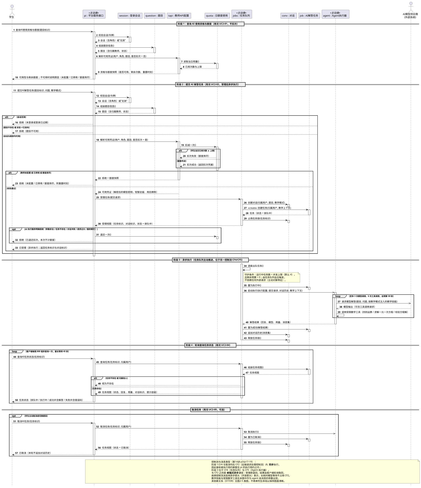

三阶段：资格与额度预查询（GET 不扣次）→ 提交（会话/字段/题目/归属/额度/解密/内部转发/202/失败退还/密钥擦除）→ Pi 异步执行（技能注入、模型与工具循环、预算）与前端 800ms 轮询。异常分支含取消（DELETE→abort）与失败码展示。

### 4.3.4 顺序图 4：追问形成多轮对话

重点展示 Pi `Jobs.submit` 的会话校验链（404 不存在/跨域、409 CREDENTIAL_CHANGED/MODE_MISMATCH/BUSY/LIMIT）与 hint 层级计算；明确当前为线性多轮，Fork 分支为目标功能。

### 4.3.5 顺序图 5：教师配置 AI API

展示 PUT/PATCH 的白名单解析、AES-256-GCM 加密（AAD 绑定教师/版本/模型）、事务内 UPSERT+审计、脱敏回显与停用边界。

---

## 4.4 状态图（State Machine Diagram）

### 4.4.1 状态图 1：题目生命周期（业务对象）

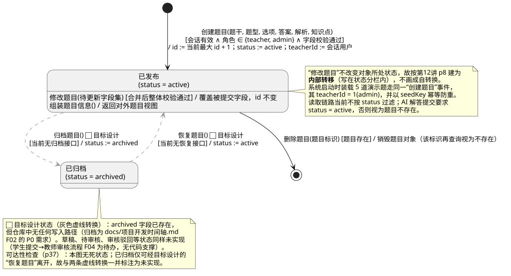

初始转换两条：启动 seed 与教师创建（均直接 active）。自环为 PUT 部分更新；终止为 DELETE 物理删除。`archived` 为**预留状态**（字段存在、无 API 可写，虚线表示）；草稿/待审核不存在（学生提交审核为待办）。注意区分：GET 列表不按 status 过滤，而 `POST /chat` 要求 active。

### 4.4.2 状态图 2：AI 解答任务生命周期（后台异步任务）

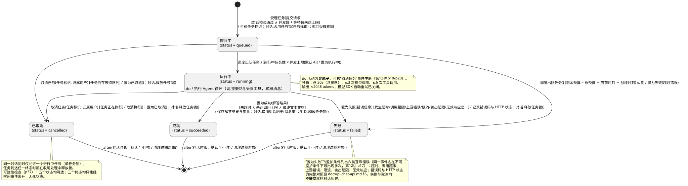

queued→running（并发槽）、queued→cancelled（出队前取消）、queued→failed（预算耗尽）、running→succeeded/failed/cancelled；三个终态经 TTL（默认 1 小时）`clean()` 清除（终止）。失败原因码与 `agent.ts` 映射一致。状态仅存 Pi 内存、重启清空，属设计约束。

### 4.4.3 状态图 3：教师 AI API 配置生命周期

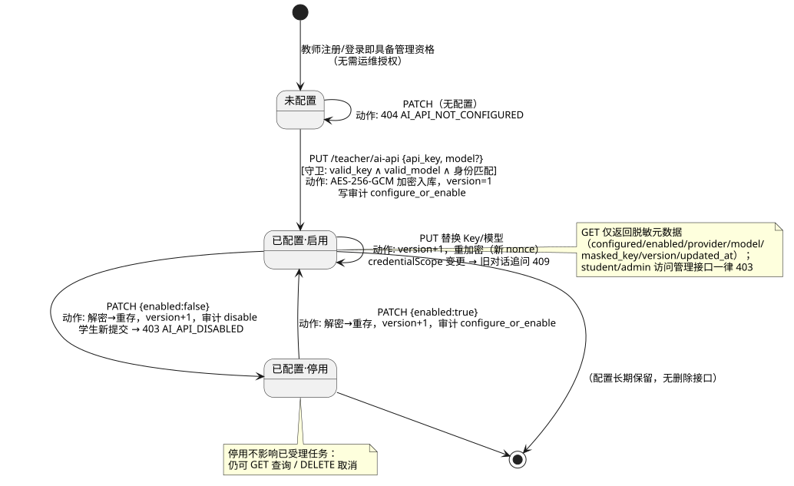

未配置→已配置·启用（PUT，version=1）；启用⇄停用（PATCH，version+1）；每次迁移写 `teacher_ai_audit`；未配置时 PATCH 为自环守卫（404）。停用不影响已受理任务。

---

## 4.5 包图（Package Diagram）

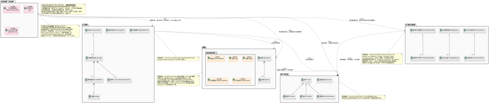

| 包 | 职责 | 实际代码位置 |
| --- | --- | --- |
| 前端交互包 | 页面渲染、hash 路由、API 封装、离线回退 | `web/`（逻辑=物理） |
| 接口与路由包 | 请求分发、静态托管、teacher 路由转交 | `routes.c`+`teacher_api_routes.c`（逻辑包） |
| 认证与会话包 | 会话创建/校验/销毁/清理 | `auth.c`（逻辑包） |
| 题库业务包 | 题目 CRUD 处理器与 seed | `routes.c` 题目部分 + `db.c`（逻辑包） |
| AI接入控制包 | 平台授权、教师API/额度、内部 AI 客户端 | `ai_access.c`/`teacher_api.c`/`ai_client.c`（逻辑包） |
| 数据访问包 | kv_store 抽象与 SQLite | `kv_store.c`/`db.c`（逻辑包） |
| 系统基础设施包 | 装配、配置、HTTP 守护、第三方库 | `main.c`/`config.c`/`http_server.c`/`third_party`（物理） |
| AI执行服务包 | 内部接口、队列、Agent、技能、工具 | `ai-service/`（物理，独立进程） |
| 运维脚本包 | 授权 CLI、配置脚本 | `scripts/`（物理） |

**依赖方向**：前端→接口层→{认证、题库、AI接入}→数据访问；基础设施包装配并回调接口层；AI 执行服务包仅被 AI 接入控制包经内部 HTTP 依赖；运维脚本包直写数据库（服务器侧带外通道）。全图**无循环依赖**；逻辑包与物理目录的差异（routes.c 内含多业务处理器）已在包注释与 `docs/architecture.md` "后续按功能拆 services_*.c" 约定中说明。
