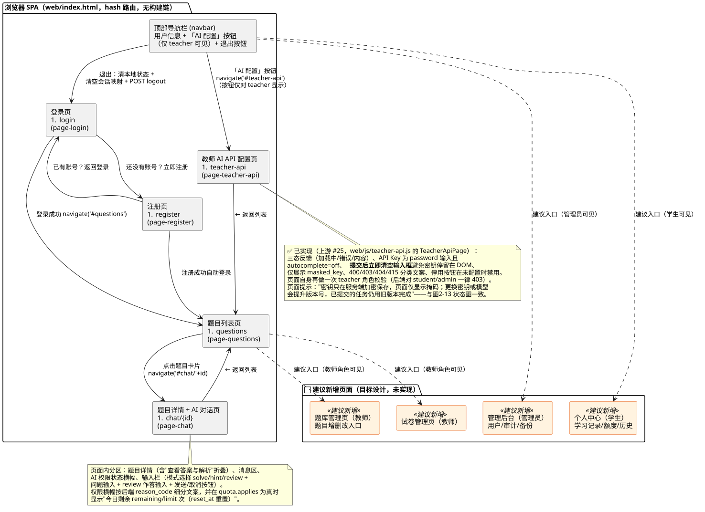
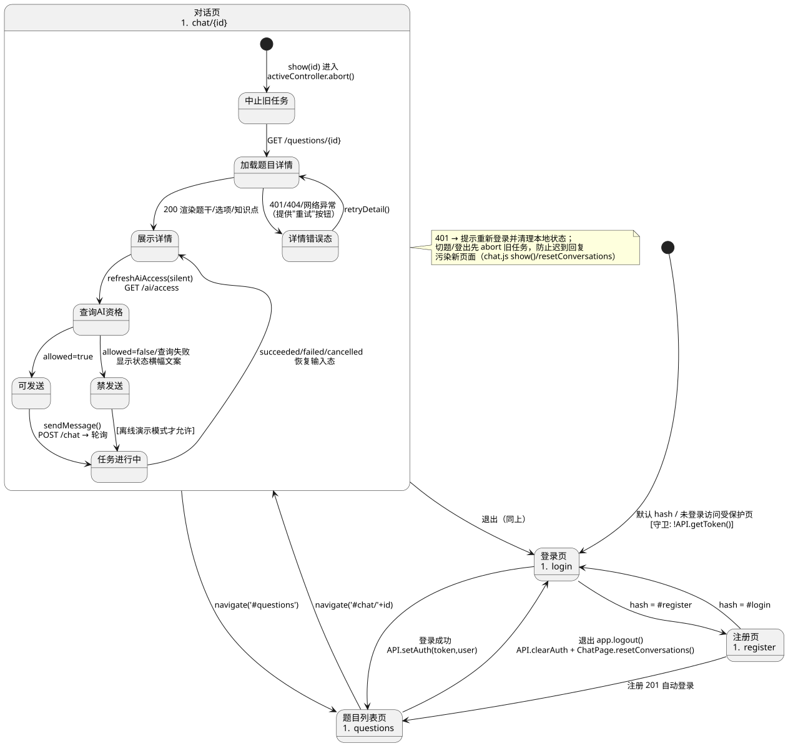
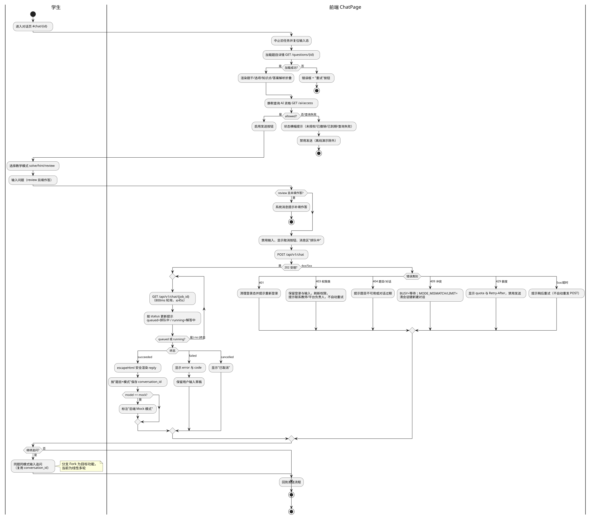
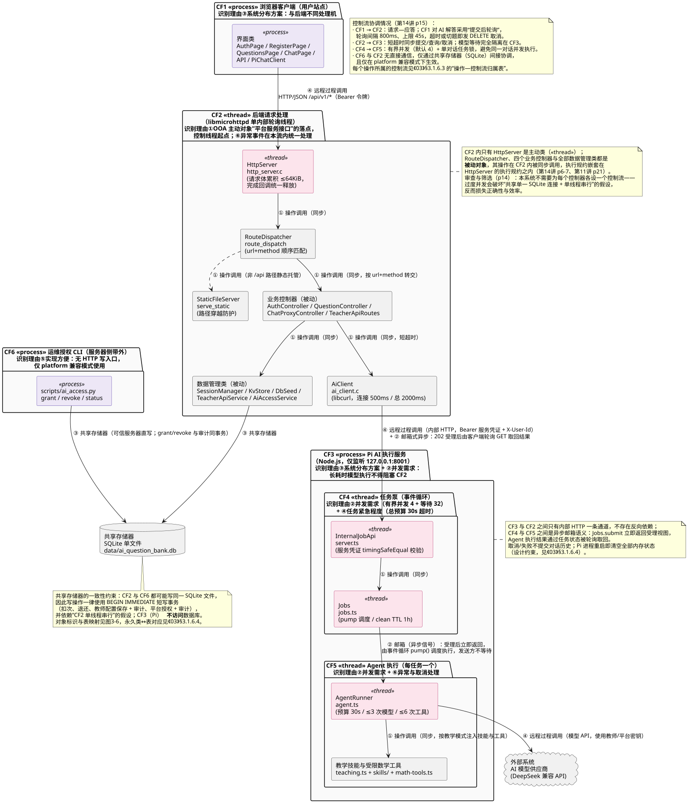
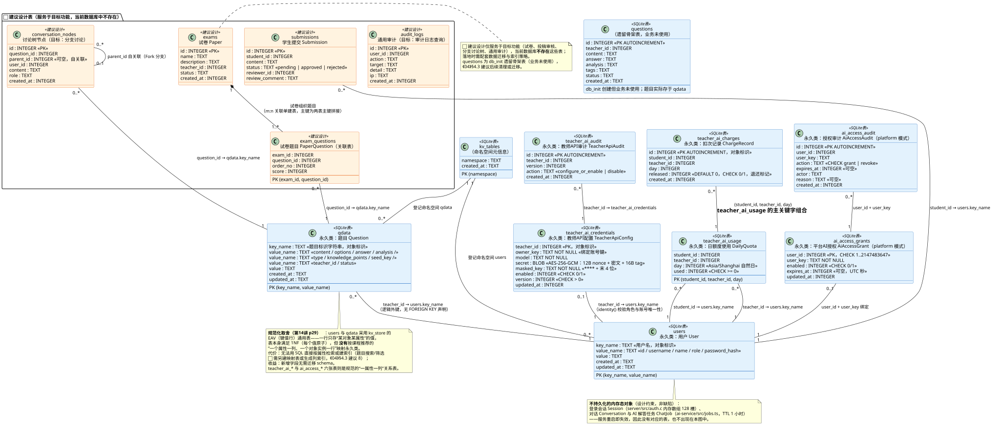

# 03 OOD 面向对象设计

> 本部分在 02 的 OOA 结果之上完成人机交互、控制驱动、数据管理三部分设计。所有设计均标注与现有代码（C11 后端 + 纯静态前端 + Node/TS AI 服务）的对应关系；超出当前实现的内容标注为**建议设计**。

---

## 5.1 人机交互设计（Human-Computer Interaction）

### 5.1.1 用户角色与使用目标

| 角色 | 使用目标 | 当前页面支撑 | 差距与建议 |
| --- | --- | --- | --- |
| 学生 | 浏览题目、获取 AI 解答、追问、查看作答反馈 | 登录/注册/题目列表/对话页（完整） | 个人中心、学习记录为目标功能 |
| 教师 | 维护题目、配置 AI 能力、控制额度 | 题目读写接口已就绪但**无管理页面**；AI API 配置**无页面** | 建议新增"题库管理页""教师 AI-API 配置页"（接口已具备，见 `docs/teacher-api.md`） |
| 管理员 | 用户/审计/运维 | 仅登录与题目写权限 | 管理后台为目标功能（Backlog F18） |

### 5.1.2 系统整体导航结构

**图说明**：现有 SPA 由顶部导航栏 + 四个页面容器构成（`web/index.html`）；hash 路由 `#login / #register / #questions / #chat/{id}` 由 `app.js route()` 统一切换，未登录访问受保护路由时回跳 `#login`。橙色组件为建议新增页面：题库管理页、教师 AI-API 配置页（后端接口已就绪）、试卷管理页、管理后台、个人中心。

### 5.1.3 核心页面关系与流转

**图说明**：页面级状态机覆盖登录守卫、注册自动登录、列表↔对话跳转、退出清理（`API.clearAuth()` + `ChatPage.resetConversations()` 防止跨用户复用 conversation_id）。对话页内部子状态：中止旧任务 → 加载详情（含错误重试）→ 查询 AI 资格（决定发送按钮可用性）→ 任务进行中 → 恢复。

### 5.1.4 主要页面及功能、输入输出与反馈

| 页面 | 主要控件 | 输入 | 输出/反馈 | 依据 |
| --- | --- | --- | --- | --- |
| 登录页 | 账号/密码框、登录按钮、错误提示区、注册链接 | username/password | 成功跳转列表页；失败显示 `loginError` 文案 | `index.html`、`auth.js` |
| 注册页 | 用户名/密码/确认/角色下拉（student/teacher） | 注册表单 | 201 自动登录；400/409 显示 `regError` | 同上 |
| 题目列表页 | 题目卡片（题干+题型+知识点标签）、加载态、错误框+重试 | 无（GET 列表） | 卡片点击进对话页；空列表显示"暂无题目" | `questions.js` |
| 对话页 | 详情区（题干/选项/知识点/"查看答案与解析"折叠）、消息区、AI 权限横幅、模式选择、问题输入、review 作答输入、发送/取消按钮 | 问题文本、模式、作答 | 消息气泡（user/ai/system/loading）；状态文案"排队中/解答中/已取消"；Mock 标注 | `chat.js`、`index.html` |

**交互反馈约定**：所有异步操作具备 加载态→成功态/错误态 三态；错误框均带"重试"按钮；发送期间禁用输入并显示取消按钮；AI 回复使用 `escapeHtml` 安全渲染（换行转 ` `），不执行 HTML/脚本。

### 5.1.5 关键业务操作流程（学生 AI 答疑）

**图说明**：活动图覆盖资格预查询、模式与作答校验、提交、轮询提示、终态渲染与全部错误类别的前端处置（401 重新登录；403 保留输入并刷新权限；409 等待或新建对话；429 显示 quota 与 Retry-After；5xx 提示稍后重试且不自动重发 POST），与 `docs/pi-chat-api.md` §5 错误表一一对应。

### 5.1.6 异常交互设计

| 异常 | 界面行为 | 依据 |
| --- | --- | --- |
| 网络不可达 / file:// 打开 | 自动进入离线演示，全链路可演示并标注"非真实 AI 生成" | `api.js withFallback` |
| 后端 chat 接口 404/405/501 | 回退内置演示数据并标注（历史兼容行为；当前接口已实现，正常不再触发） | `api.js isNotImplemented` |
| 401 | 清理本地登录态，提示重新登录 | `chat.js handleChatError` |
| AI 权限类 403 | 保留登录与草稿，刷新权限横幅，提示联系教师/平台负责人，不自动重试 | 同上 + `pi-chat-api.md` §10 |
| 额度 429 | 显示 quota（used/remaining/reset_at）与 Retry-After，禁用发送 | `teacher-api.md` |
| 任务失败/超时 | 停止轮询，展示 error+code，保留输入 | `chat.js` |
| 切换题目/登出 | abort 旧任务并清空会话映射，防止迟到回复污染新页面 | `chat.js show()/resetConversations()` |

### 5.1.7 前端与后端的交互边界

- 前端**只**调用 C 后端 `/api/v1/*`（同源相对路径；独立开发时需代理）；Pi 端口、模型 Key、内部服务凭证永不下发（`docs/pi-chat-api.md` §1）。
- 鉴权仅 Bearer 用户 token；前端不传 user_id/模型/Key/系统提示/自定义 history（字段白名单由 C 与 Pi 双重校验）。
- 前端本地仅保存 token 与 user 摘要（localStorage，file:// 降级内存）；conversation_id 按"用户+题目+模式"隔离保存，切换用户清空。
- **已知集成差距（重要）**：`api.js aiAccess()` 仍按 v1.2 契约不带 `question_id`；默认 teacher 模式下 C 的 `/ai/access` 要求该参数（缺省 400 QUESTION_REQUIRED），导致对话页资格查询失败、发送按钮被禁用。建议设计：前端按当前题目携带 `question_id` 并渲染 quota 信息（接口侧已就绪）。

---

## 5.2 控制驱动设计（Control Driver Design）

### 5.2.1 控制架构

**图说明**：七层控制架构。①边界层（浏览器 SPA）→ ②接口层（MHD 单轮询线程 + 路由分发 + 静态托管）→ ③控制层（认证/题目/对话代理/教师API路由四个控制器）→ ④领域服务层（会话、教师API与额度、平台授权、AI 内部客户端）→ ⑤数据访问层（kv_store + SQLite）；⑥异步执行层为独立 Pi 进程（内部接口鉴权 → 有界队列 → Agent 执行）；⑦外部模型供应商。依赖单向，C 与 Pi 之间仅内部 HTTP。

### 5.2.2 边界/控制/实体对象划分

| 类别 | 对象 | 职责 |
| --- | --- | --- |
| 边界 | 前端页面模块、`API`、`PiChatClient`；C 侧 `http_server.c` 请求接收、`serve_static` | 请求接收、展示、输入收集 |
| 控制 | `route_dispatch`、四个控制器、`teacher_api_route`、Pi `server.ts`/`Jobs` | 流程编排、校验、调度、错误码映射 |
| 实体 | Session、Question、Conversation、ChatJob、TeacherApiConfig、DailyQuota、审计记录、kv_store/SQLite | 状态承载与持久化 |

### 5.2.3 控制对象协作与同步/异步机制

- **同步路径（C）**：MHD 单内部轮询线程串行处理；路由按 url+method 顺序匹配（无路由表，teacher 模式优先转交 `teacher_api_route`）；请求体在 `RequestCtx` 累积（≤64KiB，超限 413），完成回调统一释放（含连接中断）。C 对 Pi 的内部请求仅等待提交/查询/取消响应（连接 500ms/总 2000ms 可配），**模型等待不占用 C 线程**。
- **异步路径（Pi）**：`Jobs.submit` 立即返回 202；事件循环 `pump()` 按并发上限（默认 4）出队执行；队列上限 32，超出 503 AI_BUSY；任务总预算 30s、≤3 次模型调用、≤6 次工具调用；SDK 重试关闭。
- **协作链（提交）**：ChatProxyController →（teacher 模式）TeacherApiService 事务扣次+解密 → AiClient 内部转发 → Pi InternalJobApi → Jobs → AgentRunner → 模型供应商；失败退还由 ChatProxyController 依据"明确未接收"判定触发 `teacher_api_refund`。
- **协作链（查询/取消）**：ChatProxyController 校验 UUID → AiClient 透传（X-User-Id 由 C 注入，Pi 侧校验 owner）。

### 5.2.4 权限校验、异常处理与任务状态管理

- **权限**：会话校验（`session_validate`）先于一切业务；角色校验先于资源存在性（题目写 403 先于 404）；教师 API 管理仅 teacher（student/admin 403）；AI 提交在 platform 模式查 `ai_access_grants`（默认拒绝、故障拒绝），teacher 模式查教师配置+额度；Pi 侧再校验服务凭证与任务归属（跨用户 404）。
- **异常处理**：统一 JSON 错误 `{error, code}`；稳定错误码表（`docs/pi-chat-api.md` §5、`docs/teacher-api.md`）；C 侧 `[ai-client]` 日志只记固定分类（connect_failed/request_timeout/transport_failed/internal_auth_failed）与数字码，不记 URL/头/凭证/用户输入；内部 401 统一转脱敏 503。
- **任务状态管理**：状态机见 02 §4.4.2；同对话单任务锁（`activeJob`）在 finally 释放；取消/失败不提交本轮历史；TTL 清理（默认 1h）；服务重启清空（设计约束，文档明示）。
- **密钥控制**：教师 Key 仅在 C/Pi 可信进程内短暂解密；payload 发送后 `OPENSSL_cleanse`；Pi 终态删除 execution 引用；GET 接口只回脱敏元数据。

### 5.2.5 主要控制流程说明（四条代表路径）

1. **登录**：边界→路由→认证控制器→kv_store(users)→会话管理→200/401（顺序图 1）。
2. **题目写**：边界→路由→题目控制器（会话+角色+字段校验）→kv_store(qdata)→201/200/400/403/404（顺序图 2）。
3. **AI 提交**：见 §5.2.3 协作链与顺序图 3；控制点为"扣次事务"与"明确拒绝才退还"。
4. **教师配置**：教师API路由→教师API服务（加密+审计事务）→脱敏回显（顺序图 5）。

> 说明：本系统为 C + libmicrohttpd 的过程式分层架构，**不是** Spring MVC 等框架架构；控制对象以 C 函数模块与 TS 类承担，上图为对其职责的面向对象抽象。

---

## 5.3 数据管理设计（Data Management）

### 5.3.1 数据库逻辑结构（ER）

**图说明**：蓝色为当前 SQLite 实际表；橙色为**建议设计表**（服务目标功能，当前不存在）。kv_store 的 namespace 映射为**同名表**（`users`、`qdata`），复合主键 `(key_name, value_name)`；`kv_tables` 为 namespace 注册表。注意 `docs/kvstore.md` 中"kv_{ns}"前缀表述已过时，实际以 `ai-access.md` 勘误与代码 `safe_table_name()` 为准。

### 5.3.2 核心数据实体与关系

| 实体 | 存储 | 关系 |
| --- | --- | --- |
| 用户 | `users`（kv） | 1—0..\* 题目（teacher_id 逻辑外键）；1—0..1 教师API配置；1—0..1 平台授权 |
| 题目 | `qdata`（kv） | 内嵌 options/knowledge_points（JSON/字符串数组） |
| 教师API配置 | `teacher_ai_credentials` | 1—0..\* `teacher_ai_audit` |
| 日额度/扣次 | `teacher_ai_usage` / `teacher_ai_charges` | usage 1—0..\* charges（逻辑关联） |
| 平台授权/审计 | `ai_access_grants` / `ai_access_audit` | grant 1—0..\* audit |
| 会话、任务、对话 | **内存**（C 数组 / Pi Map） | 不持久化，重启失效 |

### 5.3.3 关键表字段、主键与约束

| 表 | 主键/唯一 | 约束与索引 | 来源 |
| --- | --- | --- | --- |
| users / qdata | PK(key_name, value_name) | 无额外索引；value 默认 ''；created/updated 自动 | `kv_store.c ensure_table` |
| kv_tables | PK(namespace) | 注册防误删（kv_drop_namespace 仅允许已注册） | `kv_store.c kv_init` |
| questions | PK(id) | 遗留骨架表，业务未使用 | `db.c db_init` |
| teacher_ai_credentials | PK(teacher_id) | enabled CHECK(0,1)；version CHECK(>0) | `teacher_api.c teacher_api_init` |
| teacher_ai_usage | PK(student_id, teacher_id, day) | used CHECK(>=0)；扣次 UPDATE 带 `WHERE used<?` 原子守卫 | 同上 |
| teacher_ai_charges | PK(id AUTOINCREMENT) | released CHECK(0,1) | 同上 |
| teacher_ai_audit | PK(id AUTOINCREMENT) | action 枚举值 | 同上 |
| ai_access_grants | PK(user_id) | enabled CHECK(0,1)；expires_at 范围 CHECK | `ai_access.c ai_access_init` |
| ai_access_audit | PK(id AUTOINCREMENT) | action CHECK(grant,revoke) | 同上 |

**外键说明**：表间关联均为**逻辑外键**（SQLite 未声明 FOREIGN KEY），由应用层 `identity()`/owner 校验保证（如 `teacher_api.c identity()` 要求 id 唯一且角色匹配）。**索引说明**：当前仅主键隐式索引；数据量为课程规模，未建二级索引（建议设计：qdata 按 teacher_id 检索时需新增映射表或索引列）。

### 5.3.4 数据访问与业务逻辑的关系

- 业务处理器不直接拼 SQL：题目/用户经 kv_store 抽象（参数化绑定，防注入）；教师API/授权模块使用预编译语句 + 绑定参数。
- 共享单连接：`main.c` 打开一次 SQLite 连接经 `AppConfig.db` 传递；依赖 MHD 单轮询线程串行假设（头文件注释明示：启用线程池需 SERIALIZED 配置）。
- Pi 侧不访问 SQLite：任务/对话/历史仅内存；执行配置（解密后的 Key）经内部 HTTP 单任务传递，终态删除。

### 5.3.5 事务与一致性

| 场景 | 事务策略 | 依据 |
| --- | --- | --- |
| 提交扣次 | `BEGIN IMMEDIATE`：身份→归属→配置→额度检查→used+1（带 `WHERE used<?`）→charges 插入→COMMIT；任一步失败 ROLLBACK | `teacher_api.c teacher_api_resolve` |
| 退还扣次 | 独立 `BEGIN IMMEDIATE`：usage-1（仅 released=0 的 charge）+ charge released=1 | `teacher_api.c teacher_api_refund` |
| 教师配置保存 | `BEGIN IMMEDIATE`：credentials UPSERT + audit INSERT 同事务 | `teacher_api.c teacher_api_save` |
| 平台授权（CLI） | 授权更新与审计插入同事务，失败全回滚；操作幂等但审计逐次追加 | `docs/ai-access.md`、`scripts/ai_access.py` |
| 题目写 | 多次 kv_set 顺序写（**非单事务**）：部分失败可能留下半写题目 → 风险记录于 04 文档 | `routes.c handle_question_create` |

### 5.3.6 数据安全、权限隔离与敏感信息保护

- **密码**：SHA-256(salt‖password)，固定 demo salt（课程阶段取舍，文档明示）；登录防枚举（统一 401）。
- **教师 API Key**：AES-256-GCM（随机 12B nonce、16B tag），AAD 绑定 teacher-api-v1:{id}:{owner}:{version}:{model} 防跨教师/版本移植；主密钥 `AI_KEY_ENCRYPTION_KEY`（64hex）仅环境变量注入，不进库/不进 Git/不打印；丢失不可恢复需教师重提。
- **会话 token**：OpenSSL `RAND_bytes` 64 位十六进制；随机源失败拒绝创建。
- **脱敏与擦除**：GET 配置只回 masked_key；payload/明文 Key 用 `OPENSSL_cleanse` 擦除；响应 `Cache-Control: no-store`。
- **隔离**：多租户以 teacher_id 归属实现题目侧隔离；对话/任务按 owner 校验（跨用户 404）；Pi 仅监听 127.0.0.1，反向代理只转发公共 API；静态服务拒绝含 `..` 路径。
- **未达标项（如实记录）**：无 HTTPS 内置（依赖反向代理）、demo 账号默认密码需上线前处置、SQLite 审计不防篡改（`docs/ai-access.md` 明示）。

### 5.3.7 备份、恢复与日志管理

- **现状**：数据库为单文件 `data/ai_question_bank.db`（.gitignore 排除）；仓库**无自动备份/恢复机制**（Backlog 运维项 🟡）；systemd 部署示例见 `deploy/systemd/`。
- **建议设计**：① 定期文件级备份 + 备份完整性校验；② **主密钥必须与数据库分离备份**（否则密文不可恢复，`docs/teacher-api.md` 明示）；③ 恢复演练纳入运维手册。
- **日志**：C 侧 stderr 分类日志（启动/配置归一化/`[ai-client]` 固定分类/`[teacher-api] refund failed`）；Pi 侧启动事件 JSON 与错误脱敏；审计表承担操作留痕（授权与教师配置）。建议设计：统一访问日志与通用审计表（见 ER 图 `audit_logs` 建议表）。

### 5.3.8 当前结构与扩展结构的区分

- **当前**：kv 双命名空间 + 四张 teacher_ai_* 表 + 两张 ai_access_* 表 + 遗留 questions 表。
- **扩展（建议设计，未实现）**：`exams`/`exam_questions`（试卷）、`submissions`（学生提交审核）、`conversation_nodes`（讨论树，parent_id 自关联支持 Fork）、`audit_logs`（通用审计）；落地时需配套迁移脚本、索引与权限策略，并保持 kv_store 兼容期。
