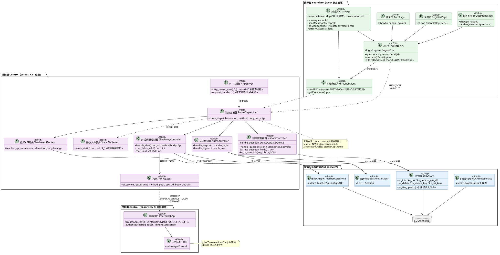
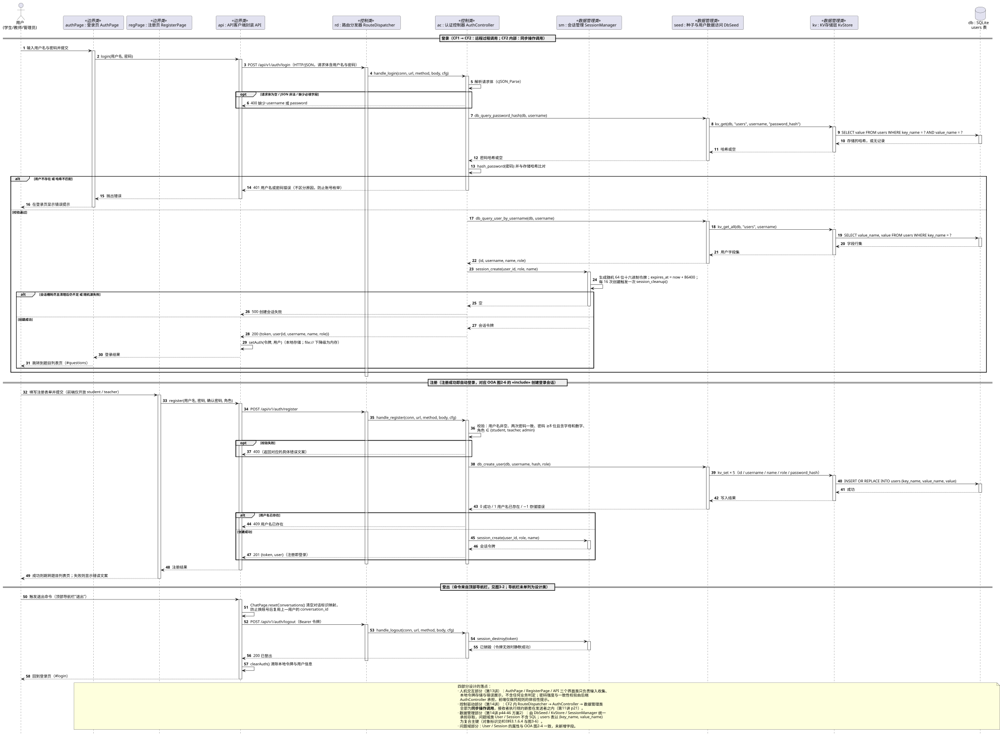
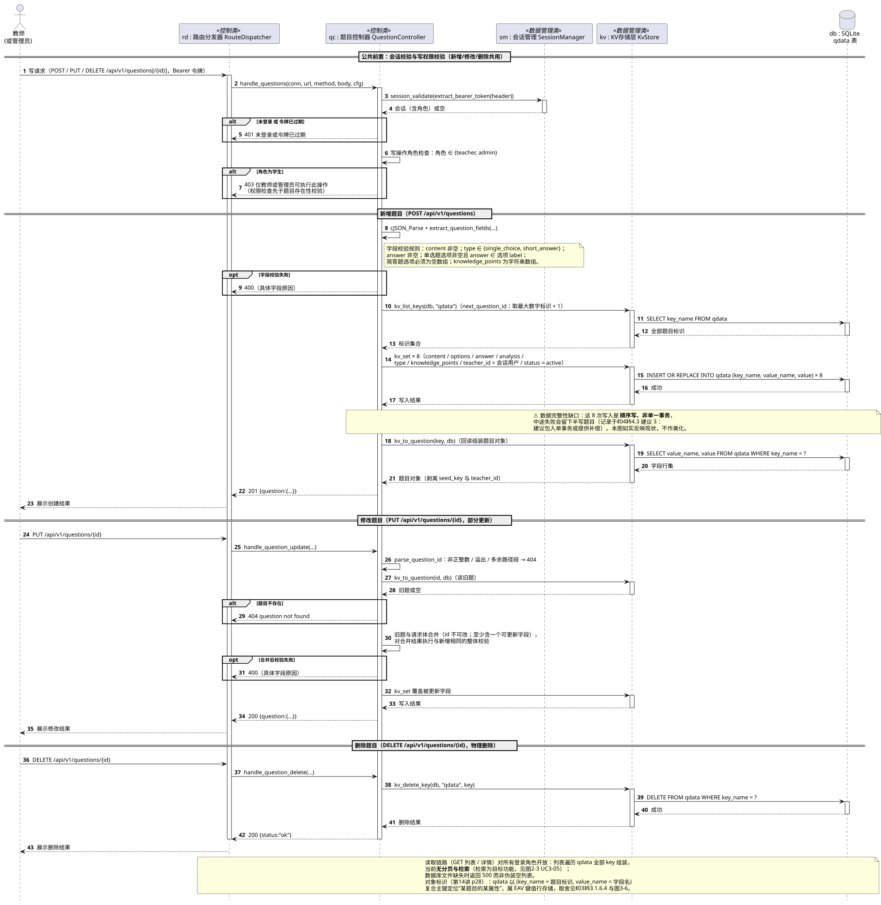
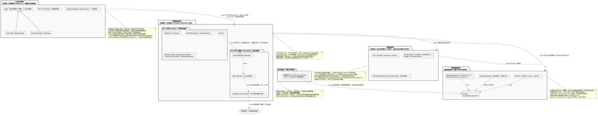

# 03 OOD 面向对象设计（第 3 章）

> 本章在 OOA（第 2 章）基础上给出**设计模型**，结构遵循课程模板《面向对象分析设计文档》第 3 章：
> 3.1 类图文档（综述 / 类描述 / 关联描述 / 泛化描述 / 依赖描述 / **设计说明**）、
> 3.2 顺序图文档（+ 设计说明）、3.3 状态图文档（+ 设计说明）、3.4 包图文档。
>
> 课程依据：第13讲 p11“从 OOA 到 OOD 不是转换，而是**调整和增补**”——把 OOA 模型搬到 OOD
> 作必要调整后作为**问题域部分**，再增补**人机交互、控制驱动、数据管理**三个部分
> （构件及部署部分属扩展内容、不在考试范围，且模板未要求交付，故本章不另立）；
> p12“OOA 与 OOD 采用一致的概念和表示法，但有不同侧重点：OOD 主要解决与实现有关的问题”。
>
> **与 OOA 的命名分工（有意为之，不是不一致）**：OOA 类图的操作名用问题域术语
> （第10讲 p14/p21/p28：实现细节推迟到 OOD）；OOD 类图按第13讲 p66/p68
> `[可见性] 名[:类型][=初值]`、`[可见性] 操作名(参数)[:返回类型]` **完善**属性与操作，
> 因此保留真实的 C 函数名与 TS 方法名。二者的对应关系在各操作说明表的
> “约束条件及其他 / 实现映射”列中给出。
>
> 状态标记：✅ 已实现／🟡 部分实现／⬜ 目标设计（含“设计抽象”“建议设计”两类无代码项）。

## 3.1 类图文档

### 3.1.1 类图综述

**设计类图（图 3-1）：按问题域 / 人机交互 / 控制驱动 / 数据管理四部分组织的设计类图**

目的与组织：把 OOA 的分析对象落实为**可实现**的设计结构。全图按 OOD 四部分组织为四个包：

- **人机交互部分（边界类）**：设计新增的一般类 `页面 Page`（⬜ 设计抽象）及其五个特殊类
  `登录页 AuthPage`、`注册页 RegisterPage`、`题目列表页 QuestionsPage`、`对话页 ChatPage`、
  `教师API配置页 TeacherApiPage`（✅ 上游 #25 实现），以及服务封装类
  `API客户端封装 API`、`Pi任务客户端 PiChatClient`。
- **控制驱动部分（控制类）**：`HTTP服务 HttpServer` `<<thread>>`、`内部接口 InternalJobApi`
  `<<process>>`、`任务队列 Jobs` `<<thread>>`、`Agent执行器 AgentRunner` `<<thread>>`
  四个**主动类**，以及 `路由分发器 RouteDispatcher`、`静态文件服务 StaticFileServer`、
  `认证控制器 AuthController`、`题目控制器 QuestionController`、
  `对话代理控制器 ChatProxyController`、`教师API路由 TeacherApiRoutes`、
  `AI客户端 AiClient` 七个**被动控制类**。
- **问题域部分（实体类）**：跨图引用桩 `用户 User`、`登录会话 Session`、`题目 Question`、
  `对话 Conversation`、`AI解答任务 ChatJob`、`教师API配置 TeacherApiConfig`
  （定义见图2-4/图2-5），以及设计期新增对象 `运行时凭证 TeacherExecution`。
- **数据管理部分（数据管理类）**：`会话管理 SessionManager`、`KV存储层 KvStore`、
  `种子与用户数据访问 DbSeed`、`教师API服务 TeacherApiService`、
  `平台授权服务 AiAccessService` 与 `SQLite` 数据库节点。

**与 OOA 的差异（每项均有设计原因，详见 §3.1.6）**：

1. OOA 的**单一主动类**“平台服务接口 PlatformInterface”在设计中按职责拆分为
   `HttpServer`（控制线程起点）+ `RouteDispatcher` + 四个业务控制器 + `StaticFileServer`
   （控制驱动部分设计，第14讲 p3/p11-16）；
2. 新增**人机交互部分**的 7 个界面/封装类（第13讲 p74-97），并按 p45“增加一般类以建立
   共同协议”、p96“定义较一般的窗口类，形成继承关系”提取一般类 `页面 Page`；
3. 新增**数据管理部分**的 5 个数据管理类（第14讲 p44-46 方案2），把 OOA 实体类中
   与持久化有关的类范围操作移交给它们，问题域类不再承担 SQL 细节；
4. 新增设计期对象 `运行时凭证 TeacherExecution`（第13讲 p34-41：为落实“明文密钥短暂驻留、
   用后擦除”的安全约束而补充）；
5. OOA 的**角色泛化被压平**为 `User.role` 判别字段 + 路由层角色守卫
   （第13讲 p53“取消继承·展平”，因 C11 不支持继承）；
6. OOA 的关联/聚合/组合语义保持不变，类间**行为调用关系统一改为依赖 «use»**
   （第13讲 p69 对象间可访问性：本项目为模块级全局可见性 → 依赖；
   第10讲 p80/p85 行为关系借用依赖表示）；
7. ⬜ 目标设计类（QuestionBank/Tag/Paper/PaperQuestion/Submission）**不进入**设计类图，
   避免把未实现内容混入可实现模型；
8. 核心协作方向：人机交互 → 控制驱动 → {问题域, 数据管理}，问题域 → 数据管理；
   C 侧控制类 → Pi 侧控制类仅经内部 HTTP 单向依赖，**全图无循环依赖**。

### 3.1.2 类描述

> 模板要求“格式同 2.2 部分”，即每类给出整体说明（类名、解释、一般类、主动性、引用情况、
> 其他）、属性说明、操作说明与关联/泛化/依赖。
> **主动性**判定口径：该类是否拥有独立控制流（第14讲 p3：用主动对象表示每个控制流）；
> **多态性**判定口径：该操作是否在泛化结构中被特殊类重写。
> 问题域部分的类为**跨图引用桩**，按模板“引用情况”栏的要求标明其所属类图，
> 不重复描述属性与操作（只描述设计阶段的调整）。

#### 3.1.2.1 人机交互部分的类描述

**类 1：页面 Page**（⬜ 设计抽象，本次新增的一般类）

| 项 | 内容 |
| --- | --- |
| 类名 | 页面 Page（抽象类） |
| 解释 | 全部前端页面的一般类，提供“显示/隐藏页面容器”的共同协议 |
| 一般类 | 无（本身即一般类） |
| 主动性 | 无（由前端应用的路由函数驱动） |
| 引用情况 | 本图定义；被 AuthPage / RegisterPage / QuestionsPage / ChatPage 泛化（G1~G4）；不进 OOA 模型 |
| 其他 | **设计依据**：第13讲 p45“增加一般类以建立共同协议”、p96“发现窗口与部件的共性，定义较一般的窗口类和部件类，形成继承关系”。**共同协议的现实来源**：`web/js/auth.js`、`questions.js`、`chat.js` 中四个页面模块**均已实现同名 `show()` 生命周期入口**，由 `app.js route()` 统一调用。⚠ **实现现状**：前端为无构建链的 IIFE 模块，代码中并未提取公共基类，故本类标注为 ⬜ 设计抽象（不是既有代码结构，也不声称已实现） |

| 属性名 | 多重性 | 解释 | 数据类型 | 聚合 | 组合 | 关联 |
| --- | --- | --- | --- | --- | --- | --- |
| 容器元素标识 | 1 | 该页面在 `index.html` 中的容器元素 id | String | 无 | 无 | 无 |

| 操作名 | 主动性 | 多态性 | 解释 | 约束条件及其他 |
| --- | --- | --- | --- | --- |
| show() | 无 | **有**（四个特殊类各自重写） | 抽象操作：显示本页面并复位其内部状态 | 由 `app.js route()` 在 hash 变化时调用；`ChatPage` 的重写带题目标识参数 |
| hide() | 无 | 无 | 隐藏本页面容器 | 实现为移除/添加 `hidden` 样式类 |

d）关联：无。e）泛化：G1~G4 的父类。f）依赖：无。

**类 2~3：登录页 AuthPage ✅　注册页 RegisterPage ✅**（二者同构，合并说明）

| 项 | 内容 |
| --- | --- |
| 类名 | 登录页 AuthPage／注册页 RegisterPage |
| 解释 | 收集登录/注册输入、展示错误文案、成功后触发页面跳转的界面类 |
| 一般类 | 页面 Page |
| 主动性 | 无 |
| 引用情况 | 本图定义；依赖 API客户端封装（D1/D2）；出现在图3-2、图3-3、图3-10 |
| 其他 | 实现：`web/js/auth.js` 的两个 IIFE 模块（`web/index.html` 中的 `page-login` / `page-register` 容器）。按第13讲 p97，界面类**只负责输入输出与窗口更新**，不含任何业务判定；密码强度与一致性校验由后端 AuthController 承担，前端仅做同规则的体验性提示 |

| 操作名 | 主动性 | 多态性 | 解释 | 约束条件及其他 / 实现映射 |
| --- | --- | --- | --- | --- |
| show() | 无 | 有（重写 Page.show） | 显示本页面并隐藏导航栏 | `auth.js show()` |
| handleLogin(事件) | 无 | 无 | 提交登录表单 | 调用 `API.login`；成功后跳转 `#questions`；400/401 显示错误文案 |
| handleRegister(事件) | 无 | 无 | 提交注册表单 | 调用 `API.register`；前端仅开放 student/teacher；201 后自动登录并跳转 |

d）关联：无。e）泛化：G1、G2（父类 Page）。f）依赖：D1、D2（→ API）。

**类 4：题目列表页 QuestionsPage** ✅

| 项 | 内容 |
| --- | --- |
| 类名 | 题目列表页 QuestionsPage |
| 解释 | 展示题目卡片列表、处理空列表与错误重试、进入对话页的界面类 |
| 一般类 | 页面 Page |
| 主动性 | 无 |
| 引用情况 | 本图定义；依赖 API（D3）；出现在图3-2、图3-3 |
| 其他 | 实现：`web/js/questions.js`。⬜ 建议设计的“题库管理页（教师）”见图3-2，本类当前**只读** |

| 操作名 | 主动性 | 多态性 | 解释 | 约束条件及其他 / 实现映射 |
| --- | --- | --- | --- | --- |
| show() | 无 | 有（重写） | 显示页面并加载列表 | `questions.js show()` |
| reload() | 无 | 无 | 重新拉取题目列表 | 空列表显示“暂无题目”；错误显示错误框 + 重试按钮 |
| renderQuestions(题目集)（私有） | 无 | 无 | 渲染题目卡片 | 输出转义后写入，不执行 HTML |

d）关联：无。e）泛化：G3。f）依赖：D3。

**类 5：对话页 ChatPage** ✅

| 项 | 内容 |
| --- | --- |
| 类名 | 对话页 ChatPage |
| 解释 | 题目详情展示、AI 资格横幅、提问与追问输入、任务轮询提示与安全渲染的界面类 |
| 一般类 | 页面 Page |
| 主动性 | 无 |
| 引用情况 | 本图定义；依赖 API（D4）与 PiChatClient（D5）；其页面状态机见图3-3，交互流程见图3-4 |
| 其他 | 实现：`web/js/chat.js`。按第13讲 p97 不承担业务逻辑：资格判定、额度扣减、模式约束全部由后端与 Pi 服务裁决，本类只呈现结果与错误文案。切题与登出先取消进行中任务，防止迟到回复污染新页面 |

| 属性名 | 多重性 | 解释 | 数据类型 | 聚合 | 组合 | 关联 |
| --- | --- | --- | --- | --- | --- | --- |
| conversations | 0..\* | “题目:模式 → 对话标识”的本地映射 | Map | 无 | 无 | 无 |
| activeController | 0..1 | 进行中请求的中止句柄 | AbortController | 无 | 无 | 无 |
| currentQuestionId | 1 | 当前题目标识（供按题查询资格） | int | 无 | 无 | 无 |
| aiAccess | 0..1 | 最近一次资格与配额快照 | 对象（allowed/status/expires_at/teacher_id/reason_code/quota） | 无 | 无 | 无 |

| 操作名 | 主动性 | 多态性 | 解释 | 约束条件及其他 / 实现映射 |
| --- | --- | --- | --- | --- |
| show(题目标识) | 无 | 有（重写） | 进入对话页：取消旧任务、加载详情、查询资格 | `chat.js show()` |
| sendMessage() | 无 | 无 | 提交问题或追问 | review 模式未填作答则本地提示不发请求；提交后禁用输入并显示取消按钮 |
| cancel() | 无 | 无 | 取消进行中任务 | 独立短超时；本轮不进对话历史 |
| onModeChange() | 无 | 无 | 切换教学模式 | 切换即新建对话（清空该题的对话标识） |
| resetConversations() | 无 | 无 | 清空本地对话标识映射 | 登出时调用，防止换账号复用他人对话 |
| refreshAiAccess(是否静默)（私有） | 无 | 无 | 按当前题目查询 AI 资格与额度并更新横幅 | ✅ 已携带 `currentQuestionId`（上游 #24）；查询失败且非静默时以系统消息提示 |
| renderAiAccessBanner()（私有） | 无 | 无 | 渲染资格横幅：优先按 `reason_code` 取分类文案，无 `reason_code` 时回退 `status` 文案；`quota.applies` 为真时追加“今日剩余 remaining/limit 次（reset_at 重置）” | `reason_code` 覆盖 AI_API_NOT_CONFIGURED / AI_API_DISABLED / AI_QUOTA_EXCEEDED / AI_TEACHER_ONLY / QUESTION_NOT_FOUND / AI_CREDENTIALS_UNAVAILABLE / AI_API_UNAVAILABLE |
| handleChatError(错误)（私有） | 无 | 无 | 按错误类别分派提示 | 与 `docs/pi-chat-api.md` §5 错误表一一对应，详见图3-4 |

d）关联：无。e）泛化：G4。f）依赖：D4、D5。

**类 6：API客户端封装 API** ✅　**类 7：Pi任务客户端 PiChatClient** ✅

| 项 | API | PiChatClient |
| --- | --- | --- |
| 解释 | 统一的后端接口封装：请求构造、Bearer 令牌注入、本地认证状态管理、离线与未实现回退 | AI 任务专用封装：提交 + 800 毫秒轮询 + 取消 |
| 一般类 / 主动性 | 无 / 无 | 无 / 无 |
| 引用情况 | 被 D1~D4、D7 依赖；依赖 D6（委托 PiChatClient）、D8（→ RouteDispatcher） | 被 D5、D6 依赖；依赖 D9（→ RouteDispatcher） |
| 属性 | 本地令牌与用户信息（本地存储，`file://` 下降级为内存） | 轮询间隔 800ms、等待上限 45s、中止句柄 |
| 操作 | login / register / logout / me / questions / questionDetail(id) / **aiAccess(题目标识)** / chat(opts) / **teacherAiApi()** / **saveTeacherAiApi(载荷)** / **setTeacherAiApiEnabled(启用)** / setAuth / clearAuth / withFallback(真实调用, 演示数据)（私有） | sendPiChat(opts) / **getPiAiAccess(令牌, 题目标识, 选项)** |
| 约束与其他 | ✅ `aiAccess(题目标识)` 已按 v1.3 契约携带 `question_id`（上游 #24）；三个教师配置封装在离线（`file://`）或接口未实现时回退到内存态演示配置 `mockTeacherApi`（刷新即失效，未配置时 PATCH 抛 404）；`withFallback` 回退内置演示数据时**显式标注非真实 AI 生成** | ✅ `getPiAiAccess` 先校验题目标识为合法正整数（否则本地抛 `INVALID_REQUEST`/400，不发请求），并把响应扁平化为 `{allowed, status, expires_at, teacher_id, reason_code, quota}`；`PiChatError` 增加 `payload` 与 `networkError` 字段，供配额提示与回退判定使用；轮询到终态即停止；取消使用独立短超时，避免被轮询阻塞 |
| 关联 / 泛化 / 依赖 | 无 / 无 / D6、D8 | 无 / 无 / D9 |

**类 8：教师API配置页 TeacherApiPage** ✅（上游 #25 实现）

| 项 | 内容 |
| --- | --- |
| 类名 | 教师API配置页 TeacherApiPage |
| 解释 | 教师自助查询、登记、启停本人模型凭证的界面类 |
| 一般类 | 页面 Page |
| 主动性 | 无 |
| 引用情况 | 本图定义；泛化 G5；依赖 D7（→ API，复用统一客户端）、D10（→ TeacherApiRoutes）；出现在图3-2（`#teacher-api` 与导航栏「AI 配置」入口）、图3-3（配置页组合状态）、图3-12（设计顺序图） |
| 其他 | 实现：`web/js/teacher-api.js` 的 `TeacherApiPage` IIFE 模块 + `web/index.html` 的 `page-teacher-api` 容器 + `app.js` 的 `#teacher-api` 路由。安全与容错设计：API Key 为 `type=password` 且 `autocomplete=off`；**提交成功后立即清空输入框**，避免密钥停留在 DOM；页面只展示 `masked_key`，任何路径都不回显完整密钥；400/403/404/415 分类文案（`errorMessage()`）；未配置时「停用」按钮禁用；具备加载态/错误态（含「重试」）/内容态三态反馈。入口按钮由 `app.js` 按 `user.role === 'teacher'` 控制显隐，页面内部再做一次 `isTeacher()` 校验（后端对 student/admin 一律 403，前端校验仅为体验） |

| 属性名 | 多重性 | 解释 | 数据类型 | 聚合 | 组合 | 关联 |
| --- | --- | --- | --- | --- | --- | --- |
| current | 0..1 | 当前配置的脱敏视图 | 对象（configured/enabled/provider/model/masked_key/version/updated_at） | 无 | 无 | 无 |

| 操作名 | 主动性 | 多态性 | 解释 | 约束条件及其他 / 实现映射 |
| --- | --- | --- | --- | --- |
| show() | 无 | 有（重写 Page.show） | 隐藏其余页面容器、显示本页、清空密钥与模型输入框，非教师则显示错误，否则加载配置 | `teacher-api.js show()`；由 `app.js route()` 在 `#teacher-api` 时调用 |
| load() | 无 | 无 | 拉取脱敏配置并渲染（供「重试」按钮复用） | 调 `API.teacherAiApi()`；三态切换 |
| save(事件) | 无 | 无 | 保存或替换凭证 | 前置：密钥非空（本地拦截，不发请求）；调 `API.saveTeacherAiApi({api_key, model?})`；成功后清空输入框、刷新脱敏配置、按钮恢复 |
| toggle() | 无 | 无 | 启停凭证 | 前置：已配置（否则按钮禁用）；调 `API.setTeacherAiApiEnabled(!current.enabled)` |
| render()（私有） | 无 | 无 | 渲染状态、掩码密钥、版本与更新时间 | 只展示脱敏值 |
| errorMessage(错误)（私有） | 无 | 无 | 按状态码/错误码给出分类文案 | `INVALID_REQUEST`/403/404/415 各有专门文案，避免把「未配置」误报成「无权限」 |

d）关联：无。e）泛化：G5（父类 页面 Page）。f）依赖：D7、D10。

#### 3.1.2.2 控制驱动部分的类描述

> 第14讲 p3：**所有的主动类构成控制驱动部分**，用主动对象表示每个控制流（进程/线程）；
> p16 给出 `<<process>>` / `<<thread>>` 表示法。本包 11 个类中只有 4 个是主动类，
> 其余 7 个是在 CF2 内被同步调用的被动控制类——按 p14“过度并发意味着执行效率损失”，
> 不为每个控制器另设控制流。控制流清单与识别理由见 §3.1.6.3 与图3-5。

**类 9：HTTP服务 HttpServer** ✅ `<<thread>>`（主动类，控制流 CF2 的起点）

| 项 | 内容 |
| --- | --- |
| 类名 | HTTP服务 HttpServer |
| 解释 | 监听端口、接收 HTTP 请求、累积请求体并把完成的请求交给路由分发器；是整个后端的控制线程起点 |
| 一般类 | 无 |
| 主动性 | **有**。识别理由（第14讲 p11-12）：① OOA 主动对象“平台服务接口”的实现落点、控制线程起点；③ 系统分布方案（独立于浏览器的服务端站点） |
| 引用情况 | 本图定义；对应 OOA 图2-4 类1 平台服务接口；依赖 D11（→ RouteDispatcher）；出现在图3-5（CF2）、图3-10/3-11/3-12 |
| 其他 | 实现：`server/src/http_server.c`（libmicrohttpd 单内部轮询线程）。请求体在上下文结构中累积，上限 64 KiB（超限返回 413）；完成回调统一释放资源（含连接中断）。**单线程串行**是共享单一数据库连接的正确性前提（头文件注释明示：启用线程池需 SERIALIZED 配置） |

| 属性名 | 多重性 | 解释 | 数据类型 | 聚合 | 组合 | 关联 |
| --- | --- | --- | --- | --- | --- | --- |
| 请求体上限 | 1 | 单次请求允许的最大字节数 | int（64 KiB） | 无 | 无 | 无 |

| 操作名 | 主动性 | 多态性 | 解释 | 约束条件及其他 / 实现映射 |
| --- | --- | --- | --- | --- |
| http_server_start(cfg) : int | **有** | 无 | 启动监听并进入轮询（主动操作，控制流入口） | 前置：配置与数据库已初始化。实现：`http_server.c` |
| request_handler(...)（私有） | 无 | 无 | 请求体累积与完成回调 | 超限 413；完成或中断时统一释放 |

d）关联：无。e）泛化：无。f）依赖：D11。

**类 10：路由分发器 RouteDispatcher** ✅（被动控制类）

| 项 | 内容 |
| --- | --- |
| 类名 | 路由分发器 RouteDispatcher |
| 解释 | 按 URL 与方法把请求转交给相应的业务控制器；非接口路径转交静态文件服务 |
| 一般类 / 主动性 | 无 / **无**（在 CF2 内被 HttpServer 同步调用） |
| 引用情况 | 本图定义；被 D8、D9 依赖；依赖 D12~D16；出现在图3-5、图3-7、图3-10、图3-11 |
| 其他 | 实现：`server/src/routes.c route_dispatch`。**无路由表**，按 url + method 顺序匹配；teacher 模式下 `/teacher/ai-api` 与 `/ai/access` 优先转交 TeacherApiRoutes |

| 操作名 | 主动性 | 多态性 | 解释 | 约束条件及其他 / 实现映射 |
| --- | --- | --- | --- | --- |
| route_dispatch(conn, url, method, body, len, cfg) | 无 | 无 | 分发一次请求 | 后置：必有一个控制器给出应答。实现：`routes.c` |

d）关联：无。e）泛化：无。f）依赖：D12~D16；被 D8、D9、D11 依赖。

**类 11：静态文件服务 StaticFileServer** ✅（被动控制类）

| 项 | 内容 |
| --- | --- |
| 类名 | 静态文件服务 StaticFileServer |
| 解释 | 托管 `web/` 静态页面资源，使前端与接口同源部署 |
| 一般类 / 主动性 | 无 / 无 |
| 引用情况 | 本图定义；被 D16 依赖 |
| 其他 | 实现：`server/src/routes.c serve_static`。**路径穿越防护**：拒绝含 `..` 的路径；响应带 `Cache-Control: no-store` |

| 操作名 | 主动性 | 多态性 | 解释 | 约束条件及其他 |
| --- | --- | --- | --- | --- |
| serve_static(conn, url, cfg) | 无 | 无 | 返回静态资源或 404 | 前置：URL 未命中 `/api/v1/*` |

**类 12~15：认证控制器 AuthController / 题目控制器 QuestionController / 对话代理控制器 ChatProxyController / 教师API路由 TeacherApiRoutes** ✅（四个被动控制类，合并说明）

| 项 | 内容 |
| --- | --- |
| 类名 | AuthController／QuestionController／ChatProxyController／TeacherApiRoutes |
| 解释 | 按业务资源划分的四个请求处理器：认证与账号、题目 CRUD 与读取、AI 任务代理、教师 API 配置管理 |
| 一般类 | 无（四者职责互不重叠，未提取一般类；第13讲 p45 的一般类只在存在共同协议时增加，此处无共同属性与共同操作） |
| 主动性 | 均为**无**（在 CF2 内被 RouteDispatcher 同步调用） |
| 引用情况 | 本图定义；分别被 D12、D13、D14、D15 依赖；出现在图3-7（ChatProxyController）、图3-10（AuthController）、图3-11（QuestionController）、图3-12（TeacherApiRoutes） |
| 其他 | **这是 OOA→OOD 的关键调整**：OOA 只有一个主动类“平台服务接口”，设计中按资源把它拆分为四个控制器 + 路由分发器，以提高内聚、便于按功能继续拆分（与 `docs/architecture.md`“后续按功能拆 services_*.c”的演进约定一致）。四者均**不含**业务规则本身（权限规则、字段规则、额度规则分别由数据管理类与问题域对象承担），避免形成上帝类 |

| 类 | 操作（[可见性] 操作名(参数) [:返回类型]） | 约束条件及其他 / 实现映射 |
| --- | --- | --- |
| AuthController | +handle_register(...)；+handle_login(...)；+handle_logout(...)；+handle_me(...)；−validate_password(密码)；−hash_password(密码) | 权限与校验顺序：先解析请求体，再查哈希、比对，最后创建会话；登录失败统一 401 防枚举；密码强度规则见 UC1-01。实现：`routes.c handle_*`、`auth.c` |
| QuestionController | +handle_questions(conn, url, method, body, cfg)；−handle_question_create(...)；−handle_question_update(...)；−handle_question_delete(...)；−extract_question_fields(...) : int；−kv_to_question(key, db) : cJSON\*；−next_question_id(db) : int | **权限检查先于题目存在性校验**（学生越权得 403 而非 404）；字段规则见 UC1-07 备注。⚠ 新增题目的 8 次键值写入为顺序写、**非单一事务**，存在半写风险（《04》§4.3 建议 3）。实现：`routes.c` |
| ChatProxyController | +handle_chat(conn, url, method, body, cfg)；−chat_fields_valid(root) : int；−chat_uuid_valid(v) : int | 媒体类型检查（415）、字段白名单与长度 ≤4000、mode 枚举、review 与 student_answer 互斥；对 Pi 的调用为短超时同步；**Pi 明确拒绝时触发退还扣次**；转发后擦除明文密钥。实现：`routes.c handle_chat` |
| TeacherApiRoutes | +teacher_api_route(conn, url, method, body, len, cfg) | 仅 teacher 角色（student/admin 一律 403）；字段白名单（仅 api_key/model 或 enabled），拒绝重复字段与 NUL 转义。实现：`teacher_api_routes.c` |

d）关联：无。e）泛化：无。f）依赖：AuthController→D18、D19；QuestionController→D17；ChatProxyController→D20、D21、D22；TeacherApiRoutes→D23。

**类 16：AI客户端 AiClient** ✅（被动控制类）

| 项 | 内容 |
| --- | --- |
| 类名 | AI客户端 AiClient |
| 解释 | 后端访问内部 Pi 服务的唯一出口：构造内部请求、注入服务凭证与用户标识、校验响应结构 |
| 一般类 / 主动性 | 无 / 无 |
| 引用情况 | 本图定义；被 D22 依赖；依赖 D24（→ InternalJobApi，跨控制流）；出现在图3-5、图3-7 |
| 其他 | 实现：`server/src/ai_client.c`（libcurl，连接超时 500ms、总超时 2000ms，禁止跳转以绕过代理）。日志只记固定分类（connect_failed / request_timeout / transport_failed / internal_auth_failed）与数字码，**不记 URL、请求头、凭证与用户输入**；内部 401 统一转为脱敏 503 |

| 操作名 | 主动性 | 多态性 | 解释 | 约束条件及其他 |
| --- | --- | --- | --- | --- |
| ai_service_request(cfg, method, path, user_id, body, out) : int | 无 | 无 | 向 Pi 发一次内部请求并取回响应 | 前置：body 已由调用方组装。后置：out 为响应体、返回值为 HTTP 状态。属第14讲 p19 的**远程过程调用** |

**类 17：内部接口 InternalJobApi** ✅ `<<process>>`（主动类，控制流 CF3）

| 项 | 内容 |
| --- | --- |
| 类名 | 内部接口 InternalJobApi |
| 解释 | Pi 服务的 HTTP 入口：校验服务凭证、严格校验提交字段、把请求交给任务队列 |
| 一般类 / 主动性 | 无 / **有**。识别理由：③ 系统分布方案（独立进程，仅监听 127.0.0.1:8001）+ ② 并发需求（长耗时模型执行不得阻塞 CF2） |
| 引用情况 | 本图定义；被 D24 依赖；依赖 D25；出现在图3-5（CF3）、图3-7 |
| 其他 | 实现：`ai-service/src/server.ts createApp`。服务凭证用**定长时间比较**校验（防时序侧信道）；字段校验为严格白名单，未知字段与类型不符一律 400 |

| 操作名 | 主动性 | 多态性 | 解释 | 约束条件及其他 |
| --- | --- | --- | --- | --- |
| createApp(config) | **有** | 无 | 构造并启动内部服务应用（控制流入口） | 暴露 `/internal/v1/jobs` 的 POST/GET/DELETE |
| authenticated(req, token)（私有） | 无 | 无 | 校验内部服务凭证 | 定长时间比较；失败 401 |
| parseSubmission(body)（私有） | 无 | 无 | 严格校验提交载荷 | 白名单字段；失败 400 |

**类 18：任务队列 Jobs** ✅ `<<thread>>`（主动类，控制流 CF4）

| 项 | 内容 |
| --- | --- |
| 类名 | 任务队列 Jobs |
| 解释 | Pi 侧的并发控制中心：受理、查询、取消、有界并发调度、存活期清理，并持有对话与任务两张内存登记表 |
| 一般类 | 无 |
| 主动性 | **有**。识别理由：① OOA 已识别的主动对象（图2-5 类6）；② 并发需求（默认并发 4、等待 32）；④ 任务紧急程度（总预算 30 秒超时） |
| 引用情况 | 本图定义；被 D25 依赖；依赖 D26；聚合 C2、C3；出现在图2-8、图2-9、图3-5、图3-7、图3-8 |
| 其他 | 实现：`ai-service/src/jobs.ts`。与 OOA 图2-5 的“任务队列 Jobs”是**同一个类的分析—设计两版**：OOA 版用问题域操作名（受理任务、调度出队任务…），本版按第13讲 p68 完善为 `submit/get/cancel/pump/execute/clean` 的实际签名；属性与关联语义不变 |

| 操作名 | 主动性 | 多态性 | 解释 | 约束条件及其他（与 OOA 操作名的对应） |
| --- | --- | --- | --- | --- |
| submit(request) | 有 | 无 | 受理一次提交 | = OOA“受理任务”。含对话校验链（归属/模式/凭证作用域/占用/历史长度）；受理即 202 |
| get(id, owner) | 无 | 无 | 查询任务视图 | = OOA“查询任务”。跨用户或不存在 → 404 |
| cancel(id, owner) | 无 | 无 | 取消任务 | = OOA“取消任务”。排队中出队；执行中调 agent.abort() |
| pump()（私有） | **有** | 无 | 出队调度（主动操作） | = OOA“调度出队任务”。守护：running < 并发上限 |
| execute(job)（私有） | **有** | 无 | 驱动一次任务执行 | = OOA“执行任务”。总预算 30 秒；收尾必然释放对话锁与凭证引用 |
| clean()（私有） | **有** | 无 | 存活期清理（主动操作） | = OOA“清理过期对象”。每 60 秒扫描；终态任务与闲置对话 1 小时过期 |

d）关联：C2、C3（聚合端）。e）泛化：无。f）依赖：D26；被 D25 依赖。

**类 19：Agent执行器 AgentRunner** ✅ `<<thread>>`（主动类，控制流 CF5）

| 项 | 内容 |
| --- | --- |
| 类名 | Agent执行器 AgentRunner |
| 解释 | 每任务一个的独立异步执行流：注入教学技能、在预算内循环调用模型与受限工具、支持中止 |
| 一般类 / 主动性 | 无 / **有**。识别理由：② 并发需求 + ⑥ 异常与超时处理（可中止） |
| 引用情况 | 本图定义；被 D26 依赖；依赖 D12（→ 教学技能与受限工具）；出现在图2-8、图2-9、图3-5、图3-7 |
| 其他 | 实现：`ai-service/src/agent.ts startAgent`（系统提示由 `teaching.ts` 按模式注入 `skills/*/SKILL.md`）。预算：≤3 次模型调用、≤6 次工具调用、输出 ≤2048 tokens；模型 SDK 自动重试关闭（maxRetries = 0）。**命名统一**：OOA 图2-5 原名 `AgentRun` 与图3-1/图3-7 的 `AgentRunner` 不一致，现全项目统一为 `AgentRunner` |

| 属性名 | 多重性 | 解释 | 数据类型 | 聚合 | 组合 | 关联 |
| --- | --- | --- | --- | --- | --- | --- |
| completion | 1 | 异步产生的执行结果 | Promise«Completion» | 无 | 无 | 无 |

| 操作名 | 主动性 | 多态性 | 解释 | 约束条件及其他 |
| --- | --- | --- | --- | --- |
| startAgent(config, request, history, teaching) | **有** | 无 | 创建并启动一次执行 | = OOA“启动执行”。hint 模式仅开放四则运算工具 |
| cancel() | 无 | 无 | 中止执行 | = OOA“取消执行”。实现为 `agent.abort()`；本轮历史不提交 |

#### 3.1.2.3 问题域部分的类描述

> 第13讲 p34：问题域部分是**在 OOA 模型基础上按实现条件做必要修改、调整与细节补充**得到的，
> 不是重新转换。本部分 6 个类为**跨图引用桩**（按模板“引用情况”栏要求标明所属类图，
> 不重复描述属性与操作），只描述设计阶段的调整；唯一在本图新定义的类是
> `运行时凭证 TeacherExecution`。

| 类名 | 定义所在 | 主动性 | 设计阶段的调整（原因见 §3.1.6.1） |
| --- | --- | --- | --- |
| 用户 User | 图2-4 类2 | 无 | 属性不变。**角色泛化被压平**：Administrator/Teacher/Student 三个特殊类在设计模型中不再出现，改由 `role` 判别字段 + 路由层角色守卫实现（第13讲 p53“取消继承·展平”，因 C11 不支持继承）。原特殊类的专用操作落到控制器与数据管理类上 |
| 登录会话 Session | 图2-4 类6 | 无 | 属性不变。类范围操作（创建/校验/销毁/清理）移交数据管理部分的 SessionManager；新增实现细节“从请求头提取 Bearer 令牌”属该类 |
| 题目 Question | 图2-4 类7 | 无 | 属性不变。`归档()` 仍为 ⬜（无写入路径）。存储采用 kv `qdata` 的“一键多值”聚合视图，**不**据此拆出新类（避免把存储结构机械映射为领域对象） |
| 选项 Option | 图2-4 类8 | 无 | 不变；仍为题目的组合部分，序列化后内嵌于 `qdata.options` |
| 对话 Conversation | 图2-5 类1 | 无 | 属性不变。操作由 Jobs 调用；其状态语义在设计阶段才显式建模，见图3-8 |
| AI解答任务 ChatJob | 图2-5 类2 | 无 | 属性不变。状态迁移由 Jobs 驱动，见图2-12 |
| 教师API配置 TeacherApiConfig | 图2-5 类10 | 无 | 属性不变。全部操作移交数据管理部分的 TeacherApiService；加密算法、AAD 绑定串与主密钥注入方式在本层落实 |

**类 20：运行时凭证 TeacherExecution** ✅（设计期新增对象）

| 项 | 内容 |
| --- | --- |
| 类名 | 运行时凭证 TeacherExecution |
| 解释 | 一次 AI 解答提交所用的、**解密后短暂驻留**的运行时凭证载体：教师标识、配置版本、明文密钥、模型名与退还凭据 |
| 一般类 | 无 |
| 主动性 | 无 |
| 引用情况 | **本图新定义**（OOA 图2-5 中不存在）；被 D27 以 «create» 依赖产出；出现在图3-7、图3-12 |
| 其他 | **新增原因（第13讲 p34-41：为落实实现条件与安全约束而补充设计对象）**：安全要求是“教师密钥只在可信进程内短暂解密、发送后立即擦除”。若不显式建模，擦除责任在类图中不可见。设计取舍：① 生命周期极短（栈上对象），故用 «create» 依赖而非组合，避免误示长期持有；② 携带 `chargeId` 作为退还凭据，使“明确拒绝才退还”这一补偿路径可追溯；③ 属性类型按第13讲 p66 完善为定长字符数组与 64 位整型。实现：`server/src/teacher_api.c` 的 `TeacherExecution` 结构与 `teacher_api_clear`（`OPENSSL_cleanse`） |

| 属性名 | 多重性 | 解释 | 数据类型 | 聚合 | 组合 | 关联 |
| --- | --- | --- | --- | --- | --- | --- |
| teacherId | 1 | 归属教师标识 | int | 无 | 无 | 无 |
| version | 1 | 配置版本（构成对话的凭证作用域） | int | 无 | 无 | 无 |
| apiKey | 1 | 解密后的明文密钥 | char[513] | 无 | 无 | 用后必须擦除 |
| model | 1 | 模型名 | char[129] | 无 | 无 | 无 |
| chargeId | 1 | 扣次凭据（退还时用） | sqlite3_int64 | 无 | 无 | 无 |

| 操作名 | 主动性 | 多态性 | 解释 | 约束条件及其他 |
| --- | --- | --- | --- | --- |
| teacher_api_clear(exec) | 无 | 无 | 擦除明文密钥与整个结构 | **后置条件**：内存中不再残留明文密钥。实现：`OPENSSL_cleanse` |

d）关联：无（瞬时对象，不作长期持有）。e）泛化：无。f）依赖：被 D27（«create»）依赖。

#### 3.1.2.4 数据管理部分的类描述

> 第14讲 p23：数据管理部分负责在特定数据管理系统中**存储和检索持久对象**，
> 目的是封装查找与存储机制、隔离数据管理方案的影响；p44-46 给出两种方案，
> 本项目采用**方案2**：设立专门的数据管理类统一负责所有对象的存储与检索，
> 问题域对象通过消息使用其操作，**问题域类不承担 SQL 细节**。
> 原图把这些类标为 «控制类»，与“四部分”划分自相矛盾，现统一改标 **«数据管理类»**。

**类 21：会话管理 SessionManager** ✅

| 项 | 内容 |
| --- | --- |
| 类名 | 会话管理 SessionManager |
| 解释 | 内存会话表的存储与检索：创建、校验、销毁与过期清理，以及从请求头提取令牌 |
| 一般类 / 主动性 | 无 / 无 |
| 引用情况 | 本图定义；聚合 C1（1—0..\* 登录会话）；依赖 D29；被 D19、D20 依赖；出现在图3-7、图3-10、图3-11、图3-12 |
| 其他 | 实现：`server/src/auth.c`（`g_sessions[128]`）。**不持久化**：会话只存内存，进程重启即全部失效（设计约束，`docs/auth.md` §8 自述）。原图有一条 `SessionManager --> SessionManager` 的**自关联**用来表达“内存数组”，属无业务语义的自环，现改为聚合 C1 + 注释 |

| 属性名 | 多重性 | 解释 | 数据类型 | 聚合 | 组合 | 关联 |
| --- | --- | --- | --- | --- | --- | --- |
| 会话槽数 | 1 | 内存会话表容量 | int（128） | 无 | 无 | 无 |

| 操作名 | 主动性 | 多态性 | 解释 | 约束条件及其他 |
| --- | --- | --- | --- | --- |
| session_create(userId, role, name) | 无 | 无 | = OOA“创建会话” | 每 16 次创建触发一次清理；槽位耗尽且清理后仍不足或随机源失败则返回空；令牌碰撞重试 ≤5 次 |
| session_validate(token) | 无 | 无 | = OOA“校验会话” | 过期即置无效并返回空 |
| session_destroy(token) | 无 | 无 | = OOA“销毁会话” | 令牌无效时静默成功 |
| extract_bearer_token(header) | 无 | 无 | 从 Authorization 头提取令牌 | 大小写不敏感匹配 `Bearer `；不分配内存。**属实现条件相关操作，故只在 OOD 出现**（第10讲 p14） |
| session_cleanup()（私有） | 无 | 无 | = OOA“清理过期会话” | 由 session_create 按计数触发，非独立定时器 |

**类 22：KV存储层 KvStore** ✅　**类 23：种子与用户数据访问 DbSeed** ✅

| 项 | KvStore | DbSeed |
| --- | --- | --- |
| 解释 | 通用键值存储层：命名空间到同名表的映射、建表、参数化读写与删除 | 数据库初始化与演示数据装载，以及用户表的专用数据访问 |
| 一般类 / 主动性 | 无 / 无 | 无 / 无 |
| 引用情况 | 被 D17、D31、D34、D37 关联；出现在图3-6、图3-11 | 被 D18、D30、D37 关联；出现在图3-10 |
| 属性 | 无自有状态（每次调用传入数据库句柄） | 无自有状态 |
| 操作 | kv_init(db)；kv_set(db, ns, key, name, value)；kv_get(db, ns, key, name)；kv_get_all(db, ns, key)；kv_delete(db, ns, key, name)；kv_delete_key(db, ns, key)；kv_list_keys(db, ns)；−safe_table_name(ns)；−ensure_table(db, ns)；kv_file_open(...) | db_init(path)；db_seed_users(db)；db_seed_questions(db)；db_create_user(db, username, hash, role)；db_query_user_by_username(db, username)；db_query_password_hash(db, username) |
| 约束与其他 | 全部语句使用**参数化绑定**，业务处理器不拼 SQL；命名空间映射为**同名表**（`users`、`qdata`），并在 `kv_tables` 登记。⚠ `docs/kvstore.md` 的 `kv_{ns}` 前缀表述**已过时**（`docs/ai-access.md` 已勘误），本项目一律以代码为准 | 种子写入**幂等**（以 seed_key 判重）；演示题归属 admin（teacher_id = 1）。`db_init` 另建了一张**遗留骨架表** `questions`，业务未使用（《04》§4.3 建议清理或迁移） |
| 关联 / 泛化 / 依赖 | 无 / 无 / D31、D34；被 D17、D37 依赖 | 无 / 无 / D30、D37；被 D18 依赖 |

**类 24：教师API服务 TeacherApiService** ✅　**类 25：平台授权服务 AiAccessService** ✅

| 项 | TeacherApiService | AiAccessService |
| --- | --- | --- |
| 解释 | 教师凭证与额度的存储、检索与事务控制：加密保存、启停、脱敏元数据、归属解析 + 额度扣减 + 解密、退还 | platform 兼容模式下的用户级 AI 授权查询与建表 |
| 一般类 / 主动性 | 无 / 无 | 无 / 无 |
| 引用情况 | 被 D21、D23 依赖；依赖 D27（«create» 运行时凭证）、D28、D35；出现在图3-6、图3-7、图3-12 | 被图3-1 引用；依赖 D36；仅 platform 模式生效 |
| 操作 | teacher_api_init(db)；teacher_api_metadata(cfg, teacher)；teacher_api_save(cfg, teacher, key, model, enabled)；teacher_api_toggle(cfg, teacher, enabled)；teacher_api_resolve(cfg, user, role, question, charge)；teacher_api_refund(db, charge_id)；−identity(db, user, role)；−crypt(方向, 槽位) | ai_access_init(db)；ai_access_get(db, user_id, now) |
| 约束与其他 | 对应 OOA 教师API配置的四个操作（保存配置/启停配置/生成脱敏元数据/解析可用凭证）与日额度使用的三个操作（读取当日用量/扣减一次/退还一次）。**事务**：扣次与保存均为 `BEGIN IMMEDIATE` 短写事务，任一步失败全量回滚；扣次带 `WHERE used < limit` 原子守卫；仅“明确拒绝”才退还。加密：AES-256-GCM（12B nonce + 密文 + 16B tag），AAD 绑定 `teacher-api-v1:{teacherId}:{owner}:{version}:{model}`，主密钥仅由环境变量注入；明文用后 `OPENSSL_cleanse` 擦除 | **默认拒绝**：无记录、已停用、已过期或存储故障均不放行；默认 teacher 模式不使用；无 HTTP 写入口，仅运维 CLI（控制流 CF6）可写，授权与审计同事务 |
| 关联 / 泛化 / 依赖 | 无 / 无 / D27、D28、D35 | 无 / 无 / D36 |

**数据库节点 SQLite** ✅：`data/ai_question_bank.db` 单文件数据库。表结构、主关键字、
永久类 ↔ 表映射与规范化取舍见图3-6 与 §3.1.6.4。

### 3.1.3 关联描述

> 第13讲 p69 决定对象间的可访问性：属性可见性 → 关联/聚合；参数、局部声明、全局可见性 → 依赖。
> 本项目前端为 ES 模块级导入、后端为 C 的模块级函数调用，都属**全局可见性**，
> 因此设计类图中的行为调用关系一律用依赖 «use» 表达（第10讲 p80/p85 亦以依赖弥补类图
> 无法表达的行为关系），只保留真正由属性持有的结构性关系为关联/聚合。
> **本次修订**：原图有 20 余条 `-->` 导航关联（如 `BLogin --> BApi`、`CHttp --> CRd`、
> `CQ --> EKv`），它们表达的都是“调用/使用”，既无关联名也无角色名，且与依赖混画导致
> 箭头语义不清；现统一改为依赖并编号 D1~D37，关联只保留 3 条聚合（C1~C3）。

| 关联名称 | 关联类型 | 关联所连接的类 | 导航性 | 排序 | 聚合 | 多重性 |
| --- | --- | --- | --- | --- | --- | --- |
| C1 内存会话数组 | 聚合 | SessionManager — Session | SessionManager → Session 单向 | 否 | 聚合（内存登记表；会话可因过期被清理移除，部分不必随整体存在 → 不构成组合） | SessionManager 1 — Session 0..\* |
| C2 内存登记对话 | 聚合 | Jobs — Conversation | Jobs → Conversation 单向 | 否 | 聚合（内存登记表，可被存活期清理移除） | Jobs 1 — Conversation 0..\* |
| C3 内存登记任务 | 聚合 | Jobs — ChatJob | Jobs → ChatJob 单向 | **是**（等待队列有先后次序） | 聚合（同上） | Jobs 1 — ChatJob 0..\* |

**与 OOA 关联的一致性**：OOA 的 A1~A3、A8~A12、B1~B15 在设计模型中**语义不变**。
其中 A1（用户—会话）在设计图中表现为 C1（由 SessionManager 代为持有）；
B1~B4（对话—任务—结果—用量—教学上下文）与 B5~B6（任务队列的登记表）分别对应
C2、C3 与问题域引用桩之间的既有关系，因问题域类在本图为引用桩而不重复绘制；
B7~B13（教师配置、额度、授权与两类审计）在设计图中由 TeacherApiService /
AiAccessService 通过 D28、D35、D36 访问对应的表（图3-6），关联本身仍在 OOA 模型中成立。
⬜ 目标关联（A8~A12）不进入设计模型。

### 3.1.4 泛化描述

| 泛化名称 | 父类 | 子类 |
| --- | --- | --- |
| G1 登录页泛化 | 页面 Page | 登录页 AuthPage |
| G2 注册页泛化 | 页面 Page | 注册页 RegisterPage |
| G3 题目列表页泛化 | 页面 Page | 题目列表页 QuestionsPage |
| G4 对话页泛化 | 页面 Page | 对话页 ChatPage |
| G5 教师API配置页泛化 | 页面 Page | 教师API配置页 TeacherApiPage |

**本次新增的泛化及其原因**：第13讲 p45“增加一般类以建立共同协议”、p96“发现窗口与部件的
共性，定义较一般的窗口类和部件类，形成继承关系”。五个页面模块在代码中**均已实现同名
`show()` 生命周期入口**并由 `app.js route()` 统一调用（`#teacher-api` 由上游 #25 加入），
存在真实的共同协议，故提取抽象一般类 `页面 Page`。⚠ 该一般类为 ⬜ **设计抽象**：
前端是无构建链的 IIFE 模块，代码中并未提取公共基类，本图不声称其已实现。

**被取消的泛化及其原因**：OOA 的 G1~G3（用户 ← 管理员/教师/学生）在设计模型中**取消**，
依据第13讲 p47-54“按编程语言调整继承”之 p53“取消继承·方法1 把继承结构展平”：
实现语言 C11 不支持继承，故压平为 `User.role` 判别字段 + 路由层角色守卫
（`routes.c`、`teacher_api_routes.c`）。三个特殊类的专用操作分别落到
QuestionController / TeacherApiRoutes / ChatProxyController 与数据管理类上。
本系统不涉及多继承与多态调整（第13讲 p47-52、p55-56）；`页面 Page.show()` 是设计模型中
唯一的多态操作（四个特殊类各自重写）。

### 3.1.5 依赖描述

| 依赖名称 | 依赖涉及的类名称 | 依赖类型 |
| --- | --- | --- |
| D1~D4 | AuthPage / RegisterPage / QuestionsPage / ChatPage → API | «use» |
| D5 | ChatPage → PiChatClient | «use» |
| D6 | API → PiChatClient（chat() 委托） | «use» |
| D7 | TeacherApiPage → API（复用统一客户端：teacherAiApi / saveTeacherAiApi / setTeacherAiApiEnabled） | «use» |
| D8 | API → RouteDispatcher（HTTP/JSON `/api/v1/*`，Bearer 令牌；跨控制流 CF1→CF2） | «use»（远程过程调用） |
| D9 | PiChatClient → RouteDispatcher | «use»（远程过程调用） |
| D10 | TeacherApiPage → TeacherApiRoutes（GET/PUT/PATCH `/api/v1/teacher/ai-api`，经 API 封装发出） | «use» |
| D11 | HttpServer → RouteDispatcher（请求分发） | «use» |
| D12~D15 | RouteDispatcher → AuthController / QuestionController / ChatProxyController / TeacherApiRoutes | «use» |
| D16 | RouteDispatcher → StaticFileServer（非 `/api` 路径） | «use» |
| D17 | QuestionController → KvStore（qdata 读写） | «use» |
| D18 | AuthController → DbSeed（users 读写） | «use» |
| D19 | AuthController → SessionManager | «use» |
| D20 | ChatProxyController → SessionManager（会话校验） | «use» |
| D21 | ChatProxyController → TeacherApiService（归属/额度/解密/退还） | «use» |
| D22 | ChatProxyController → AiClient（内部转发） | «use» |
| D23 | TeacherApiRoutes → TeacherApiService | «use» |
| D24 | AiClient → InternalJobApi（内部 HTTP，Bearer 服务凭证 + X-User-Id；跨控制流 CF2→CF3） | «use»（远程过程调用 + 邮箱式异步） |
| D25 | InternalJobApi → Jobs | «use» |
| D26 | Jobs → AgentRunner（异步启动执行；CF4→CF5） | «use»（邮箱/异步信号） |
| D27 | TeacherApiService → TeacherExecution | **«create»**（产出并随即擦除；第10讲 p70 允许使用 «use» 之外的依赖类型） |
| D28 | TeacherApiService → TeacherApiConfig（加密读写） | «use» |
| D29 | SessionManager → Session（创建/校验/销毁） | «use» |
| D30 | DbSeed → User（持久化映射 users 表） | «use» |
| D31 | KvStore → Question（持久化映射 qdata 表） | «use» |
| D32 | Conversation → Question（question 绑定） | «use»（跨图引用，同 OOA B14 的实现侧表达） |
| D33 | Conversation → User（owner 绑定） | «use»（同 OOA B15） |
| D34~D36 | KvStore / TeacherApiService / AiAccessService → SQLite | «use» |
| D37 | DbSeed → KvStore | «use» |

**依赖的方向性与无环性**：人机交互 → 控制驱动 → {问题域, 数据管理}，问题域 → 数据管理；
控制驱动内部为 HttpServer → RouteDispatcher → 控制器 → {AiClient, 数据管理类}；
跨进程只有 AiClient → InternalJobApi 一条（D24），**不存在 Pi → C 的反向依赖**。
全图无循环依赖。D32/D33 与 OOA 的关联 B14/B15 是同一事实的两种表达：
在 OOA 中它们是**关联**（对话以属性持有题目与用户标识）；在设计类图中，
Conversation 是引用桩、其持久化与访问由数据管理类承担，故以依赖表达“使用”。

### 3.1.6 设计说明

#### 3.1.6.1 问题域部分的设计

依据第13讲 p34-72 的 12 项设计活动逐项说明（无调整者亦明确写出结论）：

| 设计活动（第13讲） | 本项目的处理 |
| --- | --- |
| （1）为复用的类增加结构（p42-44） | 复用三类既有成分：① 第三方单文件库 cJSON 与系统库 libmicrohttpd / libcurl / SQLite3 / OpenSSL；② Node.js ≥22.19 与 Pi 0.84.1 SDK；③ 前端无框架、无构建链。按 p45 注 2，语言/平台提供的预定义类**不在类图中重新定义**，只在需要时以 `{复用}` 方式引用；本项目未把它们画入设计类图，以保持问题域清晰 |
| （2）增加一般类以建立共同协议（p45-46） | **已做**：人机交互部分新增抽象一般类 `页面 Page`（G1~G4）。问题域与控制驱动部分**未**新增一般类——四个业务控制器无共同属性与共同操作，强行提取一般类会违反 p59“取消用途单一的一般类” |
| （3）按编程语言调整继承和多态（p47-56） | **已做**：C11 不支持继承 → 取消 OOA 的角色泛化，按 p53“方法1 把继承结构展平”压平为 `User.role` 判别字段 + 路由层角色守卫。不涉及多继承（无菱形结构），故无需 p48-51 的聚合转换或重新定义对象类。多态性：设计模型中唯一的多态操作是 `Page.show()`；问题域无多态（原 OOA 也未定义多态操作） |
| （4）提高性能（p57-59） | ① **调整对象分布**：把长耗时模型执行从 C 后端剥离到独立 Pi 进程，使数据传输只发生在“短超时内部 HTTP”这一段，避免占用轮询线程；② **合并通讯频繁的类**：未合并——四个控制器职责清晰、通讯不频繁；③ **增加属性以减少重复计算**：`TeacherApiConfig.maskedKey` 在保存时一次算出并持久化，避免每次查询都解密；`Conversation.credentialScope` 缓存“教师:版本”串，避免每次追问都回表比对；④ **提高/降低并发度**：Pi 侧人为设置并发上限（默认 4）与等待上限（32），既提升吞吐又防止资源耗尽；C 侧刻意**保持单线程**（不增加主动类），因为共享单一数据库连接依赖串行假设；⑤ 细化对象分类：把 OOA 的“平台服务接口”细化为 HttpServer / RouteDispatcher / 四个控制器 / StaticFileServer，降低单个操作的复杂性 |
| （5）为实现对象永久存储所做的修改（p60） | **已做**：为需要持久化的类补充数据管理类与存取操作（SessionManager、KvStore、DbSeed、TeacherApiService、AiAccessService），问题域类**本身不新增** `请求保存/请求恢复` 操作——采用第14讲 p45 的**方案2**（集中式对象存储器）而非方案1（每个对象自己存储自己），以避免让 C 结构体承担 SQL 细节。详见 §3.1.6.4 |
| （6）为编程方便增加底层成分（p61） | 增加 `StaticFileServer`（静态资源托管与路径穿越防护）与 `AiClient`（内部 HTTP 客户端）两个底层类；细化题目处理为 `extract_question_fields` / `kv_to_question` / `next_question_id` 等私有操作 |
| （7）对复杂关联的转化并决定关联实现方式（p62-65） | ① OOA 的 A9“题目—标签”为 m:n，按 p62 应转化为一对多：⬜ 建议设计以关联表 `exam_questions` 同型处理（主键为两表主键拼接，第14讲 p31）；② 关联的实现方式按 p65：单向关联在源端设属性——`Session.userId`、`Question.teacherId`、`Conversation.owner/question`、`TeacherApiConfig.teacherId` 都是这种实现；对方多重性为 1 时存单个标识，大于 1 时存集合（如 `Conversation.messages`）；③ 组合（A3 选项内嵌、B2/B3/B4）按 p64“最好用部分类直接作为整体类属性的数据类型”实现为内嵌序列化结构 |
| （8）调整与完善属性（p66-67） | 按 `[可见性] 属性名[:类型][=初始值]` 完善：`TeacherExecution` 的定长字符数组与 64 位整型、`HttpServer` 的请求体上限（= 64 KiB）、`SessionManager` 的会话槽数（= 128）、`Jobs` 的并发/等待/对话上限与存活时长。**导出属性的维护**（p67）：`maskedKey` 依赖 `secret`、`version` 依赖每次保存，二者都在**同一个短写事务内**用显式代码同步更新（p67 方法 1），不采用触发器 |
| （9）构造和优化算法（p68） | 按 p68(4)“分析相关交互图，找出所有相关消息，每个消息都要由该对象的操作处理”逐条核对：图3-7/3-10/3-11/3-12 的每条消息都能在接收类的操作栏中找到对应项（见 §3.2 与 §2.3.3 的机械导出表）。关键算法：① 额度扣减用 `UPDATE ... WHERE used < limit` 的**原子守卫**代替“先读后写”，避免并发超扣；② 退还以 `chargeId` + `released` 标记保证**幂等**（重复退还不生效）；③ 服务凭证比较用定长时间比较防时序侧信道；④ **例外处理**：统一错误结构 `{error, code}` 与稳定错误码表；内部 401 转脱敏 503；对上游超时/限流/输出超限/无效响应分别映射错误码；⑤ 图2-12 的 do 活动即“执行 Agent 循环”的算法，其状态相关逻辑按 p68(4) 由状态图的内部转换与外部转换动作推导 |
| （10）决定对象间的可访问性（p69） | 全部为**全局可见性**（C 的模块级函数、JS 的模块级导入）→ 依赖；**属性可见性**只有 3 处（C1~C3 的内存登记表）→ 聚合。无参数可见性与局部声明可见性的长期持有 |
| （11）定义对象实例（p70-71） | 处理机：课程服务器（Linux，单节点）；内存对象：`Session[128]`（静态数组）、Pi 侧 `Conversation`/`ChatJob`（动态创建，上限 1000 个对话）、`TeacherExecution`（栈上，短暂驻留）；外存对象：`User`、`Question`、`TeacherApiConfig`、`DailyQuota`、`ChargeRecord`、两类审计记录、`AiAccessGrant`（均在 SQLite 单文件中）。系统启动时恢复的外存对象：演示账号与演示题目（幂等装载）；停止时**不需要**保存内存对象（设计上允许丢失） |
| （12）其他（p72） | 使用的设计模式：① **代理/外观**——AiClient 是访问 Pi 的唯一出口；API 与 PiChatClient 是前端访问后端的唯一出口；② **策略**——教学技能按 mode 选择（`teaching.ts` 注入不同 SKILL.md），受限工具集按 mode 收窄（hint 只开放四则运算）；③ **值对象**——Completion / Usage / TeachingContext / Option；④ **登记表（Registry）**——Jobs 的两张内存表与 SessionManager 的会话数组。按 p72 的注意项：包容器/集合类（JS 的 `Map`、C 的数组）**不在类图中重新定义**，只作为属性类型引用；输入数据验证由 `chat_fields_valid` / `extract_question_fields` / `parseSubmission` 三处承担；对来自中间件与上游的错误由 AiClient 与 AgentRunner 分类处理 |

#### 3.1.6.2 人机交互部分的设计

**（1）与系统交互的人的分析（第13讲 p77-78）**

| 人员类型划分角度 | 本系统的分类 | 比例与界面侧重 |
| --- | --- | --- |
| 与系统的关系 | 学生（一般用户）、教师（一般用户 + 配置权）、管理员（超级用户）、运维人员（**非 HTTP** 使用者，仅服务器 CLI） | 学生占比最高（`docs/软件需求说明书.md` 用户特征表：学生“多”），故界面重点优化学生路径：进入题目即可提问，三态反馈清晰 |
| 熟练程度 | 学生与教师为**非技术**用户；管理员与运维为**技术**用户 | 非技术用户：全图形界面、无命令行、错误文案口语化；技术用户：允许经 HTTP 接口工具与 CLI 操作 |
| 职业 | 教师、学生、教务/运维 | 教师需要“配置一次、长期复用”的低频高价值操作；学生需要高频的提问与追问 |

**（2）从 use case 抽取人机交互内容与过程（第13讲 p79-80）**：按 p80 的抽取方法
（删除与输入输出无关的语句），从 UC2-02「提交AI解答任务」抽出的交互描述为——
输入：选择教学模式、输入问题（review 模式另填本人作答）；
输出：资格与额度横幅、排队中/解答中提示、AI 回复（含 Mock 标注）、错误文案与错误码、
额度快照与 Retry-After。全部业务判定（额度、模式约束、凭证有效性）都留在系统内部，
界面只呈现结果，符合 p97“界面对象中不应该对业务领域进行处理”。

**（3）界面设计准则的落实（第13讲 p81-82）**

| 准则 | 本设计的落实 |
| --- | --- |
| 使用简便 | 单一 hash 路由、四个页面、导航栏常驻；进入题目即可提问，无多级菜单 |
| 一致性 | 四个页面共用 `show()` 协议（一般类 Page）；统一的三态反馈（加载/成功/错误）与统一错误结构 `{error, code}` |
| 启发性 | 资格横幅直接说明“为什么不能发送”（未授权/已停用/额度用尽/查询失败）；错误框带“重试”按钮 |
| 减少人脑记忆负担 | 令牌与用户信息由 `API.setAuth` 统一管理；对话标识按“题目+模式”自动保存，学生无需记忆 |
| 减少重复输入 | 失败与 5xx/超时**保留用户输入草稿**，不自动重发也不清空 |
| 容错性 | 对可能引起不良后果的操作给出提示（取消任务、退出登录清空对话映射）；无意义操作（review 未填作答）本地拦截不发请求 |
| 及时反馈 | 长耗时操作不等结束才反馈：800 毫秒轮询 + “排队中/解答中”状态提示 + 可取消 |
| 防止灾难性错误 | AI 回复经 `escapeHtml` 转义后渲染，不执行 HTML 与脚本；切换题目与登出先中止旧任务，防止迟到回复污染新页面或串号 |

**（4）输入与输出设计（第13讲 p83-85）**：输入以**表单 + 按钮**为主（命令表示形式
适合非技术用户）；输出三类俱全——提示信息（资格横幅、输入占位）、处理结果（题目详情、
AI 回复、任务状态）、反馈信息（排队中/解答中/已取消）。

**（5）命令的组织（第13讲 p86-91）**：基本命令为 hash 路由的 **5 个**页面命令
（`#login`、`#register`、`#questions`、`#chat/{id}`、`#teacher-api`），命令步为页面内的
具体输入步骤（如对话页：选择模式 → 输入问题 →〔review 另填作答〕→ 发送；
配置页：填写 API Key →〔可选模型名〕→ 保存并启用 / 停用）。结构为**树型**
（导航栏 → 页面 → 页面内命令步），层次深度 2 层，每层命令数 ≤5，符合 p91 的
“7+2 原则”与“层次深度尽量控制在三层以内”；导航栏「AI 配置」按钮按角色显隐，
属 p86 所述“高层命令引导选用基本命令”。结构见图3-2，页面状态机见图3-3。

图3-2：现有 SPA 由顶部导航栏 + **五个**页面容器构成（`web/index.html`：`page-login`、
`page-register`、`page-questions`、`page-chat`、`page-teacher-api`），`app.js route()`
统一切换；导航栏含用户信息、「AI 配置」按钮（仅 teacher 可见）与退出按钮。
橙色为 ⬜ 建议新增页面（题库管理页、试卷管理页、管理后台、个人中心）——
**教师 AI-API 配置页已由上游 #25 实现，故从“建议新增”移入已实现页面**，
其入口为导航栏「AI 配置」→ `#teacher-api`。

图3-3：**状态机语境是“前端应用（SPA）对象”**（第12讲 p36 第1步），状态即当前显示的页面；
对话页为组合状态，子状态描述该页面自身的加载与输入可用性。本次修订把原来的动作名子状态
（中止旧任务/加载题目详情/展示详情/详情错误态/查询AI资格/可发送/禁发送）全部改为**状态名**
（详情加载中/详情错误/资格查询中/可输入/禁止输入/任务进行中），原动作移入转换的动作表达式
或状态的 `entry` / `do`；转换串统一为 `事件(参数) [监护] / 动作`；为“任务进行中”补
`do / 每隔 800 毫秒轮询任务状态`。**上游 #25 后新增第二个组合状态**
“已登录·教师API配置页（`#teacher-api`）”，子状态为 配置加载中 / 配置加载失败 / 配置已展示；
其中“保存配置”“启停配置”不改变页面所处状态，按第12讲 p8 建为“配置已展示”的
**内部转移**而非自转换。外层新增 `题目列表页 → 配置页`（导航栏「AI 配置」，
监护条件为角色 = teacher）与 `配置页 → 题目列表页 / 登录页` 三条转换。

图3-4：覆盖资格预查询、模式与作答校验、提交、轮询提示、终态渲染与全部错误类别的前端处置，
与 `docs/pi-chat-api.md` §5 错误表一一对应（`chat.js handleChatError`）。本次修订：
① 原图末尾“继续追问 → 回到发送流程 → stop”是**逻辑断裂**，现改为 `repeat … repeat while`
迭代结构，把“发送—轮询—渲染”整体作为循环体；② 原“详情加载失败 → stop”丢失了页面上确实
存在的“重试”路径，现改为 `while` 迭代，只有学生放弃重试才到达终止节点；③ 原
`repeat while (…) is (是) no (终态)` 不是规范写法，现改为 `while … endwhile` 决策迭代；
④ 泳道为“学生”与“对话页 ChatPage”两个履行者（第11讲 p38）；本流程无并发，
按 p40 的注不使用分岔/汇合同步条。

**（6）界面类与问题域类的联系（第13讲 p97）**：① 界面类只负责输入、输出与窗口更新，
所有面向问题域的请求都转发给控制驱动部分（D1~D10）；② 全图**没有**任何问题域类或
数据管理类指向界面类的箭头，即问题域对象不主动发起与界面对象的通信，只被动响应；
③ 界面与问题域之间隔着控制驱动部分，二者低耦合，界面易变不外溢。

**（7）原“已知集成差距”已消除（✅ 上游 #24/#25）**：本文档前几版记录了两项 🟡/⬜ 差距，
现均已在 `upstream/main` 落地，文档与图形已同步更新：

1. **前端已接入 v1.3 教师契约（上游 #24，✅）**：`PiChatClient.getPiAiAccess` 新增
   `questionId` 参数并先做合法性校验（非正整数/越界即本地抛 `INVALID_REQUEST`，不发请求），
   拼出 `?question_id=`；响应扁平化为 `{allowed, status, expires_at, teacher_id, reason_code, quota}`；
   `API.aiAccess(题目标识)` 与 `ChatPage.refreshAiAccess` 均已按当前题目传参，
   因此默认 teacher 模式下不再返回 400、发送按钮不再被误禁用。
   横幅改为**优先按 `reason_code` 取分类文案**（未配置/已停用/额度用尽/仅教师可用/
   题目不存在/凭证不可用/服务不可用），无 `reason_code` 时回退 `status` 文案；
   `quota.applies` 为真时追加“今日剩余 remaining/limit 次（reset_at 重置）”。
   `handleChatError` 新增 `AI_QUOTA_EXCEEDED` 分支：按服务器 `quota.reset_at` 提示、
   静默刷新权限，**不退出登录、不自动重发**（`PiChatError` 为此新增 `payload` 字段，
   并增加 `networkError` 供 `withFallback` 判定是否回退演示数据）。
2. **教师 AI API 配置页已实现（上游 #25，✅）**：`web/js/teacher-api.js` 的 `TeacherApiPage`
   + `index.html` 的 `page-teacher-api` 容器 + `app.js` 的 `#teacher-api` 路由与导航栏
   「AI 配置」按钮（仅 `role === 'teacher'` 时显示）。教师工作流自此闭合，
   不再只能经 HTTP 接口工具配置。类名以代码为准（`TeacherApiPage`，
   此前文档中的建议名 `TeacherApiConfigPage` 已全部改正）。

**仍然存在的差距（🟡/⬜，不掩饰）**：**题库管理页仍未实现**——题目写操作（POST/PUT/DELETE
`/api/v1/questions`）当前只能经 HTTP 接口工具调用，故图3-11 不画界面类生命线；
试卷管理页、管理后台、个人中心仍为 ⬜ 建议设计（接口与代码均未具备）。

#### 3.1.6.3 控制驱动部分的设计

**本次修订（重要）**：原图3-5 是一张“七层分层构件图”，只表达调用层次，
**没有识别控制流、没有标注主动类/进程/线程、也没有说明控制流之间的通信机制**，
不符合第14讲 p3（“用主动对象表示每个控制流；所有的主动类构成控制驱动部分”）、
p16（`<<process>>` / `<<thread>>` 表示法）与 p17-19（四种通信机制）对控制驱动部分设计的要求。
现按**控制流**重构；分层调用关系已由图3-1（设计类图）完整表达，不再重复。
构件图与部署图属第13/14讲的扩展内容（不在考试范围）且模板未要求交付，故不另立。

**（1）识别控制流（第14讲 p11-12 的 8 条理由）**

| 控制流 | 表示法 | 承载的主动类 | 识别理由（p11-12 条目号） | 职责 |
| --- | --- | --- | --- | --- |
| CF1 | `<<process>>` 浏览器客户端 | 界面类与 API/PiChatClient（用户站点进程） | ③ 系统分布方案：与后端处于不同处理机 | 收集输入、呈现输出、轮询任务状态、管理本地令牌与对话标识映射 |
| CF2 | `<<thread>>` 后端请求处理 | HttpServer（libmicrohttpd 单内部轮询线程） | ① OOA 已识别的主动对象“平台服务接口”的实现落点、控制线程起点；⑥ 异常事件在本流内统一处理（统一错误结构与脱敏日志） | 受理全部 HTTP 请求：静态托管、认证、题目 CRUD、AI 任务代理、教师 API 配置；调用数据管理类完成存取 |
| CF3 | `<<process>>` Pi AI 执行服务 | InternalJobApi（Node.js 进程，仅监听 127.0.0.1:8001） | ③ 系统分布方案（独立进程）；② 并发需求：长耗时模型执行**不得**阻塞 CF2 | 内部服务凭证校验、提交字段严格校验、把请求交给 CF4 |
| CF4 | `<<thread>>` 任务泵 | Jobs（事件循环上的调度器） | ② 并发需求（有界并发 4 + 等待 32）；④ 任务紧急程度（总预算 30 秒超时） | 受理/查询/取消、有界并发调度、对话登记与锁、存活期清理 |
| CF5 | `<<thread>>` Agent 执行 | AgentRunner（每任务一个独立异步执行流） | ② 并发需求；⑥ 异常与超时处理（可中止） | 注入教学技能、在预算内循环调用模型与受限工具、产出解答结果 |
| CF6 | `<<process>>` 运维授权 CLI | `scripts/ai_access.py`（服务器侧带外进程） | ⑤ 实现方便：无 HTTP 写入口，避免把高危授权暴露到公网接口 | 仅 platform 兼容模式下授予/撤销平台 AI 授权，并同事务写审计 |

> **未设立的控制流及理由（第14讲 p14 审查与筛选）**：RouteDispatcher、四个业务控制器、
> AiClient 与全部数据管理类都**不是**主动类——它们在 CF2 内被同步调用，执行规约嵌套在
> HttpServer 的执行规约之内（第11讲 p21）。“过度并发意味着执行效率损失”，且共享单一
> SQLite 连接依赖“单线程串行”假设（`server/include/*.h` 注释明示：启用线程池需 SERIALIZED
> 配置），因此**刻意不为每个控制器另设控制流**。AI 模型供应商是系统边界外的外系统，
> 不是本系统的控制流。

**（2）控制流之间的通信（第14讲 p17-19 的 4 种机制）**

| 通信双方 | 机制 | 说明 |
| --- | --- | --- |
| CF1 ↔ CF2 | **④ 远程过程调用** | HTTP/JSON over 网络，Bearer 令牌；请求—应答语义 |
| CF1 ↔ CF3（经 CF2 中转） | **② 邮箱** | 提交后立即得到 202 受理并继续执行（不等待），结果由客户端每 800 毫秒轮询取回；取消为独立的短超时请求。等价于 p18“请求者发送信号后继续自己的执行，接收者在适当时候处理并回传结果” |
| CF2 内部 | **① 操作调用** | 全部同步：调用者等待接收者完成后继续；每个消息只有唯一接收者（p7 顺序系统特征） |
| CF2 → CF3 | **④ 远程过程调用** | 内部 HTTP（127.0.0.1），Bearer 服务凭证 + X-User-Id，连接 500ms / 总 2000ms，禁止跳转以绕过代理 |
| CF3 → CF4 → CF5 | **① 操作调用 + ② 邮箱** | InternalJobApi → Jobs 为同步操作调用；Jobs → AgentRunner 为异步信号（受理即返回，由事件循环调度） |
| CF5 → 外部模型服务 | **④ 远程过程调用** | 流式 Chat Completions，使用教师密钥或平台密钥 |
| CF2 ↔ CF6 | **③ 共享存储器** | 二者无直接消息，只通过同一 SQLite 文件间接协调；写操作一律使用 `BEGIN IMMEDIATE` 短写事务 |

**（3）操作—控制流归属表（第14讲 p15：“要保证每个操作属于一个控制流”）**

| 控制流 | 归属的操作 |
| --- | --- |
| CF1 | Page.show/hide；AuthPage.handleLogin/handleRegister；QuestionsPage.reload/renderQuestions；ChatPage.show/sendMessage/cancel/onModeChange/resetConversations/refreshAiAccess/handleChatError；API 的全部接口方法与 setAuth/clearAuth/withFallback；PiChatClient.sendPiChat/getPiAiAccess |
| CF2 | HttpServer.http_server_start/request_handler；RouteDispatcher.route_dispatch；StaticFileServer.serve_static；AuthController.handle_register/handle_login/handle_logout/handle_me/validate_password/hash_password；QuestionController.handle_questions 及其私有操作；ChatProxyController.handle_chat/chat_fields_valid/chat_uuid_valid；TeacherApiRoutes.teacher_api_route；AiClient.ai_service_request；SessionManager 的全部操作；KvStore 的全部操作；DbSeed 的全部操作；TeacherApiService 的全部操作；AiAccessService 的全部操作；TeacherExecution.teacher_api_clear |
| CF3 | InternalJobApi.createApp/authenticated/parseSubmission |
| CF4 | Jobs.submit/get/cancel/pump/execute/clean；Conversation 的全部操作（由 Jobs 调用）；ChatJob 的创建与状态迁移操作 |
| CF5 | AgentRunner.startAgent/cancel；受限数学工具的三个操作（由 Agent 在执行中调用） |
| CF6 | `ai_access.py` 的 grant/revoke/status（写入 AiAccessGrant 与 AiAccessAudit） |

**（4）同步、异步与并发**

- **同步路径（CF2）**：单轮询线程串行处理；路由按 url + method 顺序匹配（无路由表）；
  请求体累积上限 64 KiB（超限 413）；完成回调统一释放资源（含连接中断）。
  C 对 Pi 的内部请求只等待“提交/查询/取消”的短响应，**模型等待不占用 CF2**。
- **异步路径（CF3~CF5）**：`Jobs.submit` 立即返回 202；事件循环 `pump()` 按并发上限出队；
  队列上限 32，超出返回服务繁忙；任务总预算 30 秒、≤3 次模型调用、≤6 次工具调用；
  模型 SDK 自动重试关闭（避免与上层超时叠加）。
- **并发控制**：CF2 单线程串行（共享数据库连接的正确性前提）；CF4 有界并发 + **单对话任务锁**
  （`Conversation.activeJob`，收尾必然释放）；CF5 每任务一个执行流，互不共享可变状态。

**（5）事务、异常与权限（协作与协调情况，p15“定义控制流协调情况”）**

- **事务**：扣次与退还各为一个 `BEGIN IMMEDIATE` 短写事务；教师配置保存与审计同事务；
  平台授权与审计同事务；任一步失败全量回滚。⚠ 题目新增的 8 次键值写入为顺序写、
  **非单一事务**（半写风险，《04》§4.3 建议 3）。
- **异常**：统一错误结构 `{error, code}` 与稳定错误码表；AiClient 日志只记固定分类与数字码，
  **不记** URL、请求头、凭证与用户输入；内部 401 统一转脱敏 503；上游超时/限流/输出超限/
  无效响应分别映射错误码（图2-12）。
- **权限校验顺序**：会话校验先于一切业务；角色校验先于资源存在性（题目写操作 403 先于 404）；
  教师 API 管理仅 teacher；AI 提交在 platform 模式查授权（默认拒绝、故障拒绝），
  在 teacher 模式查教师配置 + 学生额度；Pi 侧再次校验服务凭证与任务归属（跨用户视为不存在）。
- **补偿路径**：仅当 Pi **明确拒绝**（400/404/409/413/415/503 服务繁忙）时退还扣次；
  超时或响应损坏时**保守计次**（不退还），避免重复扣减与额度穿透。

#### 3.1.6.4 数据管理部分的设计

**（1）选择数据管理系统（第14讲 p25）**：关系数据库管理系统 **SQLite 3**（单文件、
嵌入式、无独立服务进程）。选择理由：课程服务器单节点部署、Demo 阶段并发有限、
零运维成本；C11 后端可直接链接 `libsqlite3`。Pi 服务**不访问**数据库
（内存态对象 + 由 C 侧传入的运行时凭证），进一步收窄数据管理边界。

**（2）数据管理部分的职责（p23-24）**：存储与检索持久对象、封装查找与存储机制、
**隔离数据管理方案的影响**——更换 DBMS 时问题域部分基本不变。
采用 p44-46 的**方案2**：设立专门的数据管理类（SessionManager / KvStore / DbSeed /
TeacherApiService / AiAccessService）统一负责所有对象的存储与检索，
问题域类通过消息使用其操作，**不直接承担 SQL 细节**。

**（3）需要永久存储的对象（识别结果）**

| 永久类 | 对应表 | 对象标识（p28） | 创建 / 读取 / 更新 / 删除 |
| --- | --- | --- | --- |
| 用户 User | `users` | `key_name` = 用户名 | 创建：`db_create_user`；读取：`db_query_user_by_username` / `db_query_password_hash`；更新：⬜ 无（用户管理为目标功能）；删除：⬜ 无 |
| 题目 Question | `qdata` | `key_name` = 题目标识字符串 | 创建：`handle_question_create`（8 次 `kv_set`）；读取：`kv_get_all` / `kv_to_question` / `kv_list_keys`；更新：`handle_question_update`（覆盖被改字段）；删除：`kv_delete_key`（物理删除） |
| 教师API配置 TeacherApiConfig | `teacher_ai_credentials` | `teacher_id`（主键） | 创建/更新：UPSERT（保存与启停共用，版本 +1）；读取：`load` / `teacher_api_metadata`；删除：⬜ 无（配置长期保留，故图2-13 无终止伪状态） |
| 日额度使用 DailyQuota | `teacher_ai_usage` | (`student_id`, `teacher_id`, `day`) 复合主键 | 创建/更新：`UPDATE ... SET used = used + 1 WHERE used < limit`（原子守卫）与退还时的 `used − 1`；读取：`usage()`；删除：⬜ 无（按自然日累积） |
| 扣次记录 ChargeRecord | `teacher_ai_charges` | `id`（自增） | 创建：扣次时 INSERT；更新：退还时 `released = 1`；读取：退还时按 `chargeId` 校验；删除：⬜ 无 |
| 教师API审计 TeacherApiAudit | `teacher_ai_audit` | `id`（自增） | 只写：与配置保存同事务 INSERT；读取：⬜ 无查询接口（🟡） |
| 平台AI授权 AiAccessGrant | `ai_access_grants` | `user_id`（主键） | 创建/更新：运维 CLI（CF6）；读取：`ai_access_get`；删除：以 `enabled = 0` 表达撤销 |
| 授权审计 AiAccessAudit | `ai_access_audit` | `id`（自增） | 只写：与授权变更同事务；读取：⬜ 无查询接口（🟡） |
| —（元信息） | `kv_tables` | `namespace` | 命名空间登记，供建表与巡检 |
| —（遗留） | `questions` | `id` | `db_init` 创建的骨架表，**业务未使用**（《04》§4.3 建议清理或迁移） |

**不持久化的对象（设计约束，非缺陷）**：登录会话 Session（内存数组 128 槽）、
对话 Conversation 与 AI解答任务 ChatJob（Pi 内存，存活期 1 小时）、
运行时凭证 TeacherExecution（栈上短暂驻留）。因此它们**没有对应的表**，
也不出现在图3-6 中；进程重启即失效，这一点在图2-12、图3-8 与《04》中均已明示。

**（4）属性规范化与范式（第14讲 p29-30）**

- `teacher_ai_*` 四张表与 `ai_access_*` 两张表按“**一个属性一列、一个对象实例一行**”映射，
  满足 1NF（每列原子）、2NF 与 3NF（非主属性完全且直接依赖于主键，无传递依赖）。
- ⚠ **`users` 与 `qdata` 采用 EAV（键值行）通用表**：一行只存“某对象某属性”的值
  （`key_name`, `value_name`, `value`）。表本身满足 1NF（每个值原子），
  但**没有**按课程推荐的“一属性一列”映射永久类。
  **取舍说明**：收益是新增字段无需迁移 schema、`kv_store` 可被任意命名空间复用；
  代价是无法用 SQL 直接按属性检索或建索引——这正是题目搜索/筛选（⬜ UC3-05）
  尚未实现的技术原因之一。💡 建议：为支撑检索，另建 `teacher_id`/`status` 映射表
  或生成列索引（《04》§4.3 建议 8）。此为**如实记录现状 + 建议**，不谎称已规范化。
- **关联的存储（p31-36）**：一对多关联用“多”端表的外键隐含——`qdata.teacher_id`、
  `teacher_ai_credentials.teacher_id`、`teacher_ai_usage`/`charges` 的
  `student_id`+`teacher_id`；⬜ 多对多关联（试卷—题目）单建关联表 `exam_questions`，
  主键为两表主键拼接（`exam_id`, `question_id`），符合 p31 的规定。
  ⚠ 现有表**未声明 `FOREIGN KEY`**，参照完整性由应用层保证
  （`teacher_api.c identity()` 校验账号唯一与角色、Pi 侧校验任务归属）；
  💡 建议补充外键约束或在文档中明确该约定（《04》§4.1.6）。
- **泛化的存储（p37）**：设计模型取消了角色泛化，故不涉及“下推/上拉/分割表”三种方案的选择。

**（5）数据完整性与持久化约束**

- **事务**：扣次、退还、教师配置保存 + 审计、平台授权 + 审计均为 `BEGIN IMMEDIATE`
  短写事务，任一步失败全量回滚；扣次带 `WHERE used < limit` 原子守卫防并发超扣；
  退还以 `released` 标记保证幂等。
- **约束**：`teacher_ai_credentials.version CHECK (> 0)`、`enabled CHECK (0,1)`、
  `teacher_ai_usage.used CHECK (>= 0)`、`ai_access_grants.user_id CHECK (1..2147483647)`。
- **一致性假设**：共享单一数据库连接 + CF2 单线程串行；跨进程的 CF6（运维 CLI）
  通过短写事务与共享存储器协调。
- **安全**：密码存 SHA-256(salt‖password)（固定 salt 为课程阶段取舍）；教师密钥
  AES-256-GCM 加密、AAD 绑定 `teacher-api-v1:{teacherId}:{owner}:{version}:{model}`、
  主密钥仅由环境变量注入、明文用后 `OPENSSL_cleanse` 擦除、查询只回脱敏值；
  所有语句使用参数化绑定；响应带 `Cache-Control: no-store`；静态服务拒绝 `..` 路径。
- **备份与恢复**：单文件数据库，仓库**无自动备份机制**（🟡 运维待办）。
  💡 建议：定时文件级备份，且**主密钥与数据库分离备份**（否则密文不可恢复），并做恢复演练。
- **日志与审计**：C 侧 stderr 分类日志（不记敏感字段）+ Pi 启动事件 JSON +
  两张审计表留痕；⬜ 通用审计表 `audit_logs` 为建议设计（时间轴 F12）。

**（6）与代码的一致性核对**：图3-6 蓝色表与 `kv_store.c ensure_table`、`db.c db_init`、
`teacher_api.c teacher_api_init`、`ai_access.c ai_access_init` 的建表语句逐表核对一致；
橙色为 ⬜ 建议设计表（`exams`、`exam_questions`、`submissions`、`conversation_nodes`、
`audit_logs`），当前数据库中**不存在**。⚠ `docs/kvstore.md` 的 `kv_{ns}` 前缀表述已过时
（实际为同名表，`docs/ai-access.md` 已勘误），本文档与全部图件一律以代码为准。

**本次修订（图3-6）**：① 原图把外键引用画成 `..>` **依赖**箭头，现改为**关联**
（实线 + 多重性 + 关联名），因为表间外键是结构联系而非“使用关系”
（第10讲 p70/p80、第14讲 p31）；② 原图多处以斜杠把若干列挤在同一行
（如 `created_at / updated_at : TEXT`、`student_id / teacher_id / day`、
`id PK / name / description / ...`），不符合 p29“规范化后的一个属性作为表的一列”，
现逐列拆行并补类型与约束；③ 每个表标题补上对应的**永久类名**（p26 的概念对应）；
④ 补 EAV 存储的规范化取舍说明与“不持久化对象”清单。

## 3.2 顺序图文档

> 模板 §3.2：“给出经过面向对象设计后得到的顺序图，并进行文字说明，格式同 2.3 部分。
> 此外，需给出在面向对象设计的各个阶段此顺序图为何被增加或如何被调整的。”
> 因此本章的每份顺序图文档都含：综述、对象与参与者描述、对象接收发送消息的描述、
> **设计说明**（在哪一部分设计中被新增或调整、具体原因）。

### 3.2.1 顺序图综述

设计阶段共有 **4 份**顺序图。新增/调整的总体原因：OOA 顺序图（图2-6~图2-10）按
第10讲 p14 只含分析层对象（参与者 + 平台服务接口 + 领域对象），**不含** GUI 与 DBMS 对象；
而模板 §3 明确要求“在人机交互设计中增加了界面相关的类之后，相应的顺序图需进行调整，
补充相关的类”，且需体现控制驱动与数据管理设计的结果。因此按四部分设计分别补充设计级顺序图：

| 图编号 | 图名 | 目的 | 涉及的设计对象 | 新增/调整所在的设计部分 |
| --- | --- | --- | --- | --- |
| 图3-7 | AI 解答提交的控制驱动与数据管理协作 | 表达事务边界、同步/异步消息区分、退还补偿路径与密钥擦除责任 | RouteDispatcher、ChatProxyController、SessionManager、KvStore、SQLite、TeacherApiService、TeacherExecution、AiClient、InternalJobApi、Jobs、AgentRunner、模型供应商（外部） | **控制驱动部分** + **数据管理部分** + 问题域部分（新增 TeacherExecution） |
| 图3-10 | 登录与身份认证 | 表达界面类 → 控制类 → 数据管理类的完整分层，以及 kv `users` 表的语句级存取 | AuthPage、RegisterPage、API、RouteDispatcher、AuthController、SessionManager、DbSeed、KvStore、SQLite | **人机交互部分** + **控制驱动部分** + **数据管理部分** |
| 图3-11 | 教师题目管理 | 表达题目 CRUD 的校验顺序、kv `qdata` 的语句级存取与“非单一事务”的完整性缺口 | RouteDispatcher、QuestionController、SessionManager、KvStore、SQLite | **控制驱动部分** + **数据管理部分** |
| 图3-12 | 教师配置本人 AI 接口 | 表达界面类 → 控制类 → 数据管理类的分层，以及加密保存、版本递增、审计与脱敏回显的语句级顺序和事务边界 | TeacherApiPage、API、TeacherApiRoutes、SessionManager、TeacherApiService、TeacherExecution、SQLite | **人机交互部分** + **控制驱动部分** + **数据管理部分** + 问题域部分 |

**未单独作图的设计交互及理由**：① “学生追问”（图2-9）的设计级差异只有
“对话锁与凭证作用域校验在 Pi 进程内完成”，其对象与消息已由图3-7（提交链路）
与图3-8（对话状态机）完整覆盖，再作一图属重复；② “查询/取消 AI 任务”是图3-7
受理链路的只读/中止子集，图3-7 的注释已说明其控制流与图2-8 阶段 4 一致；
③ “浏览题目列表/详情”的设计级差异只有 `kv_get_all` 遍历组装，已由图3-11 的
数据管理类操作与图3-6 的表结构表达。此取舍记录为**待确认事项**（见《04》§4.7）：
若课程要求每个用况都配一张设计顺序图，可按同一模板补绘。

**本次修订（四张设计顺序图共同）**：① 生命线统一为 `[对象名] : 类名`
（第11讲 p6），原图只有类名（如 `control "任务队列\nJobs(Pi)"`）；
② 补齐**执行规约**（激活条），使调用者与被调用者的控制关系可见
（第11讲 p7、p21），原图完全没有激活条；③ 生命线构造型与四部分对应——
`<<控制类>>` / `<<数据管理类>>` / `<<实体类>>` / `<<process>>` / `<<thread>>`，
原图把 SessionManager、KvStore、TeacherApiService 一律标为 `control`，
与“数据管理部分”的划分矛盾；④ 跨控制流消息统一用异步箭头，控制流内部用同步箭头
（第11讲 p10、第14讲 p17-19）；⑤ 对象创建用 `<<create>>` 显式指明（第11讲 p20），
如运行时凭证 TeacherExecution 的产出。

### 3.2.2 顺序图中的对象与参与者描述

> 模板要求：对象类型（参与者还是类）、对象名称、是否为主动对象（仅针对对象）、其他相关信息。
> 下列各表由 `tools/gen_msg_tables.py` 从 `.puml` 源文件机械导出，保证图与表逐条一致。

**图3-7（设计顺序图：AI 解答提交的控制驱动与数据管理协作）**

| 对象类型 | 对象名称 | 是否为主动对象 | 其他相关信息 |
| --- | --- | --- | --- |
| 对象（类实例） | rd : 路由分发器 RouteDispatcher | 否 | 生命线关键字 `participant`；构造型 «控制类» |
| 对象（类实例） | ch : 对话代理控制器 ChatProxyController | 否 | 生命线关键字 `participant`；构造型 «控制类» |
| 对象（类实例） | sm : 会话管理 SessionManager | 否 | 生命线关键字 `participant`；构造型 «数据管理类» |
| 对象（类实例） | kv : KV存储层 KvStore | 否 | 生命线关键字 `participant`；构造型 «数据管理类» |
| 对象（类实例） | db : SQLite | 否 | 生命线关键字 `database` |
| 对象（类实例） | ts : 教师API服务 TeacherApiService | 否 | 生命线关键字 `participant`；构造型 «数据管理类» |
| 对象（类实例） | ac : AI客户端 AiClient | 否 | 生命线关键字 `participant`；构造型 «控制类» |
| 对象（类实例） | ps : 内部接口 InternalJobApi (Pi) | **是** | 生命线关键字 `participant`；构造型 «process» |
| 对象（类实例） | jq : 任务队列 Jobs (Pi) | **是** | 生命线关键字 `participant`；构造型 «thread» |
| 对象（类实例） | ag : Agent执行器 AgentRunner (Pi) | **是** | 生命线关键字 `participant`；构造型 «thread» |
| 对象（类实例） | exec : 运行时凭证 TeacherExecution | 否 | 生命线关键字 `participant`；构造型 «实体类» |
| 参与者 | 模型供应商 (外部系统) | —（参与者不适用） | 生命线关键字 `actor` |

**图3-10（设计顺序图：登录与身份认证）**

| 对象类型 | 对象名称 | 是否为主动对象 | 其他相关信息 |
| --- | --- | --- | --- |
| 参与者 | 用户 (学生/教师/管理员) | —（参与者不适用） | 生命线关键字 `actor` |
| 对象（类实例） | authPage : 登录页 AuthPage | 否 | 生命线关键字 `participant`；构造型 «边界类» |
| 对象（类实例） | regPage : 注册页 RegisterPage | 否 | 生命线关键字 `participant`；构造型 «边界类» |
| 对象（类实例） | api : API客户端封装 API | 否 | 生命线关键字 `participant`；构造型 «边界类» |
| 对象（类实例） | rd : 路由分发器 RouteDispatcher | 否 | 生命线关键字 `participant`；构造型 «控制类» |
| 对象（类实例） | ac : 认证控制器 AuthController | 否 | 生命线关键字 `participant`；构造型 «控制类» |
| 对象（类实例） | sm : 会话管理 SessionManager | 否 | 生命线关键字 `participant`；构造型 «数据管理类» |
| 对象（类实例） | seed : 种子与用户数据访问 DbSeed | 否 | 生命线关键字 `participant`；构造型 «数据管理类» |
| 对象（类实例） | kv : KV存储层 KvStore | 否 | 生命线关键字 `participant`；构造型 «数据管理类» |
| 对象（类实例） | db : SQLite users 表 | 否 | 生命线关键字 `database` |

**图3-11（设计顺序图：教师题目管理）**

| 对象类型 | 对象名称 | 是否为主动对象 | 其他相关信息 |
| --- | --- | --- | --- |
| 参与者 | 教师 (或管理员) | —（参与者不适用） | 生命线关键字 `actor` |
| 对象（类实例） | rd : 路由分发器 RouteDispatcher | 否 | 生命线关键字 `participant`；构造型 «控制类» |
| 对象（类实例） | qc : 题目控制器 QuestionController | 否 | 生命线关键字 `participant`；构造型 «控制类» |
| 对象（类实例） | sm : 会话管理 SessionManager | 否 | 生命线关键字 `participant`；构造型 «数据管理类» |
| 对象（类实例） | kv : KV存储层 KvStore | 否 | 生命线关键字 `participant`；构造型 «数据管理类» |
| 对象（类实例） | db : SQLite qdata 表 | 否 | 生命线关键字 `database` |

**图3-12（设计顺序图：教师配置本人 AI 接口）**

| 对象类型 | 对象名称 | 是否为主动对象 | 其他相关信息 |
| --- | --- | --- | --- |
| 参与者 | 教师 | —（参与者不适用） | 生命线关键字 `actor` |
| 对象（类实例） | tap : 教师API配置页 TeacherApiPage | 否 | 生命线关键字 `participant`；构造型 «边界类» |
| 对象（类实例） | api : API客户端封装 API | 否 | 生命线关键字 `participant`；构造型 «边界类» |
| 对象（类实例） | tar : 教师API路由 TeacherApiRoutes | 否 | 生命线关键字 `participant`；构造型 «控制类» |
| 对象（类实例） | sm : 会话管理 SessionManager | 否 | 生命线关键字 `participant`；构造型 «数据管理类» |
| 对象（类实例） | ts : 教师API服务 TeacherApiService | 否 | 生命线关键字 `participant`；构造型 «数据管理类» |
| 对象（类实例） | exec : 运行时凭证 TeacherExecution | 否 | 生命线关键字 `participant`；构造型 «实体类» |
| 对象（类实例） | db : SQLite teacher_ai_credentials teacher_ai_audit | 否 | 生命线关键字 `database` |

### 3.2.3 对象接收发送消息的描述

> 模板要求：对每一个对象和参与者，**按时间顺序**分别列出其接收/发送的全部消息，
> 每条消息给出消息名称、是发送还是接收、消息类型、直接触发的消息名称列表、
> 是否为自接收消息、发送对象名称、接收对象名称。
> 下列各表由 `tools/gen_msg_tables.py` 从 `.puml` 源文件机械导出，约定与《02》§2.3.3 相同：
> 编号与 `autonumber` 一致；`->` 同步调用、`-->` 返回消息、`->>` 异步消息、`-->>` 异步返回；
> “直接触发的消息”＝该消息的接收者在其后发出的第一条消息，无则记“无”；
> 表格按对象分组、组内按编号升序；按第11讲 p9 省略了返回箭头的确认类消息不出现在表中。

**图3-7（设计顺序图：AI 解答提交的控制驱动与数据管理协作）**

| 编号 | 消息名称 | 是发送还是接收 | 消息类型 | 直接触发的消息 | 是否为自接收消息 | 发送对象 | 接收对象 |
| --- | --- | --- | --- | --- | --- | --- | --- |
| **rd : 路由分发器 RouteDispatcher** |  |  |  |  |  |  |  |
| 1 | handle_chat(conn, url, method, body, cfg) | 发送 | 同步调用 | 2 | 否 | rd : 路由分发器 RouteDispatcher | ch : 对话代理控制器 ChatProxyController |
| 4 | 401 UNAUTHORIZED（终止） | 接收 | 返回消息 | 无 | 否 | ch : 对话代理控制器 ChatProxyController | rd : 路由分发器 RouteDispatcher |
| 10 | 404 QUESTION_NOT_FOUND（终止） | 接收 | 返回消息 | 无 | 否 | ch : 对话代理控制器 ChatProxyController | rd : 路由分发器 RouteDispatcher |
| 26 | 404 / 403 / 429 / 503（终止） | 接收 | 返回消息 | 无 | 否 | ch : 对话代理控制器 ChatProxyController | rd : 路由分发器 RouteDispatcher |
| 46 | reply_json(202, 任务受理视图) | 接收 | 返回消息 | 无 | 否 | ch : 对话代理控制器 ChatProxyController | rd : 路由分发器 RouteDispatcher |
| **ch : 对话代理控制器 ChatProxyController** |  |  |  |  |  |  |  |
| 1 | handle_chat(conn, url, method, body, cfg) | 接收 | 同步调用 | 2 | 否 | rd : 路由分发器 RouteDispatcher | ch : 对话代理控制器 ChatProxyController |
| 2 | session_validate(extract_bearer_token(header)) | 发送 | 同步调用 | 3 | 否 | ch : 对话代理控制器 ChatProxyController | sm : 会话管理 SessionManager |
| 3 | Session* 或 NULL | 接收 | 返回消息 | 4 | 否 | sm : 会话管理 SessionManager | ch : 对话代理控制器 ChatProxyController |
| 4 | 401 UNAUTHORIZED（终止） | 发送 | 返回消息 | 无 | 否 | ch : 对话代理控制器 ChatProxyController | rd : 路由分发器 RouteDispatcher |
| 5 | Content-Type 检查 + chat_fields_valid() （字段白名单 / 长度 ≤4000 / mode 枚举 / review 与 student_answer 互斥） | 发送 | 自消息（同步调用） | 6 | 是 | ch : 对话代理控制器 ChatProxyController | ch : 对话代理控制器 ChatProxyController |
| 6 | kv_to_question(key, db) | 发送 | 同步调用 | 7 | 否 | ch : 对话代理控制器 ChatProxyController | kv : KV存储层 KvStore |
| 9 | 题目 cJSON（含 status 与 teacher_id） | 接收 | 返回消息 | 10 | 否 | kv : KV存储层 KvStore | ch : 对话代理控制器 ChatProxyController |
| 10 | 404 QUESTION_NOT_FOUND（终止） | 发送 | 返回消息 | 无 | 否 | ch : 对话代理控制器 ChatProxyController | rd : 路由分发器 RouteDispatcher |
| 11 | teacher_api_resolve(cfg, user, role, qid, charge = 1) | 发送 | 同步调用 | 12 | 否 | ch : 对话代理控制器 ChatProxyController | ts : 教师API服务 TeacherApiService |
| 25 | 错误码 + 额度快照（事务已回滚，未扣次） | 接收 | 返回消息 | 26 | 否 | ts : 教师API服务 TeacherApiService | ch : 对话代理控制器 ChatProxyController |
| 26 | 404 / 403 / 429 / 503（终止） | 发送 | 返回消息 | 无 | 否 | ch : 对话代理控制器 ChatProxyController | rd : 路由分发器 RouteDispatcher |
| 29 | TeacherExecution{api_key, model, teacher_id, version, charge_id} | 接收 | 返回消息 | 30 | 否 | ts : 教师API服务 TeacherApiService | ch : 对话代理控制器 ChatProxyController |
| 30 | 组装内部 payload {user_id, question, message, mode, execution} | 发送 | 自消息（同步调用） | 31 | 是 | ch : 对话代理控制器 ChatProxyController | ch : 对话代理控制器 ChatProxyController |
| 31 | ai_service_request(POST "/internal/v1/jobs", payload) | 发送 | 同步调用 | 32 | 否 | ch : 对话代理控制器 ChatProxyController | ac : AI客户端 AiClient |
| 38 | http_status + 响应体 | 接收 | 返回消息 | 39 | 否 | ac : AI客户端 AiClient | ch : 对话代理控制器 ChatProxyController |
| 39 | teacher_api_refund(db, charge_id) | 发送 | 同步调用 | 40 | 否 | ch : 对话代理控制器 ChatProxyController | ts : 教师API服务 TeacherApiService |
| 44 | 已退还 | 接收 | 返回消息 | 45 | 否 | ts : 教师API服务 TeacherApiService | ch : 对话代理控制器 ChatProxyController |
| 45 | OPENSSL_cleanse(payload) 擦除明文 Key；teacher_api_clear(exec) | 发送 | 自消息（同步调用） | 46 | 是 | ch : 对话代理控制器 ChatProxyController | ch : 对话代理控制器 ChatProxyController |
| 46 | reply_json(202, 任务受理视图) | 发送 | 返回消息 | 无 | 否 | ch : 对话代理控制器 ChatProxyController | rd : 路由分发器 RouteDispatcher |
| **sm : 会话管理 SessionManager** |  |  |  |  |  |  |  |
| 2 | session_validate(extract_bearer_token(header)) | 接收 | 同步调用 | 3 | 否 | ch : 对话代理控制器 ChatProxyController | sm : 会话管理 SessionManager |
| 3 | Session* 或 NULL | 发送 | 返回消息 | 4 | 否 | sm : 会话管理 SessionManager | ch : 对话代理控制器 ChatProxyController |
| **kv : KV存储层 KvStore** |  |  |  |  |  |  |  |
| 6 | kv_to_question(key, db) | 接收 | 同步调用 | 7 | 否 | ch : 对话代理控制器 ChatProxyController | kv : KV存储层 KvStore |
| 7 | SELECT key_name, value_name, value FROM qdata WHERE key_name = ? | 发送 | 同步调用 | 8 | 否 | kv : KV存储层 KvStore | db : SQLite |
| 8 | 字段行集 | 接收 | 返回消息 | 9 | 否 | db : SQLite | kv : KV存储层 KvStore |
| 9 | 题目 cJSON（含 status 与 teacher_id） | 发送 | 返回消息 | 10 | 否 | kv : KV存储层 KvStore | ch : 对话代理控制器 ChatProxyController |
| **db : SQLite** |  |  |  |  |  |  |  |
| 7 | SELECT key_name, value_name, value FROM qdata WHERE key_name = ? | 接收 | 同步调用 | 8 | 否 | kv : KV存储层 KvStore | db : SQLite |
| 8 | 字段行集 | 发送 | 返回消息 | 9 | 否 | db : SQLite | kv : KV存储层 KvStore |
| 12 | identity()：users 表校验账号唯一与角色 | 接收 | 同步调用 | 13 | 否 | ts : 教师API服务 TeacherApiService | db : SQLite |
| 13 | owner_key | 发送 | 返回消息 | 14 | 否 | db : SQLite | ts : 教师API服务 TeacherApiService |
| 14 | SELECT value FROM qdata WHERE key_name = ? AND value_name = 'teacher_id' | 接收 | 同步调用 | 15 | 否 | ts : 教师API服务 TeacherApiService | db : SQLite |
| 15 | 归属教师标识 | 发送 | 返回消息 | 16 | 否 | db : SQLite | ts : 教师API服务 TeacherApiService |
| 16 | load()：SELECT ... FROM teacher_ai_credentials | 接收 | 同步调用 | 17 | 否 | ts : 教师API服务 TeacherApiService | db : SQLite |
| 17 | 配置槽（含密文与 version） | 发送 | 返回消息 | 18 | 否 | db : SQLite | ts : 教师API服务 TeacherApiService |
| 18 | SELECT used FROM teacher_ai_usage WHERE (student, teacher, day) | 接收 | 同步调用 | 19 | 否 | ts : 教师API服务 TeacherApiService | db : SQLite |
| 19 | 当日已用次数 | 发送 | 返回消息 | 20 | 否 | db : SQLite | ts : 教师API服务 TeacherApiService |
| 21 | UPDATE teacher_ai_usage SET used = used + 1 WHERE used < limit（原子守卫） | 接收 | 同步调用 | 22 | 否 | ts : 教师API服务 TeacherApiService | db : SQLite |
| 22 | 影响行数（0 表示额度已尽） | 发送 | 返回消息 | 23 | 否 | db : SQLite | ts : 教师API服务 TeacherApiService |
| 23 | INSERT INTO teacher_ai_charges | 接收 | 同步调用 | 24 | 否 | ts : 教师API服务 TeacherApiService | db : SQLite |
| 24 | charge_id | 发送 | 返回消息 | 25 | 否 | db : SQLite | ts : 教师API服务 TeacherApiService |
| 40 | UPDATE teacher_ai_usage SET used = used − 1（仅 released = 0 的 charge） | 接收 | 同步调用 | 41 | 否 | ts : 教师API服务 TeacherApiService | db : SQLite |
| 41 | 成功 | 发送 | 返回消息 | 42 | 否 | db : SQLite | ts : 教师API服务 TeacherApiService |
| 42 | UPDATE teacher_ai_charges SET released = 1 | 接收 | 同步调用 | 43 | 否 | ts : 教师API服务 TeacherApiService | db : SQLite |
| 43 | 成功 | 发送 | 返回消息 | 44 | 否 | db : SQLite | ts : 教师API服务 TeacherApiService |
| **ts : 教师API服务 TeacherApiService** |  |  |  |  |  |  |  |
| 11 | teacher_api_resolve(cfg, user, role, qid, charge = 1) | 接收 | 同步调用 | 12 | 否 | ch : 对话代理控制器 ChatProxyController | ts : 教师API服务 TeacherApiService |
| 12 | identity()：users 表校验账号唯一与角色 | 发送 | 同步调用 | 13 | 否 | ts : 教师API服务 TeacherApiService | db : SQLite |
| 13 | owner_key | 接收 | 返回消息 | 14 | 否 | db : SQLite | ts : 教师API服务 TeacherApiService |
| 14 | SELECT value FROM qdata WHERE key_name = ? AND value_name = 'teacher_id' | 发送 | 同步调用 | 15 | 否 | ts : 教师API服务 TeacherApiService | db : SQLite |
| 15 | 归属教师标识 | 接收 | 返回消息 | 16 | 否 | db : SQLite | ts : 教师API服务 TeacherApiService |
| 16 | load()：SELECT ... FROM teacher_ai_credentials | 发送 | 同步调用 | 17 | 否 | ts : 教师API服务 TeacherApiService | db : SQLite |
| 17 | 配置槽（含密文与 version） | 接收 | 返回消息 | 18 | 否 | db : SQLite | ts : 教师API服务 TeacherApiService |
| 18 | SELECT used FROM teacher_ai_usage WHERE (student, teacher, day) | 发送 | 同步调用 | 19 | 否 | ts : 教师API服务 TeacherApiService | db : SQLite |
| 19 | 当日已用次数 | 接收 | 返回消息 | 20 | 否 | db : SQLite | ts : 教师API服务 TeacherApiService |
| 20 | crypt() AES-256-GCM 解密（AAD 绑定 teacher / version / model） | 发送 | 自消息（同步调用） | 21 | 是 | ts : 教师API服务 TeacherApiService | ts : 教师API服务 TeacherApiService |
| 21 | UPDATE teacher_ai_usage SET used = used + 1 WHERE used < limit（原子守卫） | 发送 | 同步调用 | 22 | 否 | ts : 教师API服务 TeacherApiService | db : SQLite |
| 22 | 影响行数（0 表示额度已尽） | 接收 | 返回消息 | 23 | 否 | db : SQLite | ts : 教师API服务 TeacherApiService |
| 23 | INSERT INTO teacher_ai_charges | 发送 | 同步调用 | 24 | 否 | ts : 教师API服务 TeacherApiService | db : SQLite |
| 24 | charge_id | 接收 | 返回消息 | 25 | 否 | db : SQLite | ts : 教师API服务 TeacherApiService |
| 25 | 错误码 + 额度快照（事务已回滚，未扣次） | 发送 | 返回消息 | 26 | 否 | ts : 教师API服务 TeacherApiService | ch : 对话代理控制器 ChatProxyController |
| 27 | <<create>> 产出运行时凭证(teacherId, version, apiKey, model, chargeId) | 发送 | 同步调用 | 28 | 否 | ts : 教师API服务 TeacherApiService | exec : 运行时凭证 TeacherExecution |
| 28 | 凭证对象 | 接收 | 返回消息 | 29 | 否 | exec : 运行时凭证 TeacherExecution | ts : 教师API服务 TeacherApiService |
| 29 | TeacherExecution{api_key, model, teacher_id, version, charge_id} | 发送 | 返回消息 | 30 | 否 | ts : 教师API服务 TeacherApiService | ch : 对话代理控制器 ChatProxyController |
| 39 | teacher_api_refund(db, charge_id) | 接收 | 同步调用 | 40 | 否 | ch : 对话代理控制器 ChatProxyController | ts : 教师API服务 TeacherApiService |
| 40 | UPDATE teacher_ai_usage SET used = used − 1（仅 released = 0 的 charge） | 发送 | 同步调用 | 41 | 否 | ts : 教师API服务 TeacherApiService | db : SQLite |
| 41 | 成功 | 接收 | 返回消息 | 42 | 否 | db : SQLite | ts : 教师API服务 TeacherApiService |
| 42 | UPDATE teacher_ai_charges SET released = 1 | 发送 | 同步调用 | 43 | 否 | ts : 教师API服务 TeacherApiService | db : SQLite |
| 43 | 成功 | 接收 | 返回消息 | 44 | 否 | db : SQLite | ts : 教师API服务 TeacherApiService |
| 44 | 已退还 | 发送 | 返回消息 | 45 | 否 | ts : 教师API服务 TeacherApiService | ch : 对话代理控制器 ChatProxyController |
| **ac : AI客户端 AiClient** |  |  |  |  |  |  |  |
| 31 | ai_service_request(POST "/internal/v1/jobs", payload) | 接收 | 同步调用 | 32 | 否 | ch : 对话代理控制器 ChatProxyController | ac : AI客户端 AiClient |
| 32 | HTTP POST（Bearer AI_SERVICE_TOKEN + X-User-Id；连接 500ms / 总 2000ms，禁跳转绕代理） | 发送 | 异步消息 | 33 | 否 | ac : AI客户端 AiClient | ps : 内部接口 InternalJobApi (Pi) |
| 37 | 202 JSON | 接收 | 异步返回 | 38 | 否 | ps : 内部接口 InternalJobApi (Pi) | ac : AI客户端 AiClient |
| 38 | http_status + 响应体 | 发送 | 返回消息 | 39 | 否 | ac : AI客户端 AiClient | ch : 对话代理控制器 ChatProxyController |
| **ps : 内部接口 InternalJobApi (Pi)** |  |  |  |  |  |  |  |
| 32 | HTTP POST（Bearer AI_SERVICE_TOKEN + X-User-Id；连接 500ms / 总 2000ms，禁跳转绕代理） | 接收 | 异步消息 | 33 | 否 | ac : AI客户端 AiClient | ps : 内部接口 InternalJobApi (Pi) |
| 33 | authenticated(timingSafeEqual) + parseSubmission() 严格字段校验 | 发送 | 自消息（同步调用） | 34 | 是 | ps : 内部接口 InternalJobApi (Pi) | ps : 内部接口 InternalJobApi (Pi) |
| 34 | jobs.submit(request) | 发送 | 同步调用 | 35 | 否 | ps : 内部接口 InternalJobApi (Pi) | jq : 任务队列 Jobs (Pi) |
| 36 | job view（status = queued） | 接收 | 返回消息 | 37 | 否 | jq : 任务队列 Jobs (Pi) | ps : 内部接口 InternalJobApi (Pi) |
| 37 | 202 JSON | 发送 | 异步返回 | 38 | 否 | ps : 内部接口 InternalJobApi (Pi) | ac : AI客户端 AiClient |
| **jq : 任务队列 Jobs (Pi)** |  |  |  |  |  |  |  |
| 34 | jobs.submit(request) | 接收 | 同步调用 | 35 | 否 | ps : 内部接口 InternalJobApi (Pi) | jq : 任务队列 Jobs (Pi) |
| 35 | 新建/复用 Conversation；ChatJob.status = queued； 入队并 setImmediate(pump) | 发送 | 自消息（同步调用） | 36 | 是 | jq : 任务队列 Jobs (Pi) | jq : 任务队列 Jobs (Pi) |
| 36 | job view（status = queued） | 发送 | 返回消息 | 37 | 否 | jq : 任务队列 Jobs (Pi) | ps : 内部接口 InternalJobApi (Pi) |
| 47 | pump() 出队（守护：running < 并发上限 4 且剩余预算 > 0） | 发送 | 自消息（同步调用） | 48 | 是 | jq : 任务队列 Jobs (Pi) | jq : 任务队列 Jobs (Pi) |
| 48 | startAgent(config + execution, history, teaching)【异步消息，发送方不等待】 | 发送 | 异步消息 | 49 | 否 | jq : 任务队列 Jobs (Pi) | ag : Agent执行器 AgentRunner (Pi) |
| 52 | Completion{reply, model, usage, messages}【异步返回】 | 接收 | 异步返回 | 53 | 否 | ag : Agent执行器 AgentRunner (Pi) | jq : 任务队列 Jobs (Pi) |
| 53 | status = succeeded；提交对话历史； finally 释放 activeJob 与 execution 引用 | 发送 | 自消息（同步调用） | 无 | 是 | jq : 任务队列 Jobs (Pi) | jq : 任务队列 Jobs (Pi) |
| **ag : Agent执行器 AgentRunner (Pi)** |  |  |  |  |  |  |  |
| 48 | startAgent(config + execution, history, teaching)【异步消息，发送方不等待】 | 接收 | 异步消息 | 49 | 否 | jq : 任务队列 Jobs (Pi) | ag : Agent执行器 AgentRunner (Pi) |
| 49 | 流式 Chat Completions 调用（使用教师 Key）【异步】 | 发送 | 异步消息 | 50 | 否 | ag : Agent执行器 AgentRunner (Pi) | 模型供应商 (外部系统) |
| 50 | 模型输出 / 工具调用请求 | 接收 | 异步返回 | 51 | 否 | 模型供应商 (外部系统) | ag : Agent执行器 AgentRunner (Pi) |
| 51 | 执行受限工具（四则运算 / 一元一次方程求解 / 代入校验） | 发送 | 自消息（同步调用） | 52 | 是 | ag : Agent执行器 AgentRunner (Pi) | ag : Agent执行器 AgentRunner (Pi) |
| 52 | Completion{reply, model, usage, messages}【异步返回】 | 发送 | 异步返回 | 53 | 否 | ag : Agent执行器 AgentRunner (Pi) | jq : 任务队列 Jobs (Pi) |
| **exec : 运行时凭证 TeacherExecution** |  |  |  |  |  |  |  |
| 27 | <<create>> 产出运行时凭证(teacherId, version, apiKey, model, chargeId) | 接收 | 同步调用 | 28 | 否 | ts : 教师API服务 TeacherApiService | exec : 运行时凭证 TeacherExecution |
| 28 | 凭证对象 | 发送 | 返回消息 | 29 | 否 | exec : 运行时凭证 TeacherExecution | ts : 教师API服务 TeacherApiService |
| **模型供应商 (外部系统)** |  |  |  |  |  |  |  |
| 49 | 流式 Chat Completions 调用（使用教师 Key）【异步】 | 接收 | 异步消息 | 50 | 否 | ag : Agent执行器 AgentRunner (Pi) | 模型供应商 (外部系统) |
| 50 | 模型输出 / 工具调用请求 | 发送 | 异步返回 | 51 | 否 | 模型供应商 (外部系统) | ag : Agent执行器 AgentRunner (Pi) |

---

**图3-10（设计顺序图：登录与身份认证）**

| 编号 | 消息名称 | 是发送还是接收 | 消息类型 | 直接触发的消息 | 是否为自接收消息 | 发送对象 | 接收对象 |
| --- | --- | --- | --- | --- | --- | --- | --- |
| **用户 (学生/教师/管理员)** |  |  |  |  |  |  |  |
| 1 | 输入用户名与密码并提交 | 发送 | 同步调用 | 2 | 否 | 用户 (学生/教师/管理员) | authPage : 登录页 AuthPage |
| 16 | 在登录页显示错误提示 | 接收 | 返回消息 | 32 | 否 | authPage : 登录页 AuthPage | 用户 (学生/教师/管理员) |
| 31 | 跳转到题目列表页（#questions） | 接收 | 返回消息 | 32 | 否 | authPage : 登录页 AuthPage | 用户 (学生/教师/管理员) |
| 32 | 填写注册表单并提交（前端仅开放 student / teacher） | 发送 | 同步调用 | 33 | 否 | 用户 (学生/教师/管理员) | regPage : 注册页 RegisterPage |
| 49 | 成功则跳转题目列表页；失败则显示错误文案 | 接收 | 返回消息 | 50 | 否 | regPage : 注册页 RegisterPage | 用户 (学生/教师/管理员) |
| 50 | 触发退出命令（顶部导航栏“退出”） | 发送 | 同步调用 | 51 | 否 | 用户 (学生/教师/管理员) | api : API客户端封装 API |
| 58 | 回到登录页（#login） | 接收 | 返回消息 | 无 | 否 | api : API客户端封装 API | 用户 (学生/教师/管理员) |
| **authPage : 登录页 AuthPage** |  |  |  |  |  |  |  |
| 1 | 输入用户名与密码并提交 | 接收 | 同步调用 | 2 | 否 | 用户 (学生/教师/管理员) | authPage : 登录页 AuthPage |
| 2 | login(用户名, 密码) | 发送 | 同步调用 | 3 | 否 | authPage : 登录页 AuthPage | api : API客户端封装 API |
| 15 | 抛出错误 | 接收 | 返回消息 | 16 | 否 | api : API客户端封装 API | authPage : 登录页 AuthPage |
| 16 | 在登录页显示错误提示 | 发送 | 返回消息 | 32 | 否 | authPage : 登录页 AuthPage | 用户 (学生/教师/管理员) |
| 30 | 登录结果 | 接收 | 返回消息 | 31 | 否 | api : API客户端封装 API | authPage : 登录页 AuthPage |
| 31 | 跳转到题目列表页（#questions） | 发送 | 返回消息 | 32 | 否 | authPage : 登录页 AuthPage | 用户 (学生/教师/管理员) |
| **regPage : 注册页 RegisterPage** |  |  |  |  |  |  |  |
| 32 | 填写注册表单并提交（前端仅开放 student / teacher） | 接收 | 同步调用 | 33 | 否 | 用户 (学生/教师/管理员) | regPage : 注册页 RegisterPage |
| 33 | register(用户名, 密码, 确认密码, 角色) | 发送 | 同步调用 | 34 | 否 | regPage : 注册页 RegisterPage | api : API客户端封装 API |
| 48 | 注册结果 | 接收 | 返回消息 | 49 | 否 | api : API客户端封装 API | regPage : 注册页 RegisterPage |
| 49 | 成功则跳转题目列表页；失败则显示错误文案 | 发送 | 返回消息 | 50 | 否 | regPage : 注册页 RegisterPage | 用户 (学生/教师/管理员) |
| **api : API客户端封装 API** |  |  |  |  |  |  |  |
| 2 | login(用户名, 密码) | 接收 | 同步调用 | 3 | 否 | authPage : 登录页 AuthPage | api : API客户端封装 API |
| 3 | POST /api/v1/auth/login（HTTP/JSON，请求体含用户名与密码） | 发送 | 同步调用 | 4 | 否 | api : API客户端封装 API | rd : 路由分发器 RouteDispatcher |
| 6 | 400 缺少 username 或 password | 接收 | 返回消息 | 15 | 否 | ac : 认证控制器 AuthController | api : API客户端封装 API |
| 14 | 401 用户名或密码错误（不区分原因，防止账号枚举） | 接收 | 返回消息 | 15 | 否 | ac : 认证控制器 AuthController | api : API客户端封装 API |
| 15 | 抛出错误 | 发送 | 返回消息 | 16 | 否 | api : API客户端封装 API | authPage : 登录页 AuthPage |
| 26 | 500 创建会话失败 | 接收 | 返回消息 | 29 | 否 | ac : 认证控制器 AuthController | api : API客户端封装 API |
| 28 | 200 {token, user{id, username, name, role}} | 接收 | 返回消息 | 29 | 否 | ac : 认证控制器 AuthController | api : API客户端封装 API |
| 29 | setAuth(令牌, 用户)（本地存储；file:// 下降级为内存） | 发送 | 自消息（同步调用） | 30 | 是 | api : API客户端封装 API | api : API客户端封装 API |
| 30 | 登录结果 | 发送 | 返回消息 | 31 | 否 | api : API客户端封装 API | authPage : 登录页 AuthPage |
| 33 | register(用户名, 密码, 确认密码, 角色) | 接收 | 同步调用 | 34 | 否 | regPage : 注册页 RegisterPage | api : API客户端封装 API |
| 34 | POST /api/v1/auth/register | 发送 | 同步调用 | 35 | 否 | api : API客户端封装 API | rd : 路由分发器 RouteDispatcher |
| 37 | 400（返回对应的具体错误文案） | 接收 | 返回消息 | 48 | 否 | ac : 认证控制器 AuthController | api : API客户端封装 API |
| 44 | 409 用户名已存在 | 接收 | 返回消息 | 48 | 否 | ac : 认证控制器 AuthController | api : API客户端封装 API |
| 47 | 201 {token, user}（注册即登录） | 接收 | 返回消息 | 48 | 否 | ac : 认证控制器 AuthController | api : API客户端封装 API |
| 48 | 注册结果 | 发送 | 返回消息 | 49 | 否 | api : API客户端封装 API | regPage : 注册页 RegisterPage |
| 50 | 触发退出命令（顶部导航栏“退出”） | 接收 | 同步调用 | 51 | 否 | 用户 (学生/教师/管理员) | api : API客户端封装 API |
| 51 | ChatPage.resetConversations() 清空对话标识映射， 防止换账号后复用上一用户的 conversation_id | 发送 | 自消息（同步调用） | 52 | 是 | api : API客户端封装 API | api : API客户端封装 API |
| 52 | POST /api/v1/auth/logout（Bearer 令牌） | 发送 | 同步调用 | 53 | 否 | api : API客户端封装 API | rd : 路由分发器 RouteDispatcher |
| 56 | 200 已登出 | 接收 | 返回消息 | 57 | 否 | ac : 认证控制器 AuthController | api : API客户端封装 API |
| 57 | clearAuth() 清除本地令牌与用户信息 | 发送 | 自消息（同步调用） | 58 | 是 | api : API客户端封装 API | api : API客户端封装 API |
| 58 | 回到登录页（#login） | 发送 | 返回消息 | 无 | 否 | api : API客户端封装 API | 用户 (学生/教师/管理员) |
| **rd : 路由分发器 RouteDispatcher** |  |  |  |  |  |  |  |
| 3 | POST /api/v1/auth/login（HTTP/JSON，请求体含用户名与密码） | 接收 | 同步调用 | 4 | 否 | api : API客户端封装 API | rd : 路由分发器 RouteDispatcher |
| 4 | handle_login(conn, url, method, body, cfg) | 发送 | 同步调用 | 5 | 否 | rd : 路由分发器 RouteDispatcher | ac : 认证控制器 AuthController |
| 34 | POST /api/v1/auth/register | 接收 | 同步调用 | 35 | 否 | api : API客户端封装 API | rd : 路由分发器 RouteDispatcher |
| 35 | handle_register(conn, url, method, body, cfg) | 发送 | 同步调用 | 36 | 否 | rd : 路由分发器 RouteDispatcher | ac : 认证控制器 AuthController |
| 52 | POST /api/v1/auth/logout（Bearer 令牌） | 接收 | 同步调用 | 53 | 否 | api : API客户端封装 API | rd : 路由分发器 RouteDispatcher |
| 53 | handle_logout(conn, url, method, body, cfg) | 发送 | 同步调用 | 54 | 否 | rd : 路由分发器 RouteDispatcher | ac : 认证控制器 AuthController |
| **ac : 认证控制器 AuthController** |  |  |  |  |  |  |  |
| 4 | handle_login(conn, url, method, body, cfg) | 接收 | 同步调用 | 5 | 否 | rd : 路由分发器 RouteDispatcher | ac : 认证控制器 AuthController |
| 5 | 解析请求体（cJSON_Parse） | 发送 | 自消息（同步调用） | 6 | 是 | ac : 认证控制器 AuthController | ac : 认证控制器 AuthController |
| 6 | 400 缺少 username 或 password | 发送 | 返回消息 | 15 | 否 | ac : 认证控制器 AuthController | api : API客户端封装 API |
| 7 | db_query_password_hash(db, username) | 发送 | 同步调用 | 8 | 否 | ac : 认证控制器 AuthController | seed : 种子与用户数据访问 DbSeed |
| 12 | 密码哈希或空 | 接收 | 返回消息 | 13 | 否 | seed : 种子与用户数据访问 DbSeed | ac : 认证控制器 AuthController |
| 13 | hash_password(密码) 并与存储哈希比对 | 发送 | 自消息（同步调用） | 14 | 是 | ac : 认证控制器 AuthController | ac : 认证控制器 AuthController |
| 14 | 401 用户名或密码错误（不区分原因，防止账号枚举） | 发送 | 返回消息 | 15 | 否 | ac : 认证控制器 AuthController | api : API客户端封装 API |
| 17 | db_query_user_by_username(db, username) | 发送 | 同步调用 | 18 | 否 | ac : 认证控制器 AuthController | seed : 种子与用户数据访问 DbSeed |
| 22 | {id, username, name, role} | 接收 | 返回消息 | 23 | 否 | seed : 种子与用户数据访问 DbSeed | ac : 认证控制器 AuthController |
| 23 | session_create(user_id, role, name) | 发送 | 同步调用 | 24 | 否 | ac : 认证控制器 AuthController | sm : 会话管理 SessionManager |
| 25 | 空 | 接收 | 返回消息 | 26 | 否 | sm : 会话管理 SessionManager | ac : 认证控制器 AuthController |
| 26 | 500 创建会话失败 | 发送 | 返回消息 | 29 | 否 | ac : 认证控制器 AuthController | api : API客户端封装 API |
| 27 | 会话令牌 | 接收 | 返回消息 | 28 | 否 | sm : 会话管理 SessionManager | ac : 认证控制器 AuthController |
| 28 | 200 {token, user{id, username, name, role}} | 发送 | 返回消息 | 29 | 否 | ac : 认证控制器 AuthController | api : API客户端封装 API |
| 35 | handle_register(conn, url, method, body, cfg) | 接收 | 同步调用 | 36 | 否 | rd : 路由分发器 RouteDispatcher | ac : 认证控制器 AuthController |
| 36 | 校验：用户名非空、两次密码一致、密码 ≥8 位且含字母和数字、 角色 ∈ {student, teacher, admin} | 发送 | 自消息（同步调用） | 37 | 是 | ac : 认证控制器 AuthController | ac : 认证控制器 AuthController |
| 37 | 400（返回对应的具体错误文案） | 发送 | 返回消息 | 48 | 否 | ac : 认证控制器 AuthController | api : API客户端封装 API |
| 38 | db_create_user(db, username, hash, role) | 发送 | 同步调用 | 39 | 否 | ac : 认证控制器 AuthController | seed : 种子与用户数据访问 DbSeed |
| 43 | 0 成功 / 1 用户名已存在 / −1 存储错误 | 接收 | 返回消息 | 44 | 否 | seed : 种子与用户数据访问 DbSeed | ac : 认证控制器 AuthController |
| 44 | 409 用户名已存在 | 发送 | 返回消息 | 48 | 否 | ac : 认证控制器 AuthController | api : API客户端封装 API |
| 45 | session_create(user_id, role, name) | 发送 | 同步调用 | 46 | 否 | ac : 认证控制器 AuthController | sm : 会话管理 SessionManager |
| 46 | 会话令牌 | 接收 | 返回消息 | 47 | 否 | sm : 会话管理 SessionManager | ac : 认证控制器 AuthController |
| 47 | 201 {token, user}（注册即登录） | 发送 | 返回消息 | 48 | 否 | ac : 认证控制器 AuthController | api : API客户端封装 API |
| 53 | handle_logout(conn, url, method, body, cfg) | 接收 | 同步调用 | 54 | 否 | rd : 路由分发器 RouteDispatcher | ac : 认证控制器 AuthController |
| 54 | session_destroy(token) | 发送 | 同步调用 | 55 | 否 | ac : 认证控制器 AuthController | sm : 会话管理 SessionManager |
| 55 | 已销毁（令牌无效时静默成功） | 接收 | 返回消息 | 56 | 否 | sm : 会话管理 SessionManager | ac : 认证控制器 AuthController |
| 56 | 200 已登出 | 发送 | 返回消息 | 57 | 否 | ac : 认证控制器 AuthController | api : API客户端封装 API |
| **sm : 会话管理 SessionManager** |  |  |  |  |  |  |  |
| 23 | session_create(user_id, role, name) | 接收 | 同步调用 | 24 | 否 | ac : 认证控制器 AuthController | sm : 会话管理 SessionManager |
| 24 | 生成随机 64 位十六进制令牌；expires_at = now + 86400； 每 16 次创建触发一次 session_cleanup() | 发送 | 自消息（同步调用） | 25 | 是 | sm : 会话管理 SessionManager | sm : 会话管理 SessionManager |
| 25 | 空 | 发送 | 返回消息 | 26 | 否 | sm : 会话管理 SessionManager | ac : 认证控制器 AuthController |
| 27 | 会话令牌 | 发送 | 返回消息 | 28 | 否 | sm : 会话管理 SessionManager | ac : 认证控制器 AuthController |
| 45 | session_create(user_id, role, name) | 接收 | 同步调用 | 46 | 否 | ac : 认证控制器 AuthController | sm : 会话管理 SessionManager |
| 46 | 会话令牌 | 发送 | 返回消息 | 47 | 否 | sm : 会话管理 SessionManager | ac : 认证控制器 AuthController |
| 54 | session_destroy(token) | 接收 | 同步调用 | 55 | 否 | ac : 认证控制器 AuthController | sm : 会话管理 SessionManager |
| 55 | 已销毁（令牌无效时静默成功） | 发送 | 返回消息 | 56 | 否 | sm : 会话管理 SessionManager | ac : 认证控制器 AuthController |
| **seed : 种子与用户数据访问 DbSeed** |  |  |  |  |  |  |  |
| 7 | db_query_password_hash(db, username) | 接收 | 同步调用 | 8 | 否 | ac : 认证控制器 AuthController | seed : 种子与用户数据访问 DbSeed |
| 8 | kv_get(db, "users", username, "password_hash") | 发送 | 同步调用 | 9 | 否 | seed : 种子与用户数据访问 DbSeed | kv : KV存储层 KvStore |
| 11 | 哈希或空 | 接收 | 返回消息 | 12 | 否 | kv : KV存储层 KvStore | seed : 种子与用户数据访问 DbSeed |
| 12 | 密码哈希或空 | 发送 | 返回消息 | 13 | 否 | seed : 种子与用户数据访问 DbSeed | ac : 认证控制器 AuthController |
| 17 | db_query_user_by_username(db, username) | 接收 | 同步调用 | 18 | 否 | ac : 认证控制器 AuthController | seed : 种子与用户数据访问 DbSeed |
| 18 | kv_get_all(db, "users", username) | 发送 | 同步调用 | 19 | 否 | seed : 种子与用户数据访问 DbSeed | kv : KV存储层 KvStore |
| 21 | 用户字段集 | 接收 | 返回消息 | 22 | 否 | kv : KV存储层 KvStore | seed : 种子与用户数据访问 DbSeed |
| 22 | {id, username, name, role} | 发送 | 返回消息 | 23 | 否 | seed : 种子与用户数据访问 DbSeed | ac : 认证控制器 AuthController |
| 38 | db_create_user(db, username, hash, role) | 接收 | 同步调用 | 39 | 否 | ac : 认证控制器 AuthController | seed : 种子与用户数据访问 DbSeed |
| 39 | kv_set × 5（id / username / name / role / password_hash） | 发送 | 同步调用 | 40 | 否 | seed : 种子与用户数据访问 DbSeed | kv : KV存储层 KvStore |
| 42 | 写入结果 | 接收 | 返回消息 | 43 | 否 | kv : KV存储层 KvStore | seed : 种子与用户数据访问 DbSeed |
| 43 | 0 成功 / 1 用户名已存在 / −1 存储错误 | 发送 | 返回消息 | 44 | 否 | seed : 种子与用户数据访问 DbSeed | ac : 认证控制器 AuthController |
| **kv : KV存储层 KvStore** |  |  |  |  |  |  |  |
| 8 | kv_get(db, "users", username, "password_hash") | 接收 | 同步调用 | 9 | 否 | seed : 种子与用户数据访问 DbSeed | kv : KV存储层 KvStore |
| 9 | SELECT value FROM users WHERE key_name = ? AND value_name = ? | 发送 | 同步调用 | 10 | 否 | kv : KV存储层 KvStore | db : SQLite users 表 |
| 10 | 存储的哈希，或无记录 | 接收 | 返回消息 | 11 | 否 | db : SQLite users 表 | kv : KV存储层 KvStore |
| 11 | 哈希或空 | 发送 | 返回消息 | 12 | 否 | kv : KV存储层 KvStore | seed : 种子与用户数据访问 DbSeed |
| 18 | kv_get_all(db, "users", username) | 接收 | 同步调用 | 19 | 否 | seed : 种子与用户数据访问 DbSeed | kv : KV存储层 KvStore |
| 19 | SELECT value_name, value FROM users WHERE key_name = ? | 发送 | 同步调用 | 20 | 否 | kv : KV存储层 KvStore | db : SQLite users 表 |
| 20 | 字段行集 | 接收 | 返回消息 | 21 | 否 | db : SQLite users 表 | kv : KV存储层 KvStore |
| 21 | 用户字段集 | 发送 | 返回消息 | 22 | 否 | kv : KV存储层 KvStore | seed : 种子与用户数据访问 DbSeed |
| 39 | kv_set × 5（id / username / name / role / password_hash） | 接收 | 同步调用 | 40 | 否 | seed : 种子与用户数据访问 DbSeed | kv : KV存储层 KvStore |
| 40 | INSERT OR REPLACE INTO users (key_name, value_name, value) | 发送 | 同步调用 | 41 | 否 | kv : KV存储层 KvStore | db : SQLite users 表 |
| 41 | 成功 | 接收 | 返回消息 | 42 | 否 | db : SQLite users 表 | kv : KV存储层 KvStore |
| 42 | 写入结果 | 发送 | 返回消息 | 43 | 否 | kv : KV存储层 KvStore | seed : 种子与用户数据访问 DbSeed |
| **db : SQLite users 表** |  |  |  |  |  |  |  |
| 9 | SELECT value FROM users WHERE key_name = ? AND value_name = ? | 接收 | 同步调用 | 10 | 否 | kv : KV存储层 KvStore | db : SQLite users 表 |
| 10 | 存储的哈希，或无记录 | 发送 | 返回消息 | 11 | 否 | db : SQLite users 表 | kv : KV存储层 KvStore |
| 19 | SELECT value_name, value FROM users WHERE key_name = ? | 接收 | 同步调用 | 20 | 否 | kv : KV存储层 KvStore | db : SQLite users 表 |
| 20 | 字段行集 | 发送 | 返回消息 | 21 | 否 | db : SQLite users 表 | kv : KV存储层 KvStore |
| 40 | INSERT OR REPLACE INTO users (key_name, value_name, value) | 接收 | 同步调用 | 41 | 否 | kv : KV存储层 KvStore | db : SQLite users 表 |
| 41 | 成功 | 发送 | 返回消息 | 42 | 否 | db : SQLite users 表 | kv : KV存储层 KvStore |

---

**图3-11（设计顺序图：教师题目管理）**

| 编号 | 消息名称 | 是发送还是接收 | 消息类型 | 直接触发的消息 | 是否为自接收消息 | 发送对象 | 接收对象 |
| --- | --- | --- | --- | --- | --- | --- | --- |
| **教师 (或管理员)** |  |  |  |  |  |  |  |
| 1 | 写请求（POST / PUT / DELETE /api/v1/questions[/{id}]，Bearer 令牌） | 发送 | 同步调用 | 2 | 否 | 教师 (或管理员) | rd : 路由分发器 RouteDispatcher |
| 23 | 展示创建结果 | 接收 | 返回消息 | 24 | 否 | rd : 路由分发器 RouteDispatcher | 教师 (或管理员) |
| 24 | PUT /api/v1/questions/{id} | 发送 | 同步调用 | 25 | 否 | 教师 (或管理员) | rd : 路由分发器 RouteDispatcher |
| 35 | 展示修改结果 | 接收 | 返回消息 | 36 | 否 | rd : 路由分发器 RouteDispatcher | 教师 (或管理员) |
| 36 | DELETE /api/v1/questions/{id} | 发送 | 同步调用 | 37 | 否 | 教师 (或管理员) | rd : 路由分发器 RouteDispatcher |
| 43 | 展示删除结果 | 接收 | 返回消息 | 无 | 否 | rd : 路由分发器 RouteDispatcher | 教师 (或管理员) |
| **rd : 路由分发器 RouteDispatcher** |  |  |  |  |  |  |  |
| 1 | 写请求（POST / PUT / DELETE /api/v1/questions[/{id}]，Bearer 令牌） | 接收 | 同步调用 | 2 | 否 | 教师 (或管理员) | rd : 路由分发器 RouteDispatcher |
| 2 | handle_questions(conn, url, method, body, cfg) | 发送 | 同步调用 | 3 | 否 | rd : 路由分发器 RouteDispatcher | qc : 题目控制器 QuestionController |
| 5 | 401 未登录或令牌已过期 | 接收 | 返回消息 | 23 | 否 | qc : 题目控制器 QuestionController | rd : 路由分发器 RouteDispatcher |
| 7 | 403 仅教师或管理员可执行此操作 （权限检查先于题目存在性校验） | 接收 | 返回消息 | 23 | 否 | qc : 题目控制器 QuestionController | rd : 路由分发器 RouteDispatcher |
| 9 | 400（具体字段原因） | 接收 | 返回消息 | 23 | 否 | qc : 题目控制器 QuestionController | rd : 路由分发器 RouteDispatcher |
| 22 | 201 {question:{...}} | 接收 | 返回消息 | 23 | 否 | qc : 题目控制器 QuestionController | rd : 路由分发器 RouteDispatcher |
| 23 | 展示创建结果 | 发送 | 返回消息 | 24 | 否 | rd : 路由分发器 RouteDispatcher | 教师 (或管理员) |
| 24 | PUT /api/v1/questions/{id} | 接收 | 同步调用 | 25 | 否 | 教师 (或管理员) | rd : 路由分发器 RouteDispatcher |
| 25 | handle_question_update(...) | 发送 | 同步调用 | 26 | 否 | rd : 路由分发器 RouteDispatcher | qc : 题目控制器 QuestionController |
| 29 | 404 question not found | 接收 | 返回消息 | 35 | 否 | qc : 题目控制器 QuestionController | rd : 路由分发器 RouteDispatcher |
| 31 | 400（具体字段原因） | 接收 | 返回消息 | 35 | 否 | qc : 题目控制器 QuestionController | rd : 路由分发器 RouteDispatcher |
| 34 | 200 {question:{...}} | 接收 | 返回消息 | 35 | 否 | qc : 题目控制器 QuestionController | rd : 路由分发器 RouteDispatcher |
| 35 | 展示修改结果 | 发送 | 返回消息 | 36 | 否 | rd : 路由分发器 RouteDispatcher | 教师 (或管理员) |
| 36 | DELETE /api/v1/questions/{id} | 接收 | 同步调用 | 37 | 否 | 教师 (或管理员) | rd : 路由分发器 RouteDispatcher |
| 37 | handle_question_delete(...) | 发送 | 同步调用 | 38 | 否 | rd : 路由分发器 RouteDispatcher | qc : 题目控制器 QuestionController |
| 42 | 200 {status:"ok"} | 接收 | 返回消息 | 43 | 否 | qc : 题目控制器 QuestionController | rd : 路由分发器 RouteDispatcher |
| 43 | 展示删除结果 | 发送 | 返回消息 | 无 | 否 | rd : 路由分发器 RouteDispatcher | 教师 (或管理员) |
| **qc : 题目控制器 QuestionController** |  |  |  |  |  |  |  |
| 2 | handle_questions(conn, url, method, body, cfg) | 接收 | 同步调用 | 3 | 否 | rd : 路由分发器 RouteDispatcher | qc : 题目控制器 QuestionController |
| 3 | session_validate(extract_bearer_token(header)) | 发送 | 同步调用 | 4 | 否 | qc : 题目控制器 QuestionController | sm : 会话管理 SessionManager |
| 4 | 会话（含角色）或空 | 接收 | 返回消息 | 5 | 否 | sm : 会话管理 SessionManager | qc : 题目控制器 QuestionController |
| 5 | 401 未登录或令牌已过期 | 发送 | 返回消息 | 23 | 否 | qc : 题目控制器 QuestionController | rd : 路由分发器 RouteDispatcher |
| 6 | 写操作角色检查：角色 ∈ {teacher, admin} | 发送 | 自消息（同步调用） | 7 | 是 | qc : 题目控制器 QuestionController | qc : 题目控制器 QuestionController |
| 7 | 403 仅教师或管理员可执行此操作 （权限检查先于题目存在性校验） | 发送 | 返回消息 | 23 | 否 | qc : 题目控制器 QuestionController | rd : 路由分发器 RouteDispatcher |
| 8 | cJSON_Parse + extract_question_fields(...) | 发送 | 自消息（同步调用） | 9 | 是 | qc : 题目控制器 QuestionController | qc : 题目控制器 QuestionController |
| 9 | 400（具体字段原因） | 发送 | 返回消息 | 23 | 否 | qc : 题目控制器 QuestionController | rd : 路由分发器 RouteDispatcher |
| 10 | kv_list_keys(db, "qdata")（next_question_id：取最大数字标识 + 1） | 发送 | 同步调用 | 11 | 否 | qc : 题目控制器 QuestionController | kv : KV存储层 KvStore |
| 13 | 标识集合 | 接收 | 返回消息 | 14 | 否 | kv : KV存储层 KvStore | qc : 题目控制器 QuestionController |
| 14 | kv_set × 8（content / options / answer / analysis / type / knowledge_points / teacher_id = 会话用户 / status = active） | 发送 | 同步调用 | 15 | 否 | qc : 题目控制器 QuestionController | kv : KV存储层 KvStore |
| 17 | 写入结果 | 接收 | 返回消息 | 18 | 否 | kv : KV存储层 KvStore | qc : 题目控制器 QuestionController |
| 18 | kv_to_question(key, db)（回读组装题目对象） | 发送 | 同步调用 | 19 | 否 | qc : 题目控制器 QuestionController | kv : KV存储层 KvStore |
| 21 | 题目对象（剥离 seed_key 与 teacher_id） | 接收 | 返回消息 | 22 | 否 | kv : KV存储层 KvStore | qc : 题目控制器 QuestionController |
| 22 | 201 {question:{...}} | 发送 | 返回消息 | 23 | 否 | qc : 题目控制器 QuestionController | rd : 路由分发器 RouteDispatcher |
| 25 | handle_question_update(...) | 接收 | 同步调用 | 26 | 否 | rd : 路由分发器 RouteDispatcher | qc : 题目控制器 QuestionController |
| 26 | parse_question_id：非正整数 / 溢出 / 多余路径段 → 404 | 发送 | 自消息（同步调用） | 27 | 是 | qc : 题目控制器 QuestionController | qc : 题目控制器 QuestionController |
| 27 | kv_to_question(id, db)（读旧题） | 发送 | 同步调用 | 28 | 否 | qc : 题目控制器 QuestionController | kv : KV存储层 KvStore |
| 28 | 旧题或空 | 接收 | 返回消息 | 29 | 否 | kv : KV存储层 KvStore | qc : 题目控制器 QuestionController |
| 29 | 404 question not found | 发送 | 返回消息 | 35 | 否 | qc : 题目控制器 QuestionController | rd : 路由分发器 RouteDispatcher |
| 30 | 旧题与请求体合并（id 不可改；至少含一个可更新字段）， 对合并结果执行与新增相同的整体校验 | 发送 | 自消息（同步调用） | 31 | 是 | qc : 题目控制器 QuestionController | qc : 题目控制器 QuestionController |
| 31 | 400（具体字段原因） | 发送 | 返回消息 | 35 | 否 | qc : 题目控制器 QuestionController | rd : 路由分发器 RouteDispatcher |
| 32 | kv_set 覆盖被更新字段 | 发送 | 同步调用 | 33 | 否 | qc : 题目控制器 QuestionController | kv : KV存储层 KvStore |
| 33 | 写入结果 | 接收 | 返回消息 | 34 | 否 | kv : KV存储层 KvStore | qc : 题目控制器 QuestionController |
| 34 | 200 {question:{...}} | 发送 | 返回消息 | 35 | 否 | qc : 题目控制器 QuestionController | rd : 路由分发器 RouteDispatcher |
| 37 | handle_question_delete(...) | 接收 | 同步调用 | 38 | 否 | rd : 路由分发器 RouteDispatcher | qc : 题目控制器 QuestionController |
| 38 | kv_delete_key(db, "qdata", key) | 发送 | 同步调用 | 39 | 否 | qc : 题目控制器 QuestionController | kv : KV存储层 KvStore |
| 41 | 删除结果 | 接收 | 返回消息 | 42 | 否 | kv : KV存储层 KvStore | qc : 题目控制器 QuestionController |
| 42 | 200 {status:"ok"} | 发送 | 返回消息 | 43 | 否 | qc : 题目控制器 QuestionController | rd : 路由分发器 RouteDispatcher |
| **sm : 会话管理 SessionManager** |  |  |  |  |  |  |  |
| 3 | session_validate(extract_bearer_token(header)) | 接收 | 同步调用 | 4 | 否 | qc : 题目控制器 QuestionController | sm : 会话管理 SessionManager |
| 4 | 会话（含角色）或空 | 发送 | 返回消息 | 5 | 否 | sm : 会话管理 SessionManager | qc : 题目控制器 QuestionController |
| **kv : KV存储层 KvStore** |  |  |  |  |  |  |  |
| 10 | kv_list_keys(db, "qdata")（next_question_id：取最大数字标识 + 1） | 接收 | 同步调用 | 11 | 否 | qc : 题目控制器 QuestionController | kv : KV存储层 KvStore |
| 11 | SELECT key_name FROM qdata | 发送 | 同步调用 | 12 | 否 | kv : KV存储层 KvStore | db : SQLite qdata 表 |
| 12 | 全部题目标识 | 接收 | 返回消息 | 13 | 否 | db : SQLite qdata 表 | kv : KV存储层 KvStore |
| 13 | 标识集合 | 发送 | 返回消息 | 14 | 否 | kv : KV存储层 KvStore | qc : 题目控制器 QuestionController |
| 14 | kv_set × 8（content / options / answer / analysis / type / knowledge_points / teacher_id = 会话用户 / status = active） | 接收 | 同步调用 | 15 | 否 | qc : 题目控制器 QuestionController | kv : KV存储层 KvStore |
| 15 | INSERT OR REPLACE INTO qdata (key_name, value_name, value) × 8 | 发送 | 同步调用 | 16 | 否 | kv : KV存储层 KvStore | db : SQLite qdata 表 |
| 16 | 成功 | 接收 | 返回消息 | 17 | 否 | db : SQLite qdata 表 | kv : KV存储层 KvStore |
| 17 | 写入结果 | 发送 | 返回消息 | 18 | 否 | kv : KV存储层 KvStore | qc : 题目控制器 QuestionController |
| 18 | kv_to_question(key, db)（回读组装题目对象） | 接收 | 同步调用 | 19 | 否 | qc : 题目控制器 QuestionController | kv : KV存储层 KvStore |
| 19 | SELECT value_name, value FROM qdata WHERE key_name = ? | 发送 | 同步调用 | 20 | 否 | kv : KV存储层 KvStore | db : SQLite qdata 表 |
| 20 | 字段行集 | 接收 | 返回消息 | 21 | 否 | db : SQLite qdata 表 | kv : KV存储层 KvStore |
| 21 | 题目对象（剥离 seed_key 与 teacher_id） | 发送 | 返回消息 | 22 | 否 | kv : KV存储层 KvStore | qc : 题目控制器 QuestionController |
| 27 | kv_to_question(id, db)（读旧题） | 接收 | 同步调用 | 28 | 否 | qc : 题目控制器 QuestionController | kv : KV存储层 KvStore |
| 28 | 旧题或空 | 发送 | 返回消息 | 29 | 否 | kv : KV存储层 KvStore | qc : 题目控制器 QuestionController |
| 32 | kv_set 覆盖被更新字段 | 接收 | 同步调用 | 33 | 否 | qc : 题目控制器 QuestionController | kv : KV存储层 KvStore |
| 33 | 写入结果 | 发送 | 返回消息 | 34 | 否 | kv : KV存储层 KvStore | qc : 题目控制器 QuestionController |
| 38 | kv_delete_key(db, "qdata", key) | 接收 | 同步调用 | 39 | 否 | qc : 题目控制器 QuestionController | kv : KV存储层 KvStore |
| 39 | DELETE FROM qdata WHERE key_name = ? | 发送 | 同步调用 | 40 | 否 | kv : KV存储层 KvStore | db : SQLite qdata 表 |
| 40 | 成功 | 接收 | 返回消息 | 41 | 否 | db : SQLite qdata 表 | kv : KV存储层 KvStore |
| 41 | 删除结果 | 发送 | 返回消息 | 42 | 否 | kv : KV存储层 KvStore | qc : 题目控制器 QuestionController |
| **db : SQLite qdata 表** |  |  |  |  |  |  |  |
| 11 | SELECT key_name FROM qdata | 接收 | 同步调用 | 12 | 否 | kv : KV存储层 KvStore | db : SQLite qdata 表 |
| 12 | 全部题目标识 | 发送 | 返回消息 | 13 | 否 | db : SQLite qdata 表 | kv : KV存储层 KvStore |
| 15 | INSERT OR REPLACE INTO qdata (key_name, value_name, value) × 8 | 接收 | 同步调用 | 16 | 否 | kv : KV存储层 KvStore | db : SQLite qdata 表 |
| 16 | 成功 | 发送 | 返回消息 | 17 | 否 | db : SQLite qdata 表 | kv : KV存储层 KvStore |
| 19 | SELECT value_name, value FROM qdata WHERE key_name = ? | 接收 | 同步调用 | 20 | 否 | kv : KV存储层 KvStore | db : SQLite qdata 表 |
| 20 | 字段行集 | 发送 | 返回消息 | 21 | 否 | db : SQLite qdata 表 | kv : KV存储层 KvStore |
| 39 | DELETE FROM qdata WHERE key_name = ? | 接收 | 同步调用 | 40 | 否 | kv : KV存储层 KvStore | db : SQLite qdata 表 |
| 40 | 成功 | 发送 | 返回消息 | 41 | 否 | db : SQLite qdata 表 | kv : KV存储层 KvStore |

---

**图3-12（设计顺序图：教师配置本人 AI 接口）**

| 编号 | 消息名称 | 是发送还是接收 | 消息类型 | 直接触发的消息 | 是否为自接收消息 | 发送对象 | 接收对象 |
| --- | --- | --- | --- | --- | --- | --- | --- |
| **教师** |  |  |  |  |  |  |  |
| 1 | 点击导航栏「AI 配置」（navigate('#teacher-api')） | 发送 | 同步调用 | 2 | 否 | 教师 | tap : 教师API配置页 TeacherApiPage |
| 13 | 显示脱敏配置（加载态 → 内容态；失败则错误态 + 「重试」） | 接收 | 返回消息 | 14 | 否 | tap : 教师API配置页 TeacherApiPage | 教师 |
| 14 | 填写 API Key（可选模型）并点击「保存并启用」 | 发送 | 同步调用 | 15 | 否 | 教师 | tap : 教师API配置页 TeacherApiPage |
| 22 | errorMessage()：提示操作失败并可重试 | 接收 | 返回消息 | 50 | 否 | tap : 教师API配置页 TeacherApiPage | 教师 |
| 25 | errorMessage()：「仅教师可配置自己的 AI API」 | 接收 | 返回消息 | 50 | 否 | tap : 教师API配置页 TeacherApiPage | 教师 |
| 32 | errorMessage()：「填写内容不合法，请检查 API Key 与模型名」 | 接收 | 返回消息 | 50 | 否 | tap : 教师API配置页 TeacherApiPage | 教师 |
| 49 | 提示「已保存并启用」，显示新的掩码密钥与版本号 | 接收 | 返回消息 | 50 | 否 | tap : 教师API配置页 TeacherApiPage | 教师 |
| 50 | 点击「停用」/「启用」 | 发送 | 同步调用 | 51 | 否 | 教师 | tap : 教师API配置页 TeacherApiPage |
| 60 | errorMessage()：「尚未配置 AI API，请先填写并保存」 | 接收 | 返回消息 | 无 | 否 | tap : 教师API配置页 TeacherApiPage | 教师 |
| 73 | 提示「已启用」或「已停用」 | 接收 | 返回消息 | 无 | 否 | tap : 教师API配置页 TeacherApiPage | 教师 |
| **tap : 教师API配置页 TeacherApiPage** |  |  |  |  |  |  |  |
| 1 | 点击导航栏「AI 配置」（navigate('#teacher-api')） | 接收 | 同步调用 | 2 | 否 | 教师 | tap : 教师API配置页 TeacherApiPage |
| 2 | show()：隐藏其余页面容器，清空密钥与模型输入框 | 发送 | 自消息（同步调用） | 3 | 是 | tap : 教师API配置页 TeacherApiPage | tap : 教师API配置页 TeacherApiPage |
| 3 | isTeacher() 本地角色校验（非教师直接显示“仅教师可配置”） | 发送 | 自消息（同步调用） | 4 | 是 | tap : 教师API配置页 TeacherApiPage | tap : 教师API配置页 TeacherApiPage |
| 4 | teacherAiApi() | 发送 | 同步调用 | 5 | 否 | tap : 教师API配置页 TeacherApiPage | api : API客户端封装 API |
| 11 | 脱敏配置对象 | 接收 | 返回消息 | 12 | 否 | api : API客户端封装 API | tap : 教师API配置页 TeacherApiPage |
| 12 | render()：渲染状态、掩码密钥、版本与更新时间； 未配置时禁用「停用」按钮 | 发送 | 自消息（同步调用） | 13 | 是 | tap : 教师API配置页 TeacherApiPage | tap : 教师API配置页 TeacherApiPage |
| 13 | 显示脱敏配置（加载态 → 内容态；失败则错误态 + 「重试」） | 发送 | 返回消息 | 14 | 否 | tap : 教师API配置页 TeacherApiPage | 教师 |
| 14 | 填写 API Key（可选模型）并点击「保存并启用」 | 接收 | 同步调用 | 15 | 否 | 教师 | tap : 教师API配置页 TeacherApiPage |
| 15 | save(事件)：本地校验密钥非空（为空则提示，不发请求）； 按钮置为「保存中...」并禁用 | 发送 | 自消息（同步调用） | 16 | 是 | tap : 教师API配置页 TeacherApiPage | tap : 教师API配置页 TeacherApiPage |
| 16 | saveTeacherAiApi({api_key, model?}) | 发送 | 同步调用 | 17 | 否 | tap : 教师API配置页 TeacherApiPage | api : API客户端封装 API |
| 21 | 抛出错误（status = 401） | 接收 | 返回消息 | 22 | 否 | api : API客户端封装 API | tap : 教师API配置页 TeacherApiPage |
| 22 | errorMessage()：提示操作失败并可重试 | 发送 | 返回消息 | 50 | 否 | tap : 教师API配置页 TeacherApiPage | 教师 |
| 24 | 抛出错误（status = 403） | 接收 | 返回消息 | 25 | 否 | api : API客户端封装 API | tap : 教师API配置页 TeacherApiPage |
| 25 | errorMessage()：「仅教师可配置自己的 AI API」 | 发送 | 返回消息 | 50 | 否 | tap : 教师API配置页 TeacherApiPage | 教师 |
| 31 | 抛出错误（code = INVALID_REQUEST） | 接收 | 返回消息 | 32 | 否 | api : API客户端封装 API | tap : 教师API配置页 TeacherApiPage |
| 32 | errorMessage()：「填写内容不合法，请检查 API Key 与模型名」 | 发送 | 返回消息 | 50 | 否 | tap : 教师API配置页 TeacherApiPage | 教师 |
| 47 | 脱敏配置对象 | 接收 | 返回消息 | 48 | 否 | api : API客户端封装 API | tap : 教师API配置页 TeacherApiPage |
| 48 | **提交后立即清空密钥与模型输入框**（避免密钥停留在 DOM）； render() 刷新脱敏配置；按钮恢复为「保存并启用」 | 发送 | 自消息（同步调用） | 49 | 是 | tap : 教师API配置页 TeacherApiPage | tap : 教师API配置页 TeacherApiPage |
| 49 | 提示「已保存并启用」，显示新的掩码密钥与版本号 | 发送 | 返回消息 | 50 | 否 | tap : 教师API配置页 TeacherApiPage | 教师 |
| 50 | 点击「停用」/「启用」 | 接收 | 同步调用 | 51 | 否 | 教师 | tap : 教师API配置页 TeacherApiPage |
| 51 | toggle()：取 current.enabled 的反值；按钮临时禁用 | 发送 | 自消息（同步调用） | 52 | 是 | tap : 教师API配置页 TeacherApiPage | tap : 教师API配置页 TeacherApiPage |
| 52 | setTeacherAiApiEnabled(启用) | 发送 | 同步调用 | 53 | 否 | tap : 教师API配置页 TeacherApiPage | api : API客户端封装 API |
| 59 | 抛出错误（status = 404） | 接收 | 返回消息 | 60 | 否 | api : API客户端封装 API | tap : 教师API配置页 TeacherApiPage |
| 60 | errorMessage()：「尚未配置 AI API，请先填写并保存」 | 发送 | 返回消息 | 无 | 否 | tap : 教师API配置页 TeacherApiPage | 教师 |
| 71 | 脱敏配置对象 | 接收 | 返回消息 | 72 | 否 | api : API客户端封装 API | tap : 教师API配置页 TeacherApiPage |
| 72 | render() 刷新启用状态与版本号 | 发送 | 自消息（同步调用） | 73 | 是 | tap : 教师API配置页 TeacherApiPage | tap : 教师API配置页 TeacherApiPage |
| 73 | 提示「已启用」或「已停用」 | 发送 | 返回消息 | 无 | 否 | tap : 教师API配置页 TeacherApiPage | 教师 |
| **api : API客户端封装 API** |  |  |  |  |  |  |  |
| 4 | teacherAiApi() | 接收 | 同步调用 | 5 | 否 | tap : 教师API配置页 TeacherApiPage | api : API客户端封装 API |
| 5 | GET /api/v1/teacher/ai-api（Bearer 令牌） | 发送 | 同步调用 | 6 | 否 | api : API客户端封装 API | tar : 教师API路由 TeacherApiRoutes |
| 10 | 200 {"api":{...}}（绝不回显完整密钥或密文） | 接收 | 返回消息 | 11 | 否 | tar : 教师API路由 TeacherApiRoutes | api : API客户端封装 API |
| 11 | 脱敏配置对象 | 发送 | 返回消息 | 12 | 否 | api : API客户端封装 API | tap : 教师API配置页 TeacherApiPage |
| 16 | saveTeacherAiApi({api_key, model?}) | 接收 | 同步调用 | 17 | 否 | tap : 教师API配置页 TeacherApiPage | api : API客户端封装 API |
| 17 | PUT /api/v1/teacher/ai-api（Bearer 令牌） | 发送 | 同步调用 | 18 | 否 | api : API客户端封装 API | tar : 教师API路由 TeacherApiRoutes |
| 20 | 401 UNAUTHORIZED | 接收 | 返回消息 | 21 | 否 | tar : 教师API路由 TeacherApiRoutes | api : API客户端封装 API |
| 21 | 抛出错误（status = 401） | 发送 | 返回消息 | 22 | 否 | api : API客户端封装 API | tap : 教师API配置页 TeacherApiPage |
| 23 | 403 TEACHER_REQUIRED（仅教师可配置本人接口） | 接收 | 返回消息 | 24 | 否 | tar : 教师API路由 TeacherApiRoutes | api : API客户端封装 API |
| 24 | 抛出错误（status = 403） | 发送 | 返回消息 | 25 | 否 | api : API客户端封装 API | tap : 教师API配置页 TeacherApiPage |
| 30 | 400 参数非法 | 接收 | 返回消息 | 31 | 否 | tar : 教师API路由 TeacherApiRoutes | api : API客户端封装 API |
| 31 | 抛出错误（code = INVALID_REQUEST） | 发送 | 返回消息 | 32 | 否 | api : API客户端封装 API | tap : 教师API配置页 TeacherApiPage |
| 46 | 200 {"api":{...}} | 接收 | 返回消息 | 47 | 否 | tar : 教师API路由 TeacherApiRoutes | api : API客户端封装 API |
| 47 | 脱敏配置对象 | 发送 | 返回消息 | 48 | 否 | api : API客户端封装 API | tap : 教师API配置页 TeacherApiPage |
| 52 | setTeacherAiApiEnabled(启用) | 接收 | 同步调用 | 53 | 否 | tap : 教师API配置页 TeacherApiPage | api : API客户端封装 API |
| 53 | PATCH（字段白名单仅 enabled，Bearer 令牌） | 发送 | 同步调用 | 54 | 否 | api : API客户端封装 API | tar : 教师API路由 TeacherApiRoutes |
| 58 | 404 尚未配置 | 接收 | 返回消息 | 59 | 否 | tar : 教师API路由 TeacherApiRoutes | api : API客户端封装 API |
| 59 | 抛出错误（status = 404） | 发送 | 返回消息 | 60 | 否 | api : API客户端封装 API | tap : 教师API配置页 TeacherApiPage |
| 70 | 200 {"api":{...}} | 接收 | 返回消息 | 71 | 否 | tar : 教师API路由 TeacherApiRoutes | api : API客户端封装 API |
| 71 | 脱敏配置对象 | 发送 | 返回消息 | 72 | 否 | api : API客户端封装 API | tap : 教师API配置页 TeacherApiPage |
| **tar : 教师API路由 TeacherApiRoutes** |  |  |  |  |  |  |  |
| 5 | GET /api/v1/teacher/ai-api（Bearer 令牌） | 接收 | 同步调用 | 6 | 否 | api : API客户端封装 API | tar : 教师API路由 TeacherApiRoutes |
| 6 | session_validate(extract_bearer_token(header)) | 发送 | 同步调用 | 7 | 否 | tar : 教师API路由 TeacherApiRoutes | sm : 会话管理 SessionManager |
| 7 | 会话（含角色）或空 | 接收 | 返回消息 | 8 | 否 | sm : 会话管理 SessionManager | tar : 教师API路由 TeacherApiRoutes |
| 8 | teacher_api_metadata(cfg, teacher_id) | 发送 | 同步调用 | 9 | 否 | tar : 教师API路由 TeacherApiRoutes | ts : 教师API服务 TeacherApiService |
| 9 | {configured, enabled, provider:"deepseek", model, masked_key, version, updated_at} | 接收 | 返回消息 | 10 | 否 | ts : 教师API服务 TeacherApiService | tar : 教师API路由 TeacherApiRoutes |
| 10 | 200 {"api":{...}}（绝不回显完整密钥或密文） | 发送 | 返回消息 | 11 | 否 | tar : 教师API路由 TeacherApiRoutes | api : API客户端封装 API |
| 17 | PUT /api/v1/teacher/ai-api（Bearer 令牌） | 接收 | 同步调用 | 18 | 否 | api : API客户端封装 API | tar : 教师API路由 TeacherApiRoutes |
| 18 | session_validate(extract_bearer_token(header)) | 发送 | 同步调用 | 19 | 否 | tar : 教师API路由 TeacherApiRoutes | sm : 会话管理 SessionManager |
| 19 | 会话（含角色）或空 | 接收 | 返回消息 | 20 | 否 | sm : 会话管理 SessionManager | tar : 教师API路由 TeacherApiRoutes |
| 20 | 401 UNAUTHORIZED | 发送 | 返回消息 | 21 | 否 | tar : 教师API路由 TeacherApiRoutes | api : API客户端封装 API |
| 23 | 403 TEACHER_REQUIRED（仅教师可配置本人接口） | 发送 | 返回消息 | 24 | 否 | tar : 教师API路由 TeacherApiRoutes | api : API客户端封装 API |
| 26 | Content-Type 检查（415）；parse() 严格白名单 （仅接受 api_key / model，拒绝重复字段与 NUL 转义）（400） | 发送 | 自消息（同步调用） | 27 | 是 | tar : 教师API路由 TeacherApiRoutes | tar : 教师API路由 TeacherApiRoutes |
| 27 | teacher_api_save(cfg, teacher_id, key, model?, 1) | 发送 | 同步调用 | 28 | 否 | tar : 教师API路由 TeacherApiRoutes | ts : 教师API服务 TeacherApiService |
| 29 | INVALID_REQUEST | 接收 | 返回消息 | 30 | 否 | ts : 教师API服务 TeacherApiService | tar : 教师API路由 TeacherApiRoutes |
| 30 | 400 参数非法 | 发送 | 返回消息 | 31 | 否 | tar : 教师API路由 TeacherApiRoutes | api : API客户端封装 API |
| 43 | 空（表示成功） | 接收 | 返回消息 | 44 | 否 | ts : 教师API服务 TeacherApiService | tar : 教师API路由 TeacherApiRoutes |
| 44 | teacher_api_metadata(cfg, teacher_id) | 发送 | 同步调用 | 45 | 否 | tar : 教师API路由 TeacherApiRoutes | ts : 教师API服务 TeacherApiService |
| 45 | 脱敏配置 | 接收 | 返回消息 | 46 | 否 | ts : 教师API服务 TeacherApiService | tar : 教师API路由 TeacherApiRoutes |
| 46 | 200 {"api":{...}} | 发送 | 返回消息 | 47 | 否 | tar : 教师API路由 TeacherApiRoutes | api : API客户端封装 API |
| 53 | PATCH（字段白名单仅 enabled，Bearer 令牌） | 接收 | 同步调用 | 54 | 否 | api : API客户端封装 API | tar : 教师API路由 TeacherApiRoutes |
| 54 | session_validate(...) | 发送 | 同步调用 | 55 | 否 | tar : 教师API路由 TeacherApiRoutes | sm : 会话管理 SessionManager |
| 55 | 会话（角色必须为 teacher） | 接收 | 返回消息 | 56 | 否 | sm : 会话管理 SessionManager | tar : 教师API路由 TeacherApiRoutes |
| 56 | teacher_api_toggle(cfg, teacher_id, enabled) | 发送 | 同步调用 | 57 | 否 | tar : 教师API路由 TeacherApiRoutes | ts : 教师API服务 TeacherApiService |
| 57 | AI_API_NOT_CONFIGURED | 接收 | 返回消息 | 58 | 否 | ts : 教师API服务 TeacherApiService | tar : 教师API路由 TeacherApiRoutes |
| 58 | 404 尚未配置 | 发送 | 返回消息 | 59 | 否 | tar : 教师API路由 TeacherApiRoutes | api : API客户端封装 API |
| 67 | 空（表示成功） | 接收 | 返回消息 | 68 | 否 | ts : 教师API服务 TeacherApiService | tar : 教师API路由 TeacherApiRoutes |
| 68 | teacher_api_metadata(cfg, teacher_id) | 发送 | 同步调用 | 69 | 否 | tar : 教师API路由 TeacherApiRoutes | ts : 教师API服务 TeacherApiService |
| 69 | 脱敏配置 | 接收 | 返回消息 | 70 | 否 | ts : 教师API服务 TeacherApiService | tar : 教师API路由 TeacherApiRoutes |
| 70 | 200 {"api":{...}} | 发送 | 返回消息 | 71 | 否 | tar : 教师API路由 TeacherApiRoutes | api : API客户端封装 API |
| **sm : 会话管理 SessionManager** |  |  |  |  |  |  |  |
| 6 | session_validate(extract_bearer_token(header)) | 接收 | 同步调用 | 7 | 否 | tar : 教师API路由 TeacherApiRoutes | sm : 会话管理 SessionManager |
| 7 | 会话（含角色）或空 | 发送 | 返回消息 | 8 | 否 | sm : 会话管理 SessionManager | tar : 教师API路由 TeacherApiRoutes |
| 18 | session_validate(extract_bearer_token(header)) | 接收 | 同步调用 | 19 | 否 | tar : 教师API路由 TeacherApiRoutes | sm : 会话管理 SessionManager |
| 19 | 会话（含角色）或空 | 发送 | 返回消息 | 20 | 否 | sm : 会话管理 SessionManager | tar : 教师API路由 TeacherApiRoutes |
| 54 | session_validate(...) | 接收 | 同步调用 | 55 | 否 | tar : 教师API路由 TeacherApiRoutes | sm : 会话管理 SessionManager |
| 55 | 会话（角色必须为 teacher） | 发送 | 返回消息 | 56 | 否 | sm : 会话管理 SessionManager | tar : 教师API路由 TeacherApiRoutes |
| **ts : 教师API服务 TeacherApiService** |  |  |  |  |  |  |  |
| 8 | teacher_api_metadata(cfg, teacher_id) | 接收 | 同步调用 | 9 | 否 | tar : 教师API路由 TeacherApiRoutes | ts : 教师API服务 TeacherApiService |
| 9 | {configured, enabled, provider:"deepseek", model, masked_key, version, updated_at} | 发送 | 返回消息 | 10 | 否 | ts : 教师API服务 TeacherApiService | tar : 教师API路由 TeacherApiRoutes |
| 27 | teacher_api_save(cfg, teacher_id, key, model?, 1) | 接收 | 同步调用 | 28 | 否 | tar : 教师API路由 TeacherApiRoutes | ts : 教师API服务 TeacherApiService |
| 28 | valid_key：16–512 位可打印 ASCII； valid_model：≤128 且字符集受限 | 发送 | 自消息（同步调用） | 29 | 是 | ts : 教师API服务 TeacherApiService | ts : 教师API服务 TeacherApiService |
| 29 | INVALID_REQUEST | 发送 | 返回消息 | 30 | 否 | ts : 教师API服务 TeacherApiService | tar : 教师API路由 TeacherApiRoutes |
| 33 | identity()：按 id + role 从 users 表解析唯一账号键 owner | 发送 | 同步调用 | 34 | 否 | ts : 教师API服务 TeacherApiService | db : SQLite teacher_ai_credentials teacher_ai_audit |
| 34 | owner_key | 接收 | 返回消息 | 35 | 否 | db : SQLite teacher_ai_credentials teacher_ai_audit | ts : 教师API服务 TeacherApiService |
| 35 | load()：读取既有配置槽（owner / model / secret / enabled / version） | 发送 | 同步调用 | 36 | 否 | ts : 教师API服务 TeacherApiService | db : SQLite teacher_ai_credentials teacher_ai_audit |
| 36 | 既有配置或空 | 接收 | 返回消息 | 37 | 否 | db : SQLite teacher_ai_credentials teacher_ai_audit | ts : 教师API服务 TeacherApiService |
| 37 | version + 1；masked_key = "****" + 末 4 位； AES-256-GCM 加密：12B 随机 nonce + 密文 + 16B tag； AAD = teacher-api-v1:{teacherId}:{owner}:{version}:{model}； 主密钥来自 AI_KEY_ENCRYPTION_KEY（仅环境变量注入） | 发送 | 自消息（同步调用） | 38 | 是 | ts : 教师API服务 TeacherApiService | ts : 教师API服务 TeacherApiService |
| 38 | UPSERT teacher_ai_credentials (owner_key, model, secret, masked_key, enabled, version, unixepoch()) | 发送 | 同步调用 | 39 | 否 | ts : 教师API服务 TeacherApiService | db : SQLite teacher_ai_credentials teacher_ai_audit |
| 39 | 成功 | 接收 | 返回消息 | 40 | 否 | db : SQLite teacher_ai_credentials teacher_ai_audit | ts : 教师API服务 TeacherApiService |
| 40 | INSERT teacher_ai_audit(action = configure_or_enable) | 发送 | 同步调用 | 41 | 否 | ts : 教师API服务 TeacherApiService | db : SQLite teacher_ai_credentials teacher_ai_audit |
| 41 | 成功 | 接收 | 返回消息 | 42 | 否 | db : SQLite teacher_ai_credentials teacher_ai_audit | ts : 教师API服务 TeacherApiService |
| 42 | OPENSSL_cleanse 擦除明文密钥与配置槽 | 发送 | 自消息（同步调用） | 43 | 是 | ts : 教师API服务 TeacherApiService | ts : 教师API服务 TeacherApiService |
| 43 | 空（表示成功） | 发送 | 返回消息 | 44 | 否 | ts : 教师API服务 TeacherApiService | tar : 教师API路由 TeacherApiRoutes |
| 44 | teacher_api_metadata(cfg, teacher_id) | 接收 | 同步调用 | 45 | 否 | tar : 教师API路由 TeacherApiRoutes | ts : 教师API服务 TeacherApiService |
| 45 | 脱敏配置 | 发送 | 返回消息 | 46 | 否 | ts : 教师API服务 TeacherApiService | tar : 教师API路由 TeacherApiRoutes |
| 56 | teacher_api_toggle(cfg, teacher_id, enabled) | 接收 | 同步调用 | 57 | 否 | tar : 教师API路由 TeacherApiRoutes | ts : 教师API服务 TeacherApiService |
| 57 | AI_API_NOT_CONFIGURED | 发送 | 返回消息 | 58 | 否 | ts : 教师API服务 TeacherApiService | tar : 教师API路由 TeacherApiRoutes |
| 61 | BEGIN IMMEDIATE → 读取既有配置槽 | 发送 | 同步调用 | 62 | 否 | ts : 教师API服务 TeacherApiService | db : SQLite teacher_ai_credentials teacher_ai_audit |
| 62 | 既有配置（含密文） | 接收 | 返回消息 | 63 | 否 | db : SQLite teacher_ai_credentials teacher_ai_audit | ts : 教师API服务 TeacherApiService |
| 63 | crypt() 解密原密钥 → 调 teacher_api_save 重新加密存储 （version + 1；审计 action = disable 或 configure_or_enable） | 发送 | 自消息（同步调用） | 64 | 是 | ts : 教师API服务 TeacherApiService | ts : 教师API服务 TeacherApiService |
| 64 | UPSERT teacher_ai_credentials + INSERT teacher_ai_audit → COMMIT | 发送 | 同步调用 | 65 | 否 | ts : 教师API服务 TeacherApiService | db : SQLite teacher_ai_credentials teacher_ai_audit |
| 65 | 成功 | 接收 | 返回消息 | 66 | 否 | db : SQLite teacher_ai_credentials teacher_ai_audit | ts : 教师API服务 TeacherApiService |
| 66 | OPENSSL_cleanse 擦除明文密钥 | 发送 | 自消息（同步调用） | 67 | 是 | ts : 教师API服务 TeacherApiService | ts : 教师API服务 TeacherApiService |
| 67 | 空（表示成功） | 发送 | 返回消息 | 68 | 否 | ts : 教师API服务 TeacherApiService | tar : 教师API路由 TeacherApiRoutes |
| 68 | teacher_api_metadata(cfg, teacher_id) | 接收 | 同步调用 | 69 | 否 | tar : 教师API路由 TeacherApiRoutes | ts : 教师API服务 TeacherApiService |
| 69 | 脱敏配置 | 发送 | 返回消息 | 70 | 否 | ts : 教师API服务 TeacherApiService | tar : 教师API路由 TeacherApiRoutes |
| **db : SQLite teacher_ai_credentials teacher_ai_audit** |  |  |  |  |  |  |  |
| 33 | identity()：按 id + role 从 users 表解析唯一账号键 owner | 接收 | 同步调用 | 34 | 否 | ts : 教师API服务 TeacherApiService | db : SQLite teacher_ai_credentials teacher_ai_audit |
| 34 | owner_key | 发送 | 返回消息 | 35 | 否 | db : SQLite teacher_ai_credentials teacher_ai_audit | ts : 教师API服务 TeacherApiService |
| 35 | load()：读取既有配置槽（owner / model / secret / enabled / version） | 接收 | 同步调用 | 36 | 否 | ts : 教师API服务 TeacherApiService | db : SQLite teacher_ai_credentials teacher_ai_audit |
| 36 | 既有配置或空 | 发送 | 返回消息 | 37 | 否 | db : SQLite teacher_ai_credentials teacher_ai_audit | ts : 教师API服务 TeacherApiService |
| 38 | UPSERT teacher_ai_credentials (owner_key, model, secret, masked_key, enabled, version, unixepoch()) | 接收 | 同步调用 | 39 | 否 | ts : 教师API服务 TeacherApiService | db : SQLite teacher_ai_credentials teacher_ai_audit |
| 39 | 成功 | 发送 | 返回消息 | 40 | 否 | db : SQLite teacher_ai_credentials teacher_ai_audit | ts : 教师API服务 TeacherApiService |
| 40 | INSERT teacher_ai_audit(action = configure_or_enable) | 接收 | 同步调用 | 41 | 否 | ts : 教师API服务 TeacherApiService | db : SQLite teacher_ai_credentials teacher_ai_audit |
| 41 | 成功 | 发送 | 返回消息 | 42 | 否 | db : SQLite teacher_ai_credentials teacher_ai_audit | ts : 教师API服务 TeacherApiService |
| 61 | BEGIN IMMEDIATE → 读取既有配置槽 | 接收 | 同步调用 | 62 | 否 | ts : 教师API服务 TeacherApiService | db : SQLite teacher_ai_credentials teacher_ai_audit |
| 62 | 既有配置（含密文） | 发送 | 返回消息 | 63 | 否 | db : SQLite teacher_ai_credentials teacher_ai_audit | ts : 教师API服务 TeacherApiService |
| 64 | UPSERT teacher_ai_credentials + INSERT teacher_ai_audit → COMMIT | 接收 | 同步调用 | 65 | 否 | ts : 教师API服务 TeacherApiService | db : SQLite teacher_ai_credentials teacher_ai_audit |
| 65 | 成功 | 发送 | 返回消息 | 66 | 否 | db : SQLite teacher_ai_credentials teacher_ai_audit | ts : 教师API服务 TeacherApiService |

### 3.2.4 设计说明

**图3-7（AI 解答提交的控制驱动与数据管理协作）**

- **添加/修改阶段**：在**控制驱动部分**与**数据管理部分**设计阶段新增，并因**问题域部分**
  新增 `TeacherExecution` 而补充其 `<<create>>` 消息与擦除动作。
- **原因**：OOA 图2-8 是业务视角（参与者 + 平台服务接口 + 领域对象），无法表达三个设计关注点：
  ① 控制驱动——“C 侧全部为短超时同步调用、长耗时模型执行隔离在 Pi 异步队列”这一
  控制流划分决策（第14讲 p11-19），以及 CF2→CF3 的远程过程调用与 CF4→CF5 的邮箱式异步；
  ② 数据管理——扣次与退还两个 `BEGIN IMMEDIATE` 短写事务的**语句级顺序**与原子守卫
  （第14讲 p23-46）；③ 问题域——“明文密钥只在可信进程内短暂驻留、用后立即擦除”的
  安全责任必须有可见的承载对象（第13讲 p34-41）。
- **相对 OOA 图2-8 的调整**：① 删除参与者与领域对象生命线，换成设计类；
  ② 新增 SessionManager / KvStore / TeacherApiService 的返回消息与 SQLite 语句级消息；
  ③ 扣次与退还以 `group` 事务框显式标注边界；④ Pi 侧执行改为异步箭头；
  ⑤ 新增 `exec : 运行时凭证 TeacherExecution` 生命线与 `<<create>>` 消息；
  ⑥ 轮询与取消链路不重复绘制（见 OOA 图2-8 阶段 4 与图3-8）。

**图3-10（登录与身份认证）**

- **添加/修改阶段**：在**人机交互部分**、**控制驱动部分**与**数据管理部分**三部分设计后新增。
- **原因**：模板 §3 明确要求“在人机交互设计中增加了界面相关的类之后，相应的顺序图需进行调整，
  补充相关的类”。OOA 图2-6 按第10讲 p14 不含 GUI 与 DBMS 对象，因此必须有一张设计级顺序图
  来说明：① 新增的界面类 AuthPage / RegisterPage / API 如何只承担输入输出并把业务请求
  转发给控制驱动部分（第13讲 p97 的隔离原则）；② OOA 的单一主动类“平台服务接口”如何被
  拆分为 HttpServer → RouteDispatcher → AuthController（第14讲 p3/p16）；
  ③ 新增的数据管理类 SessionManager / DbSeed / KvStore 如何承担存取，
  以及 `users` 表以 `(key_name, value_name)` 复合主键标识对象（第14讲 p28/p44-46 方案2）。
- **相对 OOA 图2-6 的调整**：① 生命线由 4 个（参与者 + 平台服务接口 + 用户 + 登录会话）
  扩展为 9 个（含 3 个界面类、2 个控制类、3 个数据管理类与数据库节点）；
  ② 消息名由问题域术语（校验密码、创建会话）细化为实现签名
  （`db_query_password_hash`、`session_create`、`kv_get`、SQL 语句）；
  ③ 补出登出链路（含 `resetConversations()` 清空对话映射的防串号设计）；
  ④ 全部生命线补执行规约。

**图3-11（教师题目管理）**

- **添加/修改阶段**：在**控制驱动部分**与**数据管理部分**设计阶段新增。
- **原因**：① 控制驱动——需说明 OOA 主动类被拆分为 RouteDispatcher + QuestionController
  后的职责边界与校验顺序（会话 → 角色 → 字段 → 存储，且**权限检查先于存在性校验**）；
  ② 数据管理——需说明 `qdata` 的 EAV 存取语句序列（`kv_list_keys` 取最大标识、
  8 次 `kv_set` 写入、`kv_to_question` 回读组装、`kv_delete_key` 物理删除），
  并**如实暴露**“8 次写入为顺序写、非单一事务”的数据完整性缺口（第14讲 p23 要求说明
  数据完整性与持久化约束；《04》§4.3 建议 3）。
- **相对 OOA 图2-7 的调整**：① 生命线由 4 个扩展为 6 个；② 消息名细化为实现签名与 SQL；
  ③ 因 web/ 无题目管理页面（🟡），**不画界面类生命线**，以免把 ⬜ 建议设计的
  “题库管理页”当作既有设计（图3-2 中它以 «建议新增» 单独标注）。

**图3-12（教师配置本人 AI 接口）**

- **添加/修改阶段**：在**人机交互部分**、**控制驱动部分**与**数据管理部分**设计阶段新增，
  并含**问题域部分**新增对象 TeacherExecution 的说明。
- **原因**：OOA 图2-10 按第10讲 p14/p21 不含界面类、加密算法、AAD 绑定串、主密钥注入方式
  与表结构；这些恰是本用况的设计要点，必须在设计级顺序图中给出：① 界面类如何只做输入输出
  并转发请求（第13讲 p97）；② 保存与启停各自的 `BEGIN IMMEDIATE` 事务边界与语句顺序；
  ③ 版本递增 + 审计同事务提交；④ 明文密钥的 `OPENSSL_cleanse` 擦除时机；
  ⑤ 脱敏回显的字段集合（绝不回显完整密钥）与前端“提交后立即清空输入框”的配合。
- **相对 OOA 图2-10 的调整**：① 生命线由 5 个扩为 **8 个**设计对象——新增
  `tap : 教师API配置页 TeacherApiPage` 与 `api : API客户端封装 API`（上游 #25 实现的人机交互部分）
  以及 `exec : 运行时凭证 TeacherExecution`；② 新增“进入配置页并查询脱敏配置（GET）”分段，
  覆盖页面加载路径；③ 消息名由“保存配置/启停配置/生成脱敏元数据”细化为
  `save(事件)`/`toggle()`/`teacherAiApi()`/`saveTeacherAiApi()`/`setTeacherAiApiEnabled()`
  与 `teacher_api_save` / `teacher_api_toggle` / `teacher_api_metadata` 及其私有操作
  `identity()` / `load()` / `crypt()`；④ 事务以 `group` 框标注；⑤ 错误分支补出界面类的
  分类文案处置（`errorMessage()` 对 400/403/404/415 分别给文案）；
  ⑥ 末尾以注释给出 `teacher_api_resolve` 产出 TeacherExecution 的完整语句顺序，
  与图3-7 的扣次事务互为呼应而不重复绘制。

## 3.3 状态图文档

> 模板 §3.3：“给出经过面向对象设计后得到的状态图，并进行文字说明，格式同 2.4 部分。
> 此外，需给出在面向对象设计的各个阶段此状态图为何被增加或如何被调整的。”
> 课程依据（第12讲）见《02》§2.4 开头的规范摘要；模板亦指出
> “通过数据管理部分的设计，一些对象的状态可能变得复杂，可增加状态图对其进行说明”。

### 3.3.1 状态图综述

**图3-8 设计状态图：对话（Conversation）生命周期**

该状态图描述 Pi 内存对象 **对话 Conversation** 在外部激励（受理任务、关联任务到达终态、
`after(存活时长)` 定时清理、服务停止）作用下的状态变迁：首次提交即创建并锁定
（任务占用）→ 任务终态释放为活跃·空闲 → 追问再锁定 → 闲置超存活期被清除。
违规追问不改变状态，以**内部转移**表达。

设置目的：OOA 状态图覆盖题目、AI 解答任务、教师 API 配置三类对象，而对话对象承担
“单任务锁 + 历史边界 + 凭证作用域”三项**控制职责**，其状态语义（锁的获取与释放、
存活期销毁、重启丢弃）只有在**控制驱动部分**设计阶段才需要显式建模；
它也是解释 409 错误族与“对话过期需新建”这一前端处置的依据。

**本次修订**：① 原图把“违规追问被拒”画成 `Idle --> Idle` 的**自转换**并在标签里写
“【内部转换】”，自相矛盾——按第12讲 p8/p22，不改变状态的事件必须写入状态的
**内部转移分栏**（否则会先执行 exit 再执行 entry）；现改为 Idle 的内部转移，
并把“查询任务”也补为两个状态的内部转移（只读操作不改变状态）。
② 删除原“已销毁 Gone”状态：它只有唯一一条无条件通往终态的出转换，属无独立语义的
瞬时中转状态（第12讲 p37 冗余/死状态检查），其动作已并入通往终态的转换。
③ 转换串统一为 `事件(参数) [监护] / 动作`，事件名改用类图操作名
（受理任务、校验追问受理、占用任务锁、释放任务锁、追加对话历史、清理过期对象）。
④ 存活期到期改用时间事件 `after(存活时长，默认 1 小时)`（第12讲 p15）。

### 3.3.2 状态图的状态描述

| 状态名称 | 入口动作 | 出口动作 | 内部转换 | 其他相关信息 |
| --- | --- | --- | --- | --- |
| 任务占用 Busy（已锁定进行中任务） | 无（`占用任务锁` 在入状态转换的动作表达式中执行） | 无（释放在 Busy → Idle 转换上） | 查询任务(任务标识, 归属用户) / 返回任务视图，状态不变 | 同一对话同时至多一个进行中任务；对话标识、归属用户、题目与教学模式在本状态期间不可变 |
| 活跃·空闲 Idle（无进行中任务） | 无 | 无 | ① 查询任务(任务标识, 归属用户) / 返回任务视图，状态不变；② 校验追问受理(教学模式) 被拒 / 返回拒绝原因，状态与对话历史均不变 | 内部转移②的四类拒绝原因：同对话切换教学模式、教师配置版本变化导致凭证作用域失效、历史超 12 轮或 64KB、对话已被占用（后者实际发生在 Busy 状态，为便于集中说明一并列出）。hint 模式的提示层级在每次受理时按历史成功轮数重算（1→2→3，失败与取消不升级） |

> 原“已销毁 Gone”状态已删除（理由见 §3.3.1）。对话被清除后客户端再引用该对话标识
> 将被视为“对话不存在”，需新建对话——这是对象生命期终止后的**外部可观测结果**，
> 不是一个状态。

### 3.3.3 状态图的转换描述

| 转换的源状态 | 转换的目标状态 | 转换串 |
| --- | --- | --- |
| 初始 [*] | 任务占用 Busy | 受理任务(提交请求) [首次提问，未携带对话标识 ∧ 并发与等待队列未满 ∧ 对话数 < 上限(默认 1000)] / 创建对话并绑定归属用户、题目、教学模式与凭证作用域；占用任务锁(新任务标识) |
| 任务占用 Busy | 活跃·空闲 Idle | 关联任务到达终态() / 释放任务锁()；更新最近活跃时刻()；成功则追加对话历史(消息集)，失败与取消不追加 |
| 活跃·空闲 Idle | 任务占用 Busy | 受理任务(提交请求) [携带对话标识 ∧ 归属同一用户 ∧ 绑定同一题目 ∧ 教学模式一致或省略 ∧ 凭证作用域未变 ∧ 历史 < 12 轮成功提问 ∧ 历史 ≤ 64KB] / 创建新任务；占用任务锁(新任务标识)；更新最近活跃时刻() |
| 活跃·空闲 Idle | 终止 [*] | after(存活时长，默认 1 小时) [无进行中任务] / 清理过期对象()，从内存登记表移除对话 |
| 活跃·空闲 Idle | 终止 [*] | 服务停止() / 丢弃内存中的对话与历史（设计约束：对话不持久化） |
| 任务占用 Busy | 终止 [*] | 服务停止() / 丢弃内存状态，进行中任务一并丢失 |

> “查询任务”与“校验追问受理被拒”不改变状态，按第12讲 p8 属**内部转移**，
> 已列入 §3.3.2 的“内部转换”栏，不在转换表中出现。
> 可达性检查（p37）：两个状态均可达且均可离开，无死状态；本图未使用组合状态
> （对话状态层次是单层的，不存在并发子状态机）。

### 3.3.4 设计说明

- **添加/修改阶段**：本状态图在**控制驱动部分**设计阶段**新增**（OOA 无对话状态图）。
  另一张设计状态图 图3-3（前端应用页面状态机）在**人机交互部分**设计阶段新增。
- **原因**：控制驱动设计需要显式表达单任务锁的获取/释放语义、409 错误族的触发条件、
  存活期清理与“重启即清空”的设计约束；这些在 OOA 的任务状态图（图2-12）中无法表达
  ——**任务与对话是两个不同的对象**，一个对话可先后关联多个任务。
  模板 §3 亦指出“通过控制驱动部分的设计，系统需要支持并发操作时，可增加状态图对其进行说明”。
- **新增的入口/出口/内部转换**：两个状态的**内部转移**（查询任务、违规追问被拒）为设计新增；
  Busy → Idle 的转换动作对应 `jobs.ts execute` 的收尾处理（释放锁与凭证引用）；
  通往终态的转换动作对应 `clean()` 与进程停止。
- **相对 OOA 状态图的变化**：属**新增**而非修改；与图2-12（任务状态）正交——
  任务到达终态正是 Busy → Idle 转换的触发事件来源。
- **图3-3 的设计说明**：在人机交互部分设计阶段新增。OOA 不建模 GUI（第10讲 p14），
  因此页面流转只能在设计阶段表达；其状态机语境是“前端应用（SPA）对象”，
  对话页为组合状态。本次修订把动作名子状态改为状态名、补 `do` 活动、
  统一转换串格式（详见 §3.1.6.2）。

## 3.4 包图文档

> 模板 §3.4：“经过面向对象设计后，类图变得更加庞大和复杂，可通过一定的原则将类图的元素
> 划分为不同的包，并进行文字说明，格式同 2.5 部分。”

### 3.4.1 包图综述

**图3-9 设计包图：设计模型的包组织（四部分设计）**

**包图名称**：OOD 设计包图（`ood8_design_packages`）。

**目的**：设计类图（图3-1）含 25 个设计类 + 7 个问题域引用桩 + 1 个数据库节点，
比 OOA 类图更庞大，需按 OOD 四部分设计原则划分子包以控制复杂性，并明确
**设计元素 ↔ 物理模块**的映射。

**划分原则**：按第13讲 p17-19“尽可能隔离实现条件对系统的影响”——人机交互部分隔离
GUI 的变化、控制驱动部分隔离硬件/操作系统/网络的变化、数据管理部分隔离 DBMS 的变化，
问题域部分保持长期稳定。

**包间关系**：人机交互 → 控制驱动（依赖，HTTP/JSON，跨控制流 CF1→CF2 的远程过程调用）；
控制驱动 → 问题域（依赖，创建与操纵领域对象）；控制驱动 → 数据管理（依赖，持久化与短写事务）；
问题域 → 数据管理（依赖，永久类 ↔ 表映射）；控制驱动（Pi 侧）→ 外部模型供应商（依赖）；
带外通道（运维 CLI）→ 数据库（依赖，共享存储器）。**依赖单向，全图无循环依赖**。

**与 OOA 包图（图2-14）的关系**：二者互补而非重复——图2-14 按**业务子系统**组织
**分析模型元素**（任务调度 / 用户与会话 / 题库 / AI 解答 / AI 授权与额度），
回答“分析模型如何按业务聚合”；图3-9 按**四部分设计原则**组织**设计类**，
回答“设计元素如何归置、对应哪些物理模块”。这也解释了为什么两图的包名不同：
OOA 包是业务子域，OOD 包是实现条件的隔离边界。

**本次修订**：① 与图3-1 同步补入设计新增的一般类 `Page`（⬜ 设计抽象）及其泛化；
② 控制驱动部分标出主动类（`<<thread>>` / `<<process>>`），并按图3-5 的控制流
CF2~CF5 分组（原图只按 C/Pi 分组，未体现控制流）；③ 数据管理部分的类改标
«数据管理类»（原图沿用 «控制类»，与四部分划分矛盾）；④ 包间与类间的调用关系
统一改为依赖 «use>> 虚线（第13讲 p69、第10讲 p80/p85），原图的 `-->` 导航箭头
既无关联名也无角色名，与依赖混画导致箭头语义不清；⑤ 补“带外通道”包以安置运维 CLI，
使图2-14 中被移除的 scripts/ 信息在设计层有明确归属。

### 3.4.2 包图中的包描述

| 包名称 | 该包所包含的建模元素所在的文档 | 相关的其他包（名称 + 关系） |
| --- | --- | --- |
| 人机交互部分（边界类） | 图3-1 人机交互包：Page（⬜ 设计抽象）、AuthPage、RegisterPage、QuestionsPage、ChatPage、**TeacherApiPage（✅ 上游 #25）**、API、PiChatClient；类描述见 §3.1.2.1；交互细节见图3-2/3-3/3-4 与图3-10/图3-12 | 控制驱动部分：依赖（HTTP/JSON `/api/v1/*`，Bearer 令牌；CF1→CF2 远程过程调用） |
| 控制驱动部分（控制类，含 4 个主动类） | 图3-1 控制驱动包：CF2 — HttpServer `<<thread>>`、RouteDispatcher、StaticFileServer、AuthController、QuestionController、ChatProxyController、TeacherApiRoutes、AiClient；CF3~CF5 — InternalJobApi `<<process>>`、Jobs `<<thread>>`、AgentRunner `<<thread>>`；类描述见 §3.1.2.2；控制流与通信机制见图3-5 与 §3.1.6.3；协作见图3-7/3-10/3-11/3-12 | 人机交互部分：被依赖；问题域部分：依赖（创建与操纵领域对象）；数据管理部分：依赖（持久化与短写事务）；外部模型供应商：依赖（模型调用） |
| 问题域部分（实体类） | 图3-1 问题域包：TeacherExecution（设计新增，§3.1.2.3）与跨图引用桩 User / Session / Question / Option / Conversation / ChatJob / Completion / Usage / TeachingContext / TeacherApiConfig（定义见图2-4 §2.2.2.1、图2-5 §2.2.2.2）；对话状态见图3-8 | 控制驱动部分：被依赖；数据管理部分：依赖（永久类 ↔ 表映射） |
| 数据管理部分（数据管理类） | 图3-1 数据管理包：SessionManager（内存，不持久化）、KvStore、DbSeed、TeacherApiService、AiAccessService 与 SQLite 节点；类描述见 §3.1.2.4；表结构、主关键字与永久类映射见图3-6 与 §3.1.6.4 | 问题域部分与控制驱动部分：被依赖；带外通道：被依赖（共享同一数据库文件） |
| 带外通道（不属于四部分） | 运维授权 CLI `scripts/ai_access.py`（控制流 CF6，仅 platform 兼容模式）；对应用况见图2-2 UC2-10 | 数据管理部分：依赖（共享存储器：直写 `ai_access_grants` 与 `ai_access_audit`，授权与审计同事务） |

**其他与包图有关的说明**

1. **AI 模型供应商**是系统边界外的外系统参与者（图2-2），不建模为包，
   在图3-9 中以 `cloud` 节点表示，供 AgentRunner 依赖。
2. **物理模块映射**：人机交互部分 ↔ `web/js/*.js`（纯静态、无构建链）；
   控制驱动部分 ↔ `server/src/{main,config,http_server,routes,teacher_api_routes,ai_client}.c`
   与 `ai-service/src/{server,jobs,agent,teaching,math-tools,answer-review}.ts`；
   问题域部分 ↔ kv `users`/`qdata` 数据、`auth.c` 会话数组、`jobs.ts` 内存对象、
   `teacher_api.c` 结构体；数据管理部分 ↔ `server/src/{kv_store,db,teacher_api,ai_access}.c`
   + SQLite 单文件。
3. `deploy/`（systemd 示例）、`.github/`（CI 与分支保护）、`Makefile`、`docs/`
   属部署、协作与文档基础设施，不承载设计建模元素，故不入包。
   **构件图与部署图**属第13/14讲的扩展内容（不在考试范围）且课程模板未要求交付，
   故本项目不另立——这一取舍记录为待确认事项（《04》§4.7）。
4. ⬜ 目标设计类（QuestionBank / Tag / Paper / PaperQuestion / Submission）保留在
   OOA 图2-4，不进入设计包图，避免把未实现内容混入可实现模型。
