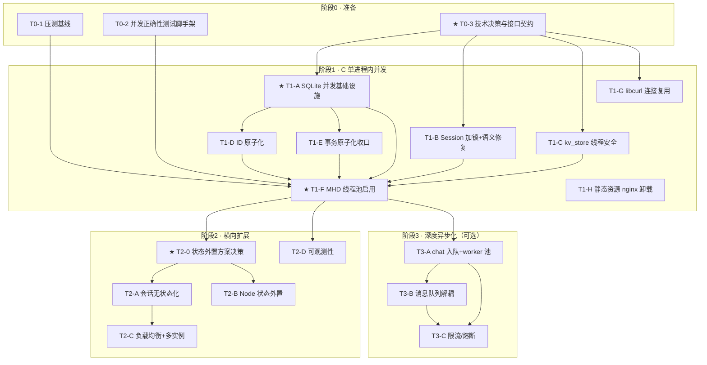

# 系统并行化改造方案（多用户并发在线）

> 本文档基于 `main` 分支 HEAD `644fd15` 源码实读，重点回答两个问题：
> 1. **线程从哪里派生**（现状与改造后的线程模型）；
> 2. **哪些共享状态需要并行化处理 / 加锁**（精确到文件与函数）。
>
> 结论先行：当前 C 后端是「单线程串行」假设，改造的关键不是"多加线程"，而是先修好共享状态（SQLite 连接、Session、kv_store 静态缓冲、非原子 ID），再启用 MHD 多线程；Node 侧已单进程内异步并发，瓶颈在于「单进程 + 内存态」无法横向扩展。

---

## 1. 现状架构与线程模型

```
┌──────────┐  HTTP/JSON   ┌───────────────────────────────┐  内部HTTP(独立凭证)   ┌─────────────────────┐
│  web/     │ ───────────▶ │ server（C11，端口 8000）       │ ────────────────────▶ │ ai-service（Node/TS， │
│ 纯静态前端 │  /api/v1/*   │ libmicrohttpd + SQLite        │   /internal/v1/jobs   │ 端口 8001）→ 模型    │
└──────────┘              │ + libcurl（AI 代理）           │                       │ Pi Agent 异步队列     │
                          └───────────────────────────────┘                       └─────────────────────┘
```

### 1.1 当前线程来源（改造前）

| 线程 | 来源 | 职责 | 证据 |
|------|------|------|------|
| 主线程 | 进程入口 `main()` | `http_server_start()` 中 `while (!g_stop) sleep(1)`，只等待信号，**不处理请求** | `http_server.c:154` |
| MHD 内部轮询线程（**唯一请求线程**） | `MHD_start_daemon(MHD_USE_INTERNAL_POLLING_THREAD, …)` | 所有 `request_handler` 回调在该线程**串行**执行 | `http_server.c:142-146` |
| libcurl 解析线程（短暂、库内部） | `curl_easy_perform` 遇到 DNS 解析时 libcurl 默认异步 resolver 会起线程 | 地址解析；`CURLOPT_NOSIGNAL=1` 已关闭信号线程 | `ai_client.c:84` |

**现状的本质：全系统只有一个请求处理线程。** 任何一个慢请求（内部 HTTP 最长 2s、大文件读入内存、DB 长查询）都会阻塞其余所有用户。这是"单线程串行"假设的根源，且代码在 `config.h` 中显式声明了这一假设。

### 1.2 改造后的线程来源（派生点）

改造后，新增线程只在以下四处派生，**必须全部发生在共享状态初始化完成之后、且已完成加锁改造**：

| # | 派生点 | 方式 | 说明 |
|---|--------|------|------|
| T1 | **MHD worker 线程池（主派生点）** | 把 `MHD_USE_INTERNAL_POLLING_THREAD` 换成 `MHD_USE_THREAD_PER_CONNECTION`（每连接一线程，MHD 内部管理、请求结束回收）或 `MHD_USE_INTERNAL_POLLING_THREAD + MHD_OPTION_THREAD_POOL_SIZE(N)`（固定 N 个 worker） | 这是吞吐收益最大的改动，也是触发所有加锁改造的直接原因 |
| T2 | **AI 提交 worker 池（阶段三可选）** | 自建 `pthread` 线程池，消费 `POST /api/v1/chat` 任务，把 `curl_easy_perform` 从请求线程剥离 | 彻底避免内部 HTTP 2s 阻塞 MHD 线程 |
| T3 | **定时清理线程（可选）** | 把 `session_cleanup` / 状态过期清理移出请求线程，独立线程 + 定时器 | 见 `auth.c:23`；需加锁 |
| T4 | **Node 多进程 worker（进程级）** | Node `cluster` / PM2 多进程，或反向代理多实例 | 见第 6 节；进程隔离，无共享内存竞争，但有分布式状态问题 |

**派生顺序约束（必须遵守）：**
1. `sqlite3_config(SQLITE_CONFIG_SERIALIZED)`（如需）必须在**任何** `sqlite3_open` 之前调用；
2. 所有模块初始化（`db_init` / `kv_init` / `db_seed_*` / `ai_access_init` / `teacher_api_init` / `exams_init`）在派生线程之前完成，形成 happens-before；
3. `curl_global_init` 在派生线程之前完成，之后每个线程使用**各自独立**的 `curl_easy` 句柄（现状已满足）。

---

## 2. 共享状态盘点与加锁清单（重点）

> 判定原则：改造后一个共享状态只要有 ≥2 个请求线程访问、且至少一个写，就必须加锁或改为每线程私有。下面按风险从高到低列出。

### 2.1 `cfg.db`：全局唯一 SQLite 连接（最高风险）

**影响面**：`db.c`、`kv_store.c`、`ai_access.c`、`teacher_api.c`、`teacher_api_routes.c`、`exams.c`、`routes.c` 全部通过 `cfg->db` 操作**同一个连接**（`main.c:23` 打开，`config.h:15-18` 声明"未加锁"）。

**两个具体危险：**

1. **连接级事务在多线程下被串扰**。
   `teacher_api.c` 多处使用显式事务：
   - `teacher_api_save`：`BEGIN IMMEDIATE`（165）… `COMMIT`（186）/ `ROLLBACK`（189）
   - `teacher_api_resolve`：`BEGIN IMMEDIATE`（238）… `COMMIT`（275）/ `ROLLBACK`（279）
   - `teacher_api_refund`：`BEGIN IMMEDIATE`（287）… `COMMIT`（296）/ `ROLLBACK`（299）

   SQLite 的 `BEGIN`/`COMMIT` 是**连接级状态**。若多个线程共享同一连接，线程 A 的 `BEGIN` 与 `COMMIT` 之间会被线程 B 的语句插入，导致 B 的写落入 A 的事务、A 的 `ROLLBACK` 回滚 B 的数据。`sqlite3_config(SQLITE_CONFIG_SERIALIZED)` 只保证**单条语句**互斥，**不能**保证跨语句事务的原子性。

2. **exams.c 的"读-改-写"无事务，并发丢失更新**。
   以下四个函数都是「`kv_get` 读 JSON → cJSON 修改 → `kv_set` 写回」，中间无事务：
   - `exams_set_questions`（448）
   - `exams_append_question`（496）
   - `exams_remove_question`（551）
   - `exams_purge_question`（662，还跨多条 exam 循环写）

   两个请求同时改同一张试卷的 questions，后写覆盖先写。
   （`exams_create`（279）已在 `BEGIN IMMEDIATE`（288）…`COMMIT`（312）/`ROLLBACK`（313）内完成「取号 + 7 次写入」，不在此列。）

**方案（二选一，按演进顺序）：**

- **最小改动（正确性优先）**：`sqlite3_config(SQLITE_CONFIG_SERIALIZED)` + **一把全局 DB 互斥锁**（`pthread_mutex`），所有 `BEGIN…COMMIT` 事务与多步读改写整体包在同一把锁内，保证事务期间无其它线程插入。
- **推荐演进（性能）**：**连接池**——每请求线程持有独立连接，事务天然绑定线程；读操作走独立读连接；开启 `PRAGMA journal_mode=WAL; PRAGMA busy_timeout=5000;`。此时 `cfg->db` 从裸指针封装为 `db_acquire()/db_release()`，所有模块改走连接池接口。

> 决策点：**单条语句**靠 `SERIALIZED` 已够；**事务/读改写**必须靠「独立连接」或「全局 DB 锁」。二者不可只取其一。

### 2.2 Session 存储（auth.c）

**共享状态**：`g_sessions[]`、`g_session_count`、`g_create_counter`（`auth.c:13-15`）。

| 函数 | 操作 | 需要的锁 |
|------|------|----------|
| `session_validate`（104） | 读 + 过期标记失效（写 `active=false`） | 读锁（若允许惰性失效则需写锁，建议锁内判定、拷贝后释放） |
| `session_create`（64） | 写新槽位 + 触发 `session_cleanup` 压缩 | 写锁 |
| `session_destroy`（120） | 写 `active=false` | 写锁 |
| `session_cleanup`（23） | 压缩数组、重排 `g_sessions` | 写锁 |

建议用 `pthread_rwlock`：validate 读锁，create/destroy/cleanup 写锁。

**两个额外隐患（不是锁能解决的，必须改语义）：**

1. **返回内部指针悬垂**：`session_create` 返回 `s->token`（`auth.c:101`），该指针指向 `g_sessions[i]` 槽位。并发 `session_cleanup` 压缩数组会使该指针失效或被覆盖。**改为调用方传入缓冲区，或返回 `strdup` 副本（调用方释放）。**
2. **`session_validate` 返回指针跨锁使用**：route 层拿到 `Session*` 后，在锁外读取 `s->role/s->name`（如 `routes.c` 各 handler）。若并发清理/压缩，该指针可能失效。**改为锁内拷贝 `user_id/role/name` 到局部结构再返回。**

### 2.3 kv_store.c 的非线程安全静态缓冲区（隐蔽但致命）

`safe_table_name()`（`kv_store.c:34`）使用 `static char buf[256]` 并返回其指针（`kv_store.c:55` 注释也自述"每次调用覆盖，不可跨调用保存"）。多线程并发调用会互相覆盖，导致 `kv_get`/`kv_set` 用错表名。**改为 C11 `_Thread_local` 或调用方提供缓冲区。**

`g_base_dir`（`kv_store.c:565`）由 `kv_set_base_dir`（567）写入、`get_base_dir`（583）读取。当前只在启动期写一次，派生线程后只读 → 约定「初始化后不可变」即可，无需锁，但需在代码注释固化该约定。

### 2.4 非原子 ID 生成（并发撞 ID）

| 位置 | 实现 | 问题 |
|------|------|------|
| `next_question_id()`（`routes.c:593`） | `kv_list_keys` 取 max + 1 | 两请求并发创建题目撞 ID |
| `next_exam_id()`（`exams.c:101`） | 同上，但仅被 `exams_create` 的 `BEGIN IMMEDIATE` 事务内调用 | 撞 ID 风险较低；仍建议改为 `counters` 自增 |
| `db_create_user()`（`db.c:277`） | `kv_list_keys` 计数 + 1 | 两请求并发注册撞 ID |

**方案**：改用 SQLite 自增（`AUTOINCREMENT` 或专用 `counters` 表 `UPDATE … RETURNING`），或对三处 ID 分配统一加一把互斥锁；不要再用「list_keys 取最大/计数 +1」这种非原子做法。

### 2.5 无需加锁 / 只读 / 启动期状态（明确排除，避免过度加锁）

| 状态 | 位置 | 处理 |
|------|------|------|
| `AppConfig cfg`（`config_load` 结果） | `config.h` | 作为 `cls` 传入所有回调，多线程**只读** → 安全；注意 `cfg` 生命周期须覆盖整个守护进程 |
| `g_stop`（`volatile sig_atomic_t`） | `http_server.c:16` | 已满足信号安全，主线程写、只读退出 |
| `hash_password` | `routes.c:34` / `db.c:22` | 纯局部计算，无共享 |
| `RequestCtx`（请求体累积） | `http_server.c:25` | per-connection 局部，由 `NOTIFY_COMPLETED` 回收 |
| `ResponseBuffer` | `ai_client.c:11` | 每请求局部 |
| cJSON 对象 | 各 handler | 每请求局部 |
| `db_seed_questions` / `db_seed_users` / 各 `*_init` | `main.c:16-66` | 仅启动期执行，线程派生前完成，天然 happens-before |
| `load_env_file` | `config.c:13` | 仅 `main` 调用 |

### 2.6 Node ai-service（jobs.ts）侧

Node 是单 JS 线程 + 事件循环，**没有 OS 级数据竞争**，但存在逻辑竞态与扩展边界：

- `Jobs` 的 `jobs` / `conversations` / `queue` / `running` / `stopped`（`jobs.ts:33-38`）全在内存；单进程内由事件循环顺序保证，无需锁。
- 逻辑竞态：`conversation.activeJob`（`jobs.ts:74,97,166`）、`cancel` vs `execute`（112-123）、`pump` 的 `running--`（167）——单进程内安全，但**迁移到多进程后必须外置状态**（Redis）或按 `conversation_id` 一致性哈希路由到固定 worker，否则跨进程 GET 状态 / DELETE 取消失效。

---

## 3. 线程派生点与加锁点的对应关系（一图）

```
                     ┌─────────────────────────────────────────────┐
main 线程 ──初始化──▶ │ 派生 T1：MHD 线程池（每请求一线程 / N worker） │
（信号等待）          └──────────────────┬──────────────────────────┘
                                        │ 并发进入 request_handler
                                        ▼
              ┌───────────────────────────────────────────────┐
              │ 需要保护的共享状态（每请求可能访问）              │
              │  S1 cfg.db         → DB 全局锁 / 连接池        │
              │  S2 g_sessions[]   → rwlock + 指针拷贝         │
              │  S3 safe_table_name → _Thread_local 缓冲       │
              │  S4 ID 分配        → 自增 / 互斥锁             │
              └───────────────┬───────────────────────────────┘
                              │ 阶段三：派生 T2 worker 池
                              ▼
              ┌───────────────────────────────────────────────┐
              │ ai-service（进程级扩展：T4 cluster/LB）          │
              │  内存态 jobs/conversations → Redis/一致性路由    │
              └───────────────────────────────────────────────┘
```

**关键结论：T1 派生之前，必须先完成 S1–S4 的加锁改造；否则 MHD 一开多线程，正确性立即崩溃（SQLite 事务串扰、Session 数组越界、表名覆盖、ID 撞车）。**

---

## 4. 分阶段实施

### 阶段一：C 后端单进程内并发（核心）

1. **SQLite 并发模型**（S1）
   - 启动时 `sqlite3_config(SQLITE_CONFIG_SERIALIZED)` + 全局 DB 互斥锁包住所有显式事务（`teacher_api_*`）与 exams 读改写；
   - 开 WAL + busy_timeout；
   - 中期演进为连接池，把 `cfg.db` 裸指针换成 `db_acquire()/db_release()`。
2. **MHD 线程模型**（T1）
   - `MHD_USE_THREAD_PER_CONNECTION` 或 `MHD_OPTION_THREAD_POOL_SIZE(N)`；线程数做成环境变量 `MHD_THREADS` 可调，建议 CPU 核数 ×2 起步，压测定值。
3. **Session 加锁 + 语义修复**（S2）
   - 加 `pthread_rwlock`；`session_create`/`session_validate` 改为缓冲区/拷贝语义，消除内部指针悬垂；`MAX_SESSIONS` 从 128 上调或改动态。
4. **静态缓冲修复**（S3）：`safe_table_name` 改 `_Thread_local`。
5. **ID 原子化**（S4）：题目/用户/试卷 ID 改自增或专用计数器 + 互斥锁。
6. **libcurl 连接复用**：curl 连接池（`CURLSH`）复用与 Node 的长连接。
7. **静态资源卸载（可选）**：前置 nginx 托管 `web/`，C 只处理 `/api/*`。

### 阶段二：进程级横向扩展

1. 会话无状态化/外置（SQLite 表或 Redis），多实例共享登录态；
2. nginx/HAProxy 前置多实例 C + 多实例 Node；
3. Node `cluster`/PM2 多进程 + jobs/conversations 外置 Redis 或一致性路由；
4. `deploy/systemd` 补多实例模板与负载均衡示例。

### 阶段三：深度异步化（可选，削峰）

1. `POST /api/v1/chat` 只做鉴权+校验+入队即返 202，独立 worker 池（T2）消费，避免 2s 内部 HTTP 阻塞 MHD 线程；
2. 引入消息队列解耦 C 与 Node，Node 做消费组；
3. 按用户/教师配额限流、全局并发上限、对模型服务 429/5xx 熔断。

---

## 5. 验收与验证

- **正确性**：并发压测下无 `SQLITE_BUSY`/崩溃、无 ID 撞车（并发注册/建题脚本验证唯一性）、无事务串扰（并发 charge/refund 计数一致）。
- **吞吐**：`wrk`/`ab`/`hey` 对 `/health`、登录、题目列表做基线 vs 改造后对比；目标 P99 延迟与并发数解耦。
- **在线用户**：定义目标（如 200 并发登录、50 并发 AI 提交）压测通过；Session 上限不再受 128 限制。
- **可观测**：`/health` 增加活跃连接数、队列深度、DB busy 计数。

---

## 6. 附录：函数级加锁/改造点对照表

| 文件:函数 | 共享状态 | 风险 | 处理 |
|-----------|----------|------|------|
| `http_server.c:142` `MHD_start_daemon` | 线程模型 | 单线程串行 | 改线程池 / thread-per-connection |
| `config.h:15` / `main.c:23` `cfg.db` | 全局单 SQLite 连接 | 事务串扰、读改写丢失 | 全局 DB 锁 或 连接池 + WAL |
| `teacher_api.c:165/238/287` 事务 | `BEGIN IMMEDIATE` | 连接级事务跨线程串扰 | 独立连接 或 全局 DB 锁包事务 |
| `teacher_api.c:238-275` `teacher_api_resolve` | usage 自增 + charge 插入 | 配额超扣/漏扣 | 事务原子化 |
| `exams.c:101` `next_exam_id` | ID 分配 | 已被 `exams_create` 事务包裹，撞 ID 风险低 | `counters` 自增 |
| `exams.c:448/496/551/662` | questions JSON 读改写 | 丢失更新 | 事务 / 每卷锁 |
| `routes.c:593` `next_question_id` | ID 分配 | 撞 ID | 自增 / 互斥锁 |
| `db.c:277` `db_create_user` | ID 分配 | 撞 ID | 自增 / 互斥锁 |
| `auth.c:13-15` | `g_sessions`/`g_session_count`/`g_create_counter` | 数组越界、脏读 | rwlock + 拷贝语义 |
| `auth.c:101` `session_create` 返回 | 内部 token 指针 | 悬垂/覆盖 | 缓冲区/strdup |
| `auth.c:104` `session_validate` 返回 | `Session*` 跨锁使用 | 悬垂 | 锁内拷贝 |
| `kv_store.c:34` `safe_table_name` | `static char buf[256]` | 表名覆盖 | `_Thread_local` |
| `kv_store.c:565` `g_base_dir` | 启动期写、运行期读 | 无（约定只读） | 固化约定 |
| `ai_client.c:44` `ai_service_request` | 每请求独立 curl handle | 无（线程安全） | 可选连接复用 |
| `routes.c:2425` `serve_static` | 全量读文件 | 无共享，纯性能 | nginx 卸载 / 内存映射 |
| `jobs.ts:33-38` | 内存 job/conversation 态 | 多进程不可见 | Redis / 一致性路由 |
| `jobs.ts:74/166` `activeJob` | 逻辑竞态 | 单进程安全 | 分布式迁移时原子化 |

---

## 7. 并行开发任务拆分（按阶段）

> 任务编号规则：`T{阶段}-{序号}`；阶段 0 为 `T0-x`。每项标注「依赖」与「产出」。
> 「屏障任务（barrier）」= 必须由 **1 人先独立完成**、其余工作才能开始的任务；图中用 ★ 标记。

### 7.0 阶段零：准备与基线（3 人并行，无相互依赖）

| 任务 | 目标 | 产出 | 依赖 |
|------|------|------|------|
| T0-1 压测基线 | 建立可复现的压测手段与基线数据 | `wrk`/`hey` 脚本（覆盖 `/health`、登录、题目列表、chat 提交）+ 基线报告 | 无 |
| T0-2 并发正确性测试脚手架 | 先写出"会失败"的确定性并发测试，作为改造验收标准 | 并发注册/建题撞 ID、charge/refund 串扰、exams 读改写丢失更新的自动化测试 | 无 |
| ★ T0-3 技术决策与接口契约 | 定死 DB 并发方案与接口，消除下游返工 | 已完成，见 [并行化改造-T0-3接口契约.md](并行化改造-T0-3接口契约.md)：`db_acquire/db_release` 连接池接口、Session 拷贝语义接口、`id_next` 原子 ID 接口、`MHD_MODE/MHD_THREADS/DB_POOL_SIZE/SQLITE_BUSY_TIMEOUT_MS` 配置契约 | 无 |

### 7.1 阶段一：C 后端单进程内并发

**前置：T0-3 完成。** 正确性改造（A~E）先行，全部通过后再打开线程池（F）。

| 任务 | 目标 | 涉及文件 | 依赖 |
|------|------|----------|------|
| ★ T1-A SQLite 并发基础设施 | `sqlite3_config(SERIALIZED)` + WAL + busy_timeout + 连接封装（全局锁或连接池） | `main.c`、`config.c`、新增 `db_pool.c`、`config.h` | T0-3 |
| T1-B Session 加锁与语义修复 | `pthread_rwlock` + token/返回值拷贝语义 + `MAX_SESSIONS` 上调/动态化 | `auth.c`、`auth.h`、`routes.c`（session 调用点） | T0-3 |
| T1-C kv_store 线程安全 | `safe_table_name` 改 `_Thread_local` + `g_base_dir` 只读约定固化 | `kv_store.c` | T0-3 |
| T1-D ID 原子化 | 题目/用户/试卷 ID 改 SQLite 自增或计数器+互斥锁 | `routes.c`（`next_question_id`）、`db.c`（`db_create_user`）、`exams.c`（`next_exam_id`） | T1-A |
| T1-E 事务原子化收口 | `teacher_api` 三个 `BEGIN IMMEDIATE` 事务包锁/独立连接；`exams` 读改写加事务 | `teacher_api.c`、`exams.c` | T1-A |
| ★ T1-F MHD 线程池启用 | `MHD_USE_THREAD_PER_CONNECTION` 或 `THREAD_POOL_SIZE` + `MHD_THREADS` 配置，压测回归 | `http_server.c`、`config.c` | T1-A、T1-B、T1-C、T1-D、T1-E、T0-1、T0-2 |
| T1-G libcurl 连接复用 | curl 连接池（`CURLSH`）复用与 Node 长连接 | `ai_client.c` | T0-3（可与 A~E 并行） |
| T1-H 静态资源 nginx 卸载 | 前置 nginx 托管 `web/`，C 只处理 `/api/*` | `deploy/`、nginx 配置 | 无（独立部署，可全程并行） |

### 7.2 阶段二：进程级横向扩展

**前置：阶段一（T1-F）完成。**

| 任务 | 目标 | 涉及文件 | 依赖 |
|------|------|----------|------|
| ★ T2-0 状态外置方案决策 | 定死「Redis vs SQLite 会话表 vs 粘性路由」及 Node 状态外置方案 | 决策文档 | T1-F |
| T2-A 会话无状态化/外置 | 会话迁出 C 进程内存，多实例共享 | `auth.c`（或引入 `session_store` 后端） | T2-0 |
| T2-B Node jobs/conversations 外置 | job/conversation 态迁 Redis 或按 `conversation_id` 一致性路由 | `ai-service/src/jobs.ts` | T2-0 |
| T2-C 负载均衡 + 多实例 | nginx/HAProxy 前置多实例 C + Node；systemd 多实例模板 | `deploy/systemd`、nginx 配置 | T2-A |
| T2-D 可观测性 | `/health` 增加活跃连接/队列深度/DB busy 指标 + 监控 | `routes.c`（health）、`ai-service` | T1-F（可与 A/B/C 并行） |

### 7.3 阶段三：深度异步化（可选，削峰）

**T3-A 仅依赖阶段一，可与阶段二并行；T3-B/T3-C 依赖 T3-A。**

| 任务 | 目标 | 涉及文件 | 依赖 |
|------|------|----------|------|
| T3-A chat 入队 + C 侧 worker 池 | `POST /api/v1/chat` 只鉴权+校验+入队返 202，worker 池消费，剥离 2s 内部 HTTP | `routes.c`（handle_chat）、`ai_client.c`、新增 worker 池 | T1-F |
| T3-B 消息队列解耦 C↔Node | 引入 Redis Streams/队列，Node 做消费组 | `ai_client.c`、`ai-service/src/server.ts` | T3-A |
| T3-C 限流/熔断 | 按用户/教师配额限流、全局并发上限、模型 429/5xx 熔断 | `routes.c`、`ai_client.c`、`ai-service` | T3-A（+T3-B） |

---

## 8. 任务依赖图

### 8.1 Mermaid 图（GitHub/支持 Mermaid 的编辑器可直接渲染）



### 8.2 ASCII 依赖图（无渲染环境下的等价表达）

```
T0-1 ──────────────────────────────┐
T0-2 ──────────────────────────────┤
★T0-3 ──┬──▶ T1-A ──┬──▶ T1-D ─────┤
         │           ├──▶ T1-E ─────┤
         │           │              │
         ├──▶ T1-B ──┴──────────────┼──▶ ★T1-F ──▶ ★T2-0 ──┬──▶ T2-A ──▶ T2-C
         ├──▶ T1-C ─────────────────┤               │       └──▶ T2-B
         └──▶ T1-G ─────────────────┘               └──▶ T2-D（← T1-F 直连）

T1-F ──▶ T3-A ──┬──▶ T3-B ──┐
                └──▶ T3-C ◀─┘

T1-H（nginx 静态卸载）：无依赖，全程并行
```

**关键屏障（单人格子）说明：**
1. **T0-3（接口契约）**：定死 DB 封装/Session 锁/ID 接口后，T1-A~D 才能各自并行而不互相返工。
2. **T1-A（SQLite 基础设施）**：T1-D（ID）与 T1-E（事务）都建立在"连接封装/全局锁"之上，须先落地。
3. **T1-F（线程池启用）**：阶段一总闸门——正确性改造（A~E）与测试脚手架（T0-1/T0-2）全绿后，才允许打开多线程；也是阶段二/三的入口。
4. **T2-0（状态外置决策）**：决定阶段二两条主线（会话外置 / Node 状态外置）的技术路线，须先定。

---

## 9. 并行协作建议与冲突控制

### 9.1 并行排布（以 4 人为例）

| 阶段 | 并行排布 |
|------|----------|
| 阶段 0 | 3 人并行 T0-1/T0-2/T0-3，其中 T0-3 由最熟 DB 并发的人牵头 |
| 阶段 1 | T0-3 完成后：1 人做 ★T1-A（基础设施），另 3 人并行 T1-B/T1-C/T1-G；T1-A 完成后再并行 T1-D/T1-E；最后汇合到 ★T1-F 集成 + 压测回归 |
| 阶段 2 | T2-0 决策后：T2-A/T2-B/T2-D 三人并行，T2-C 等 T2-A |
| 阶段 3 | T3-A 可与阶段 2 并行（由 1 人先行），T3-B/T3-C 随后 |

### 9.2 同文件冲突（需排他或拆分提交协调）

| 文件 | 涉及的并发任务 | 协调建议 |
|------|----------------|----------|
| `exams.c` | T1-D（`next_exam_id`）与 T1-E（读改写事务） | 同人先后完成，或按「ID 改自增」与「读改写加事务」两笔小提交串行合入 |
| `db.c` | T1-A（连接封装/全局锁）与 T1-D（`db_create_user` ID） | T1-D 须基于 T1-A 的新接口，顺序天然解耦 |
| `routes.c` | T1-B（session 调用点拷贝）与 T1-D（`next_question_id`）、T3-A（chat 入队） | 分属不同 handler 区域，建议按函数级拆分提交，合入前统一走 `git merge` 前本地 rebase |
| `ai_client.c` | T1-G（连接复用）与 T3-A/T3-C（worker 池/限流） | T3-A 会重写 `ai_service_request` 的调用方式，建议 T3-A 在 T1-G 之上开发 |
| `ai-service/src/jobs.ts` | T2-B（状态外置）与 T3-B（消息队列） | 均改任务状态机，需排他：先 T2-B 或先 T3-B，避免并行合入 |

### 9.3 里程碑（可独立验收的提交点）

| 里程碑 | 判定条件 |
|--------|----------|
| M0 | T0-1/T0-2/T0-3 交付，压测脚本可跑、并发测试可复现失败 |
| M1 | T1-A~E 完成：`make build && make test` 全绿，T0-2 并发测试转绿（在未开线程池的单线程下验证正确性） |
| M2 | ★T1-F 完成：线程池开启，T0-1 压测通过，无 `SQLITE_BUSY`/崩溃/ID 撞车，P99 与并发解耦 |
| M3 | T2-* 完成：多实例 + LB 可用，会话/任务跨实例一致 |
| M4 | T3-* 完成（可选）：chat 提交非阻塞、限流熔断生效 |

### 9.4 风险与约束

- **屏障顺序不可颠倒**：T1-F 之前必须 A~E 全绿；否则多线程一开即崩溃（SQLite 事务串扰、Session 越界、表名覆盖、ID 撞车）。
- **T1-A 是阶段一的关键路径**：其方案（全局锁 vs 连接池）决定 T1-D/T1-E 的实现量，须在 T0-3 就定死，避免返工。
- **T3-A 与阶段二可并行但需在 `ai_client.c`/`jobs.ts` 上排他**，见 9.2 冲突表。
