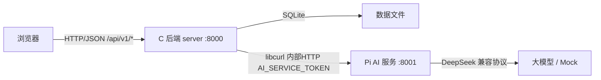
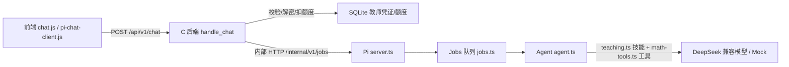
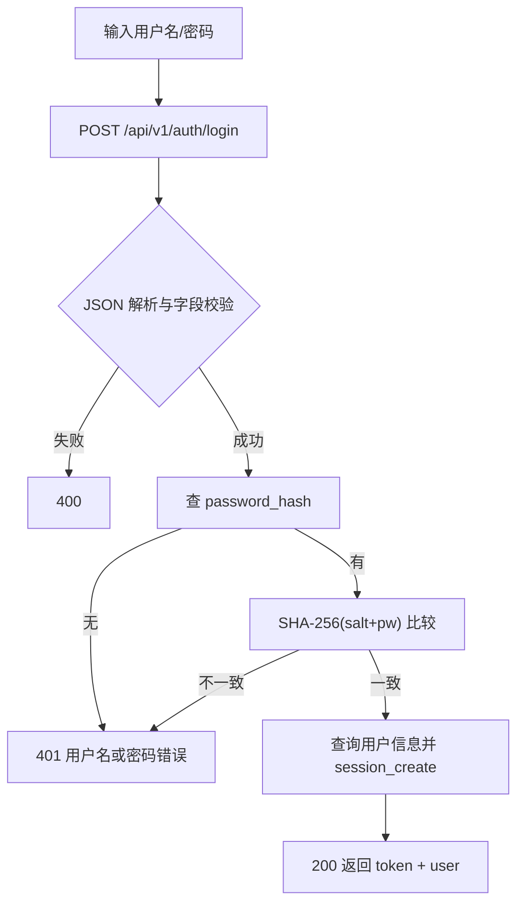
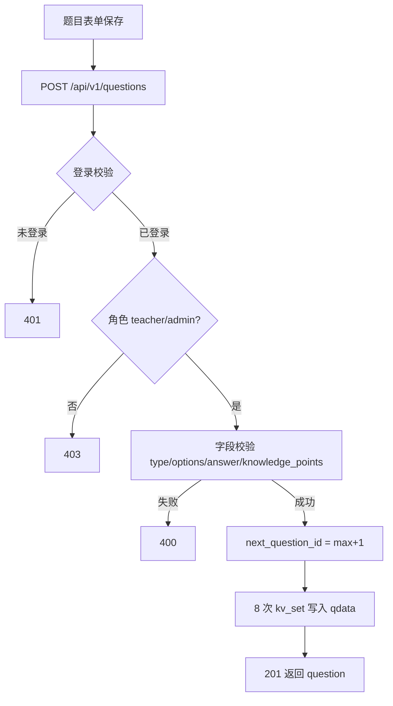
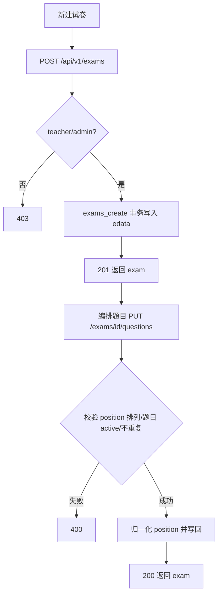
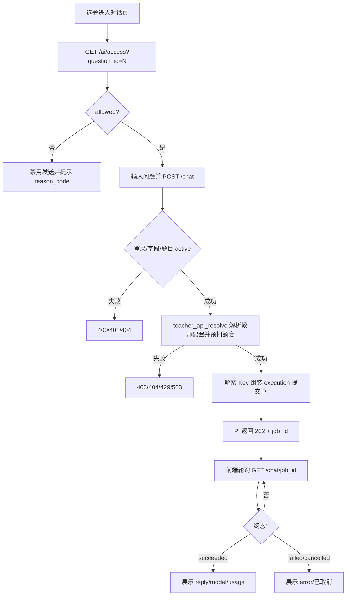
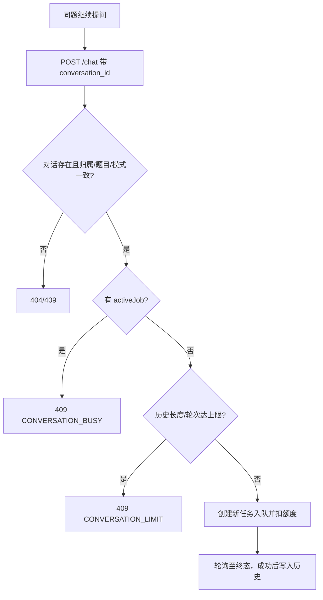
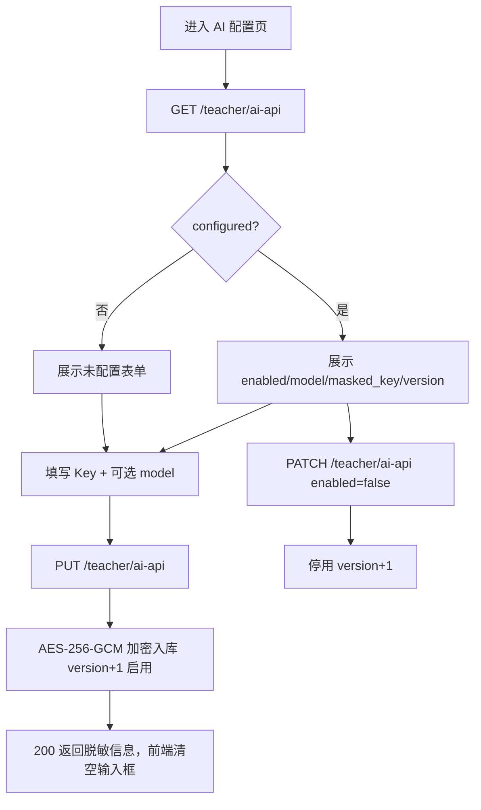
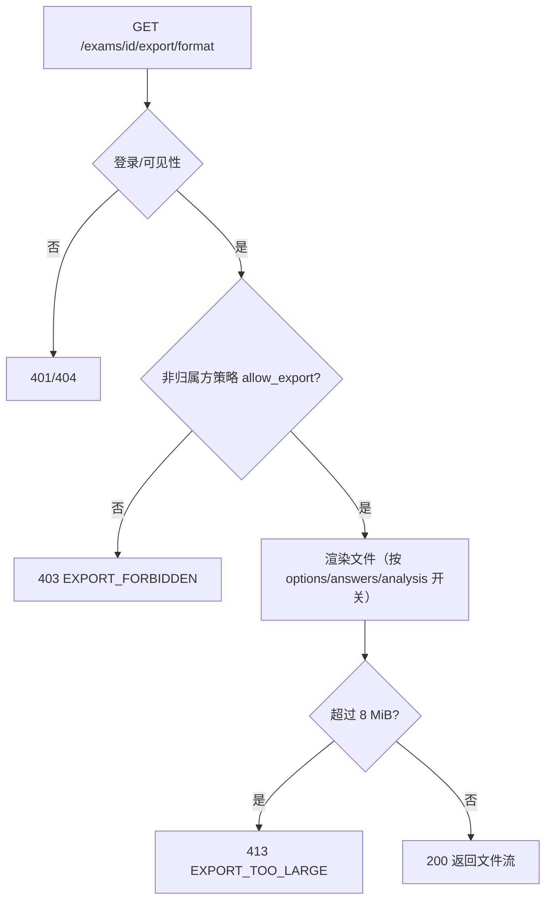

# AI+题库智能教学平台 详细功能说明书

> 版本：v1.0
> 文档性质：正式详细功能说明书（面向项目负责人、开发人员、测试人员）
> 分析基线：`ai-question-bank-fork` 工作区 `main` 分支当前代码；文档与代码冲突时以代码为准。
> 状态口径：✅ 已实现 ／ 🟡 部分实现 ／ ⬜ 未实现（预期功能） ／ ❓ 待验证

---

## 1. 文档概述

### 1.1 编写目的

本文档系统描述 AI+题库智能教学平台的详细功能，明确每个功能的使用角色、用户操作、业务处理逻辑、输入输出、权限与异常处理，作为开发参考、项目展示与测试验收的统一依据。

### 1.2 项目背景

AI+题库智能教学平台是一个面向教育场景的多教师、多学生题库与试卷管理平台。教师维护题库/试卷并配置 AI 解答；学生浏览题目/试卷、提交题目获取 AI 解答并在分支对话中追问；管理员负责用户、全局 API、审计与运维。平台以"题目"为核心数据资产，以"AI 解答"为能力核心。

### 1.3 文档适用范围

本文档覆盖当前代码库已实现的功能与已规划的预期功能，并在每条功能上明确标注实现状态。未标注"已实现"的内容不代表当前可用，仅作为后续迭代目标。

### 1.4 术语和缩略语

| 术语 | 说明 |
| --- | --- |
| C 后端 / server | `server/` 目录下的 C11 HTTP 服务，唯一公共业务入口 |
| Pi 服务 / ai-service | `ai-service/` 目录下的 Node.js/TypeScript 内部 AI 服务 |
| kv_store | 目录式键值存储层，namespace 映射同名 SQLite 表 |
| Bearer Token | 用户登录凭证，`Authorization: Bearer <token>` |
| job_id | AI 异步任务唯一标识（UUID） |
| conversation_id | 同题同模式对话唯一标识（UUID） |
| teacher 模式 | 默认 AI 路由模式，教师自管 API |
| platform 模式 | 旧平台统一 Key + CLI 授权模式 |

### 1.5 参考资料

- `README.md`、`docs/architecture.md`
- `docs/auth.md`、`docs/questions.md`、`docs/exams.md`、`docs/export.md`
- `docs/ai-access.md`、`docs/teacher-api.md`、`docs/pi-chat-api.md`、`docs/kvstore.md`
- `docs/软件需求说明书.md`、`docs/AI题库项目整体预期功能说明书.md`、`docs/项目开发时间轴.md`
- `OOA_OOD/`（用况图/类图/顺序图/状态图/包图）
- `docs/功能清单与实现状态.md`、`docs/项目功能盘点报告.md`

---

## 2. 系统总体说明

### 2.1 产品定位

一个支持多教师、多学生、多租户数据隔离的智能题库与试卷管理平台，实现题目资源数字化管理、AI 辅助教学答疑、试卷组织与导出，并为后续知识沉淀与多模型接入提供基础。

### 2.2 系统目标

- 教师自主维护题库与试卷资源；
- 学生浏览题目/试卷并获取 AI 智能解答与追问；
- 基于大模型的 AI 问答与同题追问机制；
- 教师自管 AI API，学生按题目归属调用，额度可控；
- 安全、稳定、可扩展的教育服务平台。

### 2.3 技术架构概述

| 层 | 技术 | 职责 |
| --- | --- | --- |
| web（前端） | 纯 HTML/CSS/JS，无构建工具链 | hash SPA，9 个页面，由 C 后端直接托管，支持 file:// 离线演示降级 |
| server（后端） | C11 + libmicrohttpd + SQLite3 + libcurl + cJSON + OpenSSL | 唯一公共业务入口：认证、题目、试卷、导出、AI 任务代理、教师 API 配置 |
| ai-service（AI） | Node.js ≥22.19 + TypeScript + Pi 0.84.1 | 内部模型执行、教学技能、异步任务队列；仅监听 127.0.0.1:8001 |
| 存储 | SQLite（kv_store 目录式 KV + 关系表） | users/qdata/edata 走 KV；AI 授权/教师 API/额度走关系表 |

调用关系：

### 2.4 系统边界

- C 后端是唯一公共业务入口，前端只能访问 `/api/v1/*`。
- Pi 服务是内部服务，仅监听 127.0.0.1，不直接对学生开放；模型 Key 只存在于可信后端。
- 前端永不接触 API Key、内部服务凭证、用户 ID 额度或授权状态。

### 2.5 总体功能结构

| 模块 | 编号段 | 主要内容 | 总体状态 |
| --- | --- | --- | --- |
| 系统公共 | SYS | 健康检查、注册/登录/登出/当前用户、会话管理、静态托管 | ✅ 已实现 |
| 管理员 | ADM | 用户管理、平台配置、审计、全局 AI 授权 CLI、运维 | 🟡 大部分未实现 |
| 教师 | TEA | 题目 CRUD、试卷 CRUD/编排、导出、AI API 配置 | ✅ 主体已实现（导出前端未接入） |
| 学生 | STU | 题库/试卷浏览、AI 解答、线性追问 | ✅ 主体已实现（讨论树/个人中心未实现） |
| AI 智能解答 | AI | 异步任务、三教学模式、工具、额度、密钥加密、Mock | ✅ 已实现并有真实模型评测 |

前端 9 个页面（hash 路由）：登录、注册、题目列表、题目表单、对话、试卷列表、试卷浏览、试卷编辑、教师 AI API 配置。

---

## 3. 用户角色与权限说明

### 3.1 管理员（admin）

- 系统预设账号：`admin`（默认密码 `admin123`，可由 `DEMO_ADMIN_PW` 覆盖）。
- 当前能力：登录后可读写题目（与教师同权限）、读写全部试卷（含他人试卷）、导出试卷。
- **无独立管理后台**：用户管理、平台配置、供应商管理、审计查询、备份监控均未实现。
- 默认 teacher 模式下**无 AI 调用资格**（`AI_TEACHER_ONLY`）。

### 3.2 教师（teacher）

- 系统预设账号：`teacher`（默认密码 `teacher123`）。
- 能力：题目 CRUD、试卷 CRUD/编排/状态、AI API 配置、AI 解答（使用本人配置）、试卷导出。
- 试卷与 AI 凭证有归属隔离；**题目无归属隔离**（详见 3.5）。

### 3.3 学生（student）

- 系统预设账号：`student`（默认密码 `student123`）。
- 能力：浏览题库/试卷、获取 AI 解答、同题追问。
- 只能读 active 试卷；不能写题目/试卷；不能配置 AI API。

### 3.4 角色权限矩阵

| 操作 | admin | teacher | student |
| --- | --- | --- | --- |
| 注册/登录/登出/当前用户 | ✅ | ✅ | ✅ |
| 题目读（列表/详情，含答案与解析） | ✅ | ✅ | ✅ |
| 题目写（新增/改/删） | ✅ | ✅（**无归属隔离**） | ❌ 403 |
| 试卷读 | 全部 | 仅本人创建 | 仅 active（archived 404） |
| 试卷写（CRUD/编排/状态） | 全部 | 仅本人创建 | ❌ 403 |
| 试卷导出/导出策略 | 全部 | 本人（归档卷也可导出） | 仅 active（受策略约束） |
| 教师 AI API 配置 | ❌ 403 | ✅（本人） | ❌ 403 |
| AI 调用（teacher 模式） | ❌ AI_TEACHER_ONLY | ✅（用自己配置） | ✅（用题目归属教师配置） |
| AI 调用（platform 模式） | 需 CLI 授权 | 需 CLI 授权 | 需 CLI 授权 |
| 用户管理后台 | ❌ 无此功能 | ❌ | ❌ |

### 3.5 数据访问控制规则

| 数据 | 隔离现状 |
| --- | --- |
| 用户 | username 唯一；id 按用户数 +1 生成（demo 简化） |
| 题目 | **无租户隔离**：全库题目对所有登录用户可见；任意 teacher/admin 可改删任意题目；`teacher_id` 仅记录创建者，未用于读写鉴权 |
| 试卷 | **有归属隔离**：`teacher_id` 取自 session；teacher 仅本人、admin 全部；student 仅 active |
| 教师 AI 凭证 | **有隔离**：`teacher_ai_credentials` 以 teacher_id 为主键；AAD 绑定教师 ID/账号键/版本/模型 |
| AI 额度 | **有隔离**：`teacher_ai_usage(student_id, teacher_id, day)` 按"学生+教师+上海自然日"计数 |
| AI 对话/任务 | **有隔离**：Pi 内存 Conversation/Job 绑定 owner(user_id)+question_id，跨用户 404 |

---

## 4. 用户账户与认证管理

### 4.1 SYS-03 用户登录

| 项 | 内容 |
| --- | --- |
| 所属模块 | 系统公共 / 认证 |
| 功能说明 | 用户以用户名+密码登录，成功后获得 Bearer Token |
| 使用角色 | 全部用户 |
| 前置条件 | 账号已存在 |
| 输入信息 | `{"username":"...","password":"..."}`（POST JSON） |
| 操作步骤 | 前端登录页填写账号密码 → 提交 → 保存返回的 token 与 user → 进入题目列表 |
| 业务处理逻辑 | 解析 JSON → 查 `users` namespace 的 `password_hash` → 对输入密码做 `SHA-256(固定salt‖密码)` → 比较 → 一致则查询用户信息并 `session_create` → 返回 token+user |
| 输出结果 | `200 {"token":"...","user":{"id","username","name","role"}}` |
| 业务规则与约束 | 密码哈希用固定 salt `ai-question-bank-demo-salt-2026`；token 有效期 24h |
| 异常处理 | 400 请求体/JSON/字段缺失；401 用户名或密码错误（不区分用户不存在与密码错误，防枚举）；500 查询/建会话失败 |
| 实现状态 | ✅ 已实现 |
| 实现依据 | `server/src/routes.c handle_login`、`server/src/auth.c`、`server/src/db.c`；`POST /api/v1/auth/login`；`tests/auth/case_1/2` |

### 4.2 SYS-02 用户注册

| 项 | 内容 |
| --- | --- |
| 所属模块 | 系统公共 / 认证 |
| 功能说明 | 新用户注册，注册成功后自动登录 |
| 使用角色 | 全部用户；**前端注册页仅开放 student/teacher** |
| 前置条件 | 无（未登录） |
| 输入信息 | `{"username","password","confirm_password","role"?}`（role 可选，默认 student） |
| 操作步骤 | 注册页填写用户名/密码/确认密码/角色 → 提交 → 自动登录进入系统 |
| 业务处理逻辑 | 校验用户名非空、两次密码一致、密码强度（≥8 位且含字母与数字）、角色合法（student/teacher/admin）→ 哈希入库（`db_create_user`）→ 自动建 session |
| 输出结果 | `201 {"token":"...","user":{...}}` |
| 业务规则与约束 | 接口接受 admin 角色，但前端注册页只提供 student/teacher 两选项（服务端未收紧自助注册 admin 的策略） |
| 异常处理 | 400 字段校验失败/两次密码不一致/密码强度不足/角色非法；409 用户名已存在；500 建用户/建会话失败 |
| 实现状态 | ✅ 已实现 |
| 实现依据 | `routes.c handle_register`、`db.c db_create_user`；`POST /api/v1/auth/register`；`tests/auth/case_5~8` |

### 4.3 SYS-04 登出

| 项 | 内容 |
| --- | --- |
| 所属模块 | 系统公共 / 认证 |
| 功能说明 | 销毁服务端 session，使 token 失效 |
| 使用角色 | 已登录用户 |
| 前置条件 | 携带 Bearer token |
| 输入信息 | 无请求体，仅需 `Authorization` 头 |
| 业务处理逻辑 | 提取 token → `session_destroy` → 前端清除本地 token/user 并清空会话映射 |
| 输出结果 | `200 {"status":"ok"}` |
| 业务规则与约束 | 无论 token 是否有效均返回 200；登出后 token 不可复用 |
| 异常处理 | 无（幂等） |
| 实现状态 | ✅ 已实现 |
| 实现依据 | `routes.c handle_logout`、`auth.c session_destroy`；`POST /api/v1/auth/logout` |

### 4.4 SYS-05 当前用户信息

| 项 | 内容 |
| --- | --- |
| 所属模块 | 系统公共 / 认证 |
| 功能说明 | 校验 token 并返回当前用户 id/name/role |
| 使用角色 | 已登录用户 |
| 前置条件 | 有效 Bearer token |
| 输入信息 | 无请求体 |
| 业务处理逻辑 | `session_validate` 校验 token → 返回会话中用户信息 |
| 输出结果 | `200 {"user":{"id","name","role"}}` |
| 异常处理 | 401 未登录或 token 已过期 |
| 实现状态 | ✅ 已实现 |
| 实现依据 | `routes.c handle_me`；`GET /api/v1/auth/me`；`tests/auth/case_3` |

### 4.5 SYS-06 会话管理

| 项 | 内容 |
| --- | --- |
| 所属模块 | 系统公共 / 认证 |
| 功能说明 | 服务端会话生命周期管理 |
| 使用角色 | 系统 |
| 业务处理逻辑 | 内存固定数组 `g_sessions`（最多 128）；token 用 OpenSSL `RAND_bytes` 生成 64 位十六进制；有效期 24h；每 16 次 `session_create` 触发一次 `session_cleanup`（标记过期、紧凑排列、清零尾部） |
| 业务规则与约束 | 单线程 demo 实现，不持久化、不支持多实例；生产需替换为 Redis/DB |
| 实现状态 | ✅ 已实现（demo 取舍） |
| 实现依据 | `server/src/auth.c g_sessions/session_cleanup/generate_token`；`docs/auth.md` §3 |

### 4.6 SYS-01 健康检查

| 项 | 内容 |
| --- | --- |
| 所属模块 | 系统公共 |
| 功能说明 | 返回服务健康状态，供探活与运维使用 |
| 使用角色 | 公开（无需鉴权） |
| 业务处理逻辑 | `GET /api/v1/health` 返回 `{"status":"ok","service":"ai-question-bank"}` |
| 实现状态 | ✅ 已实现 |
| 实现依据 | `routes.c handle_health`；`tests/health/case_1.sh` |

### 4.7 SYS-07 静态页面托管

| 项 | 内容 |
| --- | --- |
| 所属模块 | 系统公共 |
| 功能说明 | C 后端托管 web/ 静态页面（HTML/CSS/JS） |
| 使用角色 | 公开 |
| 业务处理逻辑 | 非 `/api/` 路径走 `serve_static`，按扩展名返回 Content-Type；拒绝含 `..` 的路径（防路径穿越） |
| 实现状态 | ✅ 已实现 |
| 实现依据 | `routes.c serve_static`、`content_type_for` |

### 4.8 用户信息管理 / 账户状态与权限控制（预期）

当前**未实现**用户自助修改资料、修改密码、账号禁用/启用、角色变更等能力。账号仅支持注册（创建）与登录（校验），无编辑、禁用、删除接口；角色由注册时的 `role` 字段决定，登录后不可变更。相关管理员用户管理见 7.1（⬜）。

---

## 5. 教师端功能详细说明

### 5.1 题库管理

#### TEA-01 题目新增/编辑/删除（题库 CRUD）

| 项 | 内容 |
| --- | --- |
| 所属模块 | 教师端 / 题库管理 |
| 功能说明 | 教师/管理员对题目进行新增、部分更新、删除 |
| 使用角色 | 教师、管理员 |
| 前置条件 | 已登录；角色为 teacher/admin |
| 输入信息 | 题目字段：`content`（必填非空）、`type`（single_choice/short_answer）、`answer`（必填非空）、`options`（数组）、`analysis`（可选）、`knowledge_points`（可选字符串数组） |
| 操作步骤 | 题目列表页"新增题目"进入表单 → 填题型/题干/选项/答案/解析/知识点 → 保存；或点"编辑/删除" |
| 业务处理逻辑 | 权限校验（teacher/admin）→ 字段校验（type 二值、single_choice 的 options 非空且 answer 为某 label、short_answer 的 options 为空数组、知识点字符串数组）→ 新增时 `next_question_id`（max+1）、`teacher_id`=创建者、`status`=active、不写 seed_key → 8 次 `kv_set` 写入 `qdata`；更新为"旧题+请求覆盖"合并后整体校验；删除为 `kv_delete_key` 并联动从所有试卷移除引用 |
| 输出结果 | 新增 `201 {"question":{...}}`；更新 `200 {"question":{...}}`；删除 `200 {"status":"ok"}` |
| 业务规则与约束 | 新增/更新为多次 `kv_set`，**非单事务**（存在半写风险）；**无题目归属隔离**（任意 teacher/admin 可改删他人题目）；id 服务端分配 |
| 异常处理 | 400 字段校验失败；401 未登录；403 学生越权（先于存在性）；404 题目不存在；405 方法不允许；500 存储失败 |
| 实现状态 | ✅ 已实现（前后端打通） |
| 实现依据 | `routes.c handle_question_create/update/delete`、`extract_question_fields`；`POST/PUT/DELETE /api/v1/questions[/{id}]`；`qdata` namespace；`tests/questions/case_*` |

#### TEA-02 题目列表与详情浏览

| 项 | 内容 |
| --- | --- |
| 所属模块 | 教师端 / 题库管理 |
| 功能说明 | 浏览全部题目列表与单题详情（单题详情在对话页的题目详情区展示） |
| 使用角色 | 教师、管理员、学生（读全角色共用） |
| 前置条件 | 已登录 |
| 输入信息 | 无（列表）/ 题目 id（详情） |
| 业务处理逻辑 | 列表遍历 `qdata` 全部 key，按 id 升序返回题目对象数组；详情按 id 读取 |
| 输出结果 | `200 {"questions":[题目,...]}` / `200 {"question":{...}}` |
| 业务规则与约束 | **无分页、无检索、无 status 过滤**（当前数据全为 active，行为等价）；题目对象字段：id/content/options/answer/analysis/knowledge_points/type/status（`status` 由代码实际返回，恒为 `active`） |
| 异常处理 | 401 未登录；404 id 非法/不存在；500 数据库不可读 |
| 实现状态 | ✅ 已实现 |
| 实现依据 | `routes.c handle_questions`（GET）；`GET /api/v1/questions`、`/questions/{id}`；`tests/questions/case_1/2` |

### 5.2 试卷管理

#### TEA-03 试卷 CRUD

| 项 | 内容 |
| --- | --- |
| 所属模块 | 教师端 / 试卷管理 |
| 功能说明 | 创建、修改元数据、删除试卷 |
| 使用角色 | 教师（仅本人）、管理员（全部） |
| 前置条件 | 已登录；写操作需 teacher/admin |
| 输入信息 | 创建/修改：`name`（必填 1–100 字符）、`description`（可选 ≤1000 字符） |
| 操作步骤 | 试卷列表"新建试卷" → 填名称/描述 → 保存；编辑页可修改元数据、删除 |
| 业务处理逻辑 | 创建：`exams_create`（`BEGIN IMMEDIATE` 事务内分配 id + 写入，失败回滚）→ 新卷 status=active、questions=[]、teacher_id=session.user_id；修改：部分更新 name/description；删除：`exams_delete`（不受 archived 限制，不影响题目本体） |
| 输出结果 | 创建 `201 {"exam":{...}}`；修改 `200 {"exam":{...}}`；删除 `200 {"status":"ok"}` |
| 业务规则与约束 | teacher 写他人试卷 → 403；teacher_id 从 session 取，不接受客户端传入 |
| 异常处理 | 400 `EXAM_INVALID_REQUEST`；401；403 `EXAM_FORBIDDEN`；404 `EXAM_NOT_FOUND`；409 `EXAM_ARCHIVED`；500 `EXAM_STORE_FAILED` |
| 实现状态 | ✅ 已实现 |
| 实现依据 | `server/src/exams.c`、`routes.c handle_exams/handle_exam_item`；`GET/POST/PUT/DELETE /api/v1/exams[/{id}]`；`edata`；`tests/exams/*` |

#### TEA-04 试卷题目编排

| 项 | 内容 |
| --- | --- |
| 所属模块 | 教师端 / 试卷管理 |
| 功能说明 | 组织试卷内题目（整体替换、追加、移除、排序、分值） |
| 使用角色 | 教师（仅本人）、管理员（全部） |
| 前置条件 | 已登录；写操作需 teacher/admin；试卷非 archived |
| 输入信息 | 整体替换：`{"questions":[{"question_id","position","score"}]}`；追加：`{"question_id","score"}`；移除：路径 qid |
| 业务处理逻辑 | 整体替换（PUT）：数组顺序即权威顺序，position 须为 1..n 排列，服务端归一化回填；追加（POST）：position=n+1，≤200 题；移除（DELETE）：移除并自动补全 position。question_id 须存在且 active，卷内不重复 |
| 输出结果 | 整体替换/追加/移除均返回 `{"exam":{...}}`（追加为 201） |
| 业务规则与约束 | score：`0 < score ≤ 1000` 允许小数；单卷 ≤200 题；**前端仅使用整体替换（PUT），未接入追加/移除单题接口** |
| 异常处理 | 400 `EXAM_INVALID_LAYOUT`/`EXAM_INVALID_QUESTION`/`EXAM_INVALID_REQUEST`；403/404/409 同上 |
| 实现状态 | ✅ 已实现（后端 4 接口齐全；前端仅用整体替换） |
| 实现依据 | `exams.c`、`routes.c handle_exam_questions/handle_exam_question_item`；`PUT/POST/DELETE /api/v1/exams/{id}/questions[/{qid}]`；`tests/exams/*` |

#### TEA-05 试卷归档/恢复

| 项 | 内容 |
| --- | --- |
| 所属模块 | 教师端 / 试卷管理 |
| 功能说明 | active↔archived 状态切换 |
| 使用角色 | 教师（仅本人）、管理员（全部） |
| 前置条件 | 已登录；teacher/admin |
| 输入信息 | `{"status":"active"|"archived"}` |
| 业务处理逻辑 | PATCH 更新状态；archived 卷禁止一切编辑（PUT 元数据/编排/追加/移除 → 409）；恢复 active 后可编辑 |
| 业务规则与约束 | archived 对学生不可见（列表不出现、详情 404） |
| 异常处理 | 400 状态值非法；403 越权；409 archived 上编辑 |
| 实现状态 | ✅ 已实现 |
| 实现依据 | `routes.c` PATCH 分支；`PATCH /api/v1/exams/{id}` |

#### TEA-06 试卷导出（🟡 后端已实现，前端未接入）

| 项 | 内容 |
| --- | --- |
| 所属模块 | 教师端 / 试卷管理 |
| 功能说明 | 单份试卷导出为 PDF/Markdown/LaTeX/DOCX，选项/答案/解析可开关 |
| 使用角色 | 教师（本人）、管理员（全部）、学生（active 卷，受策略约束） |
| 前置条件 | 已登录 |
| 输入信息 | 路径 `{format}`（pdf/markdown/latex/docx，小写）；查询参数 `options`/`answers`/`analysis`（默认 1）、`ai`（默认 0） |
| 业务处理逻辑 | 可见性校验 → 策略校验（allow_export/allow_answers）→ 渲染文件（题干与知识点始终输出；PDF 手工拼 PDF 1.4 中文、DOCX 无压缩 OOXML ZIP）→ 返回带 Content-Disposition |
| 输出结果 | `200` 文件流（Content-Type 按格式）；`ai=1` 恒 400 不支持 |
| 业务规则与约束 | 单文件 ≤8 MiB；格式名大小写敏感；**前端无导出入口，需经接口工具调用** |
| 异常处理 | 400 `EXPORT_UNSUPPORTED_FORMAT`/`EXPORT_INVALID_REQUEST`/`EXPORT_OPTION_UNSUPPORTED`；403 `EXPORT_FORBIDDEN`；404；413 `EXPORT_TOO_LARGE`；500 |
| 实现状态 | 🟡 后端已实现、前端未接入 |
| 实现依据 | `server/src/export.c`、`routes.c handle_exports`；`GET /api/v1/exams/{id}/export/{format}`；`tests/export/*` |

#### TEA-07 导出策略配置（🟡 后端已实现，前端未接入）

| 项 | 内容 |
| --- | --- |
| 所属模块 | 教师端 / 试卷管理 |
| 功能说明 | 配置单卷导出策略 `allow_export`/`allow_answers` |
| 使用角色 | 教师（本人）、管理员（全部） |
| 前置条件 | 已登录 |
| 输入信息 | `{"allow_export":bool,"allow_answers":bool}`（部分更新，至少一个字段） |
| 业务处理逻辑 | 策略存 `edata` 的 `export_policy`；默认两者 true；策略仅影响非归属方（admin/创建者不受限） |
| 输出结果 | `200 {"export_policy":{...},"capabilities":{"formats":[...],"ai_answer":false}}` |
| 业务规则与约束 | 前端无配置入口；`allow_answers=false` 时非归属方的 answers/analysis 被静默忽略 |
| 实现状态 | 🟡 后端已实现、前端未接入 |
| 实现依据 | `export.c`；`GET/PUT /api/v1/exams/{id}/export-policy` |

### 5.3 AI API 配置

#### TEA-08 教师 AI API 配置

| 项 | 内容 |
| --- | --- |
| 所属模块 | 教师端 / AI 配置 |
| 功能说明 | 教师管理自己的一个 AI API 配置（查询、替换并启用、启停） |
| 使用角色 | 教师（仅本人） |
| 前置条件 | 已登录；角色为 teacher |
| 输入信息 | 替换：`{"api_key":"供应商密钥","model"?: "deepseek-flash"}`；启停：`{"enabled":bool}` |
| 操作步骤 | 导航栏"AI 配置"→ 填 API Key（可选模型）→"保存并启用"；或"停用" |
| 业务处理逻辑 | PUT：AES-256-GCM 加密 Key 入库（AAD 绑定教师 ID/账号键/版本/模型），version 递增、enabled=true；PATCH：启停，version 递增；GET：只回 configured/enabled/provider/model/masked_key/version/updated_at |
| 输出结果 | `200 {"api":{...}}`；未配置时 GET 返回 `{"api":{"configured":false}}` |
| 业务规则与约束 | 一个教师一条配置，替换即启用；只支持 DeepSeek 兼容协议，供应商地址由运维在 Pi 环境设置；api_key 长度 16–512 个可打印 ASCII 字符；model 1–128 字符（字母/数字/`-_.:/`）；前端保存后立即清空密钥输入框；Key 只进后端，GET 不回完整 Key 与密文 |
| 异常处理 | 400 非法字段；401；403 `TEACHER_REQUIRED`；404 未知配置启停；415 非 JSON；405 方法不允许 |
| 实现状态 | ✅ 已实现（前后端打通） |
| 实现依据 | `teacher_api.c`、`teacher_api_routes.c`、`web/js/teacher-api.js`；`GET/PUT/PATCH /api/v1/teacher/ai-api`；`teacher_ai_credentials` 表 |

### 5.4 学生管理 / AI 使用情况管理 / 其他（预期或未实现）

- **学生提交审核（TEA-09）**：⬜ 未实现（无 submissions 相关代码）。
- **题目批量导入（TEA-10）**：⬜ 未实现（Word/PDF/图片/LaTeX/MD 解析未落地）。
- **题目搜索/筛选/标签/难度（TEA-11）**：⬜ 未实现（仅 `knowledge_points` 字符串数组，无检索/筛选/难度）。
- **AI 解答参数配置（TEA-12）**：🟡 部分实现（仅 `model` 可选；temperature/max_tokens/Prompt 模板未落地，相关参数为 Pi 全局配置）。
- **AI 使用情况管理**：⬜ 未实现（无教师侧用量/统计查询页面；额度计数表存在但无查询接口）。

---

## 6. 学生端功能详细说明

### 6.1 题库浏览

#### STU-01 题库浏览

| 项 | 内容 |
| --- | --- |
| 所属模块 | 学生端 / 学习资源 |
| 功能说明 | 浏览题目列表与单题详情（含答案与解析） |
| 使用角色 | 学生（教师/管理员同用只读接口） |
| 前置条件 | 已登录 |
| 输入信息 | 无 / 题目 id |
| 业务处理逻辑 | 同 TEA-02；题目详情在对话页以 `
` 折叠展示答案与解析 |
| 输出结果 | `200 {"questions":[...]}` / `200 {"question":{...}}` |
| 业务规则与约束 | 学生可见 answer/analysis（本模块非考试防作弊功能） |
| 异常处理 | 401；404 |
| 实现状态 | ✅ 已实现 |
| 实现依据 | `web/js/questions.js`、`routes.c handle_questions`（GET） |

### 6.2 试卷浏览

#### STU-02 试卷浏览

| 项 | 内容 |
| --- | --- |
| 所属模块 | 学生端 / 学习资源 |
| 功能说明 | 浏览 active 试卷及按序内联题目 |
| 使用角色 | 学生 |
| 前置条件 | 已登录 |
| 输入信息 | 无 / 试卷 id |
| 业务处理逻辑 | 列表仅返回 status=active；详情内联题目按 position 升序，展示题干/选项/答案/解析 |
| 输出结果 | `200 {"exams":[列表项,...]}` / `200 {"exam":{...}}` |
| 业务规则与约束 | archived 卷列表不出现、详情 404（不泄露存在性） |
| 异常处理 | 401；404 `EXAM_NOT_FOUND` |
| 实现状态 | ✅ 已实现 |
| 实现依据 | `web/js/exams.js ExamViewPage`、`exams.c`；`GET /api/v1/exams`、`/exams/{id}` |

### 6.3 题目提交

#### STU-08 学生提交题目（⬜ 预期功能）

**未实现**。当前学生不能向题库提交题目，也没有教师审核流程（对应 SRS UC-06、时间轴 F04）。需求描述：学生提交题目 → 教师审核（通过/驳回/修改后通过）+ 自动通过策略。当前无 submissions 相关代码、无接口、无页面。

### 6.4 AI 解答

#### STU-03 AI 解答（三模式）

| 项 | 内容 |
| --- | --- |
| 所属模块 | 学生端 / AI 答疑 |
| 功能说明 | 对题目获取 AI 解答，支持 solve/hint/review 三模式 |
| 使用角色 | 学生（teacher 模式用题目归属教师配置；platform 模式需授权） |
| 前置条件 | 已登录；题目存在且 active；具备 AI 调用资格与额度 |
| 输入信息 | `{"question_id","message","mode"?,"conversation_id"?,"student_answer"?}`（message 1–4000 字符；review 必带 student_answer） |
| 操作步骤 | 对话页选择教学模式 → 输入问题（review 额外填作答）→ 发送 → 轮询任务状态 → 展示 reply |
| 业务处理逻辑 | 详见第 8 章 AI 智能解答功能 |
| 输出结果 | `202 {"job_id","conversation_id","question_id","mode","status":"queued"}`；终态返回 `reply/model/usage` |
| 业务规则与约束 | 新提交计 1 次额度；追问也是新任务（计次）；查询/取消不计次 |
| 异常处理 | 400/401/403/404/409/413/415/429/502/503/504，详见 8.8 |
| 实现状态 | ✅ 已实现 |
| 实现依据 | `web/js/chat.js`、`web/js/pi-chat-client.js`、`routes.c handle_chat`、Pi `jobs.ts/agent.ts`；`POST /api/v1/chat` |

### 6.5 追问与分支讨论

#### STU-04 同题追问

| 项 | 内容 |
| --- | --- |
| 所属模块 | 学生端 / AI 答疑 |
| 功能说明 | 在同一题目同一模式下多轮追问 |
| 使用角色 | 学生 |
| 前置条件 | 已有成功对话，持有 conversation_id |
| 输入信息 | `{"question_id","message","conversation_id"}`（可省略 mode 继承） |
| 业务处理逻辑 | 复用 conversation 历史（服务端保留完整模型/工具消息）；单任务锁（同时只接受一个任务）；成功后该轮入历史 |
| 输出结果 | 202 新任务；成功返回本轮 reply |
| 业务规则与约束 | 同对话最多 12 轮成功提问；历史 ≤64KB；跨用户/题目/模式 404/409 |
| 异常处理 | 409 `CONVERSATION_MODE_MISMATCH`/`CONVERSATION_BUSY`/`CONVERSATION_LIMIT`；404 `CONVERSATION_NOT_FOUND` |
| 实现状态 | ✅ 已实现（仅线性多轮） |
| 实现依据 | `jobs.ts Conversation`、`pi-chat-api.md` §6 |

#### STU-05 分支讨论树（⬜ 预期功能）

**未实现**。当前为线性多轮追问，无树状结构、Fork 分支、节点折叠/搜索/推荐答案标记。`conversation_nodes`（parent_id 自关联）仅为 OOA_OOD 中的建议设计表。

### 6.6 历史记录及个人中心（⬜ 预期功能）

**未实现**（STU-06 个人中心、STU-07 API 捐赠）。当前无学习记录、提问历史、额度查看、通知消息、API 捐赠页面/接口。对话历史仅在 Pi 内存中保留 1 小时，无持久化历史记录查询。

---

## 7. 管理员端功能详细说明

> 当前**无独立管理后台页面与 `/api/v1/admin/*` 路由**。管理员能力目前由"复用教师权限 + 平台授权 CLI"构成。

### 7.1 ADM-01 用户管理（⬜ 预期功能）

**未实现**。无创建/禁用/改角色/重置密码接口与页面（对应 SRS F-14、时间轴 F18）。

### 7.2 ADM-02 平台配置 / 供应商管理（⬜ 预期功能）

**未实现**。无全局 Prompt、模型、供应商管理界面；平台统一模型 Key 仅经 Pi 环境变量注入（platform 模式），无管理 UI。

### 7.3 ADM-04 全局 AI 授权 CLI（✅ 仅 platform 模式）

| 项 | 内容 |
| --- | --- |
| 所属模块 | 管理员端 / API 管理 |
| 功能说明 | 平台模式下由运维通过 CLI 授权/撤销用户 AI 使用资格 |
| 使用角色 | 运维（有数据库写权限者） |
| 前置条件 | 已初始化数据库（含 `ai_access_grants`/`ai_access_audit` 表） |
| 输入信息 | CLI 参数：`status/grant/revoke --username --expires-at --reason` |
| 业务处理逻辑 | 授权状态与审计插入同一 SQLite 事务；grant 可设到期或无限期；revoke 保留旧到期时间，状态以 revoked 优先；重复操作幂等但每次追加审计 |
| 输出结果 | 命令行状态输出 |
| 业务规则与约束 | 无 HTTP 写入口；默认 teacher 模式不生效；撤销不中断已接受任务 |
| 异常处理 | CLI 拒绝未知账号、重复 ID、无时区/过去的到期时间、未初始化库 |
| 实现状态 | ✅ 已实现（仅 platform 模式） |
| 实现依据 | `scripts/ai_access.py`、`server/src/ai_access.c`；`ai_access_grants`/`ai_access_audit` 表 |

### 7.4 ADM-03 审计日志查询（🟡 只写不读）

**部分实现**。`ai_access_audit`（platform 模式授权审计）与 `teacher_ai_audit`（教师 API 操作审计）两张表有写入，但**无查询接口与页面**，无法通过系统查看。

### 7.5 ADM-06 管理员复用教师能力

管理员登录后可读写全部题目、读写全部试卷、导出试卷（复用教师端页面，无独立后台）。AI 调用（teacher 模式）与教师 API 配置对管理员均 403。

### 7.6 ADM-05 数据备份/恢复/监控告警（⬜ 预期功能）

**未实现**。仅有 `deploy/systemd/*` 部署示例与健康检查接口，无备份/恢复、性能统计、告警、服务降级能力。

---

## 8. AI 智能解答功能

### 8.1 AI 服务架构

### 8.2 请求调用链（teacher 模式）

1. 前端选题 → `GET /api/v1/ai/access?question_id=N` 预检查（返回 allowed/reason_code/quota，**不扣次**）。
2. 前端 `POST /api/v1/chat` → C 校验登录 → 方法 →（platform 模式校验授权）→ Content-Type → 请求字段 → 题目存在且 active。
3. teacher 模式：C 调 `teacher_api_resolve`（从题目 `qdata.teacher_id` 解析教师配置、校验学生日额度并**预扣 1 次**），解密教师 API Key。
4. C 组装内部请求（题目、message、conversation_id、mode、student_answer、execution{api_key,model,teacher_id,version}）→ `ai_client.c` 内部 HTTP 提交 Pi。
5. Pi 返回 202 与 job_id；C 转发 202 给前端。
6. 前端约每 800ms 轮询 `GET /api/v1/chat/{job_id}`，直到终态。
7. C 对内部请求只等 ≤2s（`AI_REQUEST_TIMEOUT_MS`），模型执行在 Pi 后台队列。

### 8.3 模型调用

- Pi 每任务独立 Agent，预算：总时限 30s（`AI_TIMEOUT_MS`，含排队）、最多 3 次模型调用（`AI_MAX_MODEL_CALLS`）、6 次工具调用（`AI_MAX_TOOL_CALLS`）、输出 2048 tokens（`AI_MAX_OUTPUT_TOKENS`）。
- 队列：并发 4（`AI_CONCURRENCY`）、等待 32（`AI_QUEUE_LIMIT`）；SDK 自动重试关闭。
- 模型供应商仅 DeepSeek 兼容协议；`AI_MOCK=1` 走完整授权/配额流程但不调用供应商。
- 真实模型评测：DeepSeek V4.1-Flash 30/30 案例通过（`docs/pi-chat-evaluation.md`）。

### 8.4 AI-02 完整解答 / 分层提示 / 错因分析

| 项 | 内容 |
| --- | --- |
| 所属模块 | AI 智能解答 |
| 功能说明 | 三种教学模式 |
| 使用角色 | 学生/教师 |
| 业务处理逻辑 | `solve`：完整讲解、关键步骤与答案检查；`hint`：分层提示，成功轮次递增 1→2→3（一级方向/二级公式/三级下一步），失败/取消不升级；`review`：检查学生答案或过程，定位首个可确认错误（每轮必带 `student_answer`） |
| 业务规则与约束 | 同对话禁切模式（409）；hint 模式下学生要求"直接给答案"仍走 hint 技能 |
| 输出结果 | 任务成功返回 `reply`（可含 Markdown/公式，需安全渲染）；hint 任务额外返回 `hint_level` |
| 实现状态 | ✅ 已实现 |
| 实现依据 | Pi `teaching.ts`、`jobs.ts`；`docs/pi-chat-api.md` §9 |

### 8.5 AI-03 / AI-04 受限数学工具与确定性代入反馈

| 项 | 内容 |
| --- | --- |
| 所属模块 | AI 智能解答 |
| 功能说明 | 受限算术、一元一次方程求解/代入校验；review 仅数值答案的确定性代入反馈 |
| 使用角色 | 系统 |
| 业务处理逻辑 | `math-tools.ts` 提供算术工具与数值系数一元一次方程求解/候选解代入校验；hint 不开放方程工具；`answer-review.ts` 对可识别单个数值候选与显式方程做确定性代入反馈 |
| 业务规则与约束 | 工具只核验输入数值，不证明模型列式、定义域或教学反馈正确 |
| 实现状态 | ✅ 已实现 |
| 实现依据 | `ai-service/src/math-tools.ts`、`answer-review.ts`；`docs/architecture.md` §7 |

### 8.6 AI-01 异步任务管理

| 项 | 内容 |
| --- | --- |
| 所属模块 | AI 智能解答 |
| 功能说明 | 提交/查询/取消异步解答任务 |
| 使用角色 | 学生/教师 |
| 业务处理逻辑 | 提交返回 202 + job_id；GET 查询返回 status（queued/running/succeeded/failed/cancelled）；DELETE 取消（queued 移出队列、running 发中止信号）；已完成任务保留原状态 |
| 输出结果 | GET 成功：`{job_id,conversation_id,question_id,mode,status,reply,model,usage}`；失败任务内嵌 `error/code/http_status` |
| 业务规则与约束 | 取消不能保证撤回供应商已产生的计费；取消/失败不提交该轮到历史 |
| 异常处理 | 404 `JOB_NOT_FOUND`（本人校验，跨用户 404） |
| 实现状态 | ✅ 已实现 |
| 实现依据 | `routes.c handle_chat`、Pi `server.ts/jobs.ts`；`POST/GET/DELETE /api/v1/chat[/{job_id}]` |

### 8.7 AI-05 上下文管理 / AI-06 密钥安全 / AI-07 额度校验

| 功能 | 业务规则 |
| --- | --- |
| AI-05 对话隔离与生命周期 | 对话绑定 user+question+mode；单任务锁；最多 12 轮成功提问；历史 ≤64KB；TTL 1 小时（`AI_STATE_TTL_MS`）；状态与历史仅内存保存，重启清空 |
| AI-06 教师密钥加密/脱敏/版本 | AES-256-GCM 随机 nonce+tag，AAD 绑定教师 ID/账号键/版本/模型；主密钥 `AI_KEY_ENCRYPTION_KEY`（32 字节随机、64 位十六进制）不落库不落 Git；GET 只回 `masked_key`；版本变更后已有接受任务用快照完成，追问需新建 |
| AI-07 学生日额度 | 每学生/每教师/每上海自然日默认 20 次（`AI_STUDENT_DAILY_LIMIT` 1–10000）；新任务预扣 1 次；教师自用不扣学生额度；Pi 明确拒绝（4xx/AI_BUSY）释放预扣；已接受失败/取消/超时**不退次**；429 附 quota 与 Retry-After |

### 8.8 异常处理

| HTTP/任务类别 | code | 处理 |
| --- | --- | --- |
| 400 | INVALID_REQUEST / INVALID_JSON / QUESTION_REQUIRED | 检查字段，保留用户输入；teacher 模式 `/ai/access` 缺 question_id 时为 QUESTION_REQUIRED |
| 401 | UNAUTHORIZED | 清理登录状态，提示重新登录 |
| 403 | AI_ACCESS_REQUIRED/REVOKED/EXPIRED、TEACHER_REQUIRED、AI_TEACHER_ONLY、AI_API_DISABLED | 保留登录与输入，刷新权限/提示联系负责人，不自动重试 |
| 404 | QUESTION_NOT_FOUND / JOB_NOT_FOUND / CONVERSATION_NOT_FOUND / AI_API_NOT_CONFIGURED | 返回列表或重新开始 |
| 409 | CONVERSATION_MODE_MISMATCH/BUSY/LIMIT、AI_CREDENTIAL_CHANGED | 新建对话或等待 |
| 413/415 | REQUEST_TOO_LARGE / UNSUPPORTED_MEDIA_TYPE | 缩短内容 / 使用 JSON |
| 429 | AI_QUOTA_EXCEEDED | 按 reset_at 提示，不退出登录，不自动重发 |
| 502 | AI_UPSTREAM_ERROR / AI_INVALID_RESPONSE / AI_OUTPUT_LIMIT / AI_CALL_LIMIT | 展示说明，用户决定重试 |
| 503 | AI_SERVICE_UNAVAILABLE / AI_BUSY / AI_RATE_LIMITED / AI_CREDENTIALS_UNAVAILABLE / AI_API_UNAVAILABLE | 稍后重试，不清理登录 |
| 504 | AI_SERVICE_TIMEOUT / AI_TIMEOUT | 提示超时，不自动重复 POST |

模型供应商鉴权失败作为模型服务错误呈现，不转成用户登录 401。HTTP 错误与 failed 任务均停止轮询；网络错误可保留 job_id 恢复查询。

---

## 9. 核心业务流程

### 9.1 用户登录

### 9.2 教师创建题目

### 9.3 教师创建并编排试卷

### 9.4 学生获取 AI 解答（teacher 模式）

### 9.5 AI 追问

### 9.6 教师 AI API 配置

### 9.7 试卷导出

---

## 10. 数据管理与业务规则

### 10.1 核心数据实体

| 实体 | 存储 | 关键字段 |
| --- | --- | --- |
| 用户 User | `users`（KV） | id / username / name / role / password_hash |
| 题目 Question | `qdata`（KV） | content / options / answer / analysis / type / knowledge_points / seed_key / teacher_id / status |
| 试卷 Exam | `edata`（KV） | name / description / teacher_id / status / created_at / updated_at / questions / export_policy |
| 教师 AI 凭证 | `teacher_ai_credentials` | teacher_id(PK) / owner_key / model / secret / masked_key / enabled / version / updated_at |
| 学生日额度 | `teacher_ai_usage` | student_id / teacher_id / day / used |
| 额度流水 | `teacher_ai_charges` | student_id / teacher_id / day / created_at |
| 教师 API 审计 | `teacher_ai_audit` | teacher_id / version / action / created_at |
| 平台授权 | `ai_access_grants` | user_id / enabled / expires_at |
| 平台授权审计 | `ai_access_audit` | 操作 / 操作人 / 原因 / 时间 |
| 会话/对话/任务 | 内存（不持久化） | Session / Conversation / Job |

> `questions` 为 `db_init` 遗留骨架表，业务未使用。

### 10.2 数据关联

- 题目 `teacher_id` → 用户 `id`（逻辑外键，仅记录创建者）。
- 试卷 `teacher_id` → 用户 `id`（逻辑外键，用于归属隔离）；试卷 `questions` 为题目 id 引用式组织（不复制题目内容）。
- 教师凭证 `teacher_id` ↔ 用户 `id`；额度/流水/审计 `teacher_id`/`student_id` → 用户 `id`。
- 题目删除 → 联动从所有试卷移除引用（`exams_purge_question`）。
- 外键均为逻辑外键（无 FOREIGN KEY 声明），由应用层校验 identity/owner。

### 10.3 数据归属

- 题目：**无归属隔离**（见 3.5）。
- 试卷：teacher 仅本人、admin 全部、student 仅 active。
- 教师凭证/额度/对话：有归属隔离。

### 10.4 数据校验

| 对象 | 校验规则 |
| --- | --- |
| 用户名 | 非空 |
| 密码 | ≥8 位且含字母与数字 |
| 题目 content | 必填非空 |
| 题目 type | single_choice / short_answer |
| 题目 options | single_choice 非空且每项含非空 label/text、answer 为某 label；short_answer 必须空数组 |
| 题目 knowledge_points | 字符串数组 |
| 试卷 name | 1–100 字符 |
| 试卷 description | ≤1000 字符 |
| 编排 position | 1..n 排列 |
| 编排 score | 0 < score ≤ 1000 |
| 单卷题目数 | ≤200 |
| chat message / student_answer | 1–4000 字符、非全空白、无 NUL |
| chat question_id | 1–2147483647，存在且 active |
| conversation_id / job_id | UUID 格式 |

### 10.5 数据生命周期

- 用户/题目/试卷/教师凭证/额度：持久化，跨重启保留。
- 会话（Session）：内存，24h 过期，重启失效。
- AI 任务/对话（Job/Conversation）：内存，TTL 1 小时，重启清空；成功/失败/取消/闲置对话保存 1 小时。
- 题目删除：物理删除 + 试卷引用联动清理；无回收站/软删除。
- 试卷归档：保留数据、禁止编辑、对学生不可见；可恢复。

---

## 11. 异常处理与安全机制

### 11.1 参数校验

所有写接口先鉴权再校验参数；字段校验失败返回 400 并附可读说明；未知字段/重复 JSON 字段/非法类型返回 400；请求体超过 64 KiB 返回 413。

### 11.2 权限错误

- 未登录：401（优先于参数校验）。
- 越权写：403（题目/试卷 student 写、teacher 写他人试卷、教师 API 非 teacher）。
- 越权读：不可见试卷/任务一律 404，不泄露存在性。

### 11.3 数据隔离

题目无租户隔离（已知缺口，见 13.5）；试卷、教师凭证、额度、对话有隔离。逻辑外键由应用层校验。

### 11.4 API Key 安全

- 教师 Key 仅进后端，前端永不获得完整 Key/密文；GET 只回 `masked_key`。
- AES-256-GCM 加密存储，AAD 绑定教师 ID/账号键/版本/模型；主密钥独立环境变量注入，不落库不落 Git；备份数据库须单独备份主密钥。
- 模型 Key 只存在于可信后端；内部服务凭证（`AI_SERVICE_TOKEN`）与用户 token、模型 Key 为三种独立凭证。
- Pi 仅监听 127.0.0.1；跨主机部署需 TLS 与访问控制。

### 11.5 AI 服务异常

- 内部 401 → 脱敏 503 `AI_SERVICE_UNAVAILABLE`；连接失败 → 503；超时 → 504 `AI_SERVICE_TIMEOUT`。
- 权限库/加密/存储故障 → fail-closed（默认拒绝）。
- 日志仅记录固定分类与错误码/HTTP 401，不记录 URL、token、用户输入、上游响应。

### 11.6 超时和额度限制

- C→Pi 内部请求：连接超时默认 500ms、总超时默认 2000ms（`AI_CONNECT_TIMEOUT_MS`/`AI_REQUEST_TIMEOUT_MS`）。
- Pi 模型任务总预算 30s（含排队）。
- 学生日额度默认 20 次；耗尽返回 429 附 quota 与 Retry-After。

---

## 12. 非功能性需求

| 维度 | 现状/目标 |
| --- | --- |
| 性能 | C 单轮询线程；模型执行在 Pi 后台队列，不阻塞 C；前端 800ms 轮询、等待上限 45s |
| 可用性 | 单实例部署；健康检查；AI 服务不可用时降级提示不崩溃 |
| 可靠性 | 会话/任务/对话为内存态，重启即失（demo 取舍）；题目写操作非单事务（已知风险） |
| 安全性 | 密码哈希、API Key 加密、路径穿越防护、登录防枚举、越权读 404 防泄露；已知缺口见 13.5 |
| 可维护性 | monorepo 模块化（web/server/ai-service 各自 Makefile）；C 分层（路由/业务/存储）；契约文档齐全 |
| 可扩展性 | 根 Makefile 支持新增模块；AI 路由模式可切换 teacher/platform；多模型路由、缓存、消息队列、水平扩展为后续目标 |

---

## 13. 功能实现状态与待完善事项

### 13.1 已实现功能

- SYS：健康检查、注册、登录、登出、当前用户、会话管理、静态托管。
- TEA：题目 CRUD、题目列表/详情、试卷 CRUD、试卷编排、归档/恢复、AI API 配置。
- STU：题库浏览、试卷浏览、AI 解答、同题追问。
- AI：异步任务、三教学模式、数学工具、确定性代入反馈、对话隔离、密钥加密、额度、平台授权（platform 模式）。
- ADM：全局 AI 授权 CLI（platform 模式）、复用教师能力。

### 13.2 部分实现功能

- TEA-06/07 试卷导出与导出策略：后端已实现、前端未接入。
- TEA-04 试卷编排：后端 4 接口齐全、前端仅用整体替换。
- TEA-12 AI 解答参数配置：仅 model。
- ADM-03 审计日志：只写不读。

### 13.3 未实现功能（预期）

用户管理后台、平台配置、学生提交审核、题目批量导入、题目搜索/筛选/难度/标签、分支讨论树、个人中心、API 捐赠、重复问题检测、内容审核、多模型路由、Token/金额计费、数据备份/监控。

### 13.4 待验证功能

本盘点未在 Linux/WSL 实际编译运行后端与测试（当前为 Windows 环境），测试结论来自测试脚本与文档证据。需执行 `make build && make test` 复核认证/题目/试卷/导出/AI 各测试组。

### 13.5 后续完善建议

1. 为题目增加 `teacher_id` 归属校验，闭合多租户隔离。
2. 题目写操作事务化（8 次 `kv_set` 包入单事务）。
3. 接入试卷导出与导出策略前端入口。
4. 增加审计查询接口/页面。
5. 会话/任务/对话持久化（生产化）。
6. 修正 `docs/kvstore.md`（表名前缀）、`docs/auth.md`（token 随机源）、`docs/questions.md`（示例未列 `status` 字段）等过时表述。

---

## 14. 附录

### 14.1 功能编号索引

| 编号 | 功能 | 状态 |
| --- | --- | --- |
| SYS-01 | 健康检查 | ✅ |
| SYS-02 | 用户注册 | ✅ |
| SYS-03 | 用户登录 | ✅ |
| SYS-04 | 登出 | ✅ |
| SYS-05 | 当前用户信息 | ✅ |
| SYS-06 | 会话管理 | ✅（demo） |
| SYS-07 | 静态页面托管 | ✅ |
| ADM-01 | 用户管理后台 | ⬜ |
| ADM-02 | 平台配置/供应商管理 | ⬜ |
| ADM-03 | 审计日志查询 | 🟡 |
| ADM-04 | 全局 AI 授权 CLI | ✅（platform） |
| ADM-05 | 备份/恢复/监控 | ⬜ |
| ADM-06 | 复用教师能力 | ✅ |
| TEA-01 | 题目 CRUD | ✅ |
| TEA-02 | 题目列表/详情 | ✅ |
| TEA-03 | 试卷 CRUD | ✅ |
| TEA-04 | 试卷题目编排 | ✅（前端部分） |
| TEA-05 | 试卷归档/恢复 | ✅ |
| TEA-06 | 试卷导出 | 🟡 |
| TEA-07 | 导出策略配置 | 🟡 |
| TEA-08 | AI API 配置 | ✅ |
| TEA-09 | 学生提交审核 | ⬜ |
| TEA-10 | 题目批量导入 | ⬜ |
| TEA-11 | 题目搜索/筛选/难度 | ⬜ |
| TEA-12 | AI 解答参数配置 | 🟡 |
| STU-01 | 题库浏览 | ✅ |
| STU-02 | 试卷浏览 | ✅ |
| STU-03 | AI 解答 | ✅ |
| STU-04 | 同题追问 | ✅ |
| STU-05 | 分支讨论树 | ⬜ |
| STU-06 | 个人中心 | ⬜ |
| STU-07 | API 捐赠 | ⬜ |
| STU-08 | 学生提交题目 | ⬜ |
| AI-01 | 异步任务管理 | ✅ |
| AI-02 | 三教学模式+分层提示 | ✅ |
| AI-03 | 受限数学工具 | ✅ |
| AI-04 | 确定性代入反馈 | ✅ |
| AI-05 | 对话隔离与生命周期 | ✅ |
| AI-06 | 密钥加密/脱敏/版本 | ✅ |
| AI-07 | 学生日额度 | ✅ |
| AI-08 | 平台统一 Key 授权 | ✅（platform） |
| AI-09 | 重复问题检测 | ⬜ |
| AI-10 | 内容审核 | ⬜ |
| AI-11 | 多模型路由 | ⬜ |
| AI-12 | Token/金额计费 | ⬜ |

### 14.2 关键 API 索引

| 方法 | 路径 | 说明 |
| --- | --- | --- |
| GET | `/api/v1/health` | 健康检查 |
| POST | `/api/v1/auth/register` | 注册 |
| POST | `/api/v1/auth/login` | 登录 |
| POST | `/api/v1/auth/logout` | 登出 |
| GET | `/api/v1/auth/me` | 当前用户 |
| GET/POST | `/api/v1/questions` | 题目列表 / 新增 |
| GET/PUT/DELETE | `/api/v1/questions/{id}` | 题目详情 / 修改 / 删除 |
| GET/POST | `/api/v1/exams` | 试卷列表 / 创建 |
| GET/PUT/PATCH/DELETE | `/api/v1/exams/{id}` | 试卷详情 / 改元数据 / 状态 / 删除 |
| PUT/POST | `/api/v1/exams/{id}/questions` | 整体替换 / 追加题目 |
| DELETE | `/api/v1/exams/{id}/questions/{qid}` | 移除题目 |
| GET | `/api/v1/exams/{id}/export/{format}` | 导出 |
| GET/PUT | `/api/v1/exams/{id}/export-policy` | 导出策略 |
| GET | `/api/v1/ai/access[?question_id=N]` | AI 权限预检查 |
| POST | `/api/v1/chat` | 提交解答任务 |
| GET/DELETE | `/api/v1/chat/{job_id}` | 查询 / 取消任务 |
| GET/PUT/PATCH | `/api/v1/teacher/ai-api` | 教师 API 配置 |

### 14.3 参考设计图索引（OOA_OOD/）

| 类型 | 图 |
| --- | --- |
| 用况图 | 图2-1 认证与题库管理、图2-2 AI 解答与 API 配置、图2-3 目标功能 |
| 类图 | 图2-4 用户与题库领域、图2-5 AI 解答/对话/额度领域、图3-1 OOD 设计类图 |
| 顺序图 | 图2-6 登录、图2-7 教师题目管理、图2-8 AI 解答、图2-9 追问、图2-10 教师 API 配置；图3-7/3-10/3-11/3-12 OOD 设计顺序图 |
| 状态图 | 图2-11 题目生命周期、图2-12 AI 任务生命周期、图2-13 教师 API 配置生命周期；图3-8 对话生命周期 |
| 包图 | 图2-14 OOA 包组织、图3-9 OOD 设计包 |
| 人机交互 | 图3-2 导航结构、图3-3 页面状态机、图3-4 交互活动图 |
| 控制驱动 | 图3-5 控制流与主动对象 |
| 数据管理 | 图3-6 类↔表映射 ER 图 |

> 注意：OOA_OOD 文档基于上游 `8015957` 基线，"试卷/导出未实现"的结论在本 fork 已过时（本 fork 已含 exams.c/export.c 及前端试卷页面），引用设计图时以本文档第 13 章状态为准。

### 14.4 其他必要说明

- 本说明书以当前代码为判断依据，凡标注 ⬜/🟡 的内容为预期或部分实现，与已实现功能严格区分。
- 未确认内容（如测试未经本次运行验证、管理员 AI 使用资格口径）已明确标记待核实，不擅自补全。
