# AI+题库智能教学平台 详细功能说明书（开发级功能规格）

> 版本：v2.0（开发级升级）
> 文档性质：开发级功能规格与接口契约（面向项目负责人、各模块开发人员、测试人员）
> 分析基线：`ai-question-bank-fork` 工作区 `main` 分支当前代码；文档与代码冲突时以代码为准。
> 状态口径：✅ 已实现 ／ 🟡 部分实现 ／ ⬜ 未实现（预期功能，本文档给出开发规格）／ ❓ 待验证

---

## 1. 文档概述

### 1.1 编写目的

本文档在"现状记录"的基础上，升级为**兼顾现状与开发指导的工程规格**，目标：

1. 让未参与前期需求讨论的开发者，仅阅读对应功能规格及其引用的统一契约，即可明确：要实现什么、如何实现、调用哪些接口、使用什么数据结构、如何处理异常、如何判断完成。
2. 统一不同模块之间的 API、数据模型、状态定义、错误码与调用关系，减少并行开发时的接口不一致与字段重复。
3. 为测试验收提供可执行的验收标准。

### 1.2 项目背景

AI+题库智能教学平台是一个面向教育场景的多教师、多学生题库与试卷管理平台。教师维护题库/试卷并配置 AI 解答；学生浏览题目/试卷、提交题目获取 AI 解答并在分支对话中追问；管理员负责用户、全局 API、审计与运维。

### 1.3 文档适用范围与阅读指南

| 读者 | 建议阅读路径 |
| --- | --- |
| 模块开发人员 | 先读 §2（架构与模块边界）、§11（跨模块契约）→ 再读本模块规格章节（§4~§8）→ 按需查 §10（数据模型）、§12（API 索引） |
| 接口对接人员 | §11（统一契约）→ §12（API 索引）→ 对应功能规格的"API 接口契约"小节 |
| 测试人员 | 各功能规格的"验收标准"小节 → §11.3（状态机）、§11.4（错误码） |
| 项目负责人 | §14（实现状态与待确认事项）→ 各规格中标注"待团队确认"的决策点 |

### 1.4 术语和缩略语

| 术语 | 说明 |
| --- | --- |
| C 后端 / server | `server/` 目录下的 C11 HTTP 服务，唯一公共业务入口 |
| Pi 服务 / ai-service | `ai-service/` 目录下的 Node.js/TypeScript 内部 AI 服务 |
| kv_store | 目录式键值存储层，namespace 映射同名 SQLite 表 |
| Bearer Token | 用户登录凭证，`Authorization: Bearer <token>` |
| job_id | AI 异步任务唯一标识（UUID） |
| conversation_id | 同题同模式对话唯一标识（UUID） |
| teacher 模式 | 默认 AI 路由模式，教师自管 API |
| platform 模式 | 旧平台统一 Key + CLI 授权模式 |
| 规划接口 | 本文档设计、当前代码尚未实现的接口，必须标注"规划接口" |
| 建议方案 | 需求文档未明确、由本文档提出的推荐设计，必须标注"建议方案/待团队确认" |

### 1.5 状态标记与规格约定

| 标记 | 含义 |
| --- | --- |
| ✅ 已实现 | 有实际代码/测试证据，前后端已打通 |
| 🟡 部分实现 | 仅部分业务流程实现，或存在明显限制 |
| ⬜ 未实现（规划） | 仅有需求或本文档设计，无实际实现 |
| ❓ 待验证 | 有代码但未完整运行验证 |

- 所有**规划接口**以 `【规划接口】` 前缀标注；**已有接口**以 `【已有接口】` 标注。
- 需求未明确的细节一律标注 **【建议方案】** 或 **【待团队确认】**，不得伪装成已确定需求。
- 本文档中的"现状"与"目标"严格区分；目标规则描述现状时明确写明"当前实现为…"。

### 1.6 参考资料

- `README.md`、`docs/architecture.md`、`docs/kvstore.md`
- `docs/auth.md`、`docs/questions.md`、`docs/exams.md`、`docs/export.md`
- `docs/ai-access.md`、`docs/teacher-api.md`、`docs/pi-chat-api.md`
- `docs/软件需求说明书.md`、`docs/AI题库项目整体预期功能说明书.md`、`docs/项目开发时间轴.md`
- `docs/功能盘点与实现状态.md`（由「功能清单与实现状态」「项目功能盘点报告」「功能审查报告」三份底稿合并）
- `OOA_OOD/`（用况图/类图/顺序图/状态图/包图）

---

## 2. 系统总体架构与模块边界

### 2.1 产品定位

一个支持多教师、多学生、多租户数据隔离的智能题库与试卷管理平台，实现题目资源数字化管理、AI 辅助教学答疑、试卷组织与导出、学生题目贡献与审核，并为知识沉淀与多模型接入提供基础。

### 2.2 系统目标

- 教师自主维护题库与试卷资源；
- 学生浏览题目/试卷并获取 AI 智能解答与追问；
- 学生提交题目，经教师审核后进入题库（规划）；
- 基于大模型的 AI 问答与同题追问机制；
- 教师自管 AI API，学生按题目归属调用，额度可控；
- 安全、稳定、可扩展的教育服务平台。

### 2.3 技术架构概述

| 层 | 技术 | 职责 |
| --- | --- | --- |
| web（前端） | 纯 HTML/CSS/JS，无构建工具链 | hash SPA（现 9 页），由 C 后端托管，支持 file:// 离线演示降级 |
| server（后端） | C11 + libmicrohttpd + SQLite3 + libcurl + cJSON + OpenSSL | 唯一公共业务入口：认证、题目、试卷、导出、AI 任务代理、教师 API 配置（未来：提交审核、用户管理、审计） |
| ai-service（AI） | Node.js ≥22.19 + TypeScript + Pi 0.84.1 | 内部模型执行、教学技能、异步任务队列、数学工具；仅监听 127.0.0.1:8001 |
| 存储 | SQLite（kv_store 目录式 KV + 关系表） | users/qdata/edata 走 KV；AI 授权/教师 API/额度走关系表 |

调用关系：

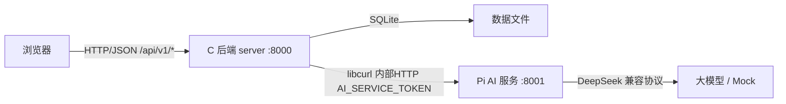

### 2.4 模块边界与职责

| 模块 | 职责边界 | 不负责 |
| --- | --- | --- |
| 前端 web | 页面交互、表单校验（仅体验层）、hash 路由、AI 权限预检查展示、轮询与取消 | 业务鉴权、额度扣减、密钥处理、服务端校验 |
| C 后端 server | 鉴权、业务规则、参数校验、数据读写、AI 任务代理、额度扣减/退还、导出渲染 | 模型执行、教学技能、Agent 循环 |
| Pi 服务 ai-service | 任务队列、Agent 循环、模型协议适配、教学技能注入、数学工具、对话历史 | 业务鉴权（只校验内部凭证与 owner）、持久化、业务数据 |
| 数据库 | 持久化用户/题目/试卷/AI 凭证/额度/审计 | 业务规则、跨模块事务（由应用层保证） |

**架构约束（新增功能必须遵守）：**
1. 浏览器只访问 C 后端 `/api/v1/*`；Pi 内部接口（`/internal/*`）不对外暴露。
2. 所有业务鉴权、额度、密钥解密必须在 C 后端完成，Pi 只接收已解密的执行配置。
3. 前端永不接触 API Key、内部服务凭证、用户 ID 额度或授权状态。
4. 新增业务模块优先复用 kv_store（目录式数据）或 SQLite 关系表（需关系查询/聚合的数据），不引入新存储引擎。

### 2.5 系统边界

- C 后端是唯一公共业务入口；Pi 服务是内部服务，仅监听 127.0.0.1。
- 模型 Key 只存在于可信后端；内部服务凭证（`AI_SERVICE_TOKEN`）与用户 token、模型 Key 为三种独立凭证。

### 2.6 总体功能结构

| 模块 | 编号段 | 主要内容 | 总体状态 |
| --- | --- | --- | --- |
| 系统公共 | SYS | 健康检查、注册/登录/登出/当前用户、会话管理、静态托管、用户信息管理（规划） | ✅ 主体已实现 |
| 管理员 | ADM | 用户管理、平台配置、审计、全局 AI 授权 CLI、备份监控 | 🟡 大部分未实现 |
| 教师 | TEA | 题目 CRUD、试卷 CRUD/编排、导出、AI API 配置、提交审核（规划）、批量导入（规划） | ✅ 主体已实现 |
| 学生 | STU | 题库/试卷浏览、AI 解答、线性追问、提交题目（规划）、讨论树（规划）、个人中心（规划） | ✅ 主体已实现 |
| AI 智能解答 | AI | 异步任务、三教学模式、工具、额度、密钥加密、Mock、重复检测（规划）、审核（规划）、多模型（规划） | ✅ 已实现 |

前端现 9 个页面（hash 路由）：登录、注册、题目列表、题目表单、对话、试卷列表、试卷浏览、试卷编辑、教师 AI API 配置。新增功能需扩展相应页面与路由。

---

## 3. 用户角色与权限体系

### 3.1 管理员（admin）

- 系统预设账号：`admin`（默认密码 `admin123`，可由 `DEMO_ADMIN_PW` 覆盖）。**该默认账号仅限本地开发/演示环境**，生产部署必须禁用或强制改密（见 §4.2 安全约束）。
- 当前能力：读写题目（与教师同权限）、读写全部试卷、导出试卷。
- **无独立管理后台**：用户管理、平台配置、供应商管理、审计查询、备份监控均未实现（见 §7）。
- 默认 teacher 模式下**无 AI 调用资格**（`AI_TEACHER_ONLY`）。

### 3.2 教师（teacher）

- 系统预设账号：`teacher`（默认密码 `teacher123`）。
- 能力：题目 CRUD、试卷 CRUD/编排/状态、AI API 配置、AI 解答（使用本人配置）、试卷导出。
- 试卷与 AI 凭证有归属隔离；**题目无归属隔离**（见 3.5、3.6）。

### 3.3 学生（student）

- 系统预设账号：`student`（默认密码 `student123`）。
- 能力：浏览题库/试卷、获取 AI 解答、同题追问。
- 只能读 active 试卷；不能写题目/试卷；不能配置 AI API。

### 3.4 角色权限矩阵

| 操作 | admin | teacher | student |
| --- | --- | --- | --- |
| 注册/登录/登出/当前用户 | ✅ | ✅ | ✅ |
| 题目读（列表/详情，含答案与解析） | ✅ | ✅ | ✅ |
| 题目写（新增/改/删） | ✅ | ✅（**无归属隔离**） | ❌ 403 |
| 试卷读 | 全部 | 仅本人创建 | 仅 active（archived 404） |
| 试卷写（CRUD/编排/状态） | 全部 | 仅本人创建 | ❌ 403 |
| 试卷导出/导出策略 | 全部 | 本人（归档卷也可导出） | 仅 active（受策略约束） |
| 教师 AI API 配置 | ❌ 403 | ✅（本人） | ❌ 403 |
| AI 调用（teacher 模式） | ❌ AI_TEACHER_ONLY | ✅（用自己配置） | ✅（用题目归属教师配置） |
| AI 调用（platform 模式） | 需 CLI 授权 | 需 CLI 授权 | 需 CLI 授权 |
| 学生提交题目（规划） | 可读全部 | 审核本人/公共池提交 | 提交/查看/撤回本人提交 |
| 用户管理后台（规划） | ✅ | ❌ | ❌ |
| 审计查询（规划） | ✅ | ❌（本人相关可另议） | ❌ |

### 3.5 数据访问控制规则（现状）

| 数据 | 隔离现状 |
| --- | --- |
| 用户 | username 唯一；id 按用户数 +1 生成（demo 简化） |
| 题目 | **无租户隔离**：全库题目对所有登录用户可见；任意 teacher/admin 可改删任意题目；`teacher_id` 仅记录创建者，未用于读写鉴权 |
| 试卷 | **有归属隔离**：`teacher_id` 取自 session；teacher 仅本人、admin 全部；student 仅 active |
| 教师 AI 凭证 | **有隔离**：`teacher_ai_credentials` 以 teacher_id 为主键；AAD 绑定教师 ID/账号键/版本/模型 |
| AI 额度 | **有隔离**：`teacher_ai_usage(student_id, teacher_id, day)` 按"学生+教师+上海自然日"计数 |
| AI 对话/任务 | **有隔离**：Pi 内存 Conversation/Job 绑定 owner(user_id)+question_id，跨用户 404 |

### 3.6 权限设计缺口与目标规则

| 缺口 | 现状 | 目标规则（建议） |
| --- | --- | --- |
| 题目归属隔离 | 题目读写不做 `teacher_id` 归属校验 | 题目读：全角色（现状保留）；题目写：teacher 仅本人创建的题目、admin 全部（**待团队确认**是否收紧读权限） |
| 管理员 AI 使用资格 | teacher 模式下 admin 无 AI 资格 | 明确：是给 admin 开放 AI，还是收窄 SRS UC-05 执行者（**待团队确认**） |
| 学生提交审核的"目标教师" | 无师生关系模型 | 见 §5.4、§6.3 的归属设计（**待团队确认**） |
| 权限变更后生效时机 | 角色注册时确定、会话固定 | 目标：角色变更后需重新登录（会话失效）；见 §7.1 |

> 权限相关状态与错误码见 §11.2、§11.4。上述"目标规则"均为建议，落地前需团队确认，不得直接按现状描述为已实现。

---

## 4. 用户账户与认证管理

### 4.1 SYS-03 用户登录

| 项 | 内容 |
| --- | --- |
| 所属模块 | 系统公共 / 认证 |
| 功能说明 | 用户以用户名+密码登录，成功后获得 Bearer Token |
| 使用角色 | 全部用户 |
| 前置条件 | 账号已存在 |
| 输入信息 | `{"username":"...","password":"..."}`（POST JSON） |
| 操作步骤 | 前端登录页填写账号密码 → 提交 → 保存 token 与 user → 进入题目列表 |
| 业务处理逻辑 | 解析 JSON → 查 `users` namespace 的 `password_hash` → 密码校验 → 一致则 `session_create` → 返回 token+user |
| 输出结果 | `200 {"token":"...","user":{"id","username","name","role"}}` |
| 业务规则与约束 | **现状**：`SHA-256(固定salt‖密码)`，固定 salt `ai-question-bank-demo-salt-2026`，token 有效期 24h。**新开发安全要求**：不得继续用固定盐单次 SHA-256；须改为 **Argon2id**（每用户独立随机盐），环境不支持时可用 bcrypt/scrypt；见 §4.10 密码安全 |
| 异常处理 | 400 请求体/JSON/字段缺失；401 用户名或密码错误（防枚举，不区分原因）；500 查询/建会话失败 |
| 安全补充 | **推荐**：登录失败限流（按用户名/IP 计数，如 5 次/5 分钟锁定）、登录/密码重置审计。当前未实现，落地前标【待确认】 |
| 实现状态 | ✅ 已实现 |
| 实现依据 | `routes.c handle_login`、`auth.c`、`db.c`；`POST /api/v1/auth/login`；`tests/auth/case_1/2` |

### 4.2 SYS-02 用户注册

| 项 | 内容 |
| --- | --- |
| 所属模块 | 系统公共 / 认证 |
| 功能说明 | 新用户注册，成功后自动登录 |
| 使用角色 | 全部用户；**前端注册页仅开放 student/teacher** |
| 输入信息 | `{"username","password","confirm_password","role"?}`（role 默认 student） |
| 业务处理逻辑 | 校验用户名非空、两次密码一致、密码强度（≥8 位且含字母数字）、角色合法 → 哈希入库（`db_create_user`）→ 自动建 session |
| 输出结果 | `201 {"token":"...","user":{...}}` |
| 业务规则与约束 | **安全约束（必须遵守）**：公开注册接口不得允许用户自助创建 admin；服务端必须做角色白名单校验（公开注册仅允许 student/teacher），不得依赖前端隐藏选项。当前实现缺陷：接口接受 admin 角色、仅前端隐藏选项，未构成有效权限保护，须在服务端收紧 |
| 安全补充 | 管理员账号创建只能通过受控初始化（seed）、管理后台代建（§7.1）或其他可信机制；默认账号 `admin/teacher/student`（密码 `xxx123`）仅限本地开发演示，生产部署不得保留公开默认密码，首次部署须强制改密或禁用 |
| 异常处理 | 400 校验失败/密码强度不足/角色非法；409 用户名已存在；500 |
| 实现状态 | 🟡 基础注册流程已实现；**角色安全控制未落地**（服务端未禁止自助 admin，见"业务规则与约束"），不得视为安全控制已完成 |
| 实现依据 | `routes.c handle_register`、`db.c db_create_user`；`POST /api/v1/auth/register`；`tests/auth/case_5~8` |

### 4.3 SYS-04 登出

| 项 | 内容 |
| --- | --- |
| 功能说明 | 销毁服务端 session，token 失效 |
| 使用角色 | 已登录用户 |
| 业务处理逻辑 | 提取 token → `session_destroy` → 前端清本地 token/user 并清会话映射 |
| 输出结果 | `200 {"status":"ok"}`（幂等，token 无效也 200） |
| 实现状态 | ✅ 已实现 |
| 实现依据 | `routes.c handle_logout`、`auth.c session_destroy`；`POST /api/v1/auth/logout` |

### 4.4 SYS-05 当前用户信息

| 项 | 内容 |
| --- | --- |
| 功能说明 | 校验 token 返回当前用户 id/name/role |
| 业务处理逻辑 | `session_validate` → 返回会话中用户信息 |
| 输出结果 | `200 {"user":{"id","name","role"}}` |
| 异常处理 | 401 未登录或 token 已过期 |
| 实现状态 | ✅ 已实现 |
| 实现依据 | `routes.c handle_me`；`GET /api/v1/auth/me` |

### 4.5 SYS-06 会话管理

| 项 | 内容 |
| --- | --- |
| 功能说明 | 服务端会话生命周期管理 |
| 业务处理逻辑 | 内存数组 `g_sessions`（最多 128）；token 用 OpenSSL `RAND_bytes` 生成 64 位十六进制；有效期 24h；每 16 次 `session_create` 触发 `session_cleanup` |
| 业务规则与约束 | 单线程 demo 实现，不持久化、不支持多实例；生产需替换为 Redis/DB |
| 实现状态 | ✅ 已实现（demo 取舍） |
| 实现依据 | `auth.c g_sessions/session_cleanup/generate_token`；`docs/auth.md` §3 |

### 4.6 SYS-01 健康检查 / 4.7 SYS-07 静态页面托管

- **SYS-01 健康检查**：`GET /api/v1/health` → `200 {"status":"ok","service":"ai-question-bank"}`，公开。依据 `routes.c handle_health`；`tests/health/case_1.sh`。✅
- **SYS-07 静态页面托管**：非 `/api/` 路径走 `serve_static`，按扩展名返回 Content-Type，拒绝含 `..` 路径（防路径穿越）。依据 `routes.c serve_static`。✅

### 4.8 SYS-08 用户资料管理（⬜ 规划）

**功能基本信息**

| 项 | 内容 |
| --- | --- |
| 功能编号 | SYS-08 |
| 所属模块 | 系统公共 / 账户管理 |
| 实现状态 | ⬜ 未实现（当前账号仅支持注册与登录，无编辑/改密接口） |
| 优先级 | P1（时间轴 F19 个人中心的账户部分） |
| 涉及角色 | 本人（查看/修改自己资料、修改密码） |
| 功能目标 | 让用户维护显示名与登录密码 |
| 依赖 | 现有 `users` KV namespace、`session_validate` |

**业务需求与使用场景**

用户登录后，在"个人中心"查看自己的显示名，修改显示名；通过旧密码验证后修改登录密码。修改密码后旧 session 处理策略见"业务规则"。

**业务流程**

1. 前端 `GET /api/v1/me/profile` 读取本人资料。
2. 修改显示名：`PUT /api/v1/me/profile` 提交 `{name}` → 后端校验非空、长度 → 更新 `users/<username>/name`。
3. 修改密码：`PUT /api/v1/me/password` 提交 `{old_password,new_password,confirm_password}` → 后端校验旧密码、新密码强度、两次一致 → 用 Argon2id 重新生成 `password_hash`。

**数据模型（复用 `users` namespace，无新增表）**

| 字段（value_name） | 类型 | 说明 |
| --- | --- | --- |
| name | string | 显示名，1–50 字符 |
| password_hash | string | 完整哈希编码（`算法$盐$参数$哈希`）；新注册/改密用 Argon2id |

**API 接口契约（规划接口）**

1. `GET /api/v1/me/profile`【规划接口】
   - 鉴权：Bearer；角色：全部登录用户。
   - 响应 `200`：`{"user":{"id":3,"username":"student","name":"李同学","role":"student"}}`
   - 错误：401。
2. `PUT /api/v1/me/profile`【规划接口】
   - 请求：`{"name":"李小明"}`（name 必填，1–50 字符，允许空白修剪）。
   - 响应 `200`：`{"user":{...}}`。
   - 错误：400 `INVALID_REQUEST`（name 非法）；401。
3. `PUT /api/v1/me/password`【规划接口】
   - 请求：`{"old_password":"...","new_password":"...","confirm_password":"..."}`。
   - 规则：new_password ≥8 位且含字母数字；与 confirm 一致；old_password 哈希匹配。
   - 响应 `200`：`{"status":"ok"}`。
   - 错误：400（强度/两次不一致）；401（old_password 错误，**与登录共用防枚举口径**）；500。

**业务规则与边界**

- 修改密码后：**建议方案**销毁该用户全部 session（强制重新登录）；**待团队确认**是否保留当前 session。
- username 不可自助修改（作为唯一账号键）。
- 并发修改：以最后一次写入为准，不做乐观锁（demo 单线程）。

**职责划分**

前端：表单、二次确认、错误提示；C 后端：鉴权、字段校验、哈希、写入 `users`。

**验收标准**

- Given 登录用户改显示名，When 提交合法 name，Then 200 且 `/me` 返回新 name。
- Given 改密码，When old_password 错误，Then 401 且密码不变。
- Given 改密码成功，When 用新密码登录，Then 200。

### 4.9 SYS-09 账号状态管理（⬜ 规划，与 §7.1 用户管理共用）

账号禁用/启用、角色变更、重置密码属管理员能力，统一在 §7.1 定义，此处仅约定**权限变更后的生效规则**：

- 角色变更后，该用户既有 session 应失效（**建议方案**，需销毁 session 或在下一次校验时读取最新角色）。
- 账号禁用后，立即拒绝登录与既有 session 的后续请求（401/403），**待团队确认**错误码（建议 `ACCOUNT_DISABLED`，见 §11.4）。

### 4.10 密码存储与账户安全（安全要求）

> 本节区分"当前代码现状"与"新开发必须遵守的安全方案"，两者不得混为一谈。

| 项 | 现状 | 新开发要求 |
| --- | --- | --- |
| 密码哈希 | `SHA-256(固定salt‖密码)`，固定 salt | **Argon2id**（每用户独立随机盐）；环境不支持时用 bcrypt/scrypt |
| 管理员注册 | 公开接口接受 admin 角色 | 公开注册仅 student/teacher；admin 仅受控初始化或管理后台代建 |
| 默认账号 | seed 三账号 + 默认密码 | 仅限开发/演示；生产须禁用或强制改密 |
| 登录失败限流 | 无 | 推荐按用户名/IP 限流（如 5 次/5 分钟）【待确认】 |
| 密码重置 | 无自助重置（仅管理员 §7.1） | 自助重置需安全机制（邮箱验证等），**待确认**是否本课程范围 |
| 账号禁用 | 无（§7.1 规划） | 禁用后立即拒绝登录与既有请求 |

**迁移要求（rehash-on-login）**：若现有 `users` 已存 `SHA-256` 哈希，引入 Argon2id 后需支持"旧哈希登录成功后透明升级为新哈希"。**三种失败情况必须区分，不得混淆**：
- 旧密码验证失败 → 401（与登录失败同口径，不迁移）。
- 旧密码验证成功、Argon2id 重新哈希失败 → 本次登录失败（500），**不得**误报登录成功，也**不得**覆盖原有有效密码哈希。
- 重新哈希成功、数据库更新失败 → 密码已通过验证，本次登录可成功，但迁移未落库；**不得**覆盖/丢失原哈希，下次登录重新触发迁移。**（"迁移落库失败是否仍允许登录成功"需团队确认，推荐允许以免拒绝合法用户；落地前待确认）**

---

## 5. 教师端功能规格

### 5.1 题库管理（TEA-01 / TEA-02，✅ 已实现）

#### TEA-01 题目 CRUD

| 项 | 内容 |
| --- | --- |
| 使用角色 | 教师、管理员 |
| 输入信息 | `content`（必填非空）、`type`（single_choice/short_answer）、`answer`（必填非空）、`options`（数组）、`analysis`（可选）、`knowledge_points`（可选字符串数组） |
| 业务处理逻辑 | 权限校验（teacher/admin）→ 字段校验（single_choice 的 options 非空且 answer 为某 label、short_answer 的 options 空数组）→ 新增 `next_question_id`（max+1）、`teacher_id`=创建者、`status`=active → 8 次 `kv_set` 写 `qdata`；更新为"旧题+请求覆盖"合并校验；删除 `kv_delete_key` 并联动 `exams_purge_question` |
| 输出结果 | 新增 `201 {"question":{...}}`；更新 `200 {"question":{...}}`；删除 `200 {"status":"ok"}` |
| 业务规则 | 写操作**非单事务**（半写风险，见 §14.5 待办）；**无题目归属隔离**（见 §3.6） |
| 异常处理 | 400 校验失败；401；403 学生越权（先于存在性）；404；405；500 |
| 实现依据 | `routes.c handle_question_create/update/delete`、`extract_question_fields`；`POST/PUT/DELETE /api/v1/questions[/{id}]`；`qdata`；`tests/questions/case_*` |

#### TEA-02 题目列表与详情

| 项 | 内容 |
| --- | --- |
| 使用角色 | 教师、管理员、学生（读全角色共用） |
| 业务处理逻辑 | 列表遍历 `qdata` 全部 key 按 id 升序；详情按 id 读取（单题详情在对话页题目详情区展示） |
| 输出结果 | `200 {"questions":[...]}` / `200 {"question":{...}}` |
| 业务规则 | **无分页、无检索、无 status 过滤**（当前全 active 等价）；题目对象字段 id/content/options/answer/analysis/knowledge_points/type/status |
| 异常处理 | 401；404；500 |
| 实现依据 | `routes.c handle_questions`（GET）；`tests/questions/case_1/2` |

### 5.2 试卷管理（TEA-03~TEA-07）

#### TEA-03 试卷 CRUD（✅）

- 创建/修改：`name`（1–100 字符）、`description`（≤1000 字符）；`exams_create` 在 `BEGIN IMMEDIATE` 事务内分配 id，新卷 status=active、questions=[]、teacher_id=session.user_id。删除不受 archived 限制、不影响题目本体。
- 权限：teacher 仅本人、admin 全部；teacher_id 从 session 取。
- 接口：`GET/POST/PUT/DELETE /api/v1/exams[/{id}]`。错误：400/401/403 `EXAM_FORBIDDEN`/404/409 `EXAM_ARCHIVED`/500。依据 `exams.c`、`tests/exams/*`。

#### TEA-04 试卷题目编排（✅ 后端全量、前端仅整体替换）

- 整体替换（PUT `/exams/{id}/questions`）：数组顺序即权威，position 1..n 排列，服务端归一化回填；追加（POST，position=n+1，≤200）；移除（DELETE `/questions/{qid}`，自动补位）。question_id 须存在且 active、卷内不重复；score 0<x≤1000。
- **未实现部分**：前端只调用整体替换（PUT），追加/移除单题接口已有但前端未接入；前端"保存编排"为本地编辑 + 一次整体替换。**新增前端"上移/下移/移除"已实现，但未直接调用追加/移除接口**。
- 复用评估：后端接口可直接复用，无需新增；待办仅前端接入追加/移除入口（可选，非必须）。

#### TEA-05 试卷归档/恢复（✅）

- `PATCH /exams/{id}` `{"status":"active"|"archived"}`；archived 禁编辑（409）；恢复 active 后可编辑；archived 对学生 404。

#### TEA-06 试卷导出（🟡 后端已实现、前端未接入）

| 项 | 内容 |
| --- | --- |
| 已实现 | `GET /api/v1/exams/{id}/export/{format}`（pdf/markdown/latex/docx，小写）；查询参数 `options/answers/analysis`（默认 1）、`ai`（默认 0）；渲染层 `export.c` 手工拼 PDF 1.4 中文 / DOCX OOXML；单文件 ≤8 MiB；策略与可见性校验 |
| 未实现 | 前端无导出入口；`ai=1` 恒 400 `EXPORT_OPTION_UNSUPPORTED`（AI 解答数据源未接入）；批量导出、异步导出、导出文件持久化 |
| 复用评估 | 后端接口可直接复用，前端仅需加"导出"按钮并拼接查询参数 |
| 依赖 | 若要支持 AI 解答导出，依赖 §8 对话历史持久化（`docs/export.md` 明确当前无 AI 数据源） |
| 实现依据 | `server/src/export.c`、`routes.c handle_exports`；`tests/export/*` |

#### TEA-07 导出策略配置（🟡 后端已实现、前端未接入）

- 已实现：`GET/PUT /api/v1/exams/{id}/export-policy`（`allow_export`/`allow_answers`，默认 true；策略存 `edata` 的 `export_policy`；仅影响非归属方）。
- 未实现：前端无策略配置入口；策略读取失败当前按默认值处理（fail-open 需复核，见 §14.5）。

### 5.3 TEA-08 教师 AI API 配置（✅ 已实现）

- `GET/PUT/PATCH /api/v1/teacher/ai-api`，仅 teacher；PUT `{api_key, model?}` 替换并启用、version 递增；PATCH `{enabled}` 启停；GET 只回 configured/enabled/provider/model/masked_key/version/updated_at。
- AES-256-GCM 加密（AAD 绑定教师 ID/账号键/版本/模型）；主密钥 `AI_KEY_ENCRYPTION_KEY` 不落库；api_key 16–512 可打印 ASCII、model 1–128 字符。
- 依据 `teacher_api.c`、`teacher_api_routes.c`、`web/js/teacher-api.js`；`teacher_ai_credentials` 表。

### 5.4 TEA-09 学生提交审核（⬜ 规划，重点规格）

#### 5.4.1 功能基本信息

| 项 | 内容 |
| --- | --- |
| 功能编号 | TEA-09（教师侧审核）/ STU-08（学生侧提交，见 §6.3） |
| 所属模块 | 教师端 / 学生提交审核 |
| 实现状态 | ⬜ 未实现（当前无 submissions 相关代码） |
| 优先级 | P0（SRS UC-06、时间轴 F04） |
| 涉及角色 | 学生（提交/撤回）、教师（审核/配置策略）、管理员（审核全部） |
| 功能目标 | 学生贡献题目，经教师审核后进入题库 |
| 依赖 | 现有 `users`/`qdata` 存储、`session_validate`、题目字段校验（复用 `extract_question_fields` 规则） |

#### 5.4.2 业务需求与使用场景

学生希望在题库中贡献新题目、或对已有题目提出修改；教师审核学生提交，通过后题目进入题库（或更新已有题目），驳回时给出意见、学生可修改后重新提交。教师可配置是否允许学生提交、是否需要审核。

**功能范围**：学生提交新题/改题建议、教师通过/驳回、修改后重新提交、自动通过策略。**不包含**：批量审核、审核讨论、题目版本历史。

#### 5.4.3 详细业务流程

提交后分两条路径（取决于教师策略 `require_review`）：

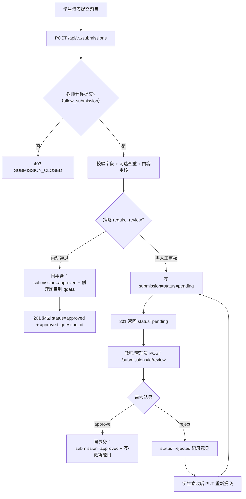

- **人工审核流程**：提交返回 `status=pending`；审核 `approve` 时在**同一事务**内完成"submission 置 approved + 题目创建/更新 + 写 approved_question_id"，任一失败整体回滚（submission 保持 pending）。
- **自动通过流程**：`require_review=false` 时，提交接口在**同一事务**内完成"submission 置 approved（`reviewer_id` 为空）+ 题目创建 + approved_question_id"，响应直接返回 `status=approved` 与 `approved_question_id`；失败整体回滚，返回 500 `SUBMISSION_STORE_FAILED`，**不产生 pending 中间态、不残留半条数据**。

#### 5.4.4 数据模型与归属（详见 §10.2.4 Submission）

存储：新增 SQLite 关系表 `submissions`（需关系查询与状态流转，不用 kv_store）。核心字段：`id`、`student_id`、`target_teacher_id`（可空）、`target_question_id`（空=新增）、题目内容字段、`status`（pending/approved/rejected）、`reviewer_id`、`review_comment`、`approved_question_id`、`owner_teacher_id`（题目归属教师）、`base_question_version`（原题版本快照，见 §5.4.6）、时间戳。

**身份概念（必须区分，不得混用）**：
- `student_id`：提交者（谁提出）。
- `reviewer_id`：审核者（谁点击通过/驳回），自动通过时为空。
- `owner_teacher_id`：审核通过后题目的归属教师。**AI 调用通过题目 `qdata.teacher_id` 查找教师 API 配置，因此归属必须是教师，不得指向 admin**。

**题目归属规则（区分"新增"与"修改已有题目"）**：
- **新增题目**（`target_question_id` 为空）：
  - 教师审核通过 → `owner_teacher_id = reviewer_id`。
  - 管理员审核通过 → 必须显式指定 `owner_teacher_id`（请求字段），否则 409 `SUBMISSION_OWNER_TEACHER_REQUIRED`；禁止归属到管理员。
  - 自动通过 → **归属来源未定**：方案 A 可取 `target_teacher_id`；方案 B 学生未指定教师、也无审核者，**无法确定归属教师**，故方案 B 下自动通过**暂不可直接开发**，**待团队确认**（可选：方案 B 提交时也必填 `target_teacher_id`；或自动通过仅适用于方案 A）。
- **修改已有题目**（`target_question_id` 非空）：**保留原题归属教师不变**（`qdata.teacher_id` 不随审核者变化），审核仅更新题目内容，不转移归属；此时 `owner_teacher_id` 不适用、无需传入。

**归属方案（待团队确认，两方案）**：
- 方案 A：提交时指定 `target_teacher_id`，教师只能审核指定给自己的提交；自动通过归属 = `target_teacher_id`（可确定）。
- 方案 B：不指定教师，任意教师/管理员可审核；新增题通过时按上表确定归属，但自动通过归属无来源。
- **推荐方案**：先实现方案 A（自动通过归属可确定、AI 路由可解析）；方案 B 需另行解决"管理员审核/自动通过的归属来源"。

**提交策略适用（关键）**：`submission_policies` 按 `teacher_id` 存储。方案 B 学生不指定教师时无法定位单一教师策略。**推荐**：`submission_policies` 增加 `teacher_id=0` 表示全局默认，教师级覆盖全局；方案 A 直接读 `target_teacher_id` 的策略。**待团队确认**。

#### 5.4.5 API 接口契约

1. `POST /api/v1/submissions`【规划接口】— 学生提交
   - 鉴权：Bearer；角色 student。
   - 请求：`{"target_teacher_id":2,"target_question_id":null,"content":"...","type":"short_answer","options":[],"answer":"...","analysis":"...","knowledge_points":["一元一次方程"]}`
   - 校验：复用题目字段规则；`target_question_id` 非空时须存在，并快照其当前版本号到 `base_question_version`（见 §5.4.6）。
   - 响应 `201`（**按策略返回两种状态之一**）：
     - 需人工审核：`{"submission":{"id":101,"status":"pending","created_at":1700000000}}`
     - 自动通过：`{"submission":{"id":101,"status":"approved","reviewer_id":null,"approved_question_id":6,"owner_teacher_id":2}}`
   - 错误：400 `INVALID_REQUEST`；401；403 `SUBMISSION_CLOSED`；404 `QUESTION_NOT_FOUND`（target_question_id 不存在）；500 `SUBMISSION_STORE_FAILED`（自动通过事务失败）。

2. `GET /api/v1/submissions`【规划接口】— 列表
   - 学生：仅本人；教师/管理员：全部（或按 `student_id`/`status` 过滤）。
   - Query：`status`（pending/approved/rejected，可选）、`student_id`（教师/管理员可选）、`page`、`page_size`（分页规范见 §11.1）。
   - 响应 `200`：`{"submissions":[{...}],"total":12,"page":1,"page_size":20}`。

3. `GET /api/v1/submissions/{id}`【规划接口】— 详情，学生本人/教师/管理员可见。

4. `PUT /api/v1/submissions/{id}`【规划接口】— 学生修改并重新提交（仅本人、**仅 rejected 状态**）
   - 请求：可更新题目内容字段（不可改 student_id/status/reviewer_id/owner_teacher_id）。
   - 规则：修改后 status 由 rejected → pending，清空 review_comment/reviewer_id，`attempt +1`，并**重新快照** `base_question_version`（若 target_question_id 非空）与**重新执行内容审核**。**pending 状态禁止直接修改**（避免与审核并发冲突）。
   - 响应 `200`：`{"submission":{...}}`。
   - 错误：409 `SUBMISSION_NOT_EDITABLE`（pending/approved 状态修改）。

5. `POST /api/v1/submissions/{id}/review`【规划接口】— 教师/管理员审核
   - 请求：`{"action":"approve"|"reject","comment":"修改解析后通过","owner_teacher_id":2}`
   - **前置条件（必须遵守）**：若该 submission 存在**当前提交轮次（attempt）**关联的 `moderation_reviews`，其 `status` 必须为 `approved` 才允许业务审核；`pending` → 409 `MODERATION_PENDING`（等待内容安全复核，禁止业务审核）；`rejected` → submission 已置 rejected，按非 pending 返回 409 `SUBMISSION_ALREADY_REVIEWED`。历史轮次的复核记录不参与判断。服务端在**同一事务**内校验内容安全复核状态与 submission 状态，防止并发绕过（不得仅依赖前端隐藏按钮）。
   - `approve`：
     - `target_question_id` 为空 → 创建题目到 `qdata`（`teacher_id = owner_teacher_id`，status=active），写 `approved_question_id`。
     - `target_question_id` 非空 → **版本校验**（§5.4.6）：原题当前版本与 `base_question_version` 不一致 → 409 `SUBMISSION_VERSION_CONFLICT`，禁止覆盖；一致才更新原题。
   - `owner_teacher_id` **仅新增题**（target_question_id 为空）需要：admin 审核必填、teacher 审核默认 = reviewer_id、方案 A 默认 = target_teacher_id；**修改已有题目时无需传入**（保留原题归属）。
   - `reject`：status=rejected、review_comment=comment；**原题保持不变**。
   - 响应 `200`：`{"submission":{...,"status":"approved","approved_question_id":6,"owner_teacher_id":2}}`。
   - 错误：400（action 非法/owner_teacher_id 缺失）；403（非教师/管理员）；404；409 `SUBMISSION_ALREADY_REVIEWED`；409 `MODERATION_PENDING`；409 `SUBMISSION_OWNER_TEACHER_REQUIRED`；409 `SUBMISSION_VERSION_CONFLICT`。

6. `DELETE /api/v1/submissions/{id}`【规划接口】— 学生撤回本人 pending/rejected 提交；approved 不允许撤回（题目已入库）。

7. `GET/PUT /api/v1/teacher/submission-policy`【规划接口】— 教师配置
   - 请求/响应：`{"allow_submission":true,"require_review":true}`（默认 true/true）。
   - 仅 teacher；存储建议 `submission_policies(teacher_id PK, allow_submission, require_review)`。

#### 5.4.6 业务规则与边界

- 重复提交：同一学生对同一"新题内容"重复提交不自动去重（去重见 §8.9）。**待团队确认**是否在提交时触发相似度检测。
- **owner_teacher_id 校验（必须遵守）**：审核/提交涉及指定归属教师时，服务端必须验证该 id 存在、账号有效（status=active）且 role=teacher，否则 400/409；不接受未经校验的客户端归属。
- **修改建议重复提交**：允许对同一题目提交多个修改建议（各自独立 submission）；每次提交都重新快照当时的 `base_question_version`；审核通过其中一个后，其余基于旧版本的修改建议在审核时版本冲突 409。
- 并发审核：两名教师同时审核同一 pending 提交 → `BEGIN IMMEDIATE` + 状态校验（仅 pending 可审）保证只有一次生效，后到者 409。
- 权限变化：提交后学生角色被改 → 提交仍归属原 student_id，撤回/查看按"本人"校验。
- 关联删除：审核通过前学生撤回 → 物理删除；审核通过后题目与 submission 解耦。
- 幂等：`review` 非幂等（重复审核 409）；`PUT`（修改重新提交）仅 rejected→pending，可重复执行（每次重置 pending）。
- **pending 状态不可修改**：学生只能撤回（DELETE）或等待审核；审核期间学生修改的竞态由此消除。若未来需要"pending 可修改"，必须为 submission 增加版本号并在审核时校验（**不建议**，会增加复杂度）。

**题目修改建议的版本与并发控制（`target_question_id` 非空时必须遵守）**：
- **快照**：提交时记录 `base_question_version` = 原题当前版本。项目当前无版本号字段，**最小可行方案**：`qdata` 增加 `version` value_name（初始 1，每次更新 +1），或以 `updated_at`+内容哈希作版本标识；**待团队确认**采用哪种。
- **审核时校验**：approve 前读取原题当前版本，与 `base_question_version` 比对；不一致 → 409 `SUBMISSION_VERSION_CONFLICT`，**禁止无条件覆盖较新内容**；一致才更新原题并把版本 +1。
- **驳回**：原题保持不变，submission 仅记录驳回状态与意见。
- **审核者权限**：审核者须 teacher/admin；若后续落地题目归属隔离（§3.6），teacher 只能审核/修改本人题目。
- **并发更新**：approve 的版本校验与原题更新在同一 `BEGIN IMMEDIATE` 事务内完成，避免两审核者同时通过造成覆盖。

#### 5.4.7 职责划分

- 前端：提交表单（复用题目表单结构）、待审列表、审核操作与意见输入。
- C 后端：鉴权、字段校验、状态流转、事务、创建/更新题目。
- 数据库：`submissions`、`submission_policies` 关系表；`qdata` 题目写入。
- Pi 服务：不参与（可选：重复检测时调用，见 §8.9）。

#### 5.4.8 验收标准

- Given 学生提交合法新题，When 教师 approve，Then 201 且 `qdata` 出现新题（teacher_id=owner_teacher_id）、submission status=approved 并含 `approved_question_id`。
- Given 管理员审核通过但未指定 owner_teacher_id，When review，Then 409 `SUBMISSION_OWNER_TEACHER_REQUIRED` 且不创建题目。
- Given `require_review=false`，When 学生提交，Then 201 直接返回 status=approved + approved_question_id（无 pending 中间态）；若题目创建失败则 500 且无残留数据。
- Given 教师 reject 并填写意见，When 学生修改后 PUT 重新提交，Then status 重置 pending 且 review_comment 清空、原题不变。
- Given 学生对 pending 提交执行 PUT，Then 409 `SUBMISSION_NOT_EDITABLE` 且内容不变。
- Given 两教师并发审核同一 pending，Then 仅一次成功，另一次 409。
- Given 修改建议提交后原题被他人更新，When 审核 approve，Then 409 `SUBMISSION_VERSION_CONFLICT`，原题不被覆盖。
- Given 学生提交，When 教师策略 `allow_submission=false`，Then 403。
- Given 学生撤回 pending 提交，When DELETE，Then 200 且详情 404。

### 5.5 TEA-10 题目批量导入（⬜ 规划）

#### 5.5.1 功能基本信息

| 项 | 内容 |
| --- | --- |
| 所属模块 | 教师端 / 题库管理 |
| 实现状态 | ⬜ 未实现 |
| 优先级 | P1（SRS F-05；时间轴 F17，Sprint 8 起） |
| 涉及角色 | 教师、管理员 |
| 功能目标 | 从文本/结构化文件批量导入题目，自动解析拆分 |
| 依赖 | 现有题目 CRUD 字段校验、`qdata` 存储 |

#### 5.5.2 业务需求与使用场景

教师将多道题整理在 Markdown / 纯文本 / LaTeX 文件中，导入系统自动拆分为多道题目并入库，避免逐题手填。Word/PDF/图片解析为后续迭代（复杂度高）。

#### 5.5.3 业务流程与接口

1. `POST /api/v1/questions/import`【规划接口】，请求体：
   - 方案 A（结构化，优先）：`{"format":"markdown","text":"...多题文本...","dry_run":false}`
   - 方案 B（文件上传）：`multipart/form-data`，`format` 字段 + 文件（**建议先做方案 A，文件上传与 C 后端 multipart 解析成本高，待确认**）。
2. 后端解析拆分 → 逐题校验 → `dry_run=true` 只返回解析结果与校验错误清单，不写库；`dry_run=false` 写入 `qdata`（teacher_id=导入者）。
3. 响应：
```json
{
  "imported": 12,
  "failed": 2,
  "results": [
    {"index": 1, "status": "ok", "question_id": 8},
    {"index": 2, "status": "error", "reason": "缺少 answer 字段"}
  ]
}
```

#### 5.5.4 解析规则（建议方案）

| 格式 | 拆分规则 |
| --- | --- |
| markdown | 以一级/二级标题或空行分隔多题；题干正文 + 选项列表（`A. ...`）+ 答案标记 + 解析块 |
| 纯文本 | 空行分隔；约定标记 `【答案】`、`【解析】`、`【知识点】` |
| latex | `\begin{question}...\end{question}` 块分隔 |

**解析容错**：单题失败不影响其他题（逐题隔离，结果列表返回），失败项给出原因。

#### 5.5.5 验收标准

- Given 合法 markdown 含 5 题，When `dry_run=false`，Then 201 且 `imported=5`、`failed=0`、库中新增 5 题。
- Given 其中 1 题缺 answer，When 导入，Then 该题 `failed` 原因明确、其余 4 题入库。

### 5.6 TEA-11 题目搜索/筛选/标签/难度（⬜ 规划）

#### 5.6.1 功能基本信息

| 项 | 内容 |
| --- | --- |
| 所属模块 | 教师端 / 题库管理 |
| 实现状态 | ⬜ 未实现（当前列表无分页/检索，仅 `knowledge_points` 字符串数组） |
| 优先级 | P1（SRS F-06） |
| 涉及角色 | 教师、管理员、学生（读） |
| 功能目标 | 按题型/知识点/关键词/难度/状态筛选与检索题目 |

#### 5.6.2 接口契约

`GET /api/v1/questions`【已有接口，需扩展】— 在现有列表接口上增加 Query 参数（**向后兼容：不传任何 Query 参数时保持现有"返回全部题目"行为不变**）：

| Query | 类型 | 说明 |
| --- | --- | --- |
| `type` | string | single_choice / short_answer |
| `knowledge_point` | string | 知识点精确匹配（可多值） |
| `keyword` | string | 题干/解析子串匹配 |
| `status` | string | active / archived（当前仅 active） |
| `difficulty` | int | 1–5（需先落地难度字段） |
| `sort` | string | 排序字段，**建议** `id`/`created_at`，`-` 前缀降序，默认 `id` 升序；**待确认** |
| `page` / `page_size` | int | `page` 默认 1、最小 1；`page_size` 默认 20、最小 1、**最大 100**，超上限按 100 截断 |

**分页/排序边界**：`page` 超出总页数返回空数组（不报错）；`page`/`page_size` 非正整数 → 400 `INVALID_REQUEST`；无 `sort` 时按 id 升序（与现状一致）。

响应（**兼容策略待确认**）：
- 方案 A：**始终**返回 `{"questions":[...],"total":n,"page":p,"page_size":s}`（破坏旧客户端纯数组假设）。
- 方案 B：仅在传分页/筛选参数时返回带 `total/page/page_size` 的对象，否则返回纯数组（向后兼容，但响应结构二义）。
- **推荐方案 B**，落地前**待团队确认**。

#### 5.6.3 数据模型

- `qdata` 增加 `difficulty` value_name（可选，1–5）与 `tags`（JSON 数组）【规划字段，需迁移存量数据时补默认值】。
- 题目字段新增需在 §10.2.2 Question 统一定义，避免与 `knowledge_points` 重复。

#### 5.6.4 验收标准

- Given 按 `type=short_answer` 筛选，When 查询，Then 仅返回简答题。
- Given `keyword` 命中题干，When 查询，Then 返回含关键字的题。

### 5.7 TEA-12 AI 解答参数配置（🟡 部分实现，规格补全）

| 项 | 内容 |
| --- | --- |
| 现状 | 仅 `model` 可选；temperature/max_tokens/Prompt 模板为 Pi 全局配置（`config.ts`），教师不可按题目/按教师配置 |
| 目标 | 教师可对"题目级或教师级"配置模型、温度、最大输出、Prompt 模板（SRS F-10） |
| 未实现部分 | ① 教师级 temperature/max_tokens/prompt_template 字段；② 题目级 AI 解答开关与参数覆盖 |
| 复用评估 | 现有 `teacher_ai_credentials` 表可扩展字段；现有 `PUT /teacher/ai-api` 可扩展请求字段（向后兼容）；题目级参数需新增存储 |
| 新增/修改接口 | ① 扩展 `PUT /api/v1/teacher/ai-api`：请求增加 `temperature`（0–2）、`max_tokens`（1–8192）、`prompt_template`（可选）；② 【规划接口】`GET/PUT /api/v1/questions/{id}/ai-config`（题目级覆盖，仅 teacher/admin） |
| 依赖 | Pi `agent.ts`/`config.ts` 需支持按 execution 传入这些参数（当前 execution 只传 api_key/model/teacher_id/version） |
| 业务规则 | 题目级配置优先于教师级，教师级优先于 Pi 全局；prompt_template 仅可信后端加载，不注入学生输入（防 Prompt 注入） |

### 5.8 新增：AI 使用情况管理（⬜ 规划）

- 教师查看自己 API 的调用次数、按学生聚合的用量、按日分布（时间轴 F08 使用统计）。
- 【规划接口】`GET /api/v1/teacher/ai-usage`：响应 `{"total_calls":120,"by_day":[{"day":"2026-11-19","calls":8}],"by_student":[{"student_id":3,"calls":20}]}`；仅 teacher（本人）。
- 复用现有 `teacher_ai_usage`/`teacher_ai_charges` 表，无需新增表；仅新增只读聚合接口。管理员全局统计见 §7.2。

---

## 6. 学生端功能规格

### 6.1 STU-01 题库浏览（✅ 已实现）

- 列表/详情（含答案与解析）；读全角色共用；详情在对话页以 `<details>` 折叠展示。`GET /api/v1/questions`、`/questions/{id}`。学生可见 answer/analysis（非考试防作弊功能）。依据 `web/js/questions.js`、`routes.c handle_questions`。

### 6.2 STU-02 试卷浏览（✅ 已实现）

- 列表仅 active；详情按 position 升序内联题目；archived 列表不出现、详情 404。`GET /api/v1/exams`、`/exams/{id}`。依据 `web/js/exams.js ExamViewPage`、`exams.c`。

### 6.3 STU-08 学生提交题目（⬜ 规划）

学生侧提交/查看/修改/撤回的完整流程与数据结构，**统一复用 §5.4（TEA-09）的 Submission 模型与接口**，此处仅补充学生视角的规则：

- **提交**：`POST /api/v1/submissions`（字段与校验见 §5.4.5）；前端"提交题目"页面复用题目表单结构，增加"目标题目（可选，表示修改建议）"。
- **我的提交**：`GET /api/v1/submissions?student_id=me`（或服务端按 session 过滤，仅返回本人）。
- **修改后重新提交**：`PUT /api/v1/submissions/{id}`（**仅 rejected 状态**，修改后重新进入 pending）。pending 禁止修改（可撤回或等待审核），approved 禁止修改。
- **撤回**：`DELETE /api/v1/submissions/{id}`（仅 pending/rejected）。
- **状态感知**：前端需展示 pending（待审核）/ approved（已通过，展示入库题目 id）/ rejected（驳回，展示意见并允许修改重提）。

**边界情况**：学生提交后教师尚未审核时，学生仍可撤回；审核通过后不可撤回（题目已入库）；驳回意见由后端返回，前端只读展示，不参与审核逻辑。

### 6.4 STU-03 AI 解答（✅ 已实现）

- `POST /api/v1/chat`（solve/hint/review 三模式）→ 202 + job_id → 轮询 `GET /chat/{job_id}` → 展示 reply/model/usage。新提交计 1 次额度，追问也计次，查询/取消不计次。详见 §8。

### 6.5 STU-04 同题追问（✅ 已实现，线性）

- 复用 conversation_id 线性多轮；同对话 ≤12 轮成功提问、历史 ≤64KB、单任务锁；跨用户/题目/模式 404/409。仅线性，非树状（树状见 §6.6）。

### 6.6 STU-05 分支讨论树（⬜ 规划，重点规格）

#### 6.6.1 功能基本信息

| 项 | 内容 |
| --- | --- |
| 所属模块 | 学生端 / AI 答疑 |
| 实现状态 | ⬜ 未实现（当前为线性多轮追问，无树状结构） |
| 优先级 | P0（SRS F-11、时间轴 F06） |
| 涉及角色 | 学生、教师（admin 的 AI 资格见 §3.6 待确认） |
| 功能目标 | 将线性追问升级为可 Fork 的树状讨论结构，支持节点折叠/搜索/推荐答案标记 |
| 依赖 | 现有 Conversation（Pi 内存）、AI 任务链路；需持久化节点（`conversation_nodes`） |

#### 6.6.2 数据模型（详见 §10.2.6 ConversationNode）

存储：新增关系表 `conversation_nodes`（需树状查询与持久化）。字段语义（详见 §10.2.6）：
- `author_user_id`：节点作者。用户消息=提问者 user_id；助手消息=NULL（无具体作者，**不用 0 表示系统**）。
- `conversation_id`：根对话标识；`question_id`：所属题目；`parent_id`：父节点（NULL=根）。
- 每个节点代表**一条消息**：用户提问一条、助手回复一条，成对出现，不把"一次问答"合并为单节点。

#### 6.6.3 节点关系与生命周期

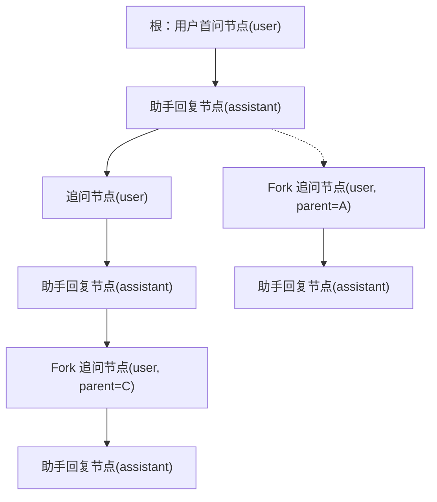

- **新建对话**：`POST /chat` 无 conversation_id，提交即创建根节点（role=user，内容=首条 message）；任务成功后追加一个 assistant 节点（内容=reply）。**根节点是用户首问，不是助手回复**。
- **连续追问**：复用 conversation_id，提交创建 user 节点（parent=上一 assistant 节点），成功后追加 assistant 节点。
- **Fork**：`POST /chat` 传 `parent_node_id`，新建 user 节点以该节点为父形成分支；上下文继承为"根到 parent_node_id 路径上的全部消息"。
- **历史重载**：`GET /conversations/{id}/nodes` 返回整棵树；前端按 parent_id 重建树状视图。
- **失败/取消/超时**：任务未成功时不落 assistant 节点；user 消息节点保留并置终态——失败=**failed**、取消=**cancelled**（临时方案；与 failed 的取舍**待确认**）、超时=**failed**；失败/取消的消息**不进入 Pi 推理历史**（数据库持久化与 Pi 内存上下文分离，见 §6.6.5）。
- **节点状态（统一）**：用户节点创建时为 **pending**，任务终态后置 succeeded/failed/cancelled；**助手节点仅在任务 succeeded 时创建，恒为 succeeded**。
- **pending 节点重试（待确认）**：失败/取消后用户重试，复用原 user 节点（更新 job_id/status）还是新建节点；**推荐**新建节点（保留原失败记录），**待团队确认**。
- **推荐答案标记**：节点 `is_recommended`；**待确认**标记权限（学生本人 vs 教师/管理员）。
- **折叠/搜索**：纯前端展示能力，不影响数据结构。

#### 6.6.4 API 接口契约（规划接口）

1. `POST /api/v1/chat`【已有接口，需扩展】：请求增加可选 `parent_node_id`（Fork 起点）。**校验（必须遵守）**：`parent_node_id` 非空时，必须与 `conversation_id`、`question_id` 同属当前登录用户，否则 404（不泄露存在性）；跨对话/跨题目/跨用户引用节点一律 404。向后兼容：不传时行为不变（线性追问）。
2. `GET /api/v1/conversations/{conversation_id}/nodes`【规划接口】：返回树（**推荐**平铺 nodes + edges 结构）`{"conversation_id":"...","nodes":[{...}],"edges":[{"parent_id":1,"child_id":2}]}`；嵌套 children 结构为备选，**待确认**。
3. `PUT /api/v1/conversation-nodes/{node_id}`【规划接口】：`{"is_recommended":true|false}` 标记/取消推荐；幂等（重复设置同值返回 200，不重复计数）。
4. 节点内容持久化后，`GET /chat/{job_id}` 返回的 `conversation_id` 需与节点树关联。

#### 6.6.5 业务规则与边界

- **对话所有者校验（必须遵守）**：节点树访问与写入均校验 `owner_user_id == session.user_id`，跨用户 404（不泄露存在性）。
- **parent_node_id 校验（必须遵守）**：非空时必须与 `conversation_id`、`question_id`、当前用户三者同时匹配，任一不匹配 → 404；禁止跨对话、跨题目、跨用户引用节点。
- **job_id 关联与去重**：用户消息节点在提交 `POST /chat` 时随 job 创建，记录 `job_id`；网络重试不重复创建节点（以 `(conversation_id, job_id)` 幂等去重）。
- **Pi 内存上下文 vs 持久化节点（必须区分）**：Pi `Conversation.messages` 是推理上下文，节点表是展示/追溯记录；任务成功后二者同步；失败=user 节点 status=failed、取消=cancelled、超时=failed，均不落 assistant 节点（状态定义见 §6.6.3）。
- 对话仍受"单任务锁、TTL"约束（§8.7）；**12 轮限制口径待确认**（按分支路径计轮还是整树计，见 §10.2.6）。
- Fork 分支的额度：每轮新提交仍计 1 次。
- **任务成功但持久化失败（必须处理）**：AI 任务成功（Pi 返回 succeeded）与 assistant 节点持久化成功是**两个不同的完成条件**。assistant 节点写入失败时的恢复流程：
  - **恢复流程**：① 前端刷新/重进会话时 `GET /conversations/{id}/nodes` 发现存在 user 节点（status=pending/succeeded）但缺少对应 assistant 节点；② 若 user 节点记录 `job_id`，调 `GET /chat/{job_id}` 查任务：succeeded → 按 `(conversation_id, job_id)` 幂等重试持久化 assistant 节点，**不重新调用模型**；failed/cancelled → 不落 assistant 节点，用户可重试（新建 user 节点）；③ `GET /chat/{job_id}` 已 404（Pi TTL 过期）→ 无法恢复，提示"回复已过期，请重新提问"，user 节点保留为 failed。
  - **职责划分**：`GET /conversations/{id}/nodes` 负责发现"缺 assistant 节点"；`GET /chat/{job_id}` 负责取回任务结果；持久化重试由 C 后端按 job_id 幂等执行。
  - **边界**：以上为**目标设计**（当前线性追问无节点表）；可靠恢复依赖 Pi TTL 内任务可查询，TTL 过期后无法恢复属已知限制，持久化补偿机制**待确认**。
- 删除/折叠节点：**待确认**是否支持软删除。

#### 6.6.6 职责划分

前端：树状渲染、折叠、搜索、Fork 入口；C 后端：节点持久化、owner 校验、上下文组装；Pi 服务：按传入的"路径历史"执行 Agent（当前线性历史逻辑可复用，仅需支持自定义历史起点）。

#### 6.6.7 验收标准

- Given 一题两次追问后从第 1 轮节点 Fork，When 提交，Then 生成两个分支且各自上下文为"根到 Fork 点"。
- Given 新建对话，When 提交首问，Then 创建 user 根节点，任务成功后追加 assistant 节点（根节点为 user，非 assistant）。
- Given 任务失败/取消，When 查询节点树，Then 无 assistant 节点、user 节点保留且 status 标记正确。
- Given `parent_node_id` 属于其他用户/题目/对话，When 提交，Then 404。
- Given 标记节点为推荐，When 查询树，Then `is_recommended=true` 可见。
- Given 跨用户访问节点树，Then 404。

### 6.7 STU-06 个人中心（⬜ 规划）

| 项 | 内容 |
| --- | --- |
| 功能组成 | ① 账户资料（§4.8）；② 我的提交（§6.3）；③ 学习记录/提问历史；④ AI 额度查看；⑤ 通知消息 |
| 学习记录 | 【规划接口】`GET /api/v1/me/activity`：返回本人提问/作答/AI 调用历史（依赖对话持久化，见 §6.6、§8.7） |
| 额度查看 | 【规划接口】`GET /api/v1/me/quota`：聚合各教师剩余次数 `{"quotas":[{"teacher_id":2,"limit":20,"used":3,"remaining":17,"reset_at":"..."}]}`；复用 `teacher_ai_usage` |
| 通知消息 | 依赖 §8.10 内容审核与通知中心（时间轴 F13），数据模型见 §10.2.8 Notification |

### 6.8 STU-07 API 捐赠（⬜ 规划，额度来源未定）

> **⚠ 阻断说明**：现有需求（SRS F-13、时间轴 F14）只描述"学生向教师捐赠 API 资源"，**未定义额度从哪里产生**，当前代码中也不存在学生独立额度/余额/支付能力。在额度来源与记账规则确定前，本节接口**不能作为可直接开发的确定契约**。以下为推荐设计，落地前必须由团队确认额度来源。

#### 6.8.1 功能基本信息

| 项 | 内容 |
| --- | --- |
| 实现状态 | ⬜ 未实现（SRS F-13、时间轴 F14） |
| 涉及角色 | 学生（捐赠方）、教师（受赠方） |
| 功能目标 | 学生向教师捐赠 API 资源，教师调用时可消耗捐赠额度 |
| 阻断点 | **额度来源未定义**：学生额度从何而来、是否涉及真实支付、是否有学生余额，均无依据 |

#### 6.8.2 数据模型（详见 §10.2.7 Donation）

新增关系表 `donations`：`id`、`student_id`、`teacher_id`、`amount`、`expires_at`、`used`、`status`、`created_at`。字段仅为占位设计，待额度来源确定后再定稿。

#### 6.8.3 接口契约（规划接口，**待额度来源确定后开发**）

1. `POST /api/v1/donations`：`{"teacher_id":2,"amount":50,"expires_at":"2026-12-31T23:59:59Z"}` → 201 `{"donation":{...}}`。
2. `GET /api/v1/donations`：学生看本人捐赠、教师看收到捐赠。
3. `GET /api/v1/teacher/donation-usage`：教师看捐赠额度消耗记录。

#### 6.8.4 业务规则（**均为待确认，暂不可直接实现**）

- **额度来源（待团队确认）**：可选方案 ① 学生拥有独立"可捐赠余额"（由平台发放/充值，本课程可能不涉及支付）；② 学生从自己的日额度中转赠；③ 纯记账不扣学生（仅记录，无实际来源）。**不得自行设计支付系统或凭空增加额度**。
- **教师额度增加与学生额度扣减**：若采用"学生余额扣减"方案，须在同一事务内完成"学生余额 -N + 教师捐赠额度 +N + 流水记录"，失败整体回滚。
- **并发/幂等**：重复提交（网络重试）须幂等（建议请求带客户端幂等键 `idempotency_key`），否则可能重复增加教师额度。
- **余额不足/超额**：余额不足 → 400 `DONATION_INSUFFICIENT_QUOTA`；超额捐赠 → 400。
- 捐赠额度与系统默认日额度**叠加/替代**：**待确认**（建议叠加，优先消耗捐赠额度）。
- 有效期过后剩余额度作废；教师配置缺失时捐赠额度可暂存，配置后可用。

#### 6.8.5 验收标准（**在额度来源确定后生效**）

- Given 学生有可捐赠余额 50，When 捐赠 50，Then 学生余额 -50、教师额度 +50、流水记录一条，事务一致。
- Given 重复提交同一捐赠（幂等键相同），Then 不重复入账。
- Given 余额不足，When 捐赠，Then 400 `DONATION_INSUFFICIENT_QUOTA`。
- Given 捐赠过期，When 调用，Then 过期额度不计入可用数。

---

## 7. 管理员端功能规格

> 现状：无独立管理后台页面与 `/api/v1/admin/*` 路由。管理员能力目前由"复用教师权限 + 平台授权 CLI"构成。本章给出管理后台的完整开发规格。

### 7.1 ADM-01 用户管理后台（⬜ 规划）

#### 7.1.1 功能基本信息

| 项 | 内容 |
| --- | --- |
| 实现状态 | ⬜ 未实现（SRS F-14、时间轴 F18） |
| 优先级 | P0（管理后台核心） |
| 涉及角色 | 仅 admin |
| 功能目标 | 管理员创建/查询/禁用/启用/改角色/重置密码 |
| 依赖 | `users` KV namespace；需新增账号状态字段（见下） |

#### 7.1.2 数据模型

`users` namespace 增加 value_name：

| 字段 | 类型 | 默认值 | 说明 |
| --- | --- | --- | --- |
| status | string | active | active / disabled（规划字段） |
| created_at | int | unixepoch | 创建时间（规划，现有用户迁移补默认） |

#### 7.1.3 接口契约（规划接口，全部仅 admin）

1. `GET /api/v1/admin/users`：分页列表，Query `role`/`status`/`keyword`/`page`/`page_size`；响应 `{"users":[{...}],"total":n,"page":1,"page_size":20}`。
2. `POST /api/v1/admin/users`：`{"username","password","role","name"}` → 201 `{"user":{...}}`（管理员代建账号，含 admin）。
3. `GET /api/v1/admin/users/{id}`：详情。
4. `PATCH /api/v1/admin/users/{id}`：`{"status":"disabled"}` 或 `{"role":"teacher"}`；改角色/禁用后触发会话失效（§4.9）。
5. `PUT /api/v1/admin/users/{id}/password`：`{"new_password":"..."}` 重置密码（管理员重置不校验旧密码）。

错误码：400 `INVALID_REQUEST`；401；403 `ADMIN_REQUIRED`；404 `USER_NOT_FOUND`；409 `USERNAME_CONFLICT`（建号重复）；409 `USER_SELF_OPERATION_FORBIDDEN`（**建议**禁止 admin 禁用/降级自己）。

#### 7.1.4 验收标准

- Given admin 建号，When 重复 username，Then 409。
- Given admin 禁用某学生，When 该学生用旧 token 访问，Then 401/403 且不能再登录。
- Given admin 改某用户角色，When 该用户重新登录，Then 新角色生效。

### 7.2 ADM-02 平台配置与供应商管理（⬜ 规划）

| 项 | 内容 |
| --- | --- |
| 实现状态 | ⬜ 未实现（platform 模式模型 Key/地址仅 Pi 环境变量注入，无管理 UI） |
| 功能目标 | 管理平台统一模型供应商（地址/模型/Key）、全局默认额度、全局 Prompt 模板 |
| 架构难点 | Pi 是独立进程，当前从环境变量读配置；管理 UI 写库后 Pi 无法热加载 |

**建议方案（待团队确认）**：平台配置存 C 后端 SQLite（新表 `platform_config`），C 在组装内部请求时把平台配置随 `execution` 传给 Pi；Pi 不再依赖 `AI_API_KEY` 环境变量（platform 模式）。接口：

1. `GET /api/v1/admin/platform-config`【规划接口】：返回脱敏配置。
2. `PUT /api/v1/admin/platform-config`【规划接口】：`{"base_url":"...","model":"...","api_key":"...","default_daily_limit":20,"prompt_template":"..."}`；Key 加密存储（复用 §11.4 主密钥）。
3. `GET /api/v1/admin/usage-stats`【规划接口】：全局 AI 调用统计（复用 `teacher_ai_usage`/`teacher_ai_charges` 聚合）。

> 若团队决定保留"Pi 环境变量注入"方式，则管理 UI 退化为只读展示 + 运维重启提示，不做写接口。此为**待决策点**。

### 7.3 ADM-04 全局 AI 授权 CLI（✅ 仅 platform 模式）

- `scripts/ai_access.py` grant/revoke/status；`ai_access_grants`/`ai_access_audit` 表；无 HTTP 写入口；默认 teacher 模式不生效；撤销不中断已接受任务。

### 7.4 ADM-03 审计日志查询（🟡 只写不读 → 规格补全）

| 项 | 内容 |
| --- | --- |
| 现状 | `ai_access_audit`、`teacher_ai_audit` 有写入，无查询接口/页面 |
| 目标 | 统一审计日志的查询（时间轴 F12） |
| 未实现部分 | ① 统一审计表（见 §10.2.9 AuditLog）；② 查询接口与页面；③ 登录日志、AI 调用日志、题目/试卷写操作日志的采集 |
| 新增接口 | 【规划接口】`GET /api/v1/admin/audit-logs`：Query `actor_id`/`action`/`module`/`from`/`to`/`page`/`page_size`；响应 `{"logs":[{...}],"total":n}`；仅 admin |
| 依赖 | 各写操作需统一调用审计中间件（见 §11.5） |

### 7.5 ADM-05 数据备份/恢复/监控（⬜ 规划）

| 项 | 内容 |
| --- | --- |
| 备份 | SQLite 文件级备份脚本（`scripts/backup.sh`）；**必须**同时备份 `AI_KEY_ENCRYPTION_KEY`（单独渠道，见 §11.4）与 `AI_SERVICE_TOKEN` 等配置，否则密文/内部凭证不可恢复 |
| 恢复 | 恢复脚本 + 主密钥恢复演练（时间轴 I07）；**恢复一致性要求**：数据库与主密钥版本匹配、教师凭证可解密、配置与备份配套 |
| 完整性/可用性验证 | 恢复后须执行：① `/health` 通过；② 教师凭证解密抽样验证；③ 教师登录 + 题目/AI 联调抽检 |
| 监控 | 【规划接口】`GET /api/v1/admin/health-stats`：进程数、AI 队列长度、近 24h 调用量、错误率；仅 admin |
| 告警 | systemd + 日志采集（当前仅健康检查，无告警） |

### 7.6 ADM-06 管理员复用教师能力（✅）

管理员登录后可读写全部题目、读写全部试卷、导出试卷（复用教师端页面，无独立后台）。AI 调用（teacher 模式）与教师 API 配置对管理员均 403。

---

## 8. AI 智能解答及 AI 管理功能规格

### 8.1 AI 服务架构（✅）

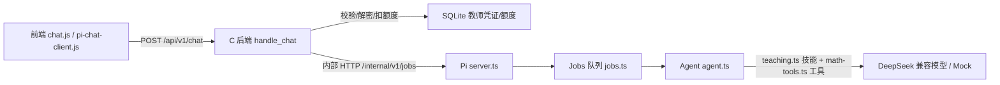

### 8.2 请求调用链（teacher 模式，✅）

1. `GET /api/v1/ai/access?question_id=N` 预检查（allowed/reason_code/quota，不扣次）。
2. `POST /api/v1/chat` → C 校验登录→方法→（platform 校验授权）→Content-Type→字段→题目 active。
3. teacher 模式：`teacher_api_resolve` 从题目 `teacher_id` 解析教师配置、校验学生日额度并预扣 1 次、解密教师 Key。
4. C 组装内部请求（题目、message、conversation_id、mode、student_answer、execution{api_key,model,teacher_id,version}）→ `ai_client.c` 提交 Pi。
5. Pi 返回 202 + job_id；前端约 800ms 轮询 `GET /chat/{job_id}` 至终态。
6. C 对内部请求只等 ≤2s；模型执行在 Pi 后台队列。

### 8.3 模型调用（✅）

- 每任务独立 Agent；预算 30s（`AI_TIMEOUT_MS`，含排队）、3 次模型调用、6 次工具调用、输出 2048 tokens；队列并发 4、等待 32；SDK 自动重试关闭。
- 仅 DeepSeek 兼容协议；`AI_MOCK=1` 走完整授权/配额但不调供应商；真实模型评测见 `docs/pi-chat-evaluation.md`（30/30）。

### 8.4 AI-02 三教学模式（✅）

`solve` 完整讲解；`hint` 分层提示（成功轮次 1→2→3，失败/取消不升级）；`review` 错因分析（每轮必带 student_answer）。同对话禁切模式（409）。

### 8.5 AI-03 / AI-04 数学工具与确定性代入反馈（✅）

`math-tools.ts` 提供算术与一元一次方程求解/代入校验（hint 不开放方程工具）；`answer-review.ts` 对可识别数值候选做确定性代入反馈。工具只核验数值，不证明列式/定义域。

### 8.6 AI-01 异步任务管理（✅）

提交 202 + job_id；GET 返回 status（queued/running/succeeded/failed/cancelled）+ reply/model/usage；DELETE 取消。取消不保证撤回供应商计费；取消/失败不提交该轮到历史；跨用户 404。

### 8.7 AI-05 上下文 / AI-06 密钥 / AI-07 额度（✅）

- 对话绑定 user+question+mode；单任务锁；≤12 轮；≤64KB；TTL 1h 内存态（重启清空）。
- 密钥 AES-256-GCM + AAD 绑定；主密钥不落库；GET 只回 masked_key。
- 学生日额度：每学生/每教师/每上海自然日默认 20 次（`AI_STUDENT_DAILY_LIMIT`）；新任务预扣 1 次；教师自用不扣学生额度；Pi 明确拒绝释放预扣，已接受失败/取消/超时不退次。

### 8.8 异常处理（✅，完整错误表见 §11.4）

400 INVALID_REQUEST/INVALID_JSON/QUESTION_REQUIRED；401 UNAUTHORIZED；403 AI_ACCESS_REQUIRED/REVOKED/EXPIRED、TEACHER_REQUIRED、AI_TEACHER_ONLY、AI_API_DISABLED；404 QUESTION_NOT_FOUND/JOB_NOT_FOUND/CONVERSATION_NOT_FOUND/AI_API_NOT_CONFIGURED；409 CONVERSATION_MODE_MISMATCH/BUSY/LIMIT、AI_CREDENTIAL_CHANGED；413/415；429 AI_QUOTA_EXCEEDED；502 AI_UPSTREAM_ERROR/AI_INVALID_RESPONSE/AI_OUTPUT_LIMIT/AI_CALL_LIMIT；503 AI_SERVICE_UNAVAILABLE/AI_BUSY/AI_RATE_LIMITED/AI_CREDENTIALS_UNAVAILABLE/AI_API_UNAVAILABLE；504 AI_SERVICE_TIMEOUT/AI_TIMEOUT。

### 8.9 AI-09 重复问题检测（⬜ 规划）

| 项 | 内容 |
| --- | --- |
| 实现状态 | ⬜ 未实现（SRS F-17、时间轴 F10） |
| 优先级 | P1 |
| 涉及角色 | 系统（学生提交题目时触发）、教师（配置策略） |
| 功能目标 | 学生提交题目时检测与题库已有题目的相似度，避免重复入库/重复消耗资源 |
| 依赖 | §5.4/§6.3 提交链路、题库检索（§5.6） |

**业务需求**：学生在提交新题前，系统检测与题库已有题目是否重复，按教师策略处理。

**策略（SRS F-17）**：`prohibit`（禁止提交，返回相似题）/ `warn`（提示相似题，允许继续）/ `off`（不检测，默认）。教师配置。

**检测方式（分阶段建议）**：
- 阶段一（关键词）：题干分词 + 知识点交集 + 答案一致，命中即判相似（无需向量库）。
- 阶段二（向量/语义）：引入 embedding 向量检索（时间轴 F10 目标，但需新增向量存储，**待确认**是否本课程范围）。

**接口**：
1. 【规划接口】`POST /api/v1/submissions/detect-duplicate`（或并入 `POST /submissions` 的预检步骤）：请求 `{content,type,answer,knowledge_points}`；响应 `{"duplicate":true,"similar":[{"question_id":6,"score":0.92}]}`。
2. 【规划接口】`GET/PUT /api/v1/teacher/duplicate-policy`：`{"mode":"off"|"warn"|"prohibit"}`。

**职责划分**：C 后端负责调用检测与策略判定；检测算法可先在 C 实现（关键词），或由 Pi 提供内部接口（向量）——**待确认**。

**验收标准**：Given 学生提交与题库高度相似的题，When 策略=prohibit，Then 400 `SUBMISSION_DUPLICATE` 并返回相似题列表；策略=warn 时允许继续。

### 8.10 AI-10 内容审核（⬜ 规划）

| 项 | 内容 |
| --- | --- |
| 实现状态 | ⬜ 未实现（时间轴 F11） |
| 涉及角色 | 系统（学生提交内容、AI 生成内容）、管理员（人工复核） |
| 功能目标 | 拦截违法违规/非学习内容，降低 AI 越狱与 Prompt 注入风险 |

**审核点**：
1. 学生提交题目内容（§5.4 提交时）。
2. 学生 message / student_answer（`POST /chat` 时）。
3. AI 生成 reply（可选，输出侧审核）。

**建议方案（分级）**：
- 阶段一：关键词/黑名单 + 长度/字符集校验（C 后端实现，成本低）。
- 阶段二：调用模型做安全分类（Pi 提供内部审核接口，复用模型能力）。

**接口**：
1. 【规划接口】Pi 内部 `POST /internal/v1/moderate`：请求 `{"text":"..."}` → 响应**三态** `{"result":"pass"|"flag"|"block","reason":"..."}`（`result` 仅允许三种取值；`reason` 仅在 `flag`/`block` 时非空）。C 后端在提交/chat 前调用。**异常/超时/返回值缺失或非法 → fail-closed 拒绝（503 `MODERATION_UNAVAILABLE`），不得未经审核放行**。
2. 人工复核走 §7.4 审计 + 通知（§10.2.8）。

**两套审核，不得混用**：
- **内容安全审核**（本节）：判断内容是否违规，结果 `pass`/`flag`/`block`，与题目内容正确性无关。
- **题目业务审核**（§5.4）：判断题目是否可入库，状态 pending/approved/rejected。
- 内容安全审核是题目业务审核的**前置闸门**，二者状态机独立。

**题目提交的内容审核衔接**：
- `pass` → 进入题目业务审核流程（§5.4：pending 或按策略自动通过）。
- `block` → 直接拒绝（400 `MODERATION_BLOCKED` 附原因），不创建 submission、不进入题目业务审核。
- `flag` → 创建 `moderation_reviews`（pending），submission 落 pending，进入"等待内容安全复核"（**不自动通过**）；待人工复核：
  - 复核 approve → 题目业务审核继续，按题目侧 `require_review` 策略流转：`require_review=true` → 进入教师待审；`require_review=false` → 自动通过入库（**待团队确认**：复核通过后是否允许再自动通过，还是强制教师复核一次）。
  - 复核 reject → submission 置 rejected（理由=内容违规），学生可修改后重新提交（重新触发内容审核）。
- **重新提交与审核轮次（必须遵守）**：学生修改 rejected 内容并重新提交（`PUT`）时，`submissions.attempt +1`，并对修改后内容重新执行内容审核；若再次 `flag`，创建新的 `moderation_reviews`（其 `attempt` 等于当前 `submissions.attempt`）。历史轮次的复核记录保留，但不参与当前轮次判断，业务审核仅依据当前 attempt 的有效复核结果。
- **推荐（待确认）**：`flag` 时强制 `require_review=true`（复核通过后仍需教师业务审核一次，不自动入库），避免"内容可疑却自动入库"；落地前待团队确认。
- **状态区分**：submission 的 `status` 不细分"等待内容复核"与"等待业务审核"，两者靠 `moderation_reviews.status` 区分；若需在 submission 上显式区分，可增加 `content_review_status` 字段，**待确认**。

**moderation_reviews 数据字典（见 §10.2.11）**：id、target_type（**submission=本期实现；chat_message/chat_reply=预留扩展，暂无完整审核流程**）、target_id、content、auto_result（pass/flag/block）、status（pending/approved/rejected）、reviewer_id、comment、created_at、reviewed_at。

**人工复核接口（规划接口，仅 admin）**：
1. `GET /api/v1/admin/moderation-reviews`：列表，Query `status`（pending/approved/rejected，可选）、`page`、`page_size`；响应 `{"reviews":[{...}],"total":n}`。
2. `GET /api/v1/admin/moderation-reviews/{id}`：详情。
3. `POST /api/v1/admin/moderation-reviews/{id}/resolve`：`{"action":"approve"|"reject","comment":"..."}`；approve/reject 更新 status、reviewer_id、reviewed_at，并按 §8.10 衔接规则驱动关联 Submission（复核 approve → 题目业务审核继续；reject → submission 置 rejected）。
   - 幂等：重复 resolve 已处理记录 → 409 `MODERATION_ALREADY_RESOLVED`。
   - 错误：400（action 非法）；401；403 `ADMIN_REQUIRED`；404；409 `MODERATION_ALREADY_RESOLVED`。
- **关联**：`moderation_reviews.target_type=submission` 时 `target_id` 即 `submissions.id`；复核结果回写该 submission（§8.10 衔接规则）。

**AI 对话内容审核（本期仅自动审核，无人工复核）**：`POST /chat` 对 message/student_answer 先做自动内容审核；`pass` → 正常继续；`block` → 拒绝请求（400 `MODERATION_BLOCKED`，不创建任务）；`flag` → 按 fail-closed **拒绝请求**（400 `MODERATION_FLAGGED`），提示内容需确认后重试，**不创建任务、不创建聊天人工复核记录**（`chat_message`/`chat_reply` 的人工复核为预留扩展，本期无此流程）。AI 输出侧 reply 审核可选，`flag`/`block` 仅标记不阻断展示（**待确认**）。

**失败处理（必须遵守）**：审核服务不可用/超时 → **fail-closed**（拒绝，503 `MODERATION_UNAVAILABLE`），不得放行；审核结果写审计日志（§10.2.9）。

### 8.11 AI-11 多模型路由（⬜ 规划）

| 项 | 内容 |
| --- | --- |
| 实现状态 | ⬜ 未实现（当前固定 DeepSeek 兼容协议，教师仅可配 model 名） |
| 优先级 | P2（时间轴 F15） |
| 功能目标 | 按题目类型/教师配置自动选择模型或供应商 |
| 依赖 | §5.7 题目级 AI 参数、§7.2 供应商管理 |

**建议方案**：路由规则为"题目级配置 → 教师级配置 → 平台默认"。路由依据：题目 `type`（如编程题路由到代码模型）、教师 `model`、成本/额度。供应商协议适配由 Pi `agent.ts` 的 provider 层完成（当前已支持 DeepSeek 兼容，扩展其他 OpenAI 兼容供应商即可）。

**接口改动**：`teacher_ai_credentials` 增加 `routing_rules`（JSON，可选）；Pi execution 增加路由决策结果。

**边界**：路由失败（供应商不可用）→ 503 `AI_ROUTE_UNAVAILABLE`，**不回退平台 Key**（沿用现有"不回退"原则）。

### 8.12 AI-12 Token/金额计费（⬜ 规划）

| 项 | 内容 |
| --- | --- |
| 实现状态 | ⬜ 未实现（当前仅"调用次数"额度，无 Token/金额计费） |
| 优先级 | P2（SRS F-12 多层级额度中的 Token/金额类型） |
| 功能目标 | 按 Token 用量或金额预算控制 AI 消耗 |

**建议方案**：
- 复用 `teacher_ai_usage` 增加 `tokens_used` 列（或新增 `ai_token_usage` 表）；每次任务成功后从 Pi usage 回写 token 数（Pi 已返回 usage.input_tokens/output_tokens）。
- 教师/平台额度从"次数"扩展为"次数 + Token + 金额"多维度（`usage_budget` 表）。

**接口**：扩展 `GET /api/v1/ai/access` 的 quota 字段返回 token 用量；新增【规划接口】`GET /api/v1/teacher/ai-usage` 返回 token 维度统计。

**计费与对账规则（目标设计，非现状；当前仅"调用次数"额度，无任何 Token/金额计费）**：

| 场景 | 计费规则 |
| --- | --- |
| 正常完成 | 按 Pi 返回 usage 计入 Token/金额 |
| 模型调用失败 | 按供应商是否实际计费为准；本地无 usage 时不记账 |
| 任务取消 | 供应商已产生费用不可撤回（与现状一致）；已产生部分按供应商回执记账 |
| 模型执行超时 | 供应商可能已计费但本地无回执 → 保守按"可能计费"标记，**禁止**本地凭空扣费 |
| 供应商已计费但本地未收到响应 | 无法精确对账（现状已如实说明）；以供应商对账单为准，本地记"未知"状态 |
| usage 回写延迟/失败 | 本地账单标记 pending 并重试回写；**不重复累计** |
| 重复回调/重复记账 | 以 job_id 为幂等键去重，同一 job 只记一次 |

**一致性原则**：本地账单与供应商账单不一致时，以供应商账单为准做对账差异记录，不自动冲正（**待确认**对账流程）。

**预算预留与并发控制（目标设计，待确认）**：
- **检查时机**：Token/金额预算检查发生在**任务执行前**（提交/入队时），与现有"调用次数"额度预扣时机一致。
- **预留机制**：执行前按预估用量预留预算（`预留 = 预估 tokens × 单价`），并发任务各自预留，避免并发下"同时通过预算检查"导致超额。
- **结算与释放**：任务终态按实际 usage 结算（多退少补）；失败/取消释放未消耗的预留。
- **超预留**：实际用量超过预留（预估偏低）时，预算充足则补齐扣减，否则记录超支并**不中断已执行任务**（供应商已计费不可撤回），下一任务按超支后余额判定。
- **价格来源/版本**：模型单价存配置（`platform_config` 或 `teacher_ai_credentials` 价格字段），带 `price_version` 与生效时间；结算按任务创建时的价格版本（价格变动不追溯已创建任务）。**待确认**价格来源。
- **多次模型调用汇总**：一次任务多次模型调用，usage 的 input/output tokens 分别累加，按汇总后总量计费。
- **幂等**：以 job_id 为幂等键，同一 job 的结算只记一次，重复回调/重复记账去重。

> 以上为 Token/金额计费的完整目标设计。**当前项目仅实现"调用次数"额度**（§8.7），无预算预留、价格、Token 结算；若本期只做次数/固定额度控制，则本节仅保留"次数额度"现状，Token/金额计费标记为后续目标，不必实现预留与对账机制。

---

## 9. 跨模块业务流程

### 9.1 用户登录（✅）

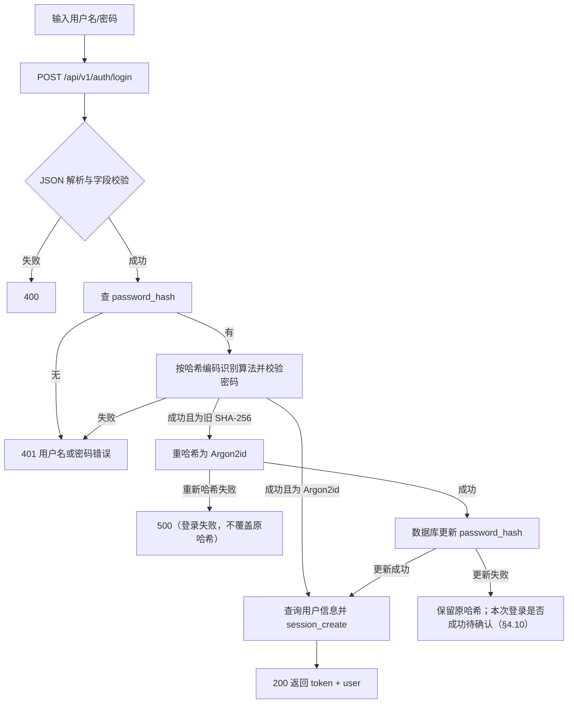

> 登录校验**现状**为固定盐 SHA-256 比较；**目标**为按 `password_hash` 编码识别算法校验，旧 SHA-256 校验成功后透明升级为 Argon2id（rehash-on-login）。异常分支与 §4.10 一致：重新哈希失败=500 且不覆盖原哈希；数据库更新失败=保留原哈希、"是否允许本次登录成功"待团队确认。新开发不得继续采用固定盐单次 SHA-256。

### 9.2 教师创建题目（✅）

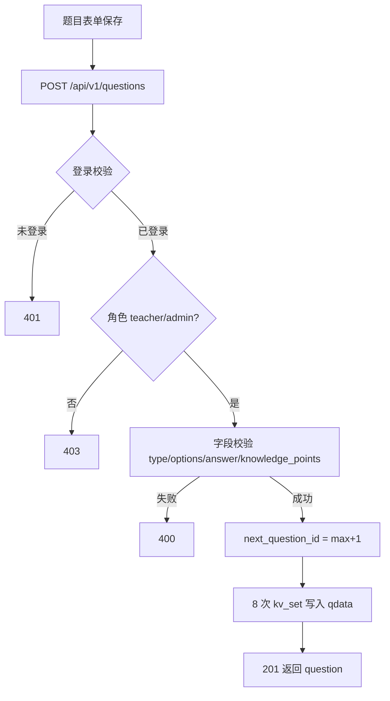

### 9.3 教师创建并编排试卷（✅）

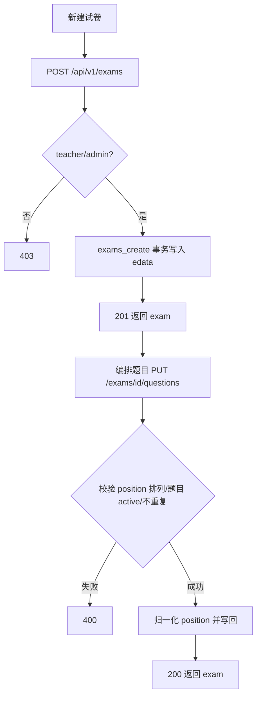

### 9.4 学生获取 AI 解答（✅）


### 9.5 AI 追问（✅）

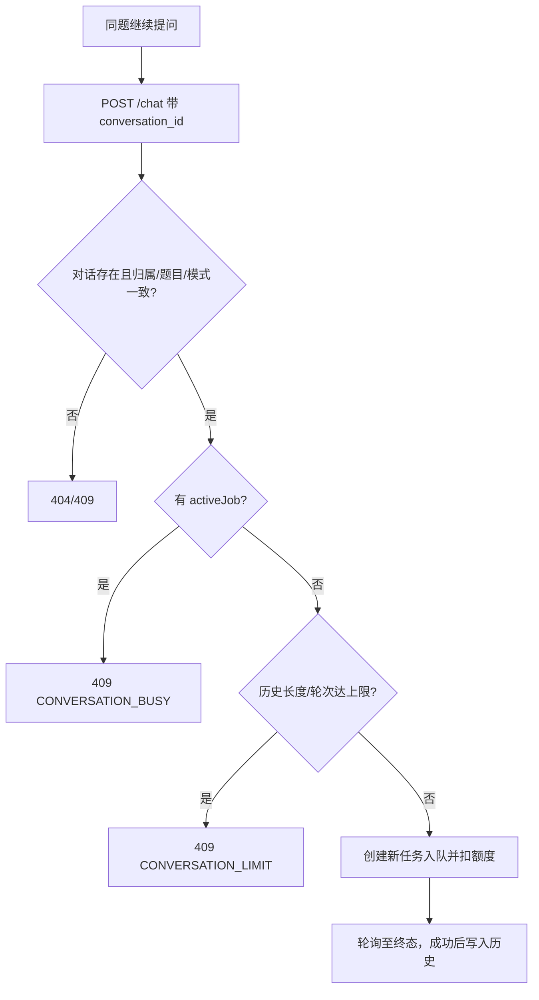

### 9.6 教师 AI API 配置（✅）

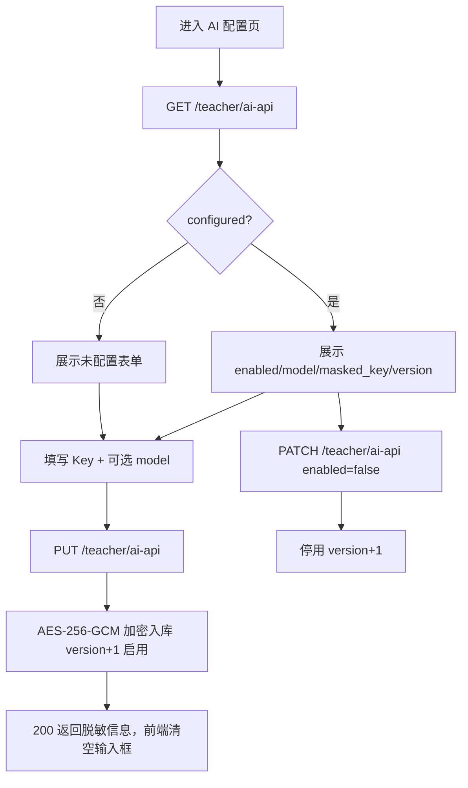

### 9.7 试卷导出（🟡 后端已实现）

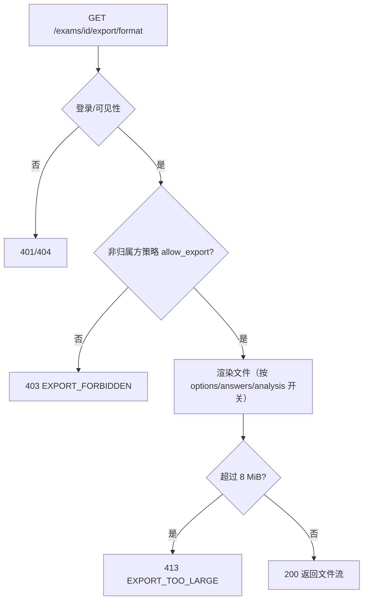

### 9.8 学生提交题目 → 教师审核 → 题目入题库（⬜ 规划）

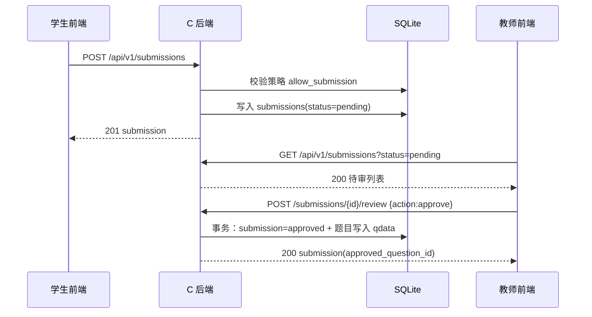

### 9.9 讨论树 Fork 与上下文继承（⬜ 规划）

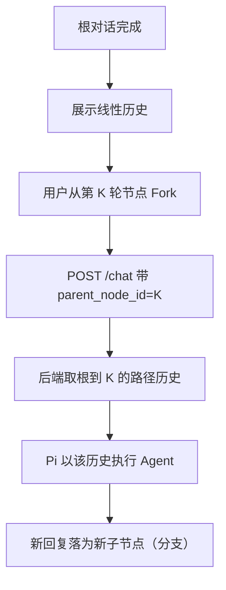

### 9.10 API 捐赠 → 额度叠加 → 调用消耗（⬜ 规划，额度来源待确认）

> ⚠ 额度来源未确定（§6.8），下图仅为**待确认的推荐流程**，不是已确定业务规则；在额度来源与记账规则确定前不可开发。


---

## 10. 核心数据模型与数据字典

> 本章为**权威数据定义来源**。各功能章节引用本章实体，不得在别处重复定义出不一致的字段。规划实体标注【规划】；已有实体标注【已有】。

### 10.1 存储约定

- **kv_store（目录式 KV）**：适合"按 key 整取、字段少、以实体为单位"的数据（users/qdata/edata）。namespace 映射同名 SQLite 表。
- **关系表**：适合"需要 WHERE 过滤、聚合、跨实体关联、状态流转"的数据（AI 凭证/额度/审计/规划中的 submissions、conversation_nodes、donations、audit_logs）。
- 规划新增实体默认走关系表，除非明确说明。

### 10.2 统一核心数据模型

#### 10.2.1 User（已有，`users` KV namespace）

| 字段（value_name） | 类型 | 必填 | 默认 | 约束 | 说明 |
| --- | --- | --- | --- | --- | --- |
| id | int | 是 | — | 唯一 | 用户 ID（当前按用户数+1，demo 简化） |
| username | string | 是 | — | 唯一 | 账号键 |
| name | string | 是 | username | 1–50 字符 | 显示名 |
| role | string | 是 | student | student/teacher/admin | 角色 |
| password_hash | string | 是 | — | 完整哈希编码 | 密码哈希。现状：`SHA-256(固定salt‖密码)` 的 hex；目标：`算法$盐$参数$哈希` 自描述编码（Argon2id + 每用户随机盐），见 §4.10 |
| status | string | 规划 | active | active/disabled | 账号状态（§7.1 规划字段） |
| created_at | int | 规划 | unixepoch | — | 创建时间 |

#### 10.2.2 Question（已有，`qdata` KV namespace）

| 字段（value_name） | 类型 | 必填 | 默认 | 约束 | 说明 |
| --- | --- | --- | --- | --- | --- |
| content | text | 是 | — | 非空 | 题干 |
| type | text | 是 | — | single_choice/short_answer | 题型 |
| options | JSON | 是 | [] | 单选非空 | 选项数组 |
| answer | text | 是 | — | 单选为选项 label | 答案 |
| analysis | text | 否 | '' | — | 解析 |
| knowledge_points | JSON | 否 | [] | 字符串数组 | 知识点 |
| teacher_id | int | 是 | 创建者 | — | 创建者（**当前无归属隔离**） |
| status | text | 是 | active | active/archived(预留) | 状态 |
| seed_key | text | 否 | 空 | 幂等 seed | 内部字段 |
| difficulty | int | 规划 | — | 1–5 | 难度（§5.6 规划字段） |
| tags | JSON | 规划 | [] | 字符串数组 | 标签（§5.6 规划字段） |
| version | int | 规划 | 1 | 每次更新 +1 | 题目版本号（§5.4.6 修改建议并发控制用） |

#### 10.2.3 Exam（已有，`edata` KV namespace）

| 字段 | 类型 | 必填 | 说明 |
| --- | --- | --- | --- |
| name | text | 是 | 1–100 字符 |
| description | text | 否 | ≤1000 字符 |
| teacher_id | int | 是 | 归属（有隔离） |
| status | text | 是 | active/archived |
| created_at / updated_at | int | 是 | Unix 秒 |
| questions | JSON | 是 | `[{question_id,position,score}]` |
| export_policy | JSON | 否 | `{allow_export,allow_answers}` |

#### 10.2.4 Submission（规划，关系表 `submissions`）

| 字段 | 类型 | 必填 | 默认 | 约束 | 说明 |
| --- | --- | --- | --- | --- | --- |
| id | INTEGER | 是 | 自增 | PK | 提交 ID |
| student_id | INTEGER | 是 | — | 索引 | 提交者 user_id |
| target_teacher_id | INTEGER | 否 | NULL | — | 指定目标教师（§5.4.4 待确认） |
| target_question_id | INTEGER | 否 | NULL | — | 空=新增；非空=修改该题 |
| content / type / options / answer / analysis / knowledge_points | 同 Question | 是/否 | — | 同 §10.2.2 | 题目内容快照 |
| status | TEXT | 是 | pending | pending/approved/rejected | 审核状态（§11.3 状态机） |
| reviewer_id | INTEGER | 否 | NULL | — | 审核者（自动通过时为空） |
| owner_teacher_id | INTEGER | 否 | NULL | — | 通过后题目归属教师（必须为 teacher，见 §5.4.4） |
| base_question_version | INTEGER | 否 | NULL | — | target_question_id 非空时的原题版本快照（§5.4.6） |
| attempt | INTEGER | 是 | 1 | 每次 rejected→pending 重新提交 +1 | 当前提交轮次（§8.10 复核记录据此对齐） |
| review_comment | TEXT | 否 | NULL | — | 审核意见 |
| approved_question_id | INTEGER | 否 | NULL | — | 通过后创建的题目 id |
| created_at / updated_at | INTEGER | 是 | unixepoch | — | 时间戳 |

#### 10.2.5 Conversation / Job（已有，Pi 内存）

- Conversation：`id(UUID)/owner/question/mode/credentialScope/messages/activeJob/touched`，内存态 TTL 1h。
- Job：`id(UUID)/owner/request/teaching/conversation/status(queued/running/succeeded/failed/cancelled)/result/error`。

#### 10.2.6 ConversationNode（规划，关系表 `conversation_nodes`）

| 字段 | 类型 | 必填 | 默认 | 说明 |
| --- | --- | --- | --- | --- |
| id | INTEGER | 是 | 自增 PK | 节点 ID |
| conversation_id | TEXT | 是 | — | 根对话标识（与 Pi Conversation.id 一致；节点持久化、Pi 为内存态） |
| owner_user_id | INTEGER | 是 | — | 对话所有者（权限校验；与根用户消息作者一致） |
| question_id | INTEGER | 是 | — | 所属题目 |
| parent_id | INTEGER | 否 | NULL | 父节点（NULL=根） |
| author_user_id | INTEGER | 否 | NULL | 用户消息=提问者 user_id；助手消息=NULL（无具体作者，**不用 0 表示系统**） |
| role | TEXT | 是 | user/assistant | 消息角色 |
| job_id | TEXT | 否 | NULL | 用户消息关联的 AI 任务 job_id（重试去重与状态回溯） |
| content | TEXT | 是 | — | 消息内容 |
| status | TEXT | 是 | pending | pending/succeeded/failed/cancelled（用户节点创建时为 pending；助手节点仅 succeeded） |
| is_recommended | INTEGER | 是 | 0 | 推荐答案标记 |
| created_at | INTEGER | 是 | unixepoch | 时间 |

> **与 Pi `conversation_id` 的映射**：`conversation_id` 复用 Pi 内存 Conversation.id，节点表是其持久化投影。Pi 重启后 Conversation 清空但节点表保留（历史记录）。**两种"历史"必须区分**：Pi `Conversation.messages` 是"参与模型推理的上下文"，节点表是"展示与追溯记录"；任务成功后二者同步，失败/取消时只落 user 节点、不落 assistant 节点。

> **12 轮限制口径（待确认）**：现有 12 轮限制作用于 Pi 单条线性历史（`Conversation.messages`）。引入树状结构后应明确"每条根到叶路径 ≤12 轮"还是"整棵树节点总数受限"；**推荐按分支路径计轮，待团队确认**。

#### 10.2.7 Donation（规划，关系表 `donations`）

| 字段 | 类型 | 必填 | 默认 | 说明 |
| --- | --- | --- | --- | --- |
| id | INTEGER | 是 | 自增 PK | 捐赠 ID |
| student_id / teacher_id | INTEGER | 是 | — | 捐赠方/受赠方 |
| amount | INTEGER | 是 | — | 捐赠额度 |
| used | INTEGER | 是 | 0 | 已消耗 |
| expires_at | INTEGER | 是 | — | 过期时间（unixepoch） |
| status | TEXT | 是 | active | active/expired/consumed |
| created_at | INTEGER | 是 | unixepoch | 时间 |

#### 10.2.8 Notification（规划，关系表 `notifications`，时间轴 F13）

| 字段 | 类型 | 必填 | 默认 | 说明 |
| --- | --- | --- | --- | --- |
| id | INTEGER | 是 | 自增 PK | 通知 ID |
| user_id | INTEGER | 是 | — | 接收者 |
| type | TEXT | 是 | — | 审核结果/额度告警/系统通知 |
| title / content | TEXT | 是 | — | 内容 |
| is_read | INTEGER | 是 | 0 | 已读标记 |
| created_at | INTEGER | 是 | unixepoch | 时间 |

#### 10.2.9 AuditLog（规划，统一关系表 `audit_logs`，替代/合并现有审计表）

| 字段 | 类型 | 必填 | 说明 |
| --- | --- | --- | --- |
| id | INTEGER | 是 | 自增 PK |
| actor_id | INTEGER | 是 | 操作者 |
| module | TEXT | 是 | auth/question/exam/submission/ai/admin |
| action | TEXT | 是 | login/create/update/delete/review/grant/revoke 等 |
| target_type / target_id | TEXT/INTEGER | 否 | 操作对象 |
| detail | JSON | 否 | 附加信息（不含密钥/明文） |
| created_at | INTEGER | 是 | unixepoch |

> 现有 `ai_access_audit`、`teacher_ai_audit` 可作为 `audit_logs` 的迁移来源；迁移需保留历史数据。

#### 10.2.10 TeacherAIConfig / AIUsage（已有）

- `teacher_ai_credentials`：teacher_id(PK)/owner_key/model/secret(BLOB 密文)/masked_key/enabled/version/updated_at。规划扩展：temperature、max_tokens、prompt_template、routing_rules（§5.7、§8.11）。
- `teacher_ai_usage`：student_id/teacher_id/day/used（复合主键）。规划扩展 tokens_used（§8.12）。
- `teacher_ai_charges`：预扣流水；`teacher_ai_audit` 审计；`ai_access_grants`/`ai_access_audit`（platform 模式）。

#### 10.2.11 ModerationReview（规划，关系表 `moderation_reviews`）

| 字段 | 类型 | 必填 | 默认 | 说明 |
| --- | --- | --- | --- | --- |
| id | INTEGER | 是 | 自增 PK | 复核 ID |
| target_type | TEXT | 是 | — | submission（本期实现）/ chat_message、chat_reply（预留扩展，暂无完整审核流程） |
| target_id | TEXT | 是 | — | 关联对象标识（submission 时为 submissions.id） |
| attempt | INTEGER | 是 | 1 | 对应 submissions.attempt | 该复核记录所属提交轮次 |
| content | TEXT | 是 | — | 被审内容快照 |
| auto_result | TEXT | 是 | flag | pass/flag/block（自动审核结果） |
| status | TEXT | 是 | pending | pending/approved/rejected（人工复核状态） |
| reviewer_id | INTEGER | 否 | NULL | 复核人 |
| comment | TEXT | 否 | NULL | 复核意见 |
| created_at / reviewed_at | INTEGER | 是/否 | unixepoch | 时间 |

### 10.3 实体关系（ER）

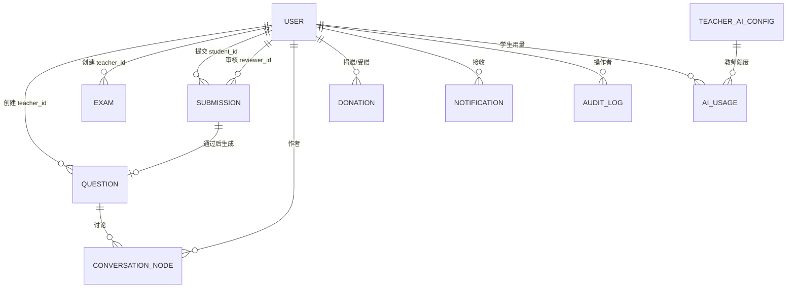

### 10.4 数据归属与权限隔离（统一）

| 实体 | 隔离规则 |
| --- | --- |
| Question | 现状无隔离（读全角色、写 teacher/admin 不限归属）；目标见 §3.6 |
| Exam | teacher 仅本人、admin 全部、student 仅 active |
| Submission | 学生仅本人；教师/管理员按 §5.4.4 归属方案 |
| Conversation/Job/Node | 绑定 owner user_id，跨用户 404 |
| TeacherAIConfig / AIUsage / Donation | 按 teacher_id/student_id 隔离 |
| AuditLog / Notification | 仅 admin（AuditLog）、本人（Notification） |

### 10.5 数据校验（统一）

| 对象 | 规则 |
| --- | --- |
| username | 非空、唯一 |
| password | ≥8 位含字母数字 |
| 题目 content | 必填非空 |
| 题目 type | single_choice / short_answer |
| 题目 options | 单选非空、每项 label/text 非空、answer 为某 label；简答空数组 |
| 题目 knowledge_points / tags | 字符串数组 |
| 试卷 name / description | 1–100 / ≤1000 字符 |
| 编排 position / score | 1..n 排列 / 0<x≤1000 |
| 单卷题目数 | ≤200 |
| chat message / student_answer | 1–4000 字符、非全空白、无 NUL |
| question_id | 1–2147483647，存在且 active |
| conversation_id / job_id | UUID |

### 10.6 数据生命周期

- 持久化：用户/题目/试卷/教师凭证/额度/（规划）submissions/nodes/donations/audit。
- 内存态：Session（24h）、Conversation/Job（TTL 1h），重启失效。
- 题目删除：物理删除 + 试卷引用联动清理（`exams_purge_question`）；无回收站。
- 试卷归档：保留数据、禁编辑、对学生不可见、可恢复。
- Submission 撤回/审核通过后：撤回物理删除（pending/rejected）；通过后解耦题目（删 submission 不影响已入库题）。

---

## 11. 跨模块接口与数据契约

> 本章为**跨模块统一规范**，是所有模块开发时必须遵守的权威约束。功能章节的接口契约引用本章。

### 11.1 统一 API 规范

| 项 | 规范 |
| --- | --- |
| 路径 | `/api/v1/{resource}`；资源用复数小写名词；子资源 `/resource/{id}/subresource`；动作型用动词后缀（如 `/review`） |
| HTTP 方法 | GET 读；POST 创建/动作；PUT 完整资源替换（目标规范）；PATCH 部分更新；DELETE 删除 |
| 字段命名 | JSON 用 `snake_case`（与现有代码一致） |
| 成功响应 | 资源包裹：`{"question":{...}}`/`{"questions":[...]}`；操作类可 `{"status":"ok"}`；列表可带 `total/page/page_size` |
| 错误响应 | 统一 `{"error":"可读说明","code":"稳定错误码"}`（旧题目接口为 `{"error":"..."}`，新增接口必须带 `code`） |
| 状态码 | 200/201 成功；400 参数；401 未认证；403 越权；404 不存在/不可见；405 方法不允许（带 Allow）；409 冲突；413 过大；415 媒体类型；422 业务校验失败（规划，可选用）；429 限流/额度；500/502/503/504 服务端/上游/超时 |
| 认证 | `Authorization: Bearer <token>`；写接口与敏感读接口均需鉴权 |
| 分页 | Query `page`（默认 1）、`page_size`（默认 20，≤100）；响应 `total` |
| 时间 | 对外 API 用 RFC3339（UTC，秒精度）；内部存储用 Unix 秒整数（现有 `created_at/updated_at` 口径） |
| ID | 资源 ID 为正整数；job_id/conversation_id 为 UUID |
| 空值/缺省 | 可选字段缺省=不传；显式 null 表示清空（语义由字段定义决定）；响应不返回密钥/密文/内部字段 |
| 幂等 | 查询/删除类天然幂等；写类非幂等需在接口契约注明（如 review 重复→409） |

> **PUT 语义（重要）**：统一规范采用 REST 语义——`PUT`=完整资源替换，`PATCH`=部分更新。**但现有接口例外**：`PUT /api/v1/questions/{id}`、`PUT /api/v1/exams/{id}`、`PUT /api/v1/teacher/ai-api` 实际为**部分更新**（未传字段保留原值）。新接口需部分更新时应使用 `PATCH`；沿用已有接口的部分更新语义时须在接口契约中显式说明。**未传字段**=保留原值；**显式 `null`**=清空（仅对可空字段）；**空值**（`""`/`[]`）按字段校验规则处理，与 `null` 严格区分。

### 11.2 统一用户与权限模型

- 角色：`admin` / `teacher` / `student`，从 session 读取，**不接受客户端传入**。
- 校验顺序：登录 → 方法 → 角色/归属 → 参数 → 资源存在性（现有 questions/exams 均"权限先于存在性"）。
- 归属校验：teacher 操作本人资源时校验 `owner == session.user_id`；admin 豁免；student 写操作一律 403。
- 未授权读：不可见资源一律 404（不泄露存在性）；未登录一律 401。
- 失败原则：权限/存储/加密故障 fail-closed（默认拒绝），不降级放行。
- 权限变更（§7.1）：角色/状态变更后旧 session 失效，需重新登录。

### 11.3 统一状态定义与状态机

#### 用户账号（规划 `status`）

| 状态 | 说明 | 允许转换 |
| --- | --- | --- |
| active | 正常 | → disabled（管理员） |
| disabled | 禁用 | → active（管理员） |

转换触发：管理员 PATCH。触发条件：禁用后拒绝登录与既有请求。

#### 题目提交（规划 Submission.status）

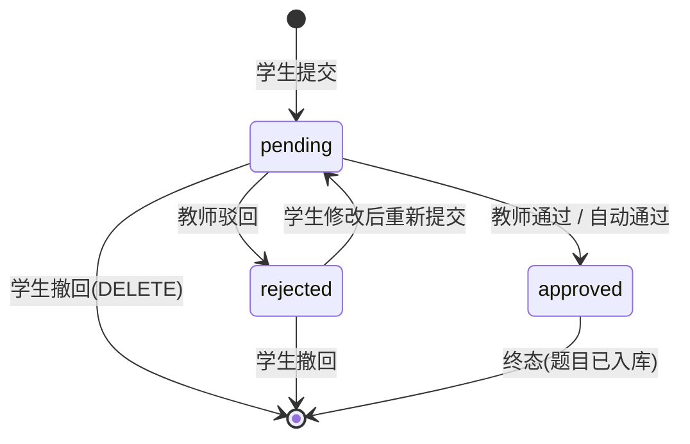

| 转换 | 触发者 | 条件 |
| --- | --- | --- |
| pending→approved | 教师/管理员（人工）；系统（自动通过，`require_review=false`，reviewer_id 为空） | 内容合法，写入/更新题目 |
| pending→rejected | 教师/管理员 | 附意见 |
| rejected→pending | 学生 | 修改后重新提交（PUT） |
| pending/rejected→删除 | 学生 | 撤回 |

> `pending` **无自环**（禁止直接修改），修改仅允许 `rejected→pending`；`pending` 仅可审核或撤回。

#### 题目 / 试卷（已有）

- Question：active（实态）；archived 为预留字段无 API 写入（§3.6 待办）。
- Exam：active ↔ archived（PATCH）；archived 禁编辑（409）；删除不受状态限制。

#### AI 任务 Job（已有）

| 状态 | 说明 |
| --- | --- |
| queued → running → succeeded / failed / cancelled | 提交入队 → 执行 → 终态 |
| queued/running → cancelled | 用户取消（DELETE） |
| 终态 + TTL 1h → 清理 | 内存态，重启清空 |

#### 教师 API 配置（已有）

- 未配置 → 已配置（PUT 首次）；已配置的 enabled ↔ disabled（PATCH）；version 每次变更 +1；无删除接口（配置长期保留）。

### 11.4 统一错误码

| 错误码 | HTTP | 模块 | 触发条件 | 前端建议处理 |
| --- | --- | --- | --- | --- |
| UNAUTHORIZED | 401 | 通用 | 未登录/token 失效 | 重新登录 |
| INVALID_REQUEST / INVALID_JSON | 400 | 通用 | 参数/JSON 非法 | 检查字段，保留输入 |
| QUESTION_REQUIRED | 400 | AI | teacher 模式 /ai/access 缺 question_id | 传入 question_id |
| METHOD_NOT_ALLOWED | 405 | 通用 | 方法错误 | 检查方法 |
| REQUEST_TOO_LARGE | 413 | 通用 | >64KiB | 缩短内容 |
| UNSUPPORTED_MEDIA_TYPE | 415 | 通用 | 非 JSON | 用 application/json |
| TEACHER_REQUIRED | 403 | 教师 API | 非教师管理配置 | 提示无权限 |
| AI_TEACHER_ONLY | 403 | AI | 教师用他人 API/admin 调用 | 提示无资格 |
| AI_API_DISABLED | 403 | AI | 教师停用 | 联系教师 |
| AI_API_NOT_CONFIGURED | 404 | AI | 教师未配置 | 联系教师 |
| AI_QUOTA_EXCEEDED | 429 | AI | 学生额度耗尽 | 按 reset_at 提示 |
| AI_CREDENTIAL_CHANGED | 409 | AI | 配置版本变更 | 新建对话 |
| AI_CREDENTIALS_UNAVAILABLE / AI_API_UNAVAILABLE | 503 | AI | 主密钥/存储故障 | 联系运维 |
| AI_ACCESS_REQUIRED/REVOKED/EXPIRED | 403 | AI(platform) | 无/撤销/过期授权 | 联系负责人 |
| AI_ACCESS_UNAVAILABLE | 503 | AI(platform) | 权限库故障 | 稍后重试 |
| CONVERSATION_NOT_FOUND / JOB_NOT_FOUND | 404 | AI | 对话/任务不存在或过期 | 重新开始 |
| CONVERSATION_MODE_MISMATCH / BUSY / LIMIT | 409 | AI | 切模式/有任务/超长 | 新建或等待 |
| QUESTION_NOT_FOUND | 404 | 题目/chat | 题目不存在或非 active | 返回列表 |
| EXAM_NOT_FOUND / EXAM_FORBIDDEN / EXAM_ARCHIVED / EXAM_INVALID_REQUEST / EXAM_INVALID_LAYOUT / EXAM_INVALID_QUESTION / EXAM_STORE_FAILED | 404/403/409/400/400/400/500 | 试卷 | 见 docs/exams.md §8 | 按码提示 |
| EXPORT_UNSUPPORTED_FORMAT / EXPORT_INVALID_REQUEST / EXPORT_OPTION_UNSUPPORTED / EXPORT_FORBIDDEN / EXPORT_TOO_LARGE / EXPORT_RENDER_FAILED / EXPORT_STORE_FAILED | 400/400/400/403/413/500/500 | 导出 | 见 docs/export.md | 按码提示 |
| AI_UPSTREAM_ERROR / AI_INVALID_RESPONSE / AI_OUTPUT_LIMIT / AI_CALL_LIMIT | 502 | AI | 上游模型错误 | 用户决定重试 |
| AI_SERVICE_UNAVAILABLE / AI_BUSY / AI_RATE_LIMITED | 503 | AI | 服务未就绪/繁忙 | 稍后重试 |
| AI_SERVICE_TIMEOUT / AI_TIMEOUT | 504 | AI | 超时 | 不自动重发 |

**规划新增错误码（待实现）**：

| 错误码 | HTTP | 模块 | 触发条件 | 前端建议 |
| --- | --- | --- | --- | --- |
| ADMIN_REQUIRED | 403 | 管理后台 | 非 admin | 提示无权限 |
| USER_NOT_FOUND | 404 | 用户管理 | 用户不存在 | 刷新列表 |
| USERNAME_CONFLICT | 409 | 用户管理 | 建号重名 | 提示重名 |
| ACCOUNT_DISABLED | 403 | 认证 | 账号被禁用 | 联系管理员 |
| SUBMISSION_NOT_FOUND | 404 | 提交 | 提交不存在 | 刷新 |
| SUBMISSION_CLOSED | 403 | 提交 | 教师关闭提交 | 提示 |
| SUBMISSION_ALREADY_REVIEWED | 409 | 提交 | 重复审核 | 刷新状态 |
| SUBMISSION_NOT_EDITABLE | 409 | 提交 | 非 rejected 状态修改提交 | 刷新状态 |
| SUBMISSION_DUPLICATE | 400 | 重复检测 | 相似题且策略 prohibit | 展示相似题 |
| MODERATION_UNAVAILABLE | 503 | 内容审核 | 审核服务不可用 | fail-closed 拒绝 |
| MODERATION_BLOCKED | 400 | 内容审核 | 内容审核 block（确定违规） | 提示违规，拒绝 |
| MODERATION_FLAGGED | 400 | 内容审核 | 聊天内容 flag（需人工确认，本次拒绝，不创建任务/复核记录） | 提示内容需确认后重试 |
| MODERATION_PENDING | 409 | 提交 | 内容安全复核 pending，禁止业务审核 | 等待内容复核 |
| MODERATION_ALREADY_RESOLVED | 409 | 内容审核 | 重复处置已处理复核 | 刷新状态 |
| DONATION_NOT_FOUND | 404 | 捐赠 | 捐赠不存在 | 刷新 |
| SUBMISSION_OWNER_TEACHER_REQUIRED | 409 | 提交 | 管理员审核未指定归属教师 | 补充 owner_teacher_id |
| SUBMISSION_VERSION_CONFLICT | 409 | 提交 | 修改建议版本冲突 | 提示原题已变化 |
| SUBMISSION_STORE_FAILED | 500 | 提交 | 自动通过事务失败 | 提示重试 |
| DONATION_INSUFFICIENT_QUOTA | 400 | 捐赠 | 学生可捐赠余额不足 | 提示 |

> 命名规则：新错误码采用"模块前缀 + 语义"（如 `SUBMISSION_*`、`AI_*`、`EXAM_*`），同义错误全项目唯一。**现状例外**：`UNAUTHORIZED`、`INVALID_REQUEST`、`METHOD_NOT_ALLOWED`、`BUSY`、`LIMIT` 等历史错误码无模块前缀（如 `CONVERSATION_BUSY`、`AI_BUSY` 实为不同模块但 `BUSY` 语义共用）。**只改文档命名不改代码现状**：新代码统一加模块前缀，不得再新增无前缀错误码。

### 11.5 跨模块调用关系

| 链路 | 顺序与数据传递 | 失败处理 | 责任模块 |
| --- | --- | --- | --- |
| 学生提交→审核→入库 | 提交写 submissions → 教师 review → approve 时事务写 qdata | 审核并发 409；approve 写题失败则 submission 不置 approved | C 后端 |
| 教师建题→归属→AI 解答 | 建题写 teacher_id → chat 从题目 teacher_id 解析教师配置 | 题目归属 teacher 缺失 → AI_API_NOT_CONFIGURED | C 后端 + Pi |
| 学生发起对话→任务→回复→追问/分支 | chat → Pi job → 轮询 → 追问复用 conversation_id → 分支传 parent_node_id | 失败/取消不写入 Pi 推理历史；user 节点保留、assistant 节点不落库（§6.6.5） | C + Pi |
| 教师配置 API→调用→额度→统计 | teacher/ai-api 写配置 → chat resolve+扣次 → usage/charges 记录 | 明确拒绝退款；失败/取消不退 | C 后端 |
| 管理员管用户→权限变化→业务生效 | admin/users 改角色/禁用 → 会话失效 → 下次请求按新角色校验 | 禁用后旧 token 拒绝 | C 后端 |
| 试卷管理→题目关联→浏览→导出 | 编排引用题目 id → 学生读 active → 导出按策略 | 题目删除联动清引用（`exams_purge_question`） | C 后端 |
| 审核/重复检测↔题库 | 提交前可选查重 → 审核结果写审计 | 查重服务不可用按策略（fail-closed 或跳过，待确认） | C 后端 +（可选）Pi |

**开发边界约定**：接口提供方负责契约与状态码；接口使用方按契约接入，不绕过公共 API 直接访问 Pi 或数据库。

---

## 12. API 接口契约（完整索引）

> 标注 `【已有】`=当前可调用；`【规划】`=本文档设计、尚未实现。所有接口的权威字段定义见对应功能章节与 §10/§11。

### 12.1 已有接口

| 方法 | 路径 | 说明 | 权限 |
| --- | --- | --- | --- |
| GET | `/api/v1/health` | 健康检查 | 公开 |
| POST | `/api/v1/auth/register` | 注册 | 公开 |
| POST | `/api/v1/auth/login` | 登录 | 公开 |
| POST | `/api/v1/auth/logout` | 登出 | 登录 |
| GET | `/api/v1/auth/me` | 当前用户 | 登录 |
| GET/POST | `/api/v1/questions` | 题目列表/新增 | 读全角色；写 teacher/admin |
| GET/PUT/DELETE | `/api/v1/questions/{id}` | 题目详情/改/删 | 读全角色；写 teacher/admin |
| GET/POST | `/api/v1/exams` | 试卷列表/创建 | 列表按角色；创建 teacher/admin |
| GET/PUT/PATCH/DELETE | `/api/v1/exams/{id}` | 试卷详情/改/状态/删 | 归属隔离 |
| PUT/POST | `/api/v1/exams/{id}/questions` | 整体替换/追加 | teacher 本人/admin |
| DELETE | `/api/v1/exams/{id}/questions/{qid}` | 移除题目 | teacher 本人/admin |
| GET | `/api/v1/exams/{id}/export/{format}` | 导出 | 按可见性+策略 |
| GET/PUT | `/api/v1/exams/{id}/export-policy` | 导出策略 | teacher 本人/admin |
| GET | `/api/v1/ai/access[?question_id=N]` | AI 权限预检查 | 登录 |
| POST | `/api/v1/chat` | 提交解答任务 | 登录+资格+额度 |
| GET/DELETE | `/api/v1/chat/{job_id}` | 查询/取消任务 | 本人 |
| GET/PUT/PATCH | `/api/v1/teacher/ai-api` | 教师 API 配置 | 仅 teacher |
| POST/GET/DELETE | `/internal/v1/jobs[/{id}]`（Pi） | 内部任务接口 | 内部凭证 |

### 12.2 规划接口

| 方法 | 路径 | 说明 | 权限 | 规格章节 |
| --- | --- | --- | --- | --- |
| GET/PUT | `/api/v1/me/profile` | 本人资料 | 登录 | §4.8 |
| PUT | `/api/v1/me/password` | 改密码 | 登录 | §4.8 |
| GET | `/api/v1/admin/users` | 用户列表 | admin | §7.1 |
| POST | `/api/v1/admin/users` | 建号 | admin | §7.1 |
| GET/PATCH | `/api/v1/admin/users/{id}` | 详情/改状态角色 | admin | §7.1 |
| PUT | `/api/v1/admin/users/{id}/password` | 重置密码 | admin | §7.1 |
| GET/PUT | `/api/v1/admin/platform-config` | 平台配置 | admin | §7.2 |
| GET | `/api/v1/admin/usage-stats` | 全局用量统计 | admin | §7.2 |
| GET | `/api/v1/admin/audit-logs` | 审计查询 | admin | §7.4 |
| GET | `/api/v1/admin/health-stats` | 运维监控 | admin | §7.5 |
| POST | `/api/v1/submissions` | 学生提交题目 | student | §5.4/§6.3 |
| GET | `/api/v1/submissions` | 提交列表 | 按角色过滤 | §5.4 |
| GET/PUT/DELETE | `/api/v1/submissions/{id}` | 详情/改/撤回 | 学生本人/教师 | §5.4 |
| POST | `/api/v1/submissions/{id}/review` | 审核 | teacher/admin | §5.4 |
| GET/PUT | `/api/v1/teacher/submission-policy` | 提交策略 | teacher | §5.4 |
| POST | `/api/v1/questions/import` | 批量导入 | teacher/admin | §5.5 |
| GET/PUT | `/api/v1/questions/{id}/ai-config` | 题目级 AI 参数 | teacher/admin | §5.7 |
| GET | `/api/v1/teacher/ai-usage` | 教师用量统计 | teacher | §5.8 |
| GET/PUT | `/api/v1/teacher/duplicate-policy` | 查重策略 | teacher | §8.9 |
| GET | `/api/v1/conversations/{id}/nodes` | 讨论树 | 登录（owner） | §6.6 |
| PUT | `/api/v1/conversation-nodes/{id}` | 推荐标记 | 登录（owner） | §6.6 |
| GET | `/api/v1/me/activity` | 学习记录 | 登录 | §6.7 |
| GET | `/api/v1/me/quota` | 额度查看 | 登录 | §6.7 |
| POST/GET | `/api/v1/donations` | 捐赠 | student/teacher | §6.8 |
| GET | `/api/v1/teacher/donation-usage` | 捐赠消耗记录 | teacher | §6.8 |
| GET | `/api/v1/admin/moderation-reviews` | 人工复核列表 | admin | §8.10 |
| GET | `/api/v1/admin/moderation-reviews/{id}` | 人工复核详情 | admin | §8.10 |
| POST | `/api/v1/admin/moderation-reviews/{id}/resolve` | 人工复核处置（approve/reject） | admin | §8.10 |
| POST | `/internal/v1/moderate`（Pi） | 内容审核 | 内部凭证 | §8.10 |

---

## 13. 异常处理、安全约束与非功能性要求

### 13.1 异常处理原则

- 所有写接口先鉴权再校验参数；字段校验失败 400 附可读说明；未知/重复/非法字段 400；>64 KiB 413。
- 未登录 401（优先于参数校验）；越权写 403；越权读 404 不泄露存在性。
- AI 内部 401 → 脱敏 503；连接失败 503；超时 504；权限/加密/存储故障 fail-closed。
- 日志仅记录固定分类与错误码/HTTP 401，不记录 URL、token、用户输入、上游响应。

### 13.2 API Key 安全

- 教师 Key 仅进后端，GET 只回 masked_key；AES-256-GCM + AAD 绑定；主密钥 `AI_KEY_ENCRYPTION_KEY` 不落库不落 Git；备份数据库须单独备份主密钥。
- 模型 Key 只存可信后端；Pi 仅监听 127.0.0.1；跨主机需 TLS。

### 13.3 超时与额度

超时关系（四层，**互不传播、互不替代**）：

| 层 | 超时 | 说明 |
| --- | --- | --- |
| C→Pi 内部请求 | 连接 500ms、总 2000ms（`AI_CONNECT_TIMEOUT_MS`/`AI_REQUEST_TIMEOUT_MS`） | 只约束提交/查询/取消的 HTTP 往返；**不取消** Pi 后台任务 |
| Pi 模型任务 | 30s（`AI_TIMEOUT_MS`，含排队） | 超时任务置 failed `AI_TIMEOUT`，与 C 内部超时独立 |
| 前端轮询 | 等待上限 45s（800ms 间隔） | 轮询超时不等于任务失败，可保留 job_id 恢复查询 |
| 用户取消 | DELETE /chat/{job_id} | 只中止排队/运行任务；不保证撤回供应商已产生计费 |

- C 内部请求超时**不传播**为任务失败、**不取消**下游 Pi 任务；任务最终状态以 `GET /chat/{job_id}` 为准。
- 学生日额度默认 20 次，耗尽 429 附 quota+Retry-After。

### 13.4 非功能性要求

| 维度 | 现状/目标 |
| --- | --- |
| 性能 | C 单轮询线程；模型在 Pi 后台队列不阻塞 C；前端 800ms 轮询、等待上限 45s |
| 可用性 | 单实例；健康检查；AI 不可用降级提示不崩溃 |
| 可靠性 | 会话/任务/对话内存态（demo）；题目写非单事务（已知风险，§14.5） |
| 安全性 | 密码哈希、Key 加密、路径穿越防护、登录防枚举、越权读 404 |
| 可维护性 | monorepo 模块化；C 分层；契约文档统一 |
| 可扩展性 | 根 Makefile 支持新模块；多模型/缓存/消息队列/水平扩展为后续目标 |

---

## 14. 功能实现状态、开发依赖与待确认事项

### 14.1 已实现功能

SYS（健康检查/注册/登录/登出/当前用户/会话/静态托管）；TEA（题目 CRUD、列表、试卷 CRUD/编排/归档、AI API 配置）；STU（题库浏览、试卷浏览、AI 解答、线性追问）；AI（异步任务、三模式、数学工具、确定性反馈、对话隔离、密钥、额度、平台授权）；ADM（CLI 授权、复用教师能力）。

### 14.2 部分实现功能（剩余开发范围见对应章节）

| 功能 | 已实现 | 剩余范围 |
| --- | --- | --- |
| TEA-06 试卷导出 | 后端四种格式导出 | 前端入口；AI 解答导出；批量/异步导出（§5.2） |
| TEA-07 导出策略 | 后端策略读写 | 前端配置入口（§5.2） |
| TEA-04 试卷编排 | 后端 4 接口 + 前端整体替换 | 前端追加/移除单题入口（可选，§5.2） |
| TEA-12 AI 参数 | 仅 model | temperature/max_tokens/prompt_template + 题目级覆盖（§5.7） |
| ADM-03 审计 | 表写入 | 统一审计表 + 查询接口 + 采集（§7.4） |

### 14.3 未实现功能开发索引

| 编号 | 功能 | 规格章节 | 依赖 | 建议开发顺序 |
| --- | --- | --- | --- | --- |
| TEA-09/STU-08 | 学生提交审核 | §5.4/§6.3 | 无 | 1（P0） |
| STU-05 | 分支讨论树 | §6.6 | 对话持久化 | 2（P0） |
| ADM-01 | 用户管理后台 | §7.1 | §4.9 会话失效 | 3（P0） |
| SYS-08/09 | 用户资料/账号状态 | §4.8/§4.9 | 无 | 3 |
| TEA-11 | 搜索筛选 | §5.6 | difficulty/tags 字段 | 4（P1） |
| TEA-10 | 批量导入 | §5.5 | 题目校验复用 | 4 |
| ADM-03 | 审计查询 | §7.4 | 审计中间件 | 4 |
| STU-06/07 | 个人中心/捐赠 | §6.7/§6.8 | 对话持久化 | 5 |
| AI-09 | 重复检测 | §8.9 | 检索 + 提交链路 | 6 |
| AI-10 | 内容审核 | §8.10 | Pi 内部接口 | 6 |
| ADM-02 | 平台配置 | §7.2 | 架构决策 | 7 |
| ADM-05 | 备份监控 | §7.5 | 运维脚本 | 7 |
| AI-11/12 | 多模型路由/计费 | §8.11/§8.12 | 供应商适配/token 回写 | 8（P2） |

### 14.4 待验证功能

后端与自动化测试未在本次环境实际编译运行（需 Linux/WSL 执行 `make build && make test` 复核认证/题目/试卷/导出/AI 各测试组）。

### 14.5 已确认的技术债与后续完善

1. 题目写操作无 `teacher_id` 归属隔离（§3.6 目标规则）。
2. 题目写操作非单事务（8 次 `kv_set`，半写风险）。
3. 会话/任务/对话内存态（生产化需持久化）。
4. 导出策略读取当前按默认值处理（fail-open 需复核）。
5. `docs/kvstore.md`（表名前缀）、`docs/auth.md`（token 随机源）、`docs/questions.md`（示例漏 `status`）等文档过时表述。

### 14.6 待团队确认事项（决策点）

1. 题目归属隔离：读权限是否收紧（现状全角色可读）。
2. 管理员在 teacher 模式下是否有 AI 调用资格（SRS UC-05 与实现冲突）。
3. 学生提交审核的"目标教师"归属（§5.4.4 方案 A/B）；方案 B 下管理员审核必须显式指定 `owner_teacher_id` 的交互。
4. 平台配置管理：库存储 + C 转发 vs 保持 Pi 环境变量（§7.2）。
5. 注册接口是否收紧为"自助注册仅 student"（§4.2 安全约束已列为必须，待确认落地方式）。
6. 讨论树节点返回形态、推荐标记权限、节点软删除、失败/取消后 user 节点是否保留（§6.6）。
7. **API 捐赠额度来源**（§6.8 阻断项）：学生额度从何产生、是否涉及支付、学生是否有余额——确定前不可开发。
8. 重复检测实现位置（C 关键词 vs Pi 向量）与是否本课程范围；内容审核与查重、人工审核的触发顺序（§8.9、§8.10）。
9. 修改密码/角色变更后旧 session 是否强制失效。
10. 题目列表扩展分页后，无参数时是否保持原纯数组响应（向后兼容，§5.6 方案 A/B）。
11. 题目版本方案（`version` value_name vs `updated_at`+内容哈希，§5.4.6）。
12. 密码哈希迁移（Argon2id）机制已确定为必须实现；实施时间/范围及"迁移落库失败是否允许登录成功"待团队确认（§4.10）。
13. 内容安全复核通过后，`require_review=false` 场景是否允许再自动通过入库，还是强制教师复核一次（§8.10）。
14. 讨论树 pending 节点重试：复用原节点 vs 新建节点（§6.6.3）。
15. AI 任务成功但节点持久化失败：是否引入持久化补偿机制（当前 Pi TTL 过期后回复可能丢失，§6.6.5）。
16. 对话树响应格式：nodes+edges vs 嵌套 children（§6.6.4）。

---

## 15. 附录

### 15.1 功能编号索引

> 逐项功能实现状态（✅/🟡/⬜）的唯一维护来源为 `docs/用况实现状态与缺口分析.md`，本索引不再独立维护状态数据，仅保留「编号 → 规格章节」导航映射。

| 编号 | 功能 | 规格章节 |
| --- | --- | --- |
| SYS-01~07 | 健康检查/注册/登录/登出/当前用户/会话/静态托管 | §4 |
| SYS-08 | 用户资料管理 | §4.8 |
| SYS-09 | 账号状态管理 | §4.9/§7.1 |
| ADM-01 | 用户管理后台 | §7.1 |
| ADM-02 | 平台配置/供应商管理 | §7.2 |
| ADM-03 | 审计日志查询 | §7.4 |
| ADM-04 | 全局 AI 授权 CLI | §7.3 |
| ADM-05 | 备份/恢复/监控 | §7.5 |
| ADM-06 | 复用教师能力 | §7.6 |
| TEA-01/02 | 题目 CRUD/列表 | §5.1 |
| TEA-03~05 | 试卷 CRUD/编排/归档 | §5.2 |
| TEA-06/07 | 试卷导出/策略 | §5.2 |
| TEA-08 | AI API 配置 | §5.3 |
| TEA-09 | 学生提交审核 | §5.4 |
| TEA-10 | 批量导入 | §5.5 |
| TEA-11 | 搜索筛选 | §5.6 |
| TEA-12 | AI 参数配置 | §5.7 |
| STU-01/02 | 题库/试卷浏览 | §6.1/6.2 |
| STU-03/04 | AI 解答/追问 | §6.4/6.5 |
| STU-05 | 分支讨论树 | §6.6 |
| STU-06 | 个人中心 | §6.7 |
| STU-07 | API 捐赠 | §6.8 |
| STU-08 | 学生提交题目 | §6.3 |
| AI-01~08 | 已实现 AI 能力 | §8.1~8.8 |
| AI-09 | 重复问题检测 | §8.9 |
| AI-10 | 内容审核 | §8.10 |
| AI-11 | 多模型路由 | §8.11 |
| AI-12 | Token/金额计费 | §8.12 |

### 15.2 参考设计图索引（OOA_OOD/）

用况图 图2-1/2-2/2-3；类图 图2-4/2-5/图3-1；顺序图 图2-6~2-10、图3-7/3-10/3-11/3-12；状态图 图2-11/2-12/2-13、图3-8；包图 图2-14/图3-9；人机交互 图3-2/3-3/3-4；控制驱动 图3-5；数据管理 图3-6。

> 注意：OOA_OOD 基于上游 `8015957` 基线，其"试卷/导出未实现"结论在本 fork 已过时；引用设计图时以本文档实现状态为准。

### 15.3 其他必要说明

- 本文档以当前代码为判断依据；标注 ⬜/🟡 的内容为预期或部分实现，与已实现功能严格区分。
- 所有"规划接口"尚未实现，不得误认为当前可用；所有"建议方案/待团队确认"为待决策项，不擅自定案。
- 未确认内容（如测试未经本次运行验证）已明确标记待核实。
